<h1 align="center"></h1>

<p align="center"><a href="./README.md">English</a> | <a href="./README.zh-TW.md">繁體中文</a> | <b>日本語</b></p>

Telepy は、直接つなげないマシンのためのセルフホスト型 Web コンソールです。NAT の内側のサーバー、自宅の Raspberry Pi、ファイアウォールの奥にあるオフィスの PC、OpenWrt のルーターなどが対象です。

各デバイスが Telepy サーバーへリバース SSH トンネルを 1 本張るだけで、あとはブラウザから操作できます。ターミナル、ファイル、リモートデスクトップ、デバイス側からネットに出るブラウザ、そしてデバイスと同じ LAN にある他のマシンまで。

ポート開放も VPN もパブリック IP も要りません。デバイスがインターネットに出られれば十分です。毎日あれだけアップデートを落としているのだから、出られないはずがありません。

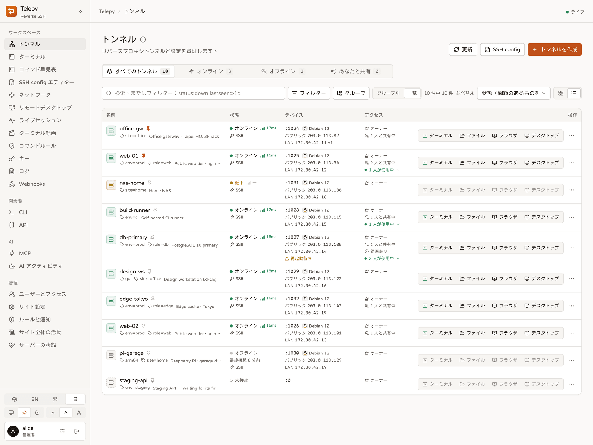

## できること

### デバイスをつなぐ

- **1 行のコマンドで追加**：Linux・macOS・OpenWrt なら 1 行貼り付けるだけ。スクリプトがデバイスの環境を調べて設定し、Telepy が実際にログインできるまで見届けます。
- **それ以外はウィザードで**：Windows、Docker、各種アプライアンスは、ステップごとのガイドと用意されたスクリプトで設定できます。
- **出られる道を自分で選ぶ**：普段は SSH ポートを使い、HTTPS しか通らないネットワークでは Web ポートの WebSocket に SSH を通します。
- **状態がひと目でわかる**：オンライン・低下・オフライン、区間ごとのレイテンシ、稼働率、パブリック／LAN アドレス。ディスク、メモリ、負荷も毎日チェックします。
- **数百台でも迷わない**：ラベル、ピン留め、個人用グループ、そして `status:down` や `label:env=prod` のような条件がわかる検索。

### デバイスで作業する

- **Web ターミナル**：タブ、Nerd Font、配色、よく使うコマンドを保存できるツールボックス、必要なら録画も。
- **ファイル**：ドラッグ＆ドロップでアップロード、移動、コピー、名前変更、権限変更、zip でダウンロード。内蔵エディタは中途半端な保存をしません。
- **リモートデスクトップ**：トンネル経由の RDP と VNC、またはタブの中で動く RustDesk。音声、クリップボードの制御、マルチモニターに対応。
- **リモートブラウザ**：本物の Chromium で、通信はデバイス側から出ていきます。そのネットワークでしか開けない、デザインが 2009 年で止まったままの管理画面に便利です。
- **デバイスの向こうの LAN**：何もインストールせずにデバイスの LAN をスキャンし、そこにあるホストにターミナルやデスクトップを開けます。
- **手元のパソコンから**：1 つのコマンドで全デバイスを SSH の設定に追加。コマンド早見表には `ssh -L`、`scp`、`rsync` がそのまま使える形で並びます。

### チームと管理

- **共有**：閲覧・編集・管理の権限、使えるログインアカウントの指定、期限付きの共有。外した人の開いているセッションはすぐに終了します。
- **機能の権限**：ターミナル、ファイル、リモートデスクトップ、API トークンなどを誰が使えるか、全員・グループ・個人単位で決められます。
- **コマンドルール**：コマンドをブロックする、承認制にする、リマインドだけ出す。Web ターミナルでも MCP エージェントでも同じように効き、`rm -rf /` をうっかりミスから会議の議題に格上げします。
- **ライブセッション**：誰がどこに接続しているかを確認し、ターミナルを見守ったり、キーボードを渡したり、セッションを終了したりできます。
- **サインインの安全性**：パスキー、認証アプリ、重要なデバイスの前での再確認。見慣れない場所からサインインがあれば通知します。
- **通知**：イベントごとに、画面内・デスクトップ・Slack・Discord・Teams・Telegram・ntfy・自前の Webhook へ。
- **監査**：改ざんを検知できるログ、ターミナルの録画、サインイン履歴。「何も触っていません」が本当かどうかも、あとから確かめられます。

### 自動化

- **`telepy` コマンドライン**：デバイスの一覧、SSH 接続、20 台まとめてのコマンド実行、ファイルのコピー。
- **REST API**：スコープ、対象デバイス、有効期限を絞れる個人用トークン。呼び出しはすべて記録されます。
- **MCP**：Claude Code や Cursor などの AI エージェントにデバイスを任せられます。アプリごとに承認し、呼び出しはすべて記録、コマンドルールもそのまま効きます。

## スクリーンショット

<table>
  <tr>
    <td width="50%">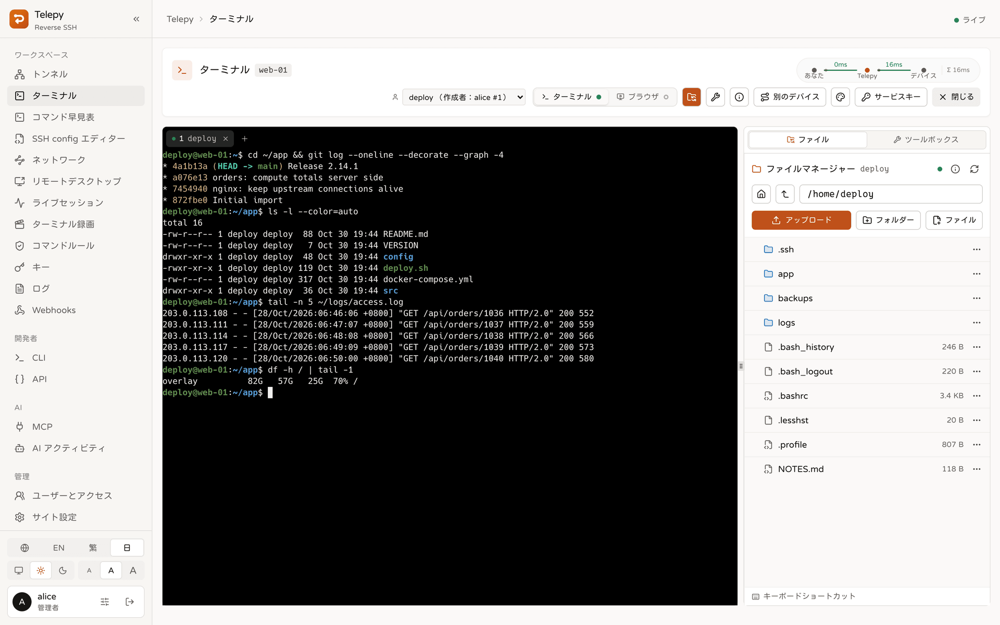<br><sub><b>ターミナルとファイル</b>：タブ、ファイルパネル、区間ごとのレイテンシ。</sub></td>
    <td width="50%">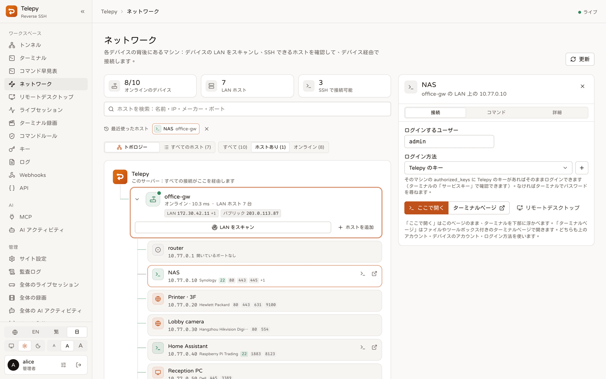<br><sub><b>ネットワーク</b>：デバイスの向こうの LAN。メーカーと開いているポート付き。</sub></td>
  </tr>
  <tr>
    <td>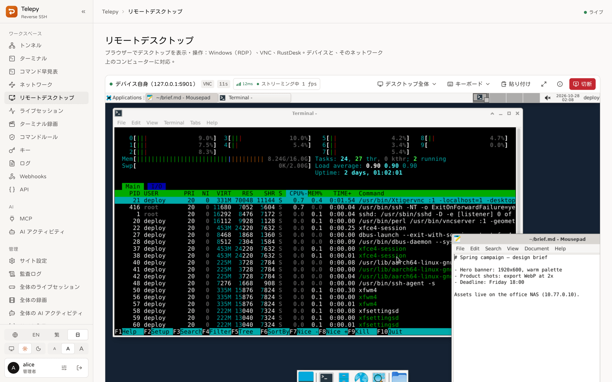<br><sub><b>リモートデスクトップ</b>：トンネル経由の VNC。ストリームの統計付き。</sub></td>
    <td>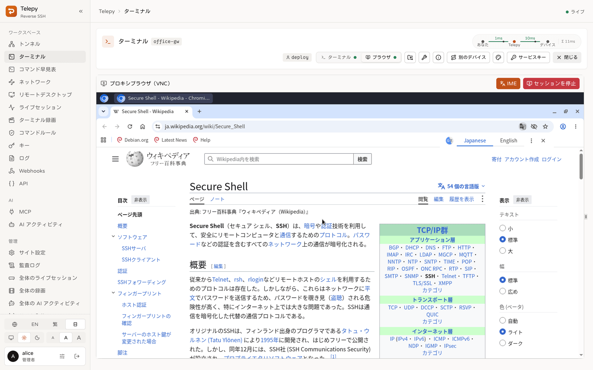<br><sub><b>リモートブラウザ</b>：デバイス側からネットに出る Chromium。</sub></td>
  </tr>
  <tr>
    <td>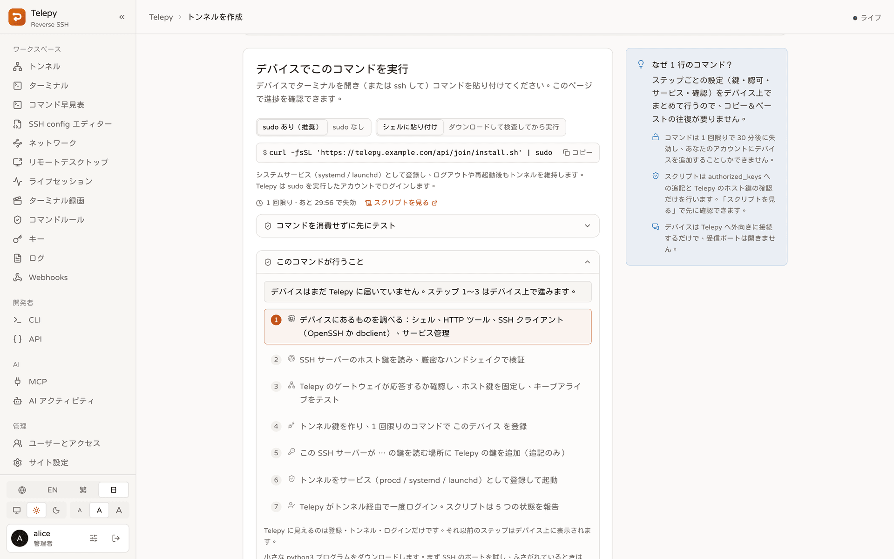<br><sub><b>デバイスの追加</b>：1 行のコマンド。Telepy がログインするまで画面で追えます。</sub></td>
    <td>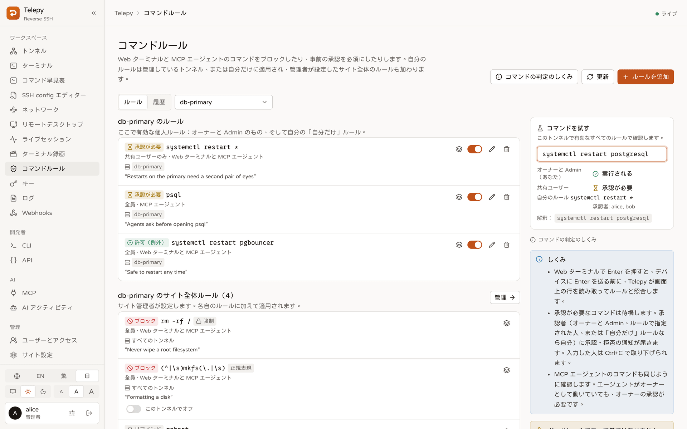<br><sub><b>コマンドルール</b>：ブロック、承認、リマインド、例外。</sub></td>
  </tr>
  <tr>
    <td>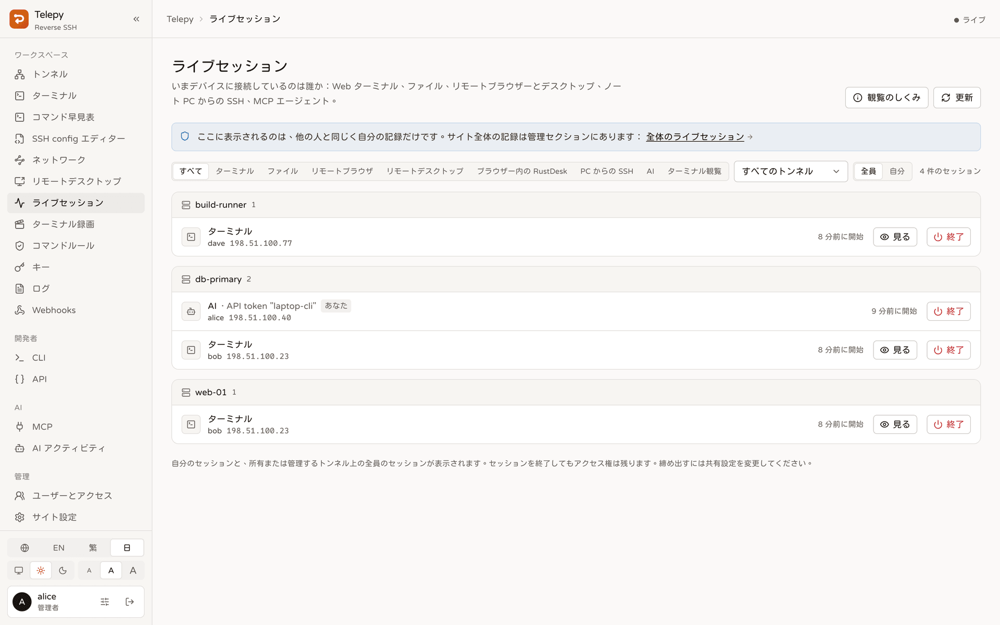<br><sub><b>ライブセッション</b>：誰が、どこから接続しているか。</sub></td>
    <td>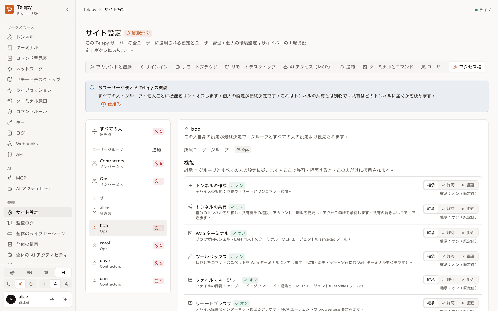<br><sub><b>機能の権限</b>：個人、グループ、全員単位で設定。</sub></td>
  </tr>
  <tr>
    <td>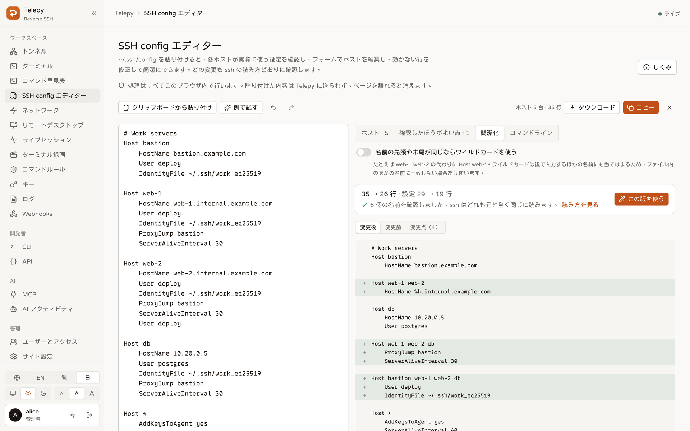<br><sub><b>SSH config エディター</b>：各ホストが実際に使う値を確かめて、簡潔に。</sub></td>
    <td>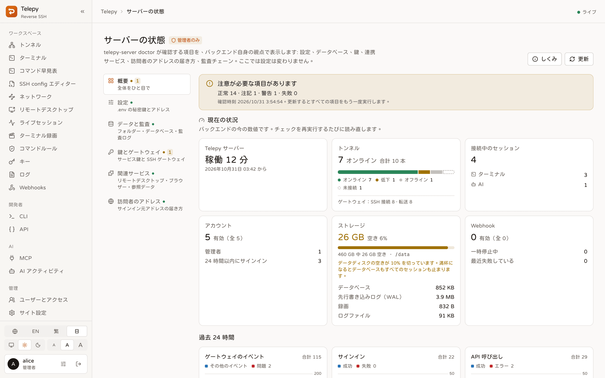<br><sub><b>サーバーの状態</b>：サーバー自身のチェックとリアルタイムの数値。</sub></td>
  </tr>
  <tr>
    <td>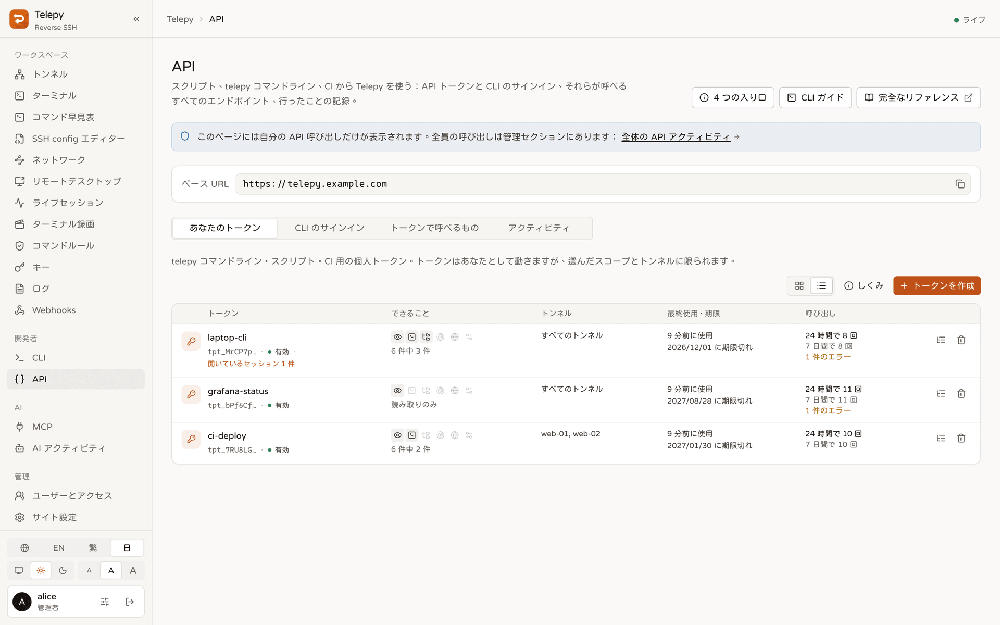<br><sub><b>API</b>：個人用トークンと、それぞれの最近の呼び出し。</sub></td>
    <td>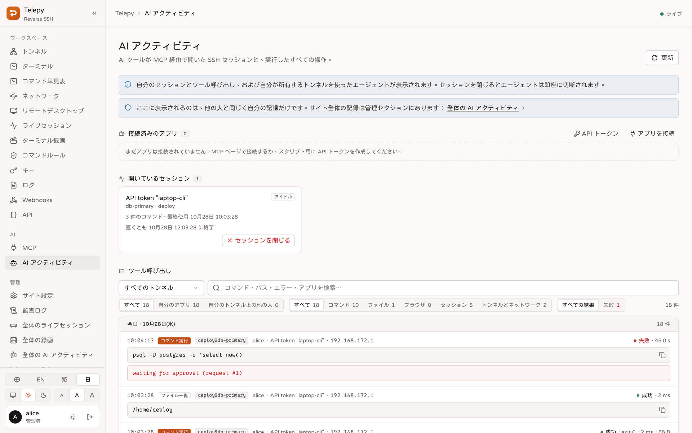<br><sub><b>エージェントのアクティビティ</b>：承認待ちを含む、すべての MCP 呼び出し。</sub></td>
  </tr>
</table>

## 仕組み

```
 ブラウザ ──https──▶ Traefik ──▶ frontend（Next.js）
                       │
                       └──────▶ backend（Rust）◀══ リバース SSH（デバイスから外向き）══ デバイス ── LAN ホスト
                                  │   REST API · WebSocket · 内蔵 SSH ゲートウェイ · 監視
                                  ├──▶ kasm-browser（リモートブラウザ用 Chromium）
                                  └──▶ guacd（RDP / VNC）
```

デバイスが実行するのは普通の `ssh -R` で、接続先は Telepy に内蔵された SSH ゲートウェイです。SSH ポートに直接つなぎ、HTTPS しか通らないときは Web ポートの WebSocket の中を通ります。セットアップ時にサービスとして登録されるので、再起動しても自動でつながり直します。

Telepy は鍵を見てどのトンネルかを判別し、メモリ上で管理します。サーバー側でポートが増えることはありません。デバイスでの操作はすべてこの 1 本の接続の中で行われ、デバイス自身の SSH サーバーにログインします。

両側が互いのホスト鍵を確かめるので、どちらかがこっそり偽物に入れ替わることはできません。

中で何が起きているか見てみたい方は、[**図で見る Telepy**](./docs/visual-guide.ja.md) へ。アプリの説明図を使って機能ごとに紹介しています。

<details>
<summary>5 つのコンテナ</summary>

| サービス       | 役割                                                                 |
| -------------- | -------------------------------------------------------------------- |
| `traefik`      | 入口：API、WebSocket、MCP はバックエンドへ、それ以外はフロントエンドへ |
| `frontend`     | Web の画面（Next.js）                                                |
| `backend`      | 1 つの Rust プロセス：REST API、WebSocket、SSH ゲートウェイ、監視、SQLite |
| `kasm-browser` | リモートブラウザ用の Chromium（KasmVNC）                             |
| `guacd`        | リモートデスクトップ用の RDP / VNC エンジン。内部ネットワークのみ    |

</details>

## クイックスタート

Docker と Compose プラグインが必要です。

1. 設定ファイルの見本をコピーして、少なくとも `SECRET_KEY`、`INTERNAL_API_TOKEN`、`SERVER_DOMAIN` を埋めます。

   ```bash
   cp .env.example .env
   ```

2. ビルドして起動します。初回起動時に Telepy が自分の SSH 鍵を作ります。この鍵は大事に取っておいてください。デバイスはこの鍵を覚えているので、作り直すと全デバイスが手のひらを返したようにサーバーを信用しなくなります。

   ```bash
   docker compose up -d --build
   ```

3. `http://localhost:8787`（または設定した `WEB_SERVER_PORT`）を開いてサインインします。

4. 設定を確認します。管理セクションの **サーバーの状態** がすべてのチェックを実行します。同じチェックはコマンドラインからも動かせます。

   ```bash
   docker compose exec backend telepy-server doctor
   ```

> [!IMPORTANT]
> 最初にサインインしたアカウントが管理者になります。同僚より先にサインインしましょう。

### 最初のデバイスを追加する

- **Linux・macOS・OpenWrt**：**トンネル → トンネルを作成 → 1 行のコマンド** を開き、表示されたコマンドをデバイスで実行します。各ステップにチェックが付いていき、最後に緑になれば完了です。
- **Windows・Docker・その他**：**ステップごとに設定** を選びます。ウィザードがプラットフォームに合ったスクリプトを用意し、最後にログインを確認します。

トンネルが **オンライン** になれば、カードのターミナル・ファイル・デスクトップ・ブラウザのボタンが使えます。

### 本番で使うとき

- Telepy の前に HTTPS プロキシを置き、公開アドレスを設定します。`.env` に書くか、あとから **サイト設定 → サーバー** で。
- デバイスから SSH ゲートウェイのポートに届くようにします。
- Web の名前が Web の通信しか通さないプロキシ（CDN、HTTP ロードバランサー、Cloudflare のオレンジ色の雲）の後ろにあると、SSH はどう頼んでも通れません。**サイト設定 → サーバー → SSH ホスト** で SSH に別の名前を付けるか、デバイスに Web ポートを使わせてください。
- **サーバーの状態** を見れば、訪問者の本当のアドレスがプロキシを抜けて正しく届いているかがわかります。

## 設定

スタックの起動前に必要な値だけは `.env` に置きます。それ以外のほとんどはサイト設定で、管理者が Web から変更でき、再起動も要りません。各変数の説明は見本の設定ファイルに書いてあります。

<details>
<summary><code>.env</code> でしか設定できないもの</summary>

| 変数                      | 既定        | 用途                                                 |
| ------------------------- | ----------- | ---------------------------------------------------- |
| `SECRET_KEY`              | 要設定      | サインインの署名と、保存する秘密情報の暗号化。長いランダム値に |
| `INTERNAL_API_TOKEN`      | 要設定      | バックエンドとブラウザ用コンテナの間で共有する秘密値 |
| `SERVER_DOMAIN`           | `localhost` | このサーバーのホスト名。スクリプトや SSH の設定に書き込まれます |
| `WEB_SERVER_PORT`         | `8787`      | Web の画面、API、WebSocket のポート                  |
| `REVERSE_SERVER_SSH_PORT` | `24242`     | デバイスがトンネルを張るポート                       |
| `PROJECT_NAME`            | `main`      | コンテナ名の接尾辞。1 台のホストに複数のスタックを置けます |
| `DEBUG`                   | `false`     | デバッグログ                                         |
| `GEOIP_DIR` / `OUI_DIR`   | データフォルダ内 | オフラインの IP 位置情報と NIC メーカー一覧の置き場所 |

</details>

<details>
<summary>任意：サイト設定 → サーバー でも変更できるもの</summary>

空にしておけば Web で管理できます。`.env` に値があればそちらが優先され、その項目はロックされます。

| 変数                          | 空のとき                                                 |
| ----------------------------- | -------------------------------------------------------- |
| `PUBLIC_URL`                  | リクエストごとに推定                                     |
| `SSH_SERVER_DOMAIN`           | `SERVER_DOMAIN` と同じ。Web の名前が Web 専用のプロキシを通るときに設定 |
| `SOCIAL_GOOGLE_CLIENT_ID`     | Google サインインなし                                    |
| `TRUSTED_PROXY_HOPS`          | `auto`：バックエンドの前にある内部アドレスはすべてプロキシ扱い |
| `CLIENT_IP_HEADER`            | なし。Cloudflare 経由のリクエストだけそのヘッダーを使用  |
| `GATEWAY_PROXY_PROTOCOL_FROM` | オフ                                                     |
| `DEVICE_PROBE`                | オン：1 日 1 回、読み取り専用でデバイスにログインし、アドレスと状態を取得 |
| `KEEP_SHARED_SERVICE_KEY`     | オフ                                                     |
| `LOG_LEVEL`                   | `info`。`DEBUG=true` なら `debug`                        |
| `OPENAPI_ENABLED`             | オン：API リファレンス。サインインした人だけ見られます   |

</details>

登録、サインインのルール、各種の上限、Webhook などもサイト設定です。ユーザーと機能の権限は管理セクションの **ユーザーとアクセス** にあります。

## コマンドライン、API、MCP

### `telepy` コマンドライン

Telepy の各リリースには macOS・Linux・Windows 用の CLI が付いています。Web のサイドバー **開発者** にある **CLI** ページを開くと、このパソコン用のインストールコマンドと、自分のデバイスで埋めた例が出てきます。

```sh
telepy login https://telepy.example.com        # ブラウザでサインイン
telepy ls                                      # デバイスの一覧、状態、レイテンシ
telepy ssh web-01                              # 手元の ssh でトンネル経由で接続
telepy exec --label env=prod -- uptime         # 複数台でまとめて実行
telepy cp ./app.conf web-01:/etc/app/
telepy update                                  # 最新のリリースに更新
```

CI ではサインインの代わりに `TELEPY_URL` と `TELEPY_TOKEN` を設定します。詳しくは [CLI ガイド](./docs/cli.ja.md) へ。

### REST API

**API** ページで個人用トークンを作ります。トークンで呼べるエンドポイントが `curl` の例付きで一覧になっていて、完全なリファレンスへのリンクもあります。

### MCP

MCP クライアントを `https://<ホスト>/mcp` に向けます。Claude Code ならこうです。

```sh
claude mcp add --transport http telepy https://<ホスト>/mcp
```

初回は承認ページが開き、そのアプリにどの権限とどのデバイスを渡すかを選べます。詳しくは [MCP ガイド](./docs/mcp.ja.md) へ。

## 運用

運用コマンドはバックエンドのコンテナ内で動くので、どの OS でも同じです。

```bash
docker compose exec backend telepy-server <コマンド>
```

| コマンド           | 内容                                                       |
| ------------------ | ---------------------------------------------------------- |
| `doctor`           | 鍵、データベース、設定、連携サービスを確認                 |
| `create-superuser` | 管理者アカウントを作成（`--username` と `--password` を指定） |
| `keygen`           | 足りない SSH 鍵を作成。既存の鍵は決して置き換えません      |
| `geoip`            | オフラインの IP 位置情報をダウンロード（サーバーの状態ページの「ダウンロード」でも可）。以後は Telepy が再起動なしで最新に保つ |
| `oui`              | LAN ホストに表示する NIC メーカー一覧をダウンロード。以後は同じく最新に保たれる |
| `migrate`          | データベースを最新の構造に。起動時にも自動で実行           |

ログを追うときは `docker compose logs -f backend` です。

アップグレードは `git pull && docker compose up -d --build` だけ。データベースはバックエンドの起動時に自動で追いつきます。

## ドキュメント

- [**図で見る Telepy**](./docs/visual-guide.ja.md)：アプリの説明図で機能ごとに紹介
- [ドキュメント一覧](./docs/README.ja.md)：どれも英語・繁體中文・日本語でそろっています
- [コマンドラインと API トークン](./docs/cli.ja.md)
- [MCP：AI エージェントからデバイスを操作](./docs/mcp.ja.md)
- [Webhook](./docs/webhooks.ja.md)
- [1 行のコマンドでデバイスを追加](./docs/device-join.ja.md)
- [リモートデスクトップ](./docs/remote-desktop.ja.md)と[リモートブラウザ](./docs/remote-browser.ja.md)
- [バックエンドがデバイスに接続する仕組み](./docs/device-connections.ja.md)
- リリースノート：[GitHub Releases](https://github.com/NatLee/telepy/releases)

## コントリビューター

<!-- ALL-CONTRIBUTORS-LIST:START - Do not remove or modify this section -->
<!-- prettier-ignore-start -->
<!-- markdownlint-disable -->
<table>
  <tbody>
    <tr>
      <td align="center"><a href="https://github.com/NatLee"><br /><sub><b>Nat Lee</b></sub></a></td>
      <td align="center"><a href="https://github.com/h-alice"><br /><sub><b>H. Alice</b></sub></a></td>
      <td align="center"><a href="https://github.com/boris-lok"><br /><sub><b>Boris Lok</b></sub></a></td>
    </tr>
  </tbody>
</table>

<!-- markdownlint-restore -->
<!-- prettier-ignore-end -->

<!-- ALL-CONTRIBUTORS-LIST:END -->

## ライセンス

Telepy は [GNU Affero General Public License v3.0](./LICENSE)（AGPL-3.0）で提供されています。改変した Telepy を他の人にサービスとして提供する場合は、その人たちにソースコードを提供する必要があります。この条件が合わない場合は商用ライセンスもあるので、[@NatLee](https://github.com/NatLee) までご連絡ください。

2026 年 10 月より前にリリースされたバージョンは MIT ライセンスです（[NOTICE](./NOTICE) を参照）。コントリビューションは[コントリビューターライセンス契約](./CONTRIBUTING.md#contributor-license-agreement)に基づきます。
