<h1 align="center"></h1>

<p align="center"><b>English</b> | <a href="./README.zh-TW.md">繁體中文</a> | <a href="./README.ja.md">日本語</a></p>

Telepy is a self-hosted web console for the machines you can't reach directly: a server behind NAT, the Raspberry Pi at home, an office PC behind a firewall, an OpenWrt router.

Each device dials out one reverse SSH tunnel to your Telepy server. From then on you work on it in the browser: terminal, files, remote desktop, a browser that goes online from the device, and the other machines on its network.

No port forwarding, no VPN, no public IP. The device only needs to reach the internet, which it can clearly already do, judging by how often it downloads updates.

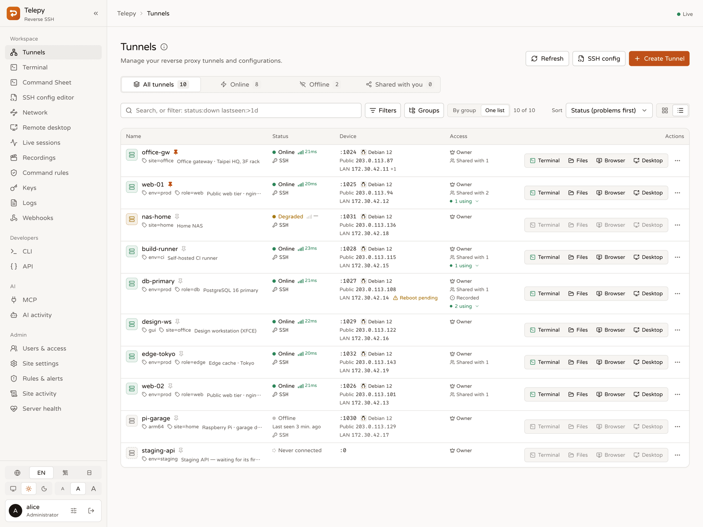

## What you can do

### Connect devices

- **One command to add a device.** On Linux, macOS and OpenWrt you paste a single line. The script checks what the device has, sets everything up, and waits until Telepy can actually log in.
- **A wizard for everything else.** Windows, Docker and appliances get a step-by-step guide with ready-made scripts.
- **Gets out wherever it can.** Devices use the SSH port. When only HTTPS gets out, they carry SSH inside a WebSocket on the web port instead.
- **Health at a glance.** Online, degraded or offline, latency per hop, uptime, public and LAN addresses, plus a daily look at disk, memory and load.
- **Ready for hundreds of devices.** Labels, pins, personal groups, and a search that understands things like `status:down` or `label:env=prod`.

### Work on a device

- **Web terminal.** Tabs, Nerd Fonts, colour schemes, a toolbox of saved commands, and recordings if you want them.
- **Files.** Drag-and-drop uploads, move, copy, rename, permissions, zip downloads, and an editor that never saves half a file.
- **Remote desktop.** RDP and VNC through the tunnel, or RustDesk right in the tab, with sound, clipboard control and multiple monitors.
- **Remote browser.** A real Chromium whose traffic leaves from the device, for admin pages that only open on that network and still look like 2009.
- **The network behind it.** Scan the device's LAN without installing anything, then open a terminal or desktop on any host there.
- **From your own laptop.** One command adds every device to your SSH config, and the command sheet hands you ready-made `ssh -L`, `scp` and `rsync` lines.

### Teams and control

- **Sharing.** View, edit or admin access, per-account allow-lists, and shares that expire. Remove someone and their open sessions end right away.
- **Feature permissions.** Decide who may use the terminal, files, desktop, API tokens and more, for everyone, a group or one person.
- **Command rules.** Block a command, hold it for approval, or just show a reminder. Works in the web terminal and for MCP agents alike, and turns `rm -rf /` from a typo into a meeting.
- **Live sessions.** See who is connected where, watch a terminal live, hand over the keyboard, or end a session.
- **Sign-in security.** Passkeys, authenticator apps, an extra check before sensitive devices, and an alert when your account signs in somewhere new.
- **Notifications.** Per event, in the app or on your desktop, and out to Slack, Discord, Teams, Telegram, ntfy or your own webhook.
- **Audit.** Tamper-evident logs, terminal recordings and sign-in history. "I didn't touch anything" is now something you can actually check.

### Automate

- **The `telepy` command line.** List devices, SSH into one, run a command on twenty at once, copy files.
- **REST API.** Personal tokens with scopes, device limits, an expiry date and a log of every call.
- **MCP.** Let AI agents such as Claude Code or Cursor work on your devices. Each app is approved separately, every call is logged, and your command rules still apply.

## Screenshots

<table>
  <tr>
    <td width="50%">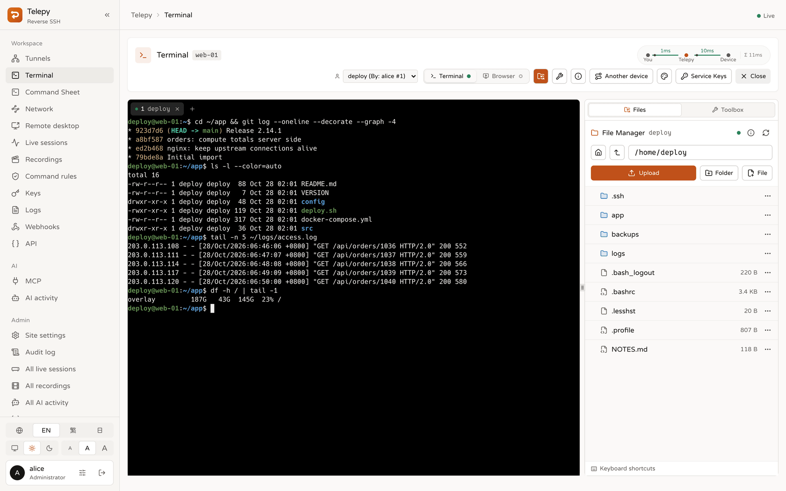<br><sub><b>Terminal and files</b>: tabs, the file panel, and the latency of each hop.</sub></td>
    <td width="50%">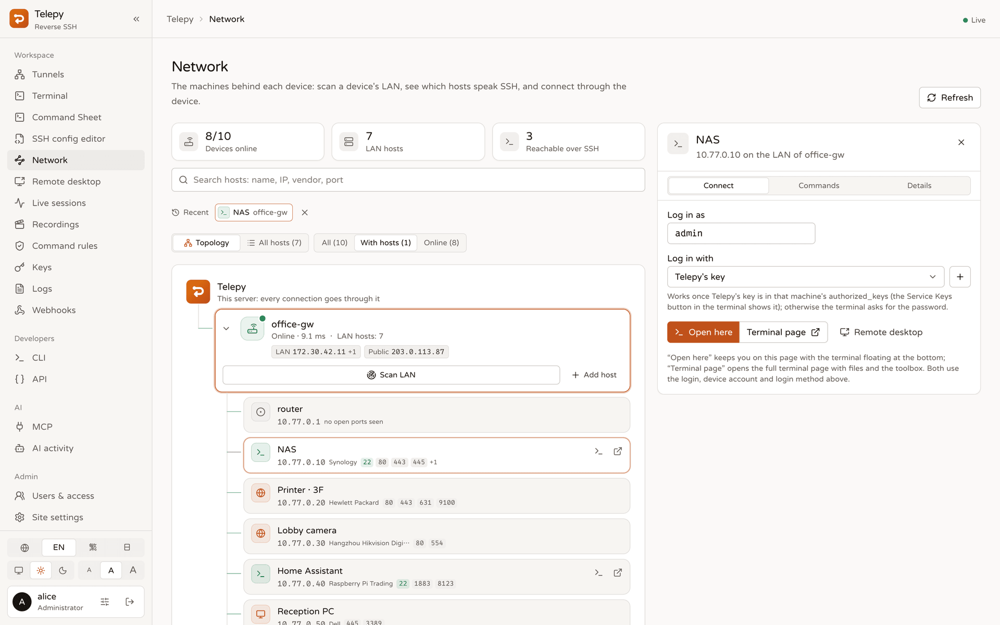<br><sub><b>Network</b>: the LAN behind a device, with vendors and open ports.</sub></td>
  </tr>
  <tr>
    <td>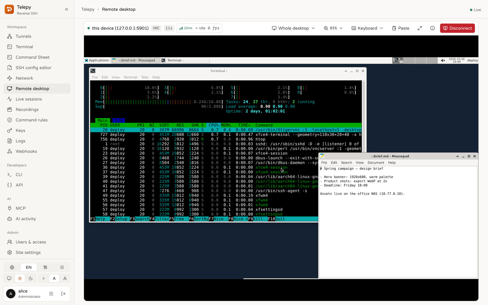<br><sub><b>Remote desktop</b>: VNC through the tunnel, with stream stats.</sub></td>
    <td>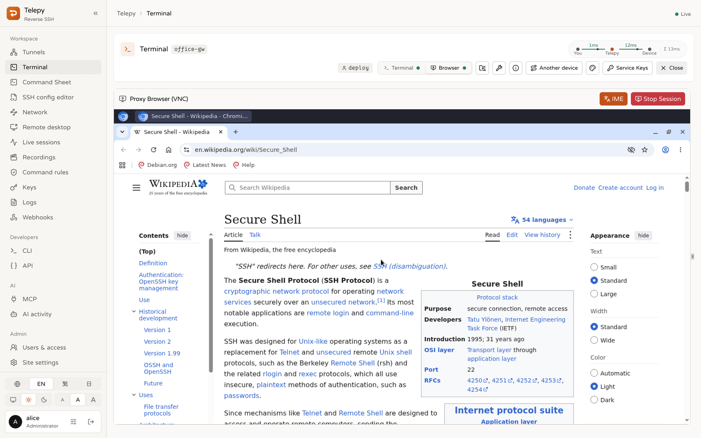<br><sub><b>Remote browser</b>: Chromium that goes online from the device.</sub></td>
  </tr>
  <tr>
    <td>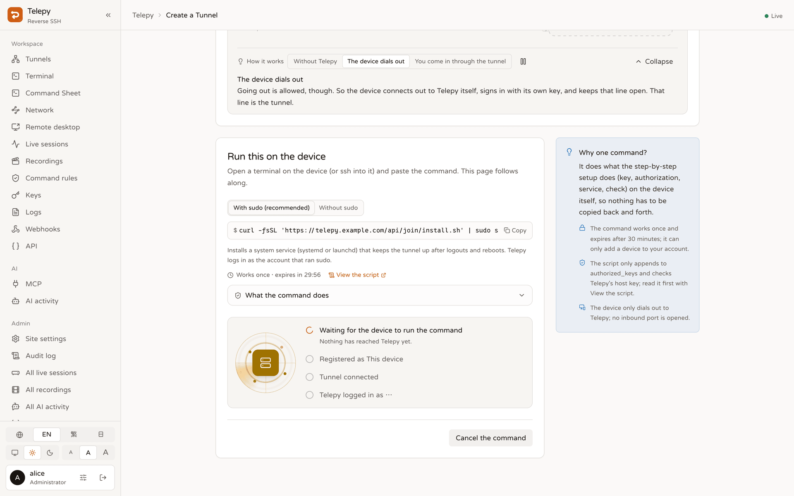<br><sub><b>Add a device</b>: one command, followed live until Telepy logs in.</sub></td>
    <td>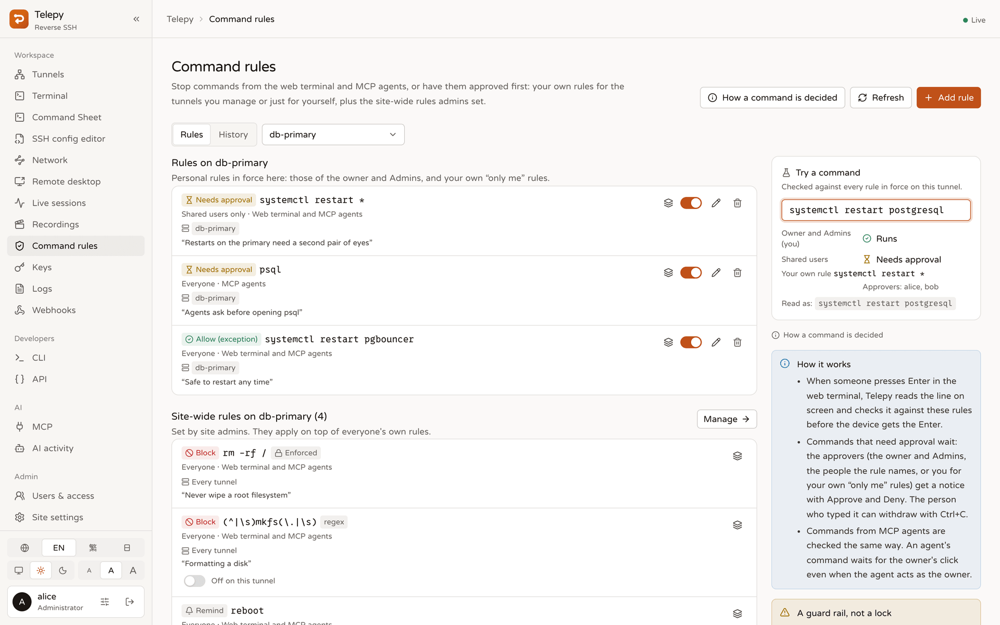<br><sub><b>Command rules</b>: block, approve, remind, or allow as an exception.</sub></td>
  </tr>
  <tr>
    <td>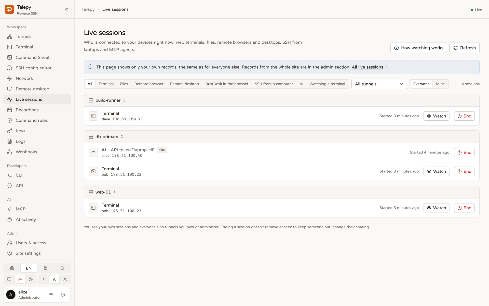<br><sub><b>Live sessions</b>: who is connected, and from where.</sub></td>
    <td>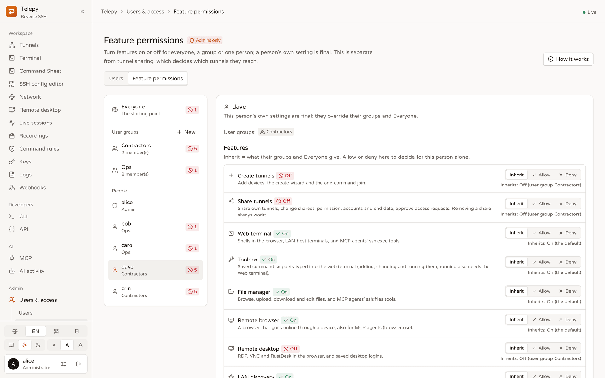<br><sub><b>Feature permissions</b>: per person, per group or for everyone.</sub></td>
  </tr>
  <tr>
    <td>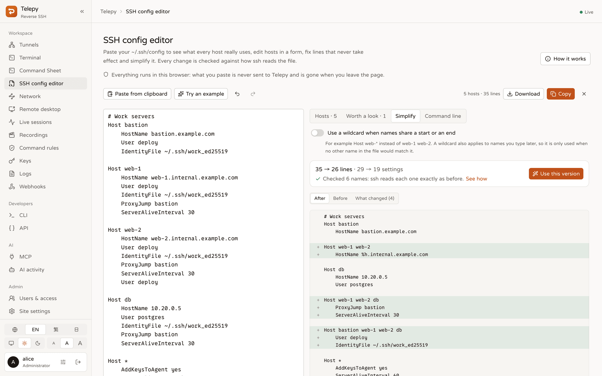<br><sub><b>SSH config editor</b>: see what each host really uses, then simplify.</sub></td>
    <td>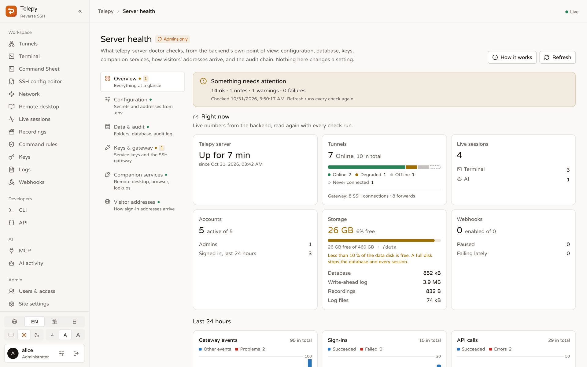<br><sub><b>Server health</b>: the server's own checks and live numbers.</sub></td>
  </tr>
  <tr>
    <td>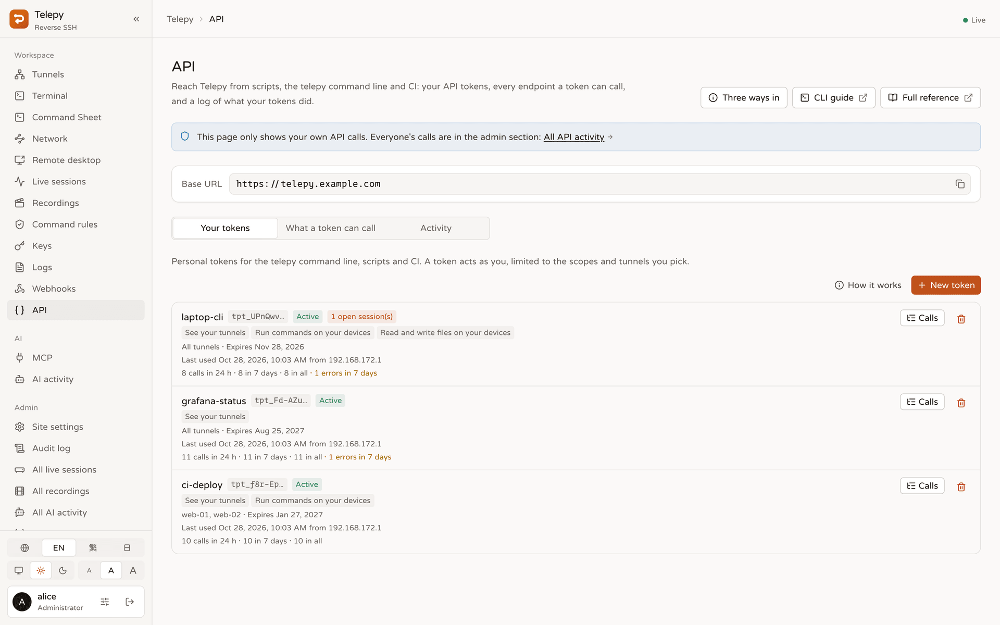<br><sub><b>API</b>: personal tokens and what each one has been calling.</sub></td>
    <td>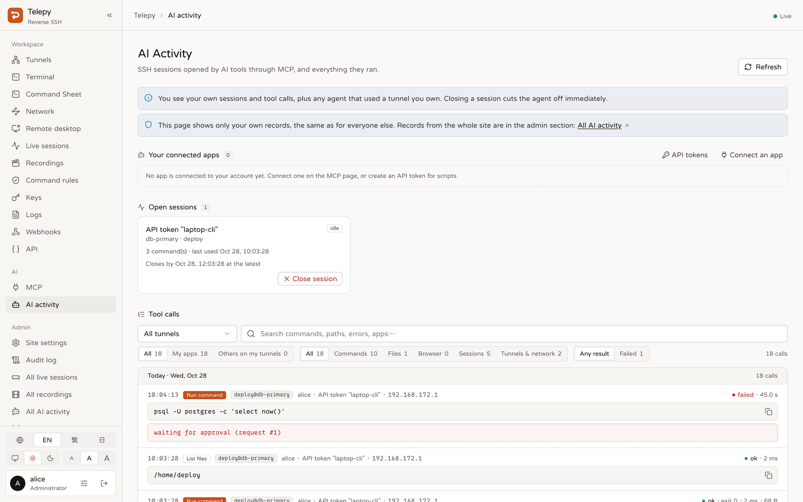<br><sub><b>Agent activity</b>: every MCP call, including ones waiting for approval.</sub></td>
  </tr>
</table>

## How it works

```
 your browser ──https──▶ Traefik ──▶ frontend (Next.js)
                            │
                            └──────▶ backend (Rust) ◀══ reverse SSH (outbound from the device) ══ device ── LAN hosts
                                       │   REST API · WebSockets · built-in SSH gateway · monitor
                                       ├──▶ kasm-browser (Chromium for remote browsing)
                                       └──▶ guacd (RDP / VNC)
```

The device runs an ordinary `ssh -R` to the SSH gateway built into Telepy. It goes straight to the SSH port, or inside a WebSocket on the web port when only HTTPS gets out. The setup installs it as a service, so it comes back after a reboot.

Telepy recognises the tunnel by its key and keeps it in memory. Nothing gets opened on the server. Everything you do on the device runs inside that one connection and logs in to the device's own SSH server.

Both ends check each other's host key, so neither side can be quietly swapped for an impostor.

Want to see what happens inside? [**Telepy in pictures**](./docs/visual-guide.md) walks through each feature with the app's own diagrams.

<details>
<summary>The five containers</summary>

| Service        | What it does                                                              |
| -------------- | ------------------------------------------------------------------------- |
| `traefik`      | Front door: sends the API, WebSockets and MCP to the backend, the rest to the frontend |
| `frontend`     | The web interface (Next.js)                                               |
| `backend`      | One Rust process: REST API, WebSockets, the SSH gateway, monitoring, SQLite |
| `kasm-browser` | Chromium for remote browser sessions (KasmVNC)                            |
| `guacd`        | The RDP / VNC engine for remote desktops, on an internal network only     |

</details>

## Quick start

You need Docker with the Compose plugin.

1. Copy the example settings and fill in at least `SECRET_KEY`, `INTERNAL_API_TOKEN` and `SERVER_DOMAIN`:

   ```bash
   cp .env.example .env
   ```

2. Build and start. On its first start Telepy creates its SSH keys. Keep them: devices remember them, and new keys would make every device treat the server like a stranger.

   ```bash
   docker compose up -d --build
   ```

3. Open `http://localhost:8787` (or the `WEB_SERVER_PORT` you chose) and sign in.

4. Check the setup. In the admin section, **Server health** runs every check. The same checks work from the command line:

   ```bash
   docker compose exec backend telepy-server doctor
   ```

> [!IMPORTANT]
> The first account to sign in becomes the administrator. Sign in before your coworker does.

### Add your first device

- **Linux, macOS, OpenWrt:** go to **Tunnels → Create Tunnel → One command**. Run the command on the device and watch the page tick through each step until it turns green.
- **Windows, Docker and the rest:** choose **Step by step**. The wizard gives you a script for your platform and checks the login at the end.

Once the tunnel shows **Online**, the terminal, files, desktop and browser buttons on its card are ready.

### Going to production

- Put an HTTPS proxy in front of Telepy and set the public address, either in `.env` or later under **Site settings → Server**.
- Make the SSH gateway port reachable from your devices.
- If your web name sits behind a proxy that only carries web traffic (a CDN, an HTTP load balancer, Cloudflare's orange cloud), SSH can't get through it, however politely it asks. Give SSH a name of its own under **Site settings → Server → SSH host**, or let devices use the web port.
- **Server health** tells you whether visitors' real addresses survive the trip through your proxies.

## Configuration

A few values have to live in `.env` because the stack needs them before it starts. Almost everything else is a site setting that an admin changes in the web, no restart needed. The example file explains every variable.

<details>
<summary>Only in <code>.env</code></summary>

| Variable                  | Default     | What it is for                                                  |
| ------------------------- | ----------- | --------------------------------------------------------------- |
| `SECRET_KEY`              | set it      | Signs sign-ins and encrypts stored secrets. Use a long random value |
| `INTERNAL_API_TOKEN`      | set it      | A shared secret between the backend and the browser container   |
| `SERVER_DOMAIN`           | `localhost` | This server's host name, written into scripts and SSH configs   |
| `WEB_SERVER_PORT`         | `8787`      | Port for the web interface, the API and WebSockets              |
| `REVERSE_SERVER_SSH_PORT` | `24242`     | Port devices dial for their tunnel                              |
| `PROJECT_NAME`            | `main`      | Suffix for container names, so several stacks fit on one host   |
| `DEBUG`                   | `false`     | Debug logging                                                   |
| `GEOIP_DIR` / `OUI_DIR`   | in the data folder | Where the offline IP-location and network-vendor lists are kept |

</details>

<details>
<summary>Optional: also editable under Site settings → Server</summary>

Leave these empty to manage them in the web. A value in `.env` wins and locks that field.

| Variable                      | When empty                                                       |
| ----------------------------- | ---------------------------------------------------------------- |
| `PUBLIC_URL`                  | Worked out from each request                                     |
| `SSH_SERVER_DOMAIN`           | Same as `SERVER_DOMAIN`. Set it when the web name goes through a web-only proxy |
| `SOCIAL_GOOGLE_CLIENT_ID`     | No Google sign-in                                                |
| `TRUSTED_PROXY_HOPS`          | `auto`: every internal address in front of the backend counts as a proxy |
| `CLIENT_IP_HEADER`            | None, except Cloudflare's header for requests that came through Cloudflare |
| `GATEWAY_PROXY_PROTOCOL_FROM` | Off                                                              |
| `DEVICE_PROBE`                | On: a daily read-only login to each device for its addresses and health |
| `KEEP_SHARED_SERVICE_KEY`     | Off                                                              |
| `LOG_LEVEL`                   | `info`, or `debug` when `DEBUG=true`                             |
| `OPENAPI_ENABLED`             | On: the API reference, for signed-in users only                  |

</details>

Registration, sign-in rules, limits, webhooks and the rest are site settings too. Users and feature permissions are under **Users & access** in the admin section.

## Command line, API and MCP

### The `telepy` command line

Every Telepy release includes CLI builds for macOS, Linux and Windows. The **CLI** page in the web (under **Developers**) gives you the install command for your computer and examples filled in with your own devices.

```sh
telepy login https://telepy.example.com        # sign in through the browser
telepy ls                                      # your devices, their health and latency
telepy ssh web-01                              # your own ssh, through the tunnel
telepy exec --label env=prod -- uptime         # many devices at once
telepy cp ./app.conf web-01:/etc/app/
telepy update                                  # get the latest release
```

In CI, set `TELEPY_URL` and `TELEPY_TOKEN` instead of signing in. More in the [CLI guide](./docs/cli.md).

### REST API

Create a personal token on the **API** page. The page lists every endpoint a token may call, each with a `curl` example, and links to the full reference.

### MCP

Point an MCP client at `https://<your-host>/mcp`. With Claude Code, for example:

```sh
claude mcp add --transport http telepy https://<your-host>/mcp
```

The first time, an approval page asks which permissions and devices the app gets. More in the [MCP guide](./docs/mcp.md).

## Maintenance

Maintenance commands run inside the backend container, so they are the same on every operating system:

```bash
docker compose exec backend telepy-server <command>
```

| Command            | What it does                                                         |
| ------------------ | -------------------------------------------------------------------- |
| `doctor`           | Checks keys, database, configuration and companion services          |
| `create-superuser` | Creates an administrator (`--username` and `--password`)             |
| `keygen`           | Creates any missing SSH keys. Existing keys are never replaced       |
| `geoip`            | Downloads the offline IP-location database (or press Download on the Server health page). Telepy keeps it current after that, no restart |
| `oui`              | Downloads the network-vendor list for LAN hosts. Kept current the same way |
| `migrate`          | Brings the database up to date. Also runs on every start             |

To follow the logs, run `docker compose logs -f backend`.

To upgrade, run `git pull && docker compose up -d --build`. The database catches up by itself when the backend starts.

## Documentation

- [**Telepy in pictures**](./docs/visual-guide.md): each feature, explained with the app's own diagrams
- [All documentation](./docs/README.md), in English, 繁體中文 and 日本語
- [The command line and API tokens](./docs/cli.md)
- [MCP: AI agents on your devices](./docs/mcp.md)
- [Webhooks](./docs/webhooks.md)
- [Adding a device with one command](./docs/device-join.md)
- [Remote desktop](./docs/remote-desktop.md) and [remote browser](./docs/remote-browser.md)
- [How the backend reaches devices](./docs/device-connections.md)
- Release notes: [GitHub Releases](https://github.com/NatLee/telepy/releases)

## Contributors

<!-- ALL-CONTRIBUTORS-LIST:START - Do not remove or modify this section -->
<!-- prettier-ignore-start -->
<!-- markdownlint-disable -->
<table>
  <tbody>
    <tr>
      <td align="center"><a href="https://github.com/NatLee"><br /><sub><b>Nat Lee</b></sub></a></td>
      <td align="center"><a href="https://github.com/h-alice"><br /><sub><b>H. Alice</b></sub></a></td>
      <td align="center"><a href="https://github.com/boris-lok"><br /><sub><b>Boris Lok</b></sub></a></td>
    </tr>
  </tbody>
</table>

<!-- markdownlint-restore -->
<!-- prettier-ignore-end -->

<!-- ALL-CONTRIBUTORS-LIST:END -->

## License

Telepy is licensed under the [GNU Affero General Public License v3.0](./LICENSE) (AGPL-3.0). If you run a modified Telepy as a service for other people, you have to offer them its source code. If that doesn't fit your plans, a commercial license is available from [@NatLee](https://github.com/NatLee).

Versions released before October 2026 were MIT-licensed, see [NOTICE](./NOTICE). Contributions are made under the [Contributor License Agreement](./CONTRIBUTING.md#contributor-license-agreement).
