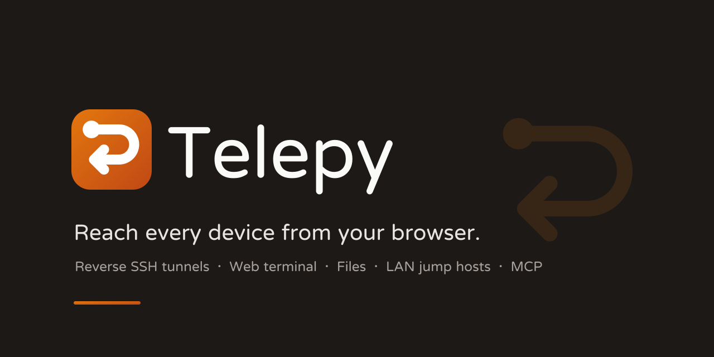
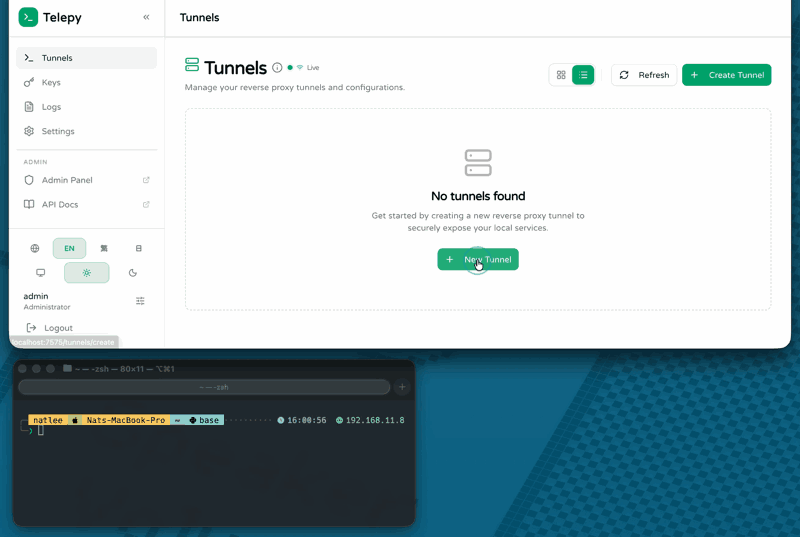
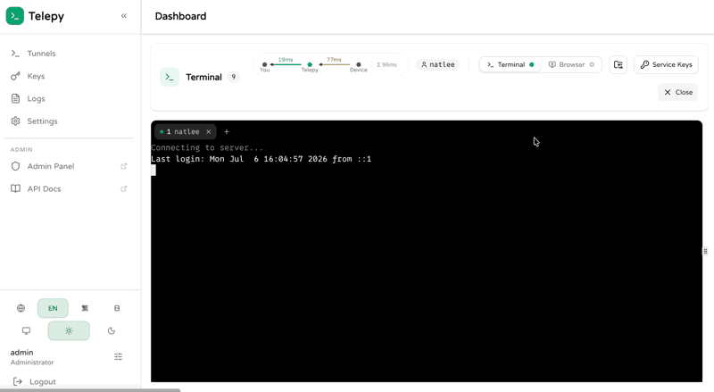
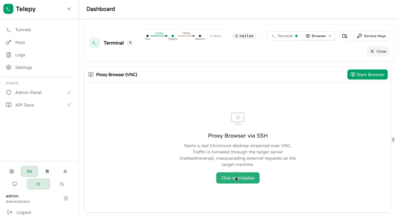

<h1 align="center"></h1>

**English** | [繁體中文](./README.zh-TW.md) | [日本語](./README.ja.md)

A self-hosted web platform for managing **reverse SSH tunnels**. Register a device once, then reach it from anywhere: monitor tunnel health on a live dashboard, open a terminal in your browser, manage files over SFTP, share access with teammates, and even browse the web *through* the remote device.

## Features

- **Tunnel dashboard** — live online/offline status and per-hop latency (you → Telepy → device), in list or card view.
- **Guided tunnel creation** — a five-step wizard issues keys and generates ready-to-run connection scripts: plain SSH, AutoSSH, systemd service, PowerShell, Docker Run, and Docker Compose, plus a single-use `curl` URL for fetching the script on the target machine.
- **One-command device join** — on Linux or macOS, paste one `curl … | sudo sh` command on the device: it creates the tunnel key, registers the device, authorizes Telepy, pins Telepy's host key, installs the tunnel as a systemd/launchd service and waits until Telepy has logged in through it. The command works once and expires after 30 minutes; the create page follows each step live.
- **Web terminal** — multi-tab xterm.js terminal over WebSocket, with per-user sessions and live latency readout.
- **File manager** — SFTP-based file browser alongside the terminal for uploading and downloading files on the device.
- **Remote proxy browser** — launch a real Chromium desktop (KasmVNC) whose traffic is tunneled through the target device, so external requests appear to come from that machine.
- **Sharing & permissions** — share tunnels with other users under hierarchical VIEW / EDIT / ADMIN permissions.
- **Command sheet** — pick a tunnel and get copy-ready `ssh -L` / `-R` / `-D` / `-J` / `scp` commands for forwarding ports or copying files from your own computer, each with a live diagram of where the traffic flows; works with your `~/.ssh/config` or as standalone one-liners.
- **Network topology (jump hosts)** — see the machines behind each device at a glance: scan a device's LAN without installing anything (the device's own sshd makes the connections), label hosts and set their login, then open a web terminal on one through the device, or copy an `ssh -J` one-liner or a `ProxyJump` ssh config stanza.
- **Webhooks** — everyone can send the notifications they get (a tunnel going offline or changing IP, a share, an access request, a command waiting for approval, a sign-in…) to Slack, Discord, Google Chat, Microsoft Teams, Telegram, ntfy or their own service, per tunnel and in their own language; admins add site-wide webhooks for outages and security events. Requests are signed (Standard Webhooks) and personal URLs may only reach public addresses.
- **Command rules** — block commands, or hold them until someone approves, site-wide or per tunnel, for the web terminal and MCP agents alike; "allow" exceptions carve out the safe cases within the same scope, an approval rule can name its own approvers (a security team for `sudo` everywhere), and an info diagram shows the path every tested command takes.
- **Keys & logs** — manage authorized keys and inspect the SSH gateway log from the UI, globally or per tunnel (users only see their own and shared tunnels).
- **Authentication** — Google OAuth2 or username/password, JWT-backed API. The first user to log in becomes the superuser. Optional two-factor sign-in with passkeys (also passwordless) or an authenticator app (TOTP), plus one-time recovery codes; administrators can reset a user's second factors.
- **Internationalization & theming** — English, 繁體中文, and 日本語; light and dark themes.

## Usage

### Create a tunnel

Go to **Tunnels → Create Tunnel**, paste the device's SSH public key, and follow the wizard. Run the generated script on the device and the tunnel comes online.



### Web terminal

Click **Terminal** on any online tunnel to get a shell on the device, straight from the browser.



### Remote proxy browser

Click **Browser** on an online tunnel to start a Chromium session that browses the web through the device (SSH SOCKS proxy + KasmVNC streaming).



## How it works

The device keeps a reverse SSH connection (`ssh -NR <port>:localhost:22 telepy@server`) to Telepy's backend, which terminates it with its built-in SSH gateway and assigns each tunnel a dedicated port. The web terminal, file manager, and proxy browser all reach the device through that port — no inbound firewall rules or public IP needed on the device side.

Telepy runs as four containers orchestrated by Docker Compose:

| Service        | Role                                                        |
| -------------- | ----------------------------------------------------------- |
| `traefik`      | Reverse proxy; routes `/api/*` & `/ws/*` to the backend, everything else to the frontend |
| `frontend`     | Next.js web UI                                              |
| `backend`      | Rust (axum) service: REST API, WebSocket terminal/file manager/relay, and the SSH gateway that terminates the reverse tunnels |
| `kasm-browser` | KasmVNC + Chromium for remote browser sessions              |

## Quick start

Requires Docker with the Compose plugin.

1. Create your environment file and adjust as needed:

   ```bash
   cp .env.example .env
   ```

2. Generate the SSH server keys:

   ```bash
   ./telepy.sh keygen
   ```

3. Build and start the stack:

   ```bash
   docker compose up -d --build
   ```

4. Open `http://localhost:<WEB_SERVER_PORT>/login` (default: `http://localhost:8787/login`) and sign in.

> [!NOTE]
> The **first user** created becomes the superuser — whether via Google login or `./telepy.sh create-superuser` (check `dev-scripts/dev-create-superuser.sh` to change the default username/password before running it).

### Connect a device

1. **Tunnels → Create Tunnel**, paste the device's SSH public key, and complete the wizard (add at least one OS username that exists on the device).
2. Append the shown service key to `~/.ssh/authorized_keys` on the device.
3. Run the generated connection script on the device (SSH for quick tests, AutoSSH/systemd/Docker for something persistent). Scripts can be retrieved any time from the tunnel's **Scripts** action.
4. When the tunnel shows **Online**, the terminal, file manager, and remote browser are ready to use.

## Configuration

Environment variables in `.env`:

| Variable                  | Default     | Description                                  |
| ------------------------- | ----------- | -------------------------------------------- |
| `PROJECT_NAME`            | `main`      | Suffix for container names                   |
| `DEBUG`                   | `false`     | Debug logging                                |
| `SECRET_KEY`              | —           | JWT signing key (set in production)          |
| `WEB_SERVER_PORT`         | `8787`      | Port Traefik exposes the web UI on           |
| `REVERSE_SERVER_SSH_PORT` | `24242`     | Port devices connect their reverse SSH to    |
| `SOCIAL_GOOGLE_CLIENT_ID` | —           | Google OAuth client ID                       |
| `SERVER_DOMAIN`           | `localhost` | Public hostname of your Telepy server        |
| `PUBLIC_URL`              | —           | Public base URL, e.g. `https://telepy.example.com` (OAuth issuer for MCP clients and the passkey origin; derived from the request when empty). Passkeys need a domain name with https (or `localhost`) |
| `INTERNAL_API_TOKEN`      | —           | Secret for internal service-to-service calls |
| `OPENAPI_ENABLED`         | `true`      | Serve Swagger UI + OpenAPI spec (see below)  |

### AI tools (MCP)

Telepy is its own OAuth 2.1 authorization server, so any MCP-capable AI tool (Claude, Cursor, …) can
be pointed at `https://<your-host>/mcp`. The first use opens an approval page in your browser where you
check the app's redirect address, choose the permissions (see tunnels / run commands / read and write
files) and the tunnels it may use. Approved apps appear under **Preferences → Connected apps**, where
revoking stops their access and closes their sessions immediately. Sessions opened by AI tools close on
their own when idle; the limits are site settings. **AI activity** in the sidebar shows the open sessions (with
a close button) and every tool call the agents made; owners of shared tunnels are notified when an agent
connects. Details: [docs/mcp.md](./docs/mcp.md).

For Claude Code: `claude mcp add --transport http telepy https://<your-host>/mcp`. Tools: `list_tunnels`,
`tunnel_status`, `ssh_session_open` / `ssh_exec` / `ssh_session_list` / `ssh_session_close`, `sftp_list` /
`sftp_read` / `sftp_write`. Every tool call is audited (`/api/ai/activity`), and a tunnel's owner is notified when
someone it is shared with opens an AI session on it. Details: [docs/mcp.md](docs/mcp.md).

### API docs

The backend publishes its OpenAPI 3 document at `/api/openapi.json` and a Swagger UI at
`/api/__hidden_swagger`. Both require a login: the page reuses your web session (open it in the
browser you are logged in with; otherwise it sends you to `/login`), and the spec needs a Bearer
token (`Authorization: Bearer <access_token>` from `POST /api/auth/token`). "Try it out" requests
carry your login automatically; **Authorize** lets you test with another token. The spec is
generated from the actual routes (`utoipa`), so it is always in sync with the server;
`telepy-server openapi` prints the same document from the CLI. Set `OPENAPI_ENABLED=false` to
remove both.

## CLI helper

`./telepy.sh` wraps the day-to-day maintenance scripts:

```
Usage: ./telepy.sh sub-command [args]
Sub-commands:
  keygen: Generate SSH host keys (gateway) and the backend service key.
  create-superuser: Create an admin account for Telepy management.
  shell: Open a shell in the backend container.
  migration: Reconcile the database schema (also runs automatically on start).
  backend-debug: Recreate the backend container and follow its logs.
  oui: Download the IEEE OUI registry so LAN hosts show their NIC vendor.
  doctor: Check .env, containers, ports and the backend's configuration; exits 1 when something is broken.
```

## Further reading

- [Remote browser architecture](./docs/remote-browser.md)
- [Remote desktop (RDP / VNC) architecture](./docs/remote-desktop.md)
- [Webhooks: events, formats and signatures](./docs/webhooks.md)
- [Latency measurement deep dive](./docs/latency-deep-dive.md)
- [Rust backend migration plan](./docs/rust-migration-plan.md)
- [Backend benchmark: Django vs Rust](./docs/benchmarks.md)
- [Articles](./docs/articles/)

## Contributors

<!-- ALL-CONTRIBUTORS-LIST:START - Do not remove or modify this section -->
<!-- prettier-ignore-start -->
<!-- markdownlint-disable -->
<table>
  <tbody>
    <tr>
      <td align="center"><a href="https://github.com/NatLee"><br /><sub><b>Nat Lee</b></sub></a></td>
      <td align="center"><a href="https://github.com/h-alice"><br /><sub><b>H. Alice</b></sub></a></td>
      <td align="center"><a href="https://github.com/boris-lok"><br /><sub><b>Boris Lok</b></sub></a></td>
    </tr>
  </tbody>
</table>

<!-- markdownlint-restore -->
<!-- prettier-ignore-end -->

<!-- ALL-CONTRIBUTORS-LIST:END -->

## License

Telepy is licensed under the [GNU Affero General Public License v3.0](./LICENSE) (AGPL-3.0). If you run a modified
Telepy as a service for other people, you must offer them its source code. If that does not fit your use, a
commercial license is available — contact [@NatLee](https://github.com/NatLee).

Versions released before October 2026 were MIT-licensed; see [NOTICE](./NOTICE). Contributions are made under the
[Contributor License Agreement](./CONTRIBUTING.md#contributor-license-agreement).
