<h1 align="center"></h1>

<p align="center"><a href="./README.md">English</a> | <b>繁體中文</b> | <a href="./README.ja.md">日本語</a></p>

Telepy 是自架的網頁主控台，專門對付那些你連不進去的機器：NAT 後面的伺服器、家裡的 Raspberry Pi、防火牆後的辦公室電腦、OpenWrt 路由器。

每台裝置只要往你的 Telepy 伺服器撥出一條反向 SSH 通道，之後就能在瀏覽器裡操作它：終端機、檔案、遠端桌面、從裝置那頭上網的瀏覽器，還有它所在區網裡的其他機器。

不用設定連接埠轉送，不用 VPN，也不用公網 IP。裝置只要能上網就好——它顯然本來就能，看它多勤勞的下載更新就知道。

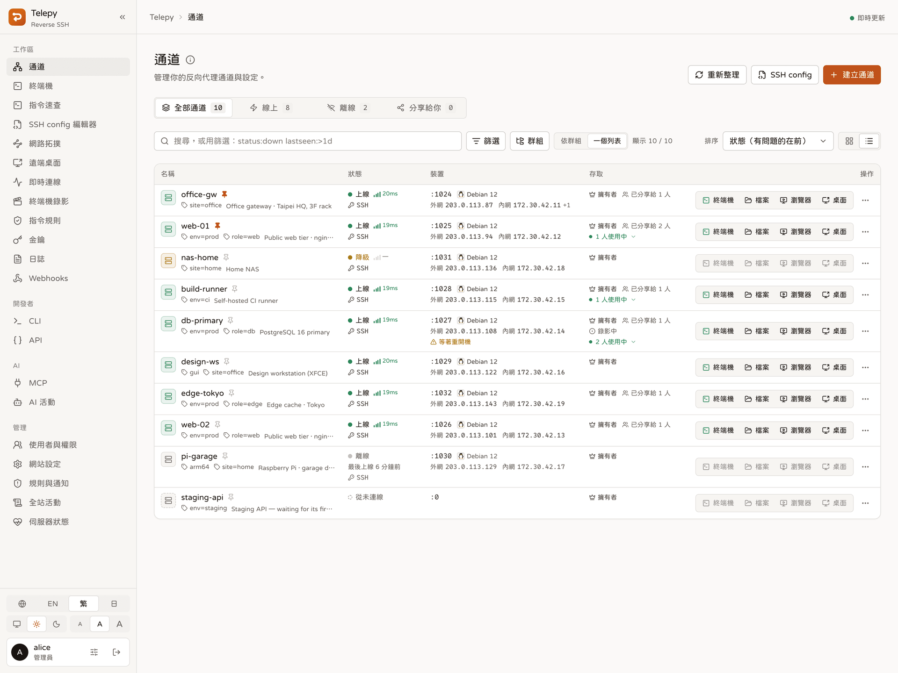

## 能做什麼

### 連接裝置

- **一行指令加入裝置**：Linux、macOS、OpenWrt 只要貼一行指令。腳本會先看裝置有什麼，自己設定好，一直等到 Telepy 真的登入成功才收工。
- **其他系統有精靈帶**：Windows、Docker 與各種設備，照著逐步精靈跑現成的腳本就好。
- **哪裡出得去就走哪裡**：裝置平常走 SSH 埠；只有 HTTPS 出得去的網路，就把 SSH 包在網頁埠的 WebSocket 裡。
- **狀態一眼看完**：上線、降級或離線，每一段的延遲、上線率、公網與內網位址，每天也會看一下磁碟、記憶體和負載。
- **上百台也管得動**：標籤、釘選、個人群組，搜尋看得懂 `status:down`、`label:env=prod` 這類條件。

### 操作裝置

- **網頁終端機**：分頁、Nerd Font、配色、存好常用指令的工具箱，需要的話也能錄影。
- **檔案管理**：拖放上傳、移動、複製、重新命名、改權限、打包下載，內建的編輯器絕不會只存一半。
- **遠端桌面**：經通道使用 RDP 與 VNC，或直接在分頁裡跑 RustDesk，支援聲音、剪貼簿控制與多螢幕。
- **遠端瀏覽器**：真正的 Chromium，流量從裝置那頭出去，適合那些只有在那個網路裡才打得開、設計還停在 2009 年的管理頁面。
- **裝置背後的區網**：不用裝任何東西就能掃描裝置所在的網路，再對裡面任何一台主機開終端機或遠端桌面。
- **從自己的電腦連**：一行指令把所有裝置加進你的 SSH 設定；指令速查頁直接給你現成的 `ssh -L`、`scp`、`rsync`。

### 團隊與管控

- **分享**：檢視、編輯或管理權限，指定可用的登入帳號，分享還能設到期日。把人移掉，他開著的連線就會立刻結束。
- **功能權限**：決定誰可以用終端機、檔案、遠端桌面、API token 等功能，可以對所有人、某個群組或某個人設定。
- **指令規則**：擋下指令、要求核准，或只是提醒一下。網頁終端機與 MCP agent 一體適用，讓 `rm -rf /` 從一次手滑，變成一場會議。
- **即時連線**：看誰連在哪台裝置，即時觀看終端機、交出鍵盤，或直接結束連線。
- **登入安全**：通行金鑰、驗證器 app、連敏感裝置前再確認一次身分，帳號在新地方登入時也會通知你。
- **通知**：每種事件都能分開設定，在網頁裡、桌面上，或送到 Slack、Discord、Teams、Telegram、ntfy 與你自己的 webhook。
- **稽核**：防竄改的日誌、終端機錄影與登入紀錄。「我什麼都沒動」這句話，終於可以查證了。

### 自動化

- **`telepy` 命令列**：列出裝置、SSH 進去、一次對二十台下指令、複製檔案。
- **REST API**：個人 token，可以限制範圍與裝置、設到期日，每次呼叫都有紀錄。
- **MCP**：讓 Claude Code、Cursor 這類 AI agent 操作你的裝置。每個 app 分開核准，每次呼叫都有紀錄，指令規則照樣管用。

## 截圖

<table>
  <tr>
    <td width="50%">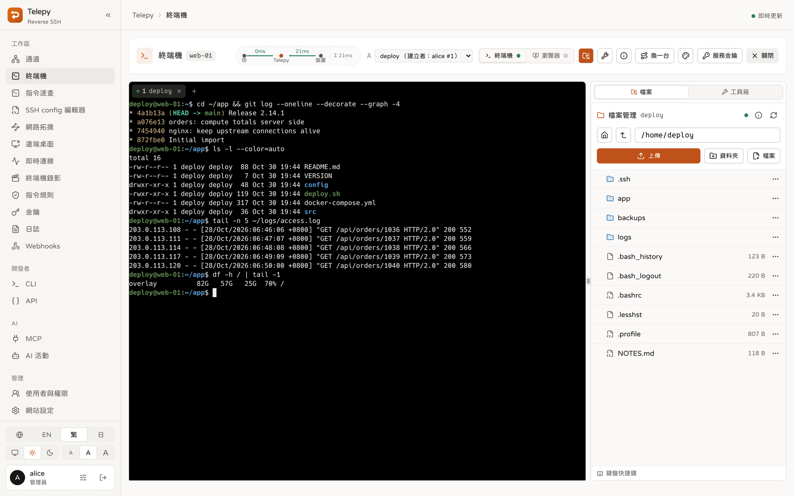<br><sub><b>終端機與檔案</b>：分頁、檔案側欄，以及每一段的延遲。</sub></td>
    <td width="50%">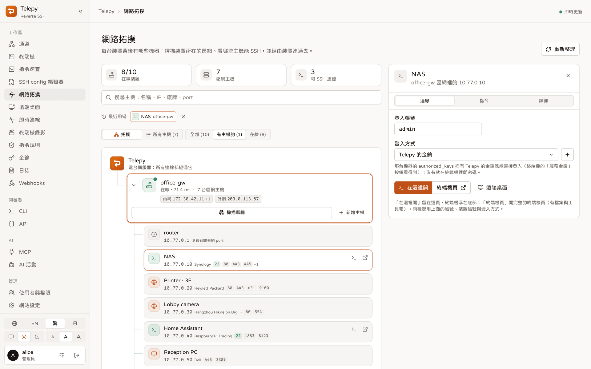<br><sub><b>網路拓撲</b>：裝置背後的區網，含廠牌與開著的連接埠。</sub></td>
  </tr>
  <tr>
    <td>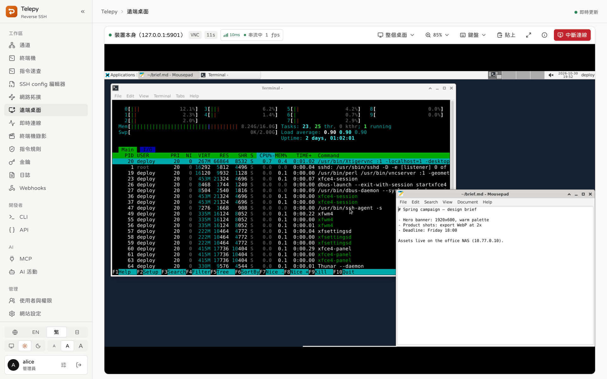<br><sub><b>遠端桌面</b>：經通道連上的 VNC，附串流數據。</sub></td>
    <td>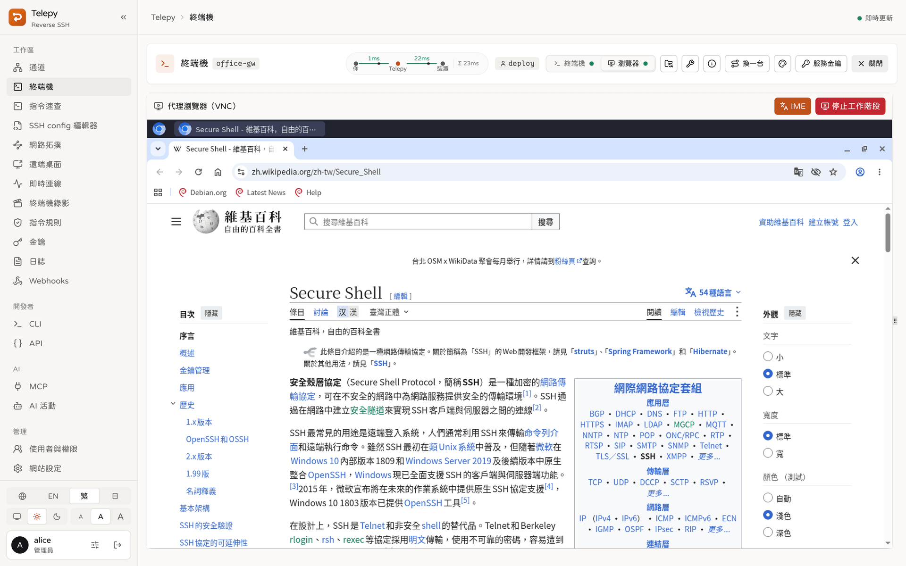<br><sub><b>遠端瀏覽器</b>：從裝置那頭上網的 Chromium。</sub></td>
  </tr>
  <tr>
    <td>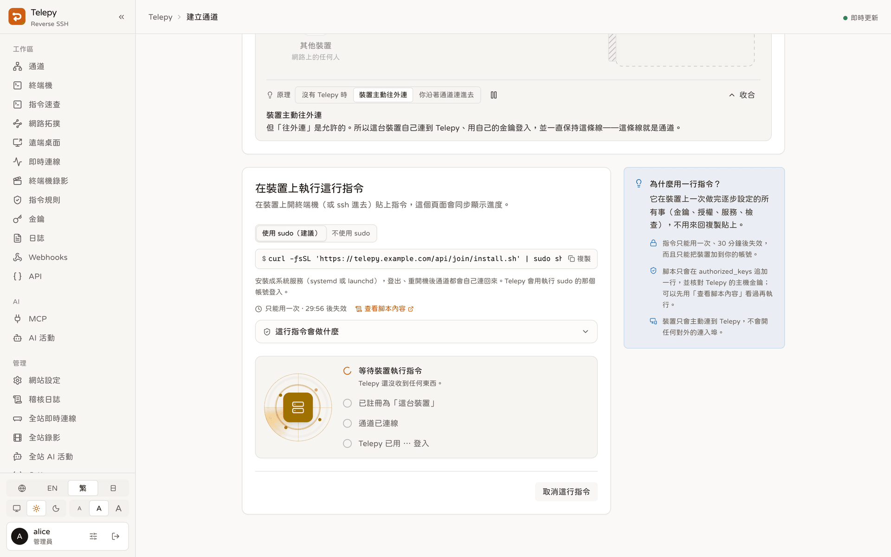<br><sub><b>新增裝置</b>：一行指令，頁面一路跟到 Telepy 登入成功。</sub></td>
    <td>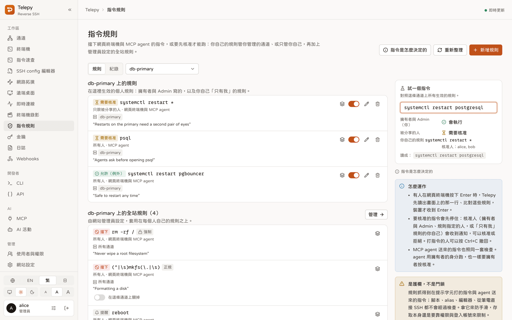<br><sub><b>指令規則</b>：擋下、核准、提醒，或設成例外。</sub></td>
  </tr>
  <tr>
    <td>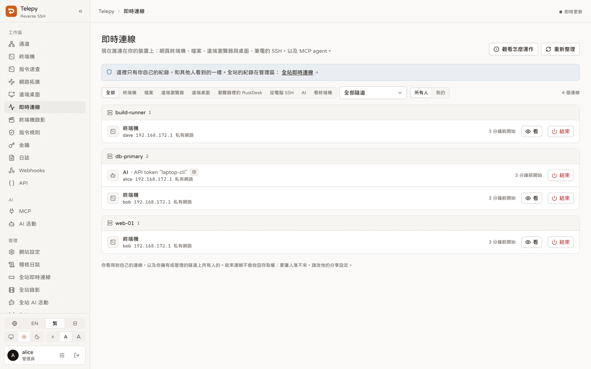<br><sub><b>即時連線</b>：誰連進來、從哪裡連進來。</sub></td>
    <td>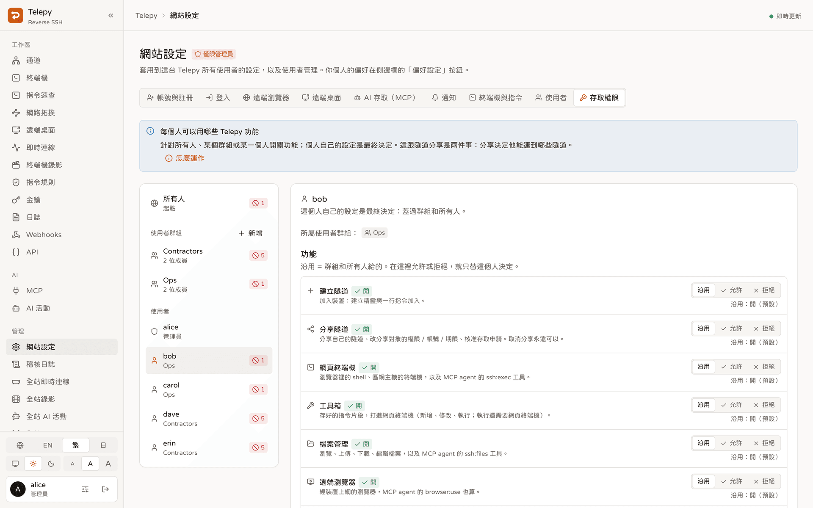<br><sub><b>功能權限</b>：對個人、群組或所有人設定。</sub></td>
  </tr>
  <tr>
    <td>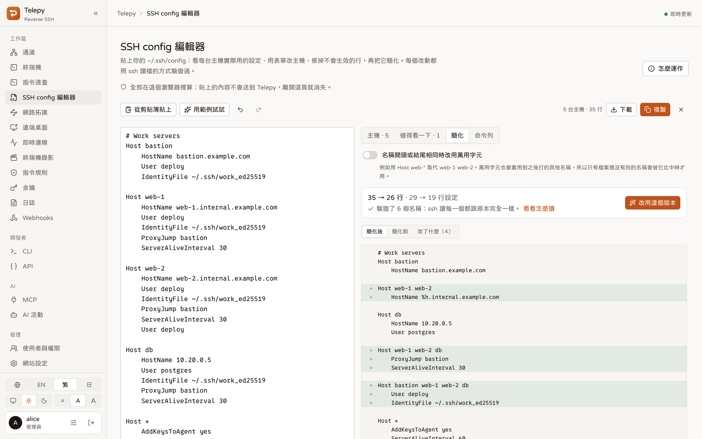<br><sub><b>SSH config 編輯器</b>：看每台主機實際用到什麼，再把設定簡化。</sub></td>
    <td>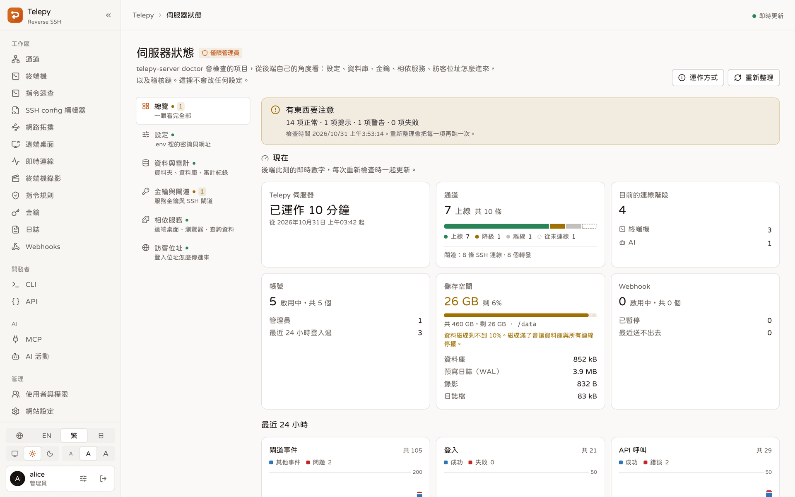<br><sub><b>伺服器狀態</b>：伺服器自己的檢查與即時數據。</sub></td>
  </tr>
  <tr>
    <td>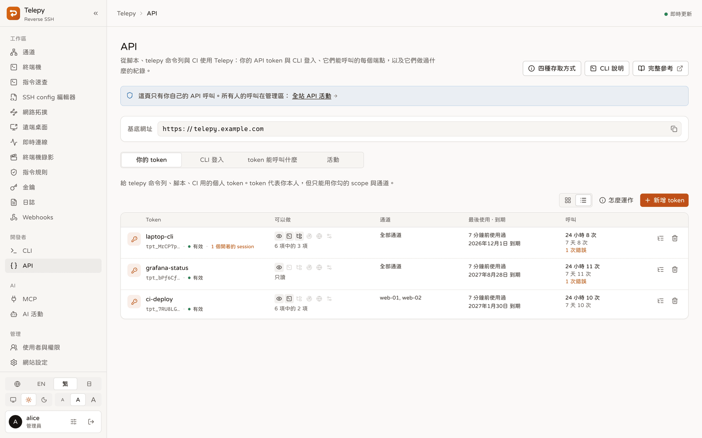<br><sub><b>API</b>：個人 token，以及每把 token 最近呼叫了什麼。</sub></td>
    <td>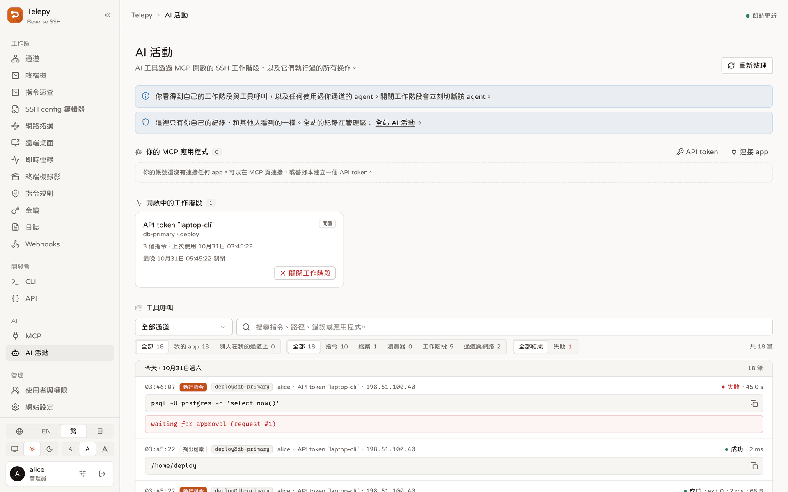<br><sub><b>Agent 活動</b>：每一次 MCP 呼叫，包含還在等核准的。</sub></td>
  </tr>
</table>

## 運作原理

```
 你的瀏覽器 ──https──▶ Traefik ──▶ frontend（Next.js）
                         │
                         └──────▶ backend（Rust）◀══ 反向 SSH（由裝置往外撥）══ 裝置 ── 區網主機
                                    │   REST API · WebSocket · 內建 SSH gateway · 監控
                                    ├──▶ kasm-browser（遠端瀏覽用的 Chromium）
                                    └──▶ guacd（RDP / VNC）
```

裝置跑的是一般的 `ssh -R`，連到 Telepy 內建的 SSH gateway。能直接連 SSH 埠就直接連；只有 HTTPS 出得去時，就包在網頁埠的 WebSocket 裡。安裝時會把它設成服務，所以裝置重開機後會自己連回來。

Telepy 用金鑰認出是哪一條通道，並把它記在記憶體裡，伺服器上不會多開任何連接埠。你在裝置上做的每件事，都走這同一條連線，登入的是裝置自己的 SSH 伺服器。

兩邊都會檢查對方的主機金鑰，所以誰都沒辦法被人悄悄的掉包。

想看裡面怎麼運作？[**圖解 Telepy**](./docs/visual-guide.zh-TW.md) 用介面裡的說明圖，一個功能一個功能講給你聽。

<details>
<summary>五個容器</summary>

| 服務           | 負責什麼                                                       |
| -------------- | -------------------------------------------------------------- |
| `traefik`      | 大門：API、WebSocket 與 MCP 交給後端，其他交給前端             |
| `frontend`     | 網頁介面（Next.js）                                            |
| `backend`      | 一個 Rust 程序：REST API、WebSocket、SSH gateway、監控、SQLite |
| `kasm-browser` | 遠端瀏覽器用的 Chromium（KasmVNC）                             |
| `guacd`        | 遠端桌面的 RDP / VNC 引擎，只在內部網路                        |

</details>

## 快速開始

需要 Docker 與 Compose 外掛。

1. 複製範例設定檔，至少填好 `SECRET_KEY`、`INTERNAL_API_TOKEN` 和 `SERVER_DOMAIN`：

   ```bash
   cp .env.example .env
   ```

2. 建置並啟動。第一次啟動時 Telepy 會產生自己的 SSH 金鑰。請好好留著：裝置都記得這些金鑰，換掉的話，所有裝置都會當場翻臉不認人。

   ```bash
   docker compose up -d --build
   ```

3. 打開 `http://localhost:8787`（或你設定的 `WEB_SERVER_PORT`）登入。

4. 檢查設定。管理區的**伺服器狀態**會跑完所有檢查，命令列也能跑同一組：

   ```bash
   docker compose exec backend telepy-server doctor
   ```

> [!IMPORTANT]
> 第一個登入的帳號會成為管理員。請趕在同事之前登入。

### 加入第一台裝置

- **Linux、macOS、OpenWrt**：到**通道 → 建立通道 → 一行指令**，在裝置上執行那行指令，看著頁面一步步打勾，直到變綠。
- **Windows、Docker 與其他**：選**逐步設定**。精靈會給你對應平台的腳本，最後幫你驗證登入。

通道顯示**上線**後，卡片上的終端機、檔案、桌面與瀏覽器按鈕就能用了。

### 正式上線

- 在 Telepy 前面放一層 HTTPS 代理，並設定對外網址：寫在 `.env`，或之後到**網站設定 → 伺服器**設定。
- 讓裝置連得到 SSH gateway 的連接埠。
- 如果網頁的名稱經過只轉送網頁流量的代理（CDN、HTTP 負載平衡器、Cloudflare 的橘色雲朵），SSH 是過不去的，好說歹說都沒用。請到**網站設定 → 伺服器 → SSH 主機**給 SSH 一個自己的名稱，或讓裝置改走網頁埠。
- **伺服器狀態**會告訴你，訪客的真實位址有沒有平安穿過你那幾層代理。

## 環境設定

有幾個值一定要寫在 `.env`，因為整套服務啟動前就要用到。其他幾乎都是網站設定，管理員在網頁上改就好，不用重啟。每個變數的說明都寫在範例設定檔裡。

<details>
<summary>只能寫在 <code>.env</code> 的</summary>

| 變數                      | 預設        | 用途                                             |
| ------------------------- | ----------- | ------------------------------------------------ |
| `SECRET_KEY`              | 必填        | 簽署登入、加密保存的機密。請設一長串亂數         |
| `INTERNAL_API_TOKEN`      | 必填        | 後端與瀏覽器容器之間共用的密鑰                   |
| `SERVER_DOMAIN`           | `localhost` | 這台伺服器的主機名稱，會寫進腳本與 SSH 設定      |
| `WEB_SERVER_PORT`         | `8787`      | 網頁介面、API 與 WebSocket 的連接埠              |
| `REVERSE_SERVER_SSH_PORT` | `24242`     | 裝置撥通道用的連接埠                             |
| `PROJECT_NAME`            | `main`      | 容器名稱的後綴，讓一台主機能放好幾套             |
| `DEBUG`                   | `false`     | 除錯日誌                                         |
| `GEOIP_DIR` / `OUI_DIR`   | 資料夾裡    | 離線 IP 地理資料與網卡廠牌清單放在哪裡           |

</details>

<details>
<summary>選填：也能在網站設定 → 伺服器修改</summary>

留空就在網頁上管理；`.env` 裡有值時以它為準，網頁上那一格會鎖住。

| 變數                          | 留空時                                                   |
| ----------------------------- | -------------------------------------------------------- |
| `PUBLIC_URL`                  | 依每個請求推算                                           |
| `SSH_SERVER_DOMAIN`           | 跟 `SERVER_DOMAIN` 一樣；網頁名稱經過只轉送網頁的代理時才要設 |
| `SOCIAL_GOOGLE_CLIENT_ID`     | 沒有 Google 登入                                         |
| `TRUSTED_PROXY_HOPS`          | `auto`：後端前面每一個內部位址都算代理                   |
| `CLIENT_IP_HEADER`            | 不用；只有經過 Cloudflare 的請求會用它的標頭             |
| `GATEWAY_PROXY_PROTOCOL_FROM` | 關閉                                                     |
| `DEVICE_PROBE`                | 開啟：每天以唯讀方式登入裝置一次，讀位址與健康狀態       |
| `KEEP_SHARED_SERVICE_KEY`     | 關閉                                                     |
| `LOG_LEVEL`                   | `info`；`DEBUG=true` 時為 `debug`                        |
| `OPENAPI_ENABLED`             | 開啟：API 參考文件，只有登入的人看得到                   |

</details>

註冊、登入規則、各種上限、webhook 等等也都是網站設定；使用者與功能權限在管理區的**使用者與權限**。

## 命令列、API 與 MCP

### `telepy` 命令列

每個 Telepy 發行版都附上 macOS、Linux、Windows 的命令列工具。網頁側欄**開發者**底下的 **CLI** 頁，會給你這台電腦的安裝指令，範例也直接填好你自己的裝置。

```sh
telepy login https://telepy.example.com        # 用瀏覽器登入
telepy ls                                      # 你的裝置、健康狀態與延遲
telepy ssh web-01                              # 用你自己的 ssh，經通道連過去
telepy exec --label env=prod -- uptime         # 一次跑很多台
telepy cp ./app.conf web-01:/etc/app/
telepy update                                  # 更新到最新版
```

CI 裡不用登入，設好 `TELEPY_URL` 與 `TELEPY_TOKEN` 就行。詳見 [CLI 指南](./docs/cli.zh-TW.md)。

### REST API

在 **API** 頁建立個人 token。頁面會列出 token 能呼叫的每個端點，每個都附 `curl` 範例，也連得到完整的參考文件。

### MCP

把 MCP 用戶端指向 `https://<你的主機>/mcp`。以 Claude Code 為例：

```sh
claude mcp add --transport http telepy https://<你的主機>/mcp
```

第一次使用會跳出核准頁，讓你決定這個 app 拿到哪些權限、能碰哪些裝置。詳見 [MCP 指南](./docs/mcp.zh-TW.md)。

## 維運

維運指令都在後端容器裡執行，所以不管什麼作業系統都一樣：

```bash
docker compose exec backend telepy-server <指令>
```

| 指令               | 做什麼                                                 |
| ------------------ | ------------------------------------------------------ |
| `doctor`           | 檢查金鑰、資料庫、設定與搭配的服務                     |
| `create-superuser` | 建立管理員帳號（加上 `--username` 與 `--password`）    |
| `keygen`           | 補上缺少的 SSH 金鑰，已有的絕不會被換掉                |
| `geoip`            | 下載離線 IP 地理資料庫（也可以在伺服器狀態頁按「下載」），之後 Telepy 自己保持最新，不用重啟 |
| `oui`              | 下載網卡廠牌清單，讓區網主機顯示廠牌，之後一樣自己保持最新 |
| `migrate`          | 把資料庫結構更新到最新，每次啟動也會自動做             |

看日誌用 `docker compose logs -f backend`。

升級就是 `git pull && docker compose up -d --build`，後端啟動時資料庫會自己跟上。

## 文件

- [**圖解 Telepy**](./docs/visual-guide.zh-TW.md)：用介面裡的說明圖，一個功能一個功能看
- [所有文件](./docs/README.zh-TW.md)，都有英文、繁體中文與日文版
- [命令列與 API token](./docs/cli.zh-TW.md)
- [MCP：讓 AI agent 操作你的裝置](./docs/mcp.zh-TW.md)
- [Webhook](./docs/webhooks.zh-TW.md)
- [一行指令加入裝置](./docs/device-join.zh-TW.md)
- [遠端桌面](./docs/remote-desktop.zh-TW.md)與[遠端瀏覽器](./docs/remote-browser.zh-TW.md)
- [後端怎麼連到裝置](./docs/device-connections.zh-TW.md)
- 版本說明：[GitHub Releases](https://github.com/NatLee/telepy/releases)

## 貢獻者

<!-- ALL-CONTRIBUTORS-LIST:START - Do not remove or modify this section -->
<!-- prettier-ignore-start -->
<!-- markdownlint-disable -->
<table>
  <tbody>
    <tr>
      <td align="center"><a href="https://github.com/NatLee"><br /><sub><b>Nat Lee</b></sub></a></td>
      <td align="center"><a href="https://github.com/h-alice"><br /><sub><b>H. Alice</b></sub></a></td>
      <td align="center"><a href="https://github.com/boris-lok"><br /><sub><b>Boris Lok</b></sub></a></td>
    </tr>
  </tbody>
</table>

<!-- markdownlint-restore -->
<!-- prettier-ignore-end -->

<!-- ALL-CONTRIBUTORS-LIST:END -->

## 授權條款

Telepy 採用 [GNU Affero 通用公共授權條款 v3.0](./LICENSE)（AGPL-3.0）。如果你把修改過的 Telepy 架成服務給別人用，就必須提供他們原始碼。這不適合你的話，也有商業授權，請聯絡 [@NatLee](https://github.com/NatLee)。

2026 年 10 月以前發行的版本採用 MIT 授權，見 [NOTICE](./NOTICE)。貢獻需同意[貢獻者授權協議](./CONTRIBUTING.md#contributor-license-agreement)。
