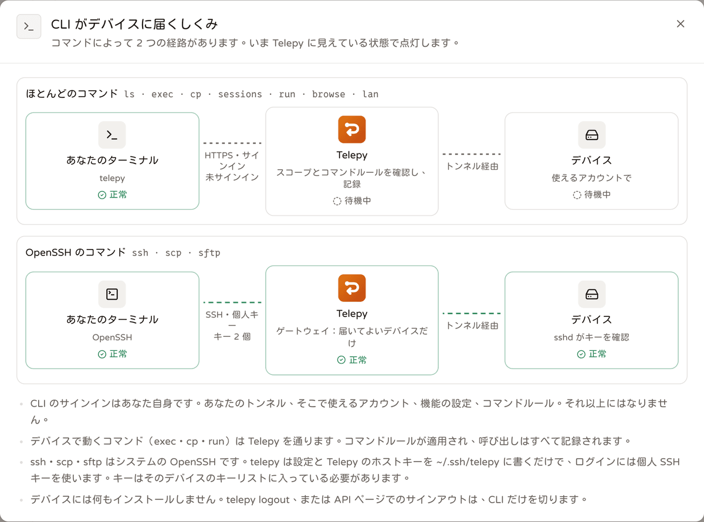
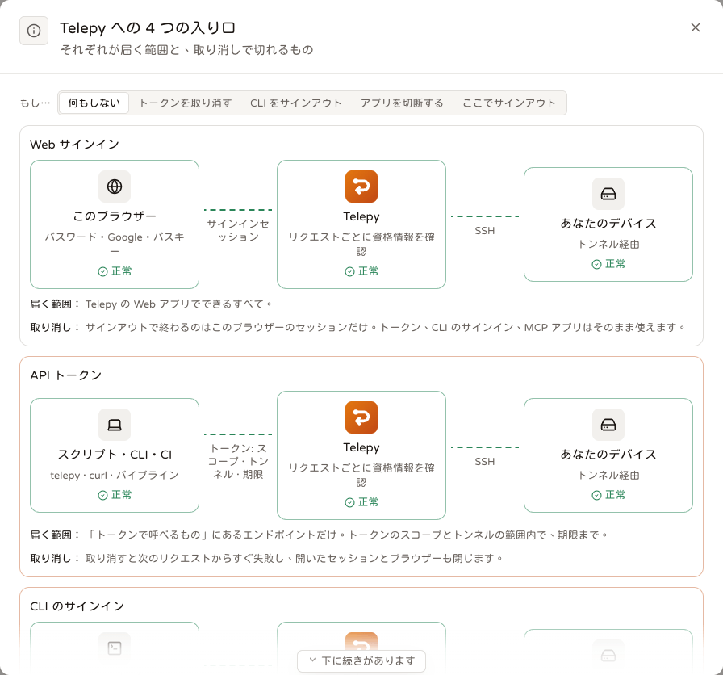

# `telepy` コマンドラインと個人用 API トークン

<p align="center"><a href="./cli.md">English</a> | <a href="./cli.zh-TW.md">繁體中文</a> | <b>日本語</b></p>

`telepy` は、ターミナルから使う Telepy です。トンネルの一覧表示、`ssh`・`scp`・`sftp` でのデバイスへの直接接続、1 台またはラベルの付いた全デバイスでのコマンド実行、ファイルのコピー、ライブセッションの確認と終了、ターミナル録画の再生、ツールボックスのスニペット実行ができます。`uptime` 1 回のためにブラウザーを開くのは大げさだ、と感じる人向けです。

スクリプトや CI も同じコマンドを使います。ブラウザーでサインインする代わりに、**個人用 API トークン**を持たせます。

トークンと CLI のサインインは、どちらも Web の **API** ページ（サイドバーの「開発者」→ API）で管理します。タブは 4 つです。

- **CLI のサインイン**：`telepy login` を実行したすべてのコンピューター。
- **あなたのトークン**：トークンの作成、確認、失効。
- **トークンで呼べるもの**：すべてのエンドポイントを、そのままコピーできる `curl` と対応する `telepy` コマンド付きで。
- **アクティビティ**：トークンと CLI のサインインが行ったこと。

## インストール

いちばん手軽なのは Web の **CLI** ページ（サイドバーの「開発者」→ CLI）です。ブラウザーから判別したお使いのコンピューター向けのインストールコマンドと、お使いのサーバー向けのサインインコマンドが表示されます。例も、自分のトンネル、アカウント、ラベル、グループ、スニペットで埋めた状態で載っています。

手作業でインストールする場合は次のとおりです。`v2.8.0` 以降のすべての Telepy リリースに、次の CLI が含まれます。

- macOS arm64 と x86_64
- Linux x86_64 と arm64（静的リンク、musl）
- Windows x86_64

どれもそのリリースのタグからビルドされ、同じバージョンを報告します（`telepy --version`）。ファイル名にはバージョンが入らないので、`releases/latest/download/…` は常に最新版を指します。

```sh
# macOS / Linux
TARGET=aarch64-apple-darwin   # x86_64-apple-darwin, x86_64-unknown-linux-musl, aarch64-unknown-linux-musl
curl -fsSL "https://github.com/NatLee/telepy/releases/latest/download/telepy-$TARGET.tar.gz" | tar xz telepy
sudo mkdir -p /usr/local/bin && sudo install -m 755 telepy /usr/local/bin/ && rm telepy
telepy --version
```

```powershell
# Windows：%LOCALAPPDATA%\telepy に展開し、PATH に追加します（追加は 1 回だけ）
$dir = "$env:LOCALAPPDATA\telepy"
Invoke-WebRequest https://github.com/NatLee/telepy/releases/latest/download/telepy-x86_64-pc-windows-msvc.zip -OutFile "$env:TEMP\telepy.zip"
Expand-Archive "$env:TEMP\telepy.zip" $dir -Force
$p = [Environment]::GetEnvironmentVariable("Path", "User")
if (($p -split ";") -notcontains $dir) { [Environment]::SetEnvironmentVariable("Path", "$p;$dir", "User") }
$env:Path += ";$dir"
telepy --version
```

バージョンを指定するときは、代わりに `…/releases/download/v2.11.0/telepy-$TARGET.tar.gz` を使います。

`ssh`・`scp`・`sftp` には、PATH 上にシステムの OpenSSH クライアントも必要です。`telepy doctor` が確認してくれます。

### ダウンロードしたファイルを確かめる

各アーカイブの隣には `.sha256` があり、各リリースには `SHA256SUMS` があります。`curl -fsSL …/telepy-$TARGET.tar.gz.sha256 | sha256sum -c` で確認できます（macOS では `shasum -a 256 -c`）。

バイナリーには Apple や Microsoft の署名がありません。`curl` ではなくブラウザーでダウンロードした場合、macOS で動かす前に `xattr -d com.apple.quarantine telepy` が必要です。

リリースのファイルが本当に Telepy のものだと確かめる手段が、さらに 2 つあります。どちらもアカウントは不要です。

- **ビルドの来歴**：リリースの各ファイルは、ビルド自身が証明しています（GitHub artifact attestation）。`gh attestation verify telepy-$TARGET.tar.gz --repo NatLee/telepy` を実行すると、どのコミットのどの workflow 実行がこのバイト列を作ったかが分かります。
- **署名付きのチェックサム一覧**：`SHA256SUMS` は Telepy のリリース鍵で署名されています。OpenSSH の ed25519 鍵で、公開鍵は [`src/backend-api/src/release_key.rs`](../src/backend-api/src/release_key.rs) にあります。署名は OpenSSH の署名形式の `SHA256SUMS.sig` なので、OpenSSH だけで検証できます。

  ```sh
  echo "telepy-release $(sed -n 's/^ *"\(ssh-ed25519 [^"]*\)".*/\1/p' release_key.rs | head -1)" > allowed_signers
  ssh-keygen -Y verify -f allowed_signers -I telepy-release -n telepy-release -s SHA256SUMS.sig < SHA256SUMS
  sha256sum -c --ignore-missing SHA256SUMS
  ```

  そのファイルの鍵の行を手で貼ってもかまいません。`allowed_signers` は `telepy-release <鍵>` の 1 行だけです。

`telepy update` はこの検証を自分で行います。Telepy サーバーがリリースからデバイス用の補助プログラムを取得するときも同じです。どちらも、`SHA256SUMS` がないリリースや、Telepy のリリース鍵で署名されていないリリースは受け付けません。自分の鍵で署名し直すミラーでは、`TELEPY_RELEASE_KEYS`（公開鍵の行を 1 つ以上、改行か `;` で区切る）で内蔵の鍵を差し替えられます。

### 自分でビルドする

Rust 1.88 以降が必要です。

```sh
cargo install --locked --git https://github.com/NatLee/telepy telepy-cli
```

このビルドが報告するバージョンは Cargo.toml の `0.1.0` です。ビルド時に `TELEPY_VERSION` を設定すると、別のバージョンを刻印できます。

### アップデート

```sh
telepy update --check        # 新しいリリースは出ている？
telepy update                # ダウンロードし、リリースの署名付き SHA256SUMS で確かめてから、この telepy を置き換える
telepy update --to v2.9.0    # 指定したリリースにする（古い版に戻すときも）
```

`telepy update` が行うことは次のとおりです。

1. リリースから、このプラットフォーム用のアーカイブをダウンロードします。
2. `SHA256SUMS` が Telepy のリリース鍵で署名されていないか、アーカイブの SHA-256 が一致しなければ、受け付けません。
3. 新しいバイナリーを古いものの隣に書き込み、古いものを脇へ移して、新しいものの `--version` を実行します。
4. それが失敗したら、古いものを元に戻します。

telepy があるフォルダーへの書き込み権限が必要です（`/usr/local/bin` なら `sudo telepy update`）。`cargo install` や Homebrew でインストールした telepy は、それらのツールに任せます。Windows では実行中のファイルを削除できないので、古い `.exe` の名前を変えておき、次回の実行時に片付けます。

リリースビルドは、新しいリリースが出ていないかも自分で確認します。

- 1 日に 1 回まで、バックグラウンドで、2 秒のタイムアウト付き。
- stderr がターミナルで、`CI` が設定されていないときだけ。
- 新しいものがあれば、コマンドが成功したあとに 1 行で知らせます。

`TELEPY_NO_UPDATE_CHECK=1` でオフにできます。`TELEPY_RELEASES_URL` を使うと、確認と `telepy update` の両方を `https://github.com/NatLee/telepy/releases` のミラーに向けられます。最新のタグは `/latest` のリダイレクトから読むので、GitHub API のレート制限は関係ありません。

`telepy doctor` はバージョンと、新しいものが出ているかどうかを表示します（警告であり、失敗にはなりません）。自分でビルドした telepy は、自分からは確認しません。

## サインイン

```sh
telepy login https://telepy.example.com                 # ブラウザー：OAuth + PKCE、ループバックへのコールバック
telepy login https://telepy.example.com --scope "tunnels:read ssh:exec ssh:files network:scan"
telepy login https://telepy.example.com --no-browser    # ブラウザーを開かず、サインイン用の URL を表示する
telepy login https://telepy.example.com --token tpt_…   # 個人用 API トークン（API ページ → あなたのトークン）。--with-token でも可
telepy whoami                                           # 誰として、どのトークン / アプリで、スコープ、トンネル、有効期限
telepy logout
```

`--scope` を付けなければ、ブラウザーでのサインインは `tunnels:read ssh:exec ssh:files` を求めます。各スコープでできることは[スコープ](#スコープ)を見てください。

承認すると、ブラウザーは Telepy の「サインイン完了」ページに移ります。CLI に今できることと、試せるコマンドがいくつか表示されます。見た目は**サイト設定 → サインイン**にある承認ページの設定に従います。このページがない古い Telepy サーバーでは、CLI 自身が描く小さなページが表示されます。

### CLI のサインインは MCP アプリではありません

ブラウザーでのサインインは MCP アプリと同じ OAuth の承認を使うので、承認ページにも見覚えがあるはずです。それでも CLI は MCP アプリではありません。

- **API** ページの **CLI のサインイン**に、コンピューターごとに 1 件表示されます。その呼び出しは API アクティビティに入ります。MCP アプリの一覧には現れません。
- サインアウトはそこか、`telepy logout` で行います。
- 同じコンピューターで `telepy login` をもう一度実行すると、以前のサインインを置き換えるか尋ねられます。
- CLI のサインインは 1 人あたり最大 10 件です。11 件目を作ると、最も長く使われていないものがサインアウトされます。
- ブラウザーでのサインインは **MCP アプリ**機能に従い、管理者はこれをオフにできます（**管理 → ユーザーとアクセス → 機能の権限**）。トークンはそれとは関係なく使えます。

### サインイン情報の保存場所

CLI はアクセストークンとリフレッシュトークンを保存します。

- **macOS**：キーチェーン。
- **Windows**：資格情報マネージャー。
- **Linux**、および `TELEPY_NO_KEYRING=1` を設定した場合やキーリングが使えなかった場合：設定ディレクトリー内の `credentials.json`（モード 0600）。設定ディレクトリーは `TELEPY_CONFIG_DIR`、なければ `$XDG_CONFIG_HOME/telepy` か `~/.config/telepy` です（Windows では `%APPDATA%\telepy`）。

`telepy logout` はサインイン情報を忘れます。ブラウザーでのサインインなら、サーバー側でも失効させます。トークンは、API ページで失効させるまで有効です。

CI では何も保存する必要がありません。[CI で](#ci-で)を見てください。

### Tapi について

ターミナルでは、`telepy login` と問題のない `telepy doctor` の結果の横に、Telepy の小さなお化け Tapi が表示されます。横のテキストはターミナルの幅に合わせて折り返され、幅が狭いと Tapi の下に回り、非常に狭いと Tapi は省かれます。

出力をパイプしているときは表示されず、`NO_COLOR` では色なしで描かれます。お化けが苦手なら `TELEPY_NO_MASCOT=1` を設定してください。もう出てきません。

## 普段使うコマンド



ターゲットはトンネルで、デバイスのアカウントを付けることもできます。`box` ならトンネルのデフォルトのアカウント、`box@pi` なら `pi` を使います（`pi@box` でも可）。`telepy <コマンド> --help` で、そのコマンドのすべてのオプションを表示できます。

### トンネルを探す

```sh
telepy ls                                  # NAME  HEALTH  LATENCY  ACCOUNTS  LABELS  GROUP  SEEN
telepy ls --label env=prod --online --json
telepy ls --group "Lab"
telepy status box                          # ヘルス、稼働時間、デバイス情報と警告
```

### SSH、scp、sftp

```sh
telepy ssh box                             # トンネルのデフォルトのアカウント
telepy ssh box@pi -- uname -a              # <トンネル>@<アカウント>（pi@box でも可）
telepy ssh box -L 8080:localhost:80        # ポートを転送する。SOCKS なら -D 1080
telepy ssh box -i ~/.ssh/id_work           # 両方のホップで特定の鍵を使う
telepy ssh box --ssh-opt "-o ServerAliveInterval=30"   # その他の ssh オプション（繰り返し可。scp / sftp でも使える）
telepy scp ./build.tar.gz box@pi:/tmp/
telepy scp -r box@pi:/var/log/app ./logs
telepy sftp box@pi
```

これらはシステムの OpenSSH を実行し、**あなた自身の個人用 SSH 鍵**で、Telepy のゲートウェイとトンネルを通ってログインします。Web の **SSH 設定**ダイアログが用意するのと同じ経路です。

実行のたびに `~/.ssh/telepy/` に 2 つのファイルを書き込みます（フォルダーは `TELEPY_SSH_DIR` で移せます）。

- `<alias>.conf`：生成された設定。ProxyCommand がこのファイル自身を指しています。
- `known_hosts-<server>`：固定された Telepy ゲートウェイのホスト鍵。

そのうえで OpenSSH を `-F` 付きで起動します。あなた自身の `~/.ssh/config` には一切触れません。

### Web ポートか SSH ポートか

`telepy ssh`・`scp`・`sftp` は、デフォルトでは Telepy の **Web ポート**経由で接続します。`telepy` 自身が Telepy へのホップの ProxyCommand になり、SSH を WebSocket の中で運びます（`/ws/gateway/`、python3 は不要）。

中の SSH は同じです。あなたの鍵、固定されたホスト鍵、デバイス自身の sshd を使います。違いは、Telepy があなたの実際のアドレスを記録できるようになることです。SSH ポートの手前にあるもの（OrbStack や Docker のポート転送、NAT）は、これを隠してしまうことがよくあります。

SSH のホップは 30 秒ごとにキープアライブを送るので、Web ポートの手前にあるプロキシ（CDN、ロードバランサー）がアイドル中のセッションを閉じることはありません。

```sh
telepy ssh box --via ssh                   # Web ポートを使わず、Telepy の SSH ポートに直接つなぐ
telepy config fallback always              # このサーバー：Web ポートに届かないときは、確認せずに SSH ポートを使う
```

Web ポートに届かないとき、`telepy` があなたの同意なしに SSH ポートへ切り替えることはありません。

| `--fallback` / `telepy config fallback` | 動作 |
| --- | --- |
| `ask`（デフォルト） | ターミナルで尋ねます：**y** 今回だけ、**a** このサーバーでは常に（保存されます）、**N** 使わない。ターミナルがない場合（CI、スクリプト）は切り替えず、許可する方法を表示します。 |
| `always` | SSH ポートを使い、stderr にその旨を表示します。 |
| `never` | 理由を表示して失敗します。 |

この選択はサーバーごとに `<config dir>/prefs.json` に保存され、値なしの `telepy config fallback` で確認できます。`--fallback` または `TELEPY_SSH_FALLBACK` は、その 1 回の実行だけ上書きします。`--via ssh` または `TELEPY_SSH_VIA=ssh` は Web ポートをまったく使いません。`telepy doctor` は両方を表示します。

### 自分の `~/.ssh/config`

Web の SSH 設定ダイアログと同じように、Telepy のブロックを自分の設定に入れるには次のようにします。

```sh
telepy config install box nas              # Web のダイアログのインストールコマンドを代わりに実行（~/.ssh/config、マーカー付きブロック、バックアップ）
telepy config install --all --print        # 使えるすべてのトンネル。書き込まずにブロックを表示（--file <path> で別のファイルに書き込み）
```

`config.bak` を残し、ホスト鍵を `~/.ssh/telepy_known_hosts` に保存します。Web のダイアログと同様に、別の Telepy サーバーに属する同名のデバイスには手を付けません。両方を共存させるには、SSH 設定ダイアログの「このコンピューターで複数の Telepy を使っていますか？」で名前のプレフィックスを設定します。

`config tidy` は、すでにある設定を簡略化します。

```sh
telepy config tidy                         # ~/.ssh/config を簡略化：変更点と差分を表示し、確認してから書き込み、config.bak を残す
telepy config tidy --check                 # 報告のみ。もっと簡略にできるか、確認すべき行があれば 1 で終了（dotfiles の CI 向け）
```

サインインは不要で、ファイルをどこにも送信しません。Web の **SSH config エディター**と同じルールに従います（同じエンジンで、共通のテストケースによって一致が保たれています）。

- 複数のホストが共有する行は、それらの後ろに置いた `Host a b c` ブロックに 1 回だけ書かれます。独自の値を設定しているホストは、その値を保ちます。
- `Host web1` の下の `HostName web1.example.com` は `HostName %h.example.com` になります。
- ssh が読むことのない重複は削除されます。

そのあと、ファイルに挙がっているすべての名前をもう一度解決し、以前とまったく同じ結果になることを確かめます。`Match` や `Include` をまたいで移動するものはなく、Telepy 自身のブロックはマーカーを保ちます。効果のない行や、ssh が知らないオプションも一覧します。

`--wildcards` は、ファイル内の他のどの名前にも一致しない場合に `Host web-*` を許可します。`--yes` は確認なしで書き込みます（バックアップは作られます）。`--file <path>` は別のファイルを簡略化します。

### コマンドを実行する

```sh
telepy exec box -- systemctl is-active nginx
telepy exec --label env=prod -- uptime     # ラベルの付いたすべてのトンネルで並列実行。各行に「名前 | 」が付く
telepy exec --group Lab -u root --timeout 300 -- apt-get -y upgrade   # 自分のトンネルグループ、1 つのアカウント、タイムアウトは 600 秒まで
telepy exec box nas --json -- df -h /
telepy exec box --wait-approval -- sudo reboot   # コマンドルールが承認待ちにしている間、待ち続ける
```

`exec` は Telepy を通してトンネルごとに短命のセッションを開き、コマンドを実行してから閉じます（`POST /api/ai/sessions`、続いて `POST /api/ai/sessions/{id}/exec`）。このセッションは MCP エージェントと同じ扱いで、後片付け、コマンドルール、監査も同じです。タイムアウトは、指定しなければ 60 秒です。

コマンドは **AI アクティビティ**ページに、トークンの名前（ブラウザーでのサインインなら CLI のアプリ名）で表示されます。

### ファイルをコピーする

```sh
telepy cp box@pi:/var/log/syslog ./syslog
telepy cp ./config.yml box@pi:/etc/app/
```

`cp` は Telepy の API を通して SFTP でコピーし、`ssh:files` スコープが必要です。`scp` は OpenSSH を使う方法で、個人用 SSH 鍵が必要です。

### セッション、録画、スニペット

```sh
telepy sessions                            # 自分のトンネルのライブセッション
telepy sessions end 42
telepy recordings ls --tunnel box
telepy recordings play 17 --speed 2        # 録画のタイミングどおりに再生。間は最大 2 秒（--idle-limit 0 ですべての間を残す）
telepy snippets ls --tunnel box
telepy run "restart service" box --var svc=nginx   # -y で「先に確認」の確認を省く
```

セッションを終了しても、権限を失効させたことにはなりません。相手は再接続できます。

### LAN ホスト

```sh
telepy lan ls box                          # Telepy が把握している、デバイスの背後の LAN ホスト
telepy lan add box 192.168.1.20 --label nas --user pi --port 22
telepy lan rm box nas                      # ID、アドレス、ラベルのどれかで指定
```

一覧に必要なのは `tunnels:read` だけです。追加と削除には `tunnels:manage` が必要で、このスコープは API トークンしか持てません。

### デバイスのネットワーク上のブラウザー

```sh
ID=$(telepy browse box http://192.168.1.1/)   # デバイスのネットワーク上でブラウザーを開き（browser:use）、その ID を表示する
telepy browse text "$ID" --selector main
telepy browse shot "$ID" -o router.png
telepy browse click "$ID" --text "Status"
telepy browse type "$ID" "#q" "uptime" --enter
telepy browse go "$ID" http://192.168.1.1/logs
telepy browse ls
telepy browse close "$ID"
```

`browse` は**スクリプト用ブラウザー**を操作します。デバイスの前に座っているかのようにブラウズする本物の Chromium で、デバイスの LAN、localhost、グローバル IP が見えます。ルーターの管理ページ、社内ダッシュボード、その IP や地域だけを許可するサイトなどに届きます。

- 操作は 1 回に 1 つで、それぞれ 30 秒までです。
- 各ブラウザーは完全な Chromium で、1 人あたりのセッション数の上限（サイト設定の「ユーザーあたりの AI セッション数」）に数えられます。スクリプトによる確認、スクリーンショット、小規模なスクレイピング向けです。大量のクロールに使うと、サーバーが泣きます。
- ブラウザーはアイドル時に自動で閉じます。
- すべての操作が AI アクティビティログに残ります。入力したテキストは、`--show` を付けない限り長さだけが記録されます。
- 本人確認（ステップアップ）を求めるトンネルは、これを拒否します。

## コマンド一覧

どのコマンドも `--server <url>` と `--token tpt_…`（または `TELEPY_URL` と `TELEPY_TOKEN`）を受け付け、その実行で使うサーバーと認証情報を選べます。

<details>
<summary>すべてのコマンド、その働きと必要なスコープ</summary>

| コマンド | 働き | スコープ |
| --- | --- | --- |
| `telepy login <url>` | ブラウザーでサインイン。`--token` / `--with-token` でトークンを使ってサインイン、`--scope` と `--no-browser` は前述のとおり | — |
| `telepy logout` | サインイン情報を忘れる。ブラウザーでのサインインはサーバー側でも失効 | — |
| `telepy whoami` | 誰として、どのトークンまたはアプリで、スコープ、トンネル、有効期限 | — |
| `telepy ls` | トンネルとヘルス、遅延、アカウント、ラベル、グループ。`--label`、`--group`、`--online`、`--json` | `tunnels:read` |
| `telepy status <tunnel>` | 1 つのトンネル：ヘルス、稼働時間、デバイス情報と警告 | `tunnels:read` |
| `telepy ssh <target>` | デバイスに SSH。`-L`、`-D`、`-i`、`--ssh-opt`、`--via`、`--fallback`、`--` のあとにコマンド | `tunnels:read` + 自分の SSH 鍵 |
| `telepy scp [-r] <from>… <to>` | scp でコピー。リモート側は `<tunnel>[@account]:<path>` | `tunnels:read` + 自分の SSH 鍵 |
| `telepy sftp <target>` | デバイスへの sftp を開く | `tunnels:read` + 自分の SSH 鍵 |
| `telepy config install` | Telepy のブロックを `~/.ssh/config` に入れる。トンネル名か `--all`、`--print`、`--file` | `tunnels:read` |
| `telepy config fallback` | Web ポートに届かないときの動作を表示・設定：`ask`、`always`、`never` | — |
| `telepy config tidy` | ssh の設定を簡略化。`--check`、`--wildcards`、`--yes`、`--file`。サインイン不要 | — |
| `telepy exec <targets> -- <command>` | 1 台以上のデバイスでコマンドを実行。`--label`、`--group`、`-u`、`--timeout`（デフォルト 60、最大 600）、`--wait-approval`、`--json` | `ssh:exec` |
| `telepy cp <from> <to>` | SFTP でデバイスとファイルをやり取り | `ssh:files` |
| `telepy sessions` | 自分のトンネルのライブセッション | `tunnels:read` |
| `telepy sessions end <id>` | ライブセッションを 1 つ終了 | `tunnels:manage` |
| `telepy recordings ls` | 録画の一覧（新しい順）。`--tunnel` | `ssh:exec` |
| `telepy recordings play <id>` | このターミナルで再生。`--speed`（デフォルト 1）、`--idle-limit`（デフォルト 2 秒） | `ssh:exec` |
| `telepy snippets ls` | 自分のスニペット、サイトのスニペット、`--tunnel` を付ければそのトンネルのもの | `ssh:exec` |
| `telepy run <snippet> <target>` | ツールボックスのスニペットを実行。`--var name=value`、`-y`、`--timeout` | `ssh:exec` |
| `telepy lan ls <tunnel>` | Telepy が把握している、デバイスの背後の LAN ホスト | `tunnels:read` |
| `telepy lan add <tunnel> <address>` | ホストを手動で追加。`--label`、`--user`、`--port` | `tunnels:manage` |
| `telepy lan rm <tunnel> <host>` | ID、アドレス、ラベルでホストを削除 | `tunnels:manage` |
| `telepy browse <target> [url]` | スクリプト用ブラウザーを開き、ID を表示（`browse open` と同じ） | `browser:use` |
| `telepy browse ls` / `go` / `text` / `shot` / `click` / `type` / `close` | このサインインで開いているブラウザーの一覧、または ID で 1 つを操作 | `browser:use` |
| `telepy api tokens` | 自分のトークンと呼び出しの集計 | — |
| `telepy api activity` | トークンと CLI のサインインによる呼び出し（[呼び出しログ](#呼び出しログ)を参照） | — |
| `telepy doctor` | サーバー、サインイン、スコープ、有効期限、手元の ssh ツール、バージョンを確認 | — |
| `telepy update` | telepy を更新。`--check`、`--to <version>` | — |

</details>

### 終了コード

- 1 つのターゲットに対する `exec` と `run` は、リモートコマンドの終了コードで終了します。タイムアウトして強制終了された場合は 124、Telepy が拒否したか実行できなかった場合は 255 です。
- ターゲットが複数あるときは、どれかが失敗すると `exec` は 1 で終了します。
- `ssh`・`scp`・`sftp` は OpenSSH の終了コードで終了します。
- Telepy からのその他のエラーは 1 で終了し、サーバーのメッセージを表示します。

## トークンとスコープ

### 4 つの入り口、4 つの鍵



```
 このブラウザー ──────────────────── Web サインインセッション ───────────────────────────────┐
                                                                                             │
 スクリプト / CI ─────────────────── API トークン（スコープ · トンネル · 有効期限） ─────────┤
                                                                                             │
 あなたのコンピューターの telepy ─── CLI のサインイン（OAuth、コンピューターごとに 1 つ） ───├──▶ Telepy ──── トンネル経由の SSH ───▶ あなたのデバイス
                                                                                             │
 MCP アプリ ──────────────────────── OAuth の許可（このアプリを承認済み） ───────────────────┘

 API トークンを失効させると：
 スクリプト / CI ─────────────✂── （ただちに拒否され、開いている exec セッションは閉じる）
 このブラウザー、CLI のサインイン、MCP アプリ ── そのまま動き続ける
```

この図のライブ版は、API ページの **4 つの入り口**ボタンの先にあります。「もし…」スイッチを切り替えると、トークンの失効、CLI のサインアウト、アプリの切断、Web からのサインアウトが、それぞれ自分の経路だけを切ることが分かります。トークンごとの図は**あなたのトークン → しくみ**にあります。

### トークンにできること、できないこと

- **トークンはあなた自身です**：あなたのトンネル、そこで使えるアカウント、管理者があなたに設定した機能スイッチ、コマンドルールがすべてそのまま適用されます。あなたが持っている以上の権限は得られません。
- **アカウントは操作できません**：Web へのサインイン、パスワードや 2 段階認証の設定変更、トークンの追加作成はできません。開かれているのは許可リストにある REST ルートだけで、それぞれ 1 つのスコープが必要です。**トークンで呼べるもの**タブは同じリスト（`GET /api/auth/tokens/routes`）から作られているので、サーバーの動作と食い違うことはありません。
- **ステップアップのトンネルには使えません**：本人確認を求めるトンネルは、MCP エージェントと同じようにトークンを拒否します。
- **有効期限があります**：どのトークンも、作成から最長 1 年で期限が切れます。失効はただちに反映されます。
- **管理者が止められます**：管理者は、全員・ユーザーグループ・特定の 1 人に対して **API トークン**機能をオフにでき（**管理 → ユーザーとアクセス → 機能の権限**）、その人のトークンは動かなくなります。管理者があなたに対してオフにした他の機能（Web ターミナル、ファイルマネージャーなど）も、トークンからは 403 `feature_disabled` で拒否されます。
- **アカウントが無効になると一時停止します**：管理者があなたのアカウントを無効にすると、トークンと CLI のサインインは失効ではなく一時停止になります。無効の間は拒否され、有効に戻せばまた使えます。

### スコープ

| スコープ | トークンにできること | CLI コマンド |
| --- | --- | --- |
| `tunnels:read` | トンネル一覧、状態、稼働時間、アカウント、生成された ssh config、ライブセッションの取得 | `ls`、`status`、`ssh`、`scp`、`sftp`、`config install`、`sessions`、`lan ls` |
| `ssh:exec` | exec セッションを開いてコマンドを実行（コマンドルールが適用されます）、録画とスニペットの読み取り | `exec`、`run`、`recordings`、`snippets` |
| `ssh:files` | すべての SFTP 操作 | `cp` |
| `network:scan` | LAN スキャン（MCP の `lan_scan`、スキャン用 REST ルート） | — |
| `browser:use` | デバイス経由のスクリプト用ブラウザー：MCP のブラウザーツールと `/api/browser/sessions*` | `browse` |
| `tunnels:manage` | トンネルの作成 / 変更 / 削除 / 共有、ラベル、LAN ホスト、セッションの終了（トークン専用） | `sessions end`、`lan add` / `rm` |

`tunnels:read` には、デバイスの背後にある LAN ホストの一覧も含まれます（`telepy lan ls`、`GET /api/reverse/lan/topology`）。

`ssh`・`scp`・`sftp` に必要なのは `tunnels:read` だけです。Telepy は ssh config を渡すだけで、その先はシステムの OpenSSH があなたの個人用 SSH 鍵でゲートウェイ経由でログインします。

## スクリプト、CI、その他のクライアント

### CI で

API ページでトークンを作ります（**あなたのトークン → トークンを作成**）。ジョブに必要なスコープを選んでください。あとはサインインの代わりに、変数を 2 つ設定します。

```sh
export TELEPY_URL=https://telepy.example.com
export TELEPY_TOKEN=tpt_…
telepy exec --label env=prod -- uptime
```

コマンドごとに `--server` と `--token` を渡しても同じです。ランナーには何も保存されず、`CI` が設定されていれば CLI は更新を確認しません。

### curl で

```sh
curl -H "Authorization: Bearer $TELEPY_TOKEN" https://telepy.example.com/api/reverse/server/dashboard
```

**トークンで呼べるもの**タブには、すべてのエンドポイントについて、ベース URL を埋めた `curl` があり、シークレットは `$TELEPY_TOKEN` になっています。一度エクスポートしておけば十分です。ページが本物のシークレットを再び表示することはありません。パス変数もシェル変数です（`$TUNNEL_ID`、`$ID`、`$HOST_ID`）。

### MCP クライアントで

```json
{ "mcpServers": { "telepy": { "url": "https://telepy.example.com/mcp", "headers": { "Authorization": "Bearer tpt_…" } } } }
```

`/mcp` では、トークンは OAuth アプリのトークンと同じように動作します。ツール、スコープ、トンネルの制限も同じです。ただし、あなたに対して **API トークン**と **MCP アプリ**の両方の機能がオンになっている必要があります。ツールについては [mcp.ja.md](mcp.ja.md) を参照してください。

## 呼び出しログ

個人用 API トークンや CLI のブラウザーサインインで行われたすべての REST リクエストが、読み取りも含めて記録されます。個人用トークンで行われたすべての MCP ツール呼び出しも同様です。MCP アプリのツール呼び出しは、もともと AI アクティビティログにあります。

拒否されたリクエストも記録されます。`token_route`、`token_scope`、そしてトークンのトンネル範囲外に対する `404` です。

1 行には、日時、誰か、どのトークンまたはアプリか、メソッドと**ルートのテンプレート**（クエリ文字列は含みません）、トンネル、ステータス、所要時間、IP が入ります。MCP の行は `MCP <tool>` で、ステータスは 200、ツールがエラーを返した場合は 400 とエラーの冒頭部分です。

### Web で

- **API → アクティビティ**には、自分の呼び出しが日ごとに表示されます。トークンや CLI のサインイン（どちらも**呼び出し**ボタンからここへ移動できます）、ステータス（OK / 4xx / 5xx）、メソッドで絞り込んだり、検索したりできます。
- **あなたのトークン**には、トークンごとに直近 24 時間と 7 日間の呼び出し数、エラー数、合計が表示されます。古いログの行が消えても、合計（`call_count`）は数え続けます。
- 管理者は、管理セクションの**サイト全体の活動 → API アクティビティ**で全員分を見られ、人で絞り込めます。「ユーザーを管理」ダイアログからもリンクされています。

スクリプトからも同じ一覧を読めます：`GET /api/auth/tokens/calls?scope=mine|all&token_id=&grant_id=&user_id=&username=&status=&method=&limit=&before=`。

### ターミナルで

```sh
telepy api tokens                          # 自分のトークン：スコープ、有効期限、最終利用、24 時間 / 7 日の呼び出し数、エラー
telepy api activity                        # トークンと CLI のサインインによる直近 50 件の呼び出し
telepy api activity --api-token ci --status 4xx --since 2h
telepy api activity --method DELETE --limit 200 --json
telepy api activity --follow               # tail -f のように、2 秒ごとに新しい呼び出しを表示。Ctrl+C で終了
telepy api activity --all --user bob       # 管理者：全員分、または特定の 1 人分
```

`telepy api activity` は一覧を新しい順に表示します。ローカルタイムゾーンでの時刻、トークンまたはアプリ、メソッド、ルート、トンネル、ステータス、所要時間、IP です。絞り込みは次のとおりです。

- `--api-token <name|id|prefix>`：1 つのトークンの呼び出しだけ。グローバルの `--token` はすでにサインインの上書きに使われているので、別の名前になっています。
- `--status ok|4xx|5xx|error` と `--method GET…|MCP`。
- `--since 30m|2h|7d|<RFC 3339>`。
- `--limit N`：デフォルト 50、最大 1000。古いページは `before` で取得します。
- `--all` / `--user <name|id>`：管理者向けの表示です。それ以外の人には「Only admins can see other people's API activity」と表示されます。
- `--follow`：直近の呼び出しを古い順に表示し、その後は新しい呼び出しが来るたびに表示します（2 秒ごと。`--json` なら 1 行に 1 オブジェクト）。自分自身のポーリングは表示されないので、自分の姿をひたすら眺め続けることにはなりません。

`telepy api tokens` は、トークンごとの同じ集計付きでトークンを一覧します。トークンと CLI のブラウザーサインインは、追加のスコープなしでこの 2 つのエンドポイント（`GET /api/auth/tokens`、`GET /api/auth/tokens/calls`）を読めます。トークンの作成と失効は、引き続き Web でしかできません。

### ほかに記録されるもの、保存期間

- トークンで行った書き込み（共有、ラベル、LAN ホスト、セッションの終了など）は、そのトンネルの**ログ**にも `token_call` の項目を残します。
- ログの行はバックグラウンドでまとめて書き込まれます。キューが満杯のときは呼び出しを破棄して件数だけ数え、リクエストを待たせることはありません。
- 行は 90 日間、最大 200,000 行まで保持され、削除されたユーザーの分は一緒に消えます。
- 呼び出しログはハッシュチェーンではありません。量が多く、1 人分の行を消すとチェーンが壊れてしまうためです。**ログ**にある `token_call` イベントのほうはハッシュチェーンでつながっています。

## 環境変数

| 変数 | 働き |
| --- | --- |
| `TELEPY_URL` | Telepy サーバー。`--server` と同じ |
| `TELEPY_TOKEN` | 個人用 API トークン。`--token` と同じで、CI 向け |
| `TELEPY_CONFIG_DIR` | 設定ディレクトリー（デフォルトは `$XDG_CONFIG_HOME/telepy` か `~/.config/telepy`、Windows では `%APPDATA%\telepy`） |
| `TELEPY_NO_KEYRING=1` | サインイン情報をシステムのキーリングではなく `credentials.json` に保存 |
| `TELEPY_SSH_DIR` | `ssh` / `scp` / `sftp` が設定と known_hosts を書き込む場所（デフォルト `~/.ssh/telepy`） |
| `TELEPY_SSH_VIA=ssh` | Telepy の SSH ポートに直接つなぐ。`--via ssh` と同じ |
| `TELEPY_SSH_FALLBACK` | その実行での `ask`・`always`・`never`。`--fallback` と同じ |
| `TELEPY_NO_UPDATE_CHECK=1` | 1 日 1 回の新しいリリースの確認をしない |
| `TELEPY_RELEASES_URL` | リリースページのミラー。更新の確認と `telepy update` で使う |
| `TELEPY_RELEASE_KEYS` | 内蔵の鍵の代わりに信頼するリリース公開鍵（署名し直すミラー向け） |
| `TELEPY_NO_MASCOT=1` | `login` と `doctor` の横に Tapi を表示しない |
| `NO_COLOR` | Tapi を色なしで描く |
| `CI` | 設定されていれば、更新を確認しない |
| `TELEPY_VERSION` | ビルド時に使用：バイナリーに刻印するバージョン |

## トラブルシューティング

まずは `telepy doctor` を実行してください。

```sh
telepy doctor                              # サーバー、サインイン、スコープ、有効期限、ssh / scp / sftp
```

これで、サーバー、サインイン、そのスコープと有効期限、手元の `ssh` / `scp` / `sftp`、ポートの設定、新しい telepy が出ているかどうかを確認します。

- **macOS がバイナリーを開かせてくれない**：ブラウザーでダウンロードするとこうなります。`xattr -d com.apple.quarantine telepy` を一度実行してください。
- **`ssh`・`scp`・`sftp` が起動しない**：PATH 上にシステムの OpenSSH クライアントが必要です。
- **デバイスが SSH 鍵を受け付けない**：`ssh`・`scp`・`sftp` は個人用 SSH 鍵でログインします。Web でそのトンネルの **SSH 設定**ダイアログを開くと、鍵でログインできるか（「鍵でログインできるか確認する」）が分かり、鍵を追加することもできます。
- **Web ポートに届かない**：ターミナルでは、telepy は SSH ポートを使う前に確認します。ターミナルがない場合は切り替えません。`--fallback always`、`TELEPY_SSH_FALLBACK=always`、`telepy config fallback always` のどれかで許可するか、`--via ssh` で最初から SSH ポートを使ってください。
- **403 `token_scope`**：このコマンドに必要なスコープがトークンにありません（[スコープ](#スコープ)を参照）。そのスコープを持つトークンを作るか、`--scope` を付けてサインインし直してください。
- **403 `token_route`**：そのエンドポイントはトークンにはまったく開かれていません。アカウント、2 段階認証、トークン自体の管理は Web でしかできません。
- **Web では見えるトンネルで 404 になる**：そのトークンは別のトンネルに限定されています。
- **403 `feature_disabled`**：管理者がその機能をあなたに対してオフにしています。トークンにも Web と同じ答えが返ります。
- **トンネルがトークンや `browse` を拒否する**：本人確認（ステップアップ）を求めるトンネルです。トークンやスクリプト用ブラウザーは本人確認ができないので、そのトンネルは Web から使ってください。
- **アカウントを無効にされてから何もかも拒否される**：トークンと CLI のサインインは、失効ではなく一時停止しています。管理者がアカウントを有効に戻せば、また使えます。
- **`exec` がコマンドルールで止まる**：ルールがコマンドを承認待ちにしています。`--wait-approval` を付けると待ち続けます（最大 10 分）。
- **`telepy update` がバイナリーを置き換えられない**：telepy があるフォルダーへの書き込み権限が必要です（`/usr/local/bin` なら `sudo telepy update`）。`cargo install` や Homebrew でインストールした場合は、そちらで更新してください。
- **「Only admins can see other people's API activity.」と出る**：`--all` / `--user` を外せば、自分の分を見られます。

## メンテナー向け：リリースのビルド

<details>
<summary>GitHub リリースが CLI をビルドし、署名して添付するまで</summary>

GitHub リリースを公開すると（`gh release create v2.7.0 …`）、`.github/workflows/release-cli.yml` が動きます。

1. そのタグから 5 つのターゲットをビルドします。`TELEPY_VERSION` には、先頭の `v` を除いたタグが入ります。
2. 各ビルドにスモークテストを行います。`telepy --version` がそのバージョンを表示しなければなりません。
3. ファイルの来歴を証明し、それぞれの `.sha256` と一緒にリリースへ添付します。
4. `RELEASE_SIGNING_KEY` secret（OpenSSH の ed25519 秘密鍵）で署名した `SHA256SUMS` を加えます。この secret がなければ、release ジョブは失敗します。

Actions タブから workflow を手動で実行することもできます。タグを指定すると、既存のそのリリースにファイルを（再）添付します。指定しなければ試験ビルドとなり、ファイルはその実行の artifacts に残るだけです。

バージョン刻印より前のタグ（`v2.8.0` など）にも同じ方法でビルドを付けられ、その CLI は Cargo.toml の `0.1.0` を報告します。`v2.8.0` 以降のすべての Telepy リリースには、そこからビルドした CLI が含まれ、CLI 専用のタグはありません。

</details>
