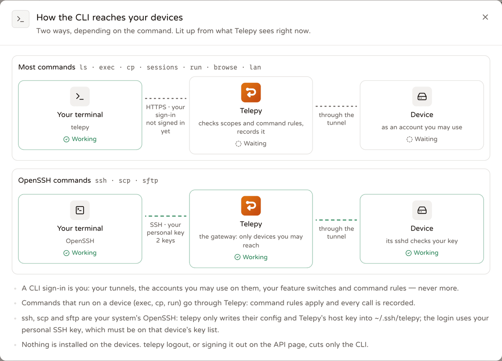
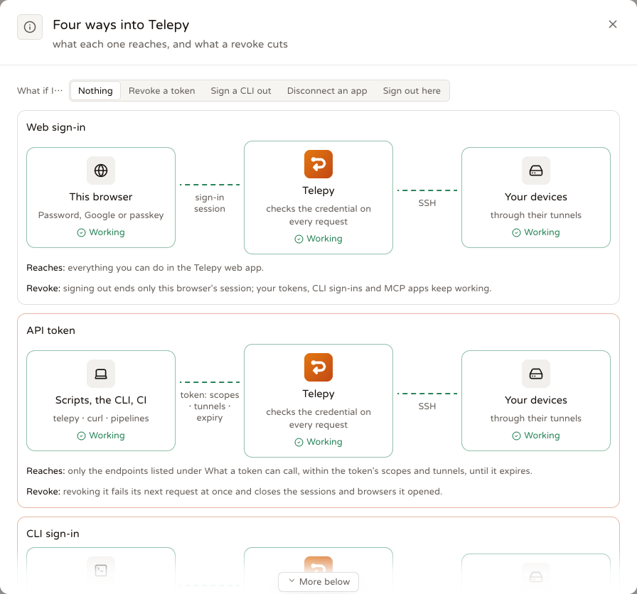

# The `telepy` command line and personal API tokens

<p align="center"><b>English</b> | <a href="./cli.zh-TW.md">繁體中文</a> | <a href="./cli.ja.md">日本語</a></p>

`telepy` is Telepy in your terminal. It lists your tunnels, takes `ssh`, `scp` and `sftp` straight to a device, runs a command on one device or on every device with a label, copies files, shows and ends live sessions, plays terminal recordings and runs toolbox snippets. It's for anyone who finds opening a web page a lot of ceremony for one `uptime`.

Scripts and CI use the same commands. Instead of a browser sign-in, they carry a **personal API token**.

Tokens and CLI sign-ins live on the **API** page in the web (sidebar **Developers → API**), which has four tabs:

- **CLI sign-ins**: every computer you ran `telepy login` on.
- **Your tokens**: create, check and revoke tokens.
- **What a token can call**: every endpoint, with a copy-ready `curl` and the matching `telepy` command.
- **Activity**: what your tokens and CLI sign-ins did.

## Install

The easy way is the **CLI** page in the web (sidebar **Developers → CLI**). It picks the install command for your computer from your browser, gives you the sign-in command for your server, and fills its examples with your own tunnels, accounts, labels, groups and snippets.

By hand, it goes like this. Every Telepy release from `v2.8.0` on carries the CLI for:

- macOS arm64 and x86_64
- Linux x86_64 and arm64 (static, musl)
- Windows x86_64

Each build comes from that release's tag and reports the same version (`telepy --version`). The file names carry no version, so `releases/latest/download/…` always gets the newest.

```sh
# macOS / Linux
TARGET=aarch64-apple-darwin   # x86_64-apple-darwin, x86_64-unknown-linux-musl, aarch64-unknown-linux-musl
curl -fsSL "https://github.com/NatLee/telepy/releases/latest/download/telepy-$TARGET.tar.gz" | tar xz telepy
sudo mkdir -p /usr/local/bin && sudo install -m 755 telepy /usr/local/bin/ && rm telepy
telepy --version
```

```powershell
# Windows: unpacks into %LOCALAPPDATA%\telepy and adds it to your PATH once
$dir = "$env:LOCALAPPDATA\telepy"
Invoke-WebRequest https://github.com/NatLee/telepy/releases/latest/download/telepy-x86_64-pc-windows-msvc.zip -OutFile "$env:TEMP\telepy.zip"
Expand-Archive "$env:TEMP\telepy.zip" $dir -Force
$p = [Environment]::GetEnvironmentVariable("Path", "User")
if (($p -split ";") -notcontains $dir) { [Environment]::SetEnvironmentVariable("Path", "$p;$dir", "User") }
$env:Path += ";$dir"
telepy --version
```

For a specific version, use `…/releases/download/v2.11.0/telepy-$TARGET.tar.gz` instead.

`ssh`, `scp` and `sftp` also need the system's OpenSSH client on your PATH. `telepy doctor` checks that for you.

### Check what you downloaded

Each archive has a `.sha256` next to it, and every release has a `SHA256SUMS`: `curl -fsSL …/telepy-$TARGET.tar.gz.sha256 | sha256sum -c` (on macOS, `shasum -a 256 -c`).

The binary carries no Apple or Microsoft signature. If you downloaded it with a browser instead of `curl`, macOS wants `xattr -d com.apple.quarantine telepy` before it will run it.

Two more checks prove that a release file really is Telepy's. Neither needs an account.

- **Build provenance**: every file of a release is attested by the build itself (GitHub artifact attestations). `gh attestation verify telepy-$TARGET.tar.gz --repo NatLee/telepy` names the commit and the workflow run that produced exactly these bytes.
- **The signed checksum list**: `SHA256SUMS` is signed with Telepy's release key, an OpenSSH ed25519 key whose public half is in [`src/backend-api/src/release_key.rs`](../src/backend-api/src/release_key.rs). The signature is `SHA256SUMS.sig`, in OpenSSH's signature format, so OpenSSH alone can check it:

  ```sh
  echo "telepy-release $(sed -n 's/^ *"\(ssh-ed25519 [^"]*\)".*/\1/p' release_key.rs | head -1)" > allowed_signers
  ssh-keygen -Y verify -f allowed_signers -I telepy-release -n telepy-release -s SHA256SUMS.sig < SHA256SUMS
  sha256sum -c --ignore-missing SHA256SUMS
  ```

  You can also paste the key line from that file by hand: `allowed_signers` is one line, `telepy-release <the key>`.

`telepy update` runs this check itself, and so does the Telepy server when it downloads its device helper from a release. Both refuse a release whose `SHA256SUMS` is missing or not signed with a Telepy release key. A mirror that re-signs releases with its own key can set `TELEPY_RELEASE_KEYS` (one or more public key lines, separated by newlines or `;`) to replace the built-in keys.

### Build it yourself

With Rust 1.88 or newer:

```sh
cargo install --locked --git https://github.com/NatLee/telepy telepy-cli
```

That build reports Cargo.toml's version, `0.1.0`. Set `TELEPY_VERSION` while building to stamp another one.

### Update

```sh
telepy update --check        # is a newer release out?
telepy update                # download it, check it against the release's signed SHA256SUMS and replace this telepy
telepy update --to v2.9.0    # a given release (also to go back)
```

What `telepy update` does:

1. Downloads this platform's archive from the release.
2. Refuses it when `SHA256SUMS` isn't signed with a Telepy release key, or the archive's SHA-256 doesn't match it.
3. Writes the new binary next to the old one, moves the old one aside and runs the new one's `--version`.
4. If that fails, puts the old one back.

It needs write access to the folder telepy is in (`sudo telepy update` for `/usr/local/bin`). A telepy installed with `cargo install` or Homebrew is left to those tools. On Windows the old `.exe` is renamed, because a running file can't be deleted, and cleaned up on the next run.

Release builds also look for a newer release on their own:

- at most once a day, in the background, with a two-second timeout;
- only when stderr is a terminal and `CI` is not set;
- when one is out, a single line after a successful command says so.

`TELEPY_NO_UPDATE_CHECK=1` turns that off. `TELEPY_RELEASES_URL` points both the check and `telepy update` at a mirror of `https://github.com/NatLee/telepy/releases`. The latest tag is read from the `/latest` redirect, so no GitHub API rate limit applies.

`telepy doctor` shows the version and whether a newer one is out (a warning, never a failure). A telepy you built yourself never checks on its own.

### Tab completion

`telepy completions` tells you which line to add to your shell's startup file. For zsh:

```sh
eval "$(telepy completions zsh)"     # in ~/.zshrc
```

| Shell | File | Line |
| --- | --- | --- |
| bash | `~/.bashrc` (macOS: `~/.bash_profile`) | `eval "$(telepy completions bash)"` |
| zsh | `~/.zshrc` | `eval "$(telepy completions zsh)"` |
| fish | `~/.config/fish/config.fish` | `telepy completions fish \| source` |
| PowerShell | `$PROFILE` | `telepy completions powershell \| Out-String \| Invoke-Expression` |
| elvish | `~/.config/elvish/rc.elv` | `eval (telepy completions elvish \| slurp)` |

Besides commands and flags, Tab completes your tunnel names, accounts (`box@` then Tab), `--label`, `--group`, toolbox snippets for `telepy run`, and the device side of `cp` / `scp` (`box:`). Each Tab asks telepy, which answers from a small cache in the config directory and refreshes it from the server at most every 30 seconds, waiting two seconds at most. An unreachable server costs one slow Tab; after that the cached names keep coming. Signing out deletes the cache. Tab completes names; which device you meant to reboot is still up to you.

Old shells: the bash line works in the bash 3.2 that macOS ships (`source <(…)` silently does nothing there, hence `eval`). If your `~/.zshrc` never loads zsh's completion system, the zsh line loads it. Plain `sh`, `dash` and BusyBox `ash` (OpenWrt) have no programmable completion, so there is nothing to add; Tab completes file names there as before. PowerShell needs 5.0 or later.

### Colours

In a terminal telepy colours a few things: tunnel health in `ls` and `status` (online green, degraded yellow, offline dimmed), the ✓ / ✗ / ! of `doctor`, each device's prefix and exit code when `exec` runs on several, HTTP status codes in `api activity`, and `--help`. It sticks to the 16 basic colours plus bold and dim, so it follows your terminal's own palette and old terminals understand it. What the device prints (the output of `exec`) is passed through untouched.

No colour when:

- the output goes to a pipe or a file (`telepy ls | grep …` gets plain text);
- `NO_COLOR` is set, or `CLICOLOR=0`;
- `TERM` is `dumb`, or not set at all (cron, some services);
- a Windows console can't switch to ANSI mode (before Windows 10): you get plain text instead of escape codes.

`--color always` (or `CLICOLOR_FORCE=1`) colours a pipe too, say for `less -R`, and `--color never` turns colour off for one run. The flag wins over the environment.

## Sign in

```sh
telepy login https://telepy.example.com                 # browser: OAuth + PKCE, loopback callback
telepy login https://telepy.example.com --scope "tunnels:read ssh:exec ssh:files network:scan"
telepy login https://telepy.example.com --no-browser    # print the sign-in URL instead of opening a browser
telepy login https://telepy.example.com --token tpt_…   # a personal API token (the API page → Your tokens); --with-token works too
telepy whoami                                           # who, and with which token / app, scopes, tunnels and expiry
telepy logout
```

Without `--scope`, the browser sign-in asks for `tunnels:read ssh:exec ssh:files`. See [Scopes](#scopes) for what each one allows.

After you approve, the browser lands on Telepy's "signed in" page. It shows what the CLI may do now and a few commands to try, and it follows the approval page's look from **Site settings → Sign-in**. An older Telepy server without that page gets a small page drawn by the CLI itself.

### CLI sign-ins are not MCP apps

The browser sign-in uses the same OAuth approval as MCP apps, which is why the approval page looks alike. The CLI is still not an MCP app:

- It is listed on the **API** page under **CLI sign-ins**, one per computer, and its calls show up in the API activity. It never appears among MCP apps.
- You sign it out there, or with `telepy logout`.
- Running `telepy login` again on the same computer offers to replace its earlier sign-in.
- Each person keeps at most 10 CLI sign-ins. An 11th signs out the one used least recently.
- Browser sign-in follows the **MCP apps** feature, which an admin can turn off (**Admin → Users & access → Feature permissions**). A token keeps working without it.

### Where the sign-in is kept

The CLI stores an access token and a refresh token:

- **macOS**: in the Keychain.
- **Windows**: in the Credential Manager.
- **Linux**, and anywhere with `TELEPY_NO_KEYRING=1` or a keyring that fails: in `credentials.json`, mode 0600, in the config directory. That is `TELEPY_CONFIG_DIR` when set, else `$XDG_CONFIG_HOME/telepy` or `~/.config/telepy` (Windows: `%APPDATA%\telepy`).

`telepy logout` forgets the sign-in and, for a browser sign-in, revokes it on the server. A token stays valid until you revoke it on the API page.

In CI there is nothing to store: see [In CI](#in-ci).

### Meet Tapi

In a terminal, `telepy login` and a clean `telepy doctor` show Tapi, Telepy's little ghost, next to the result. The text beside it wraps to the terminal's width. In a narrow terminal it moves below Tapi, and in a very narrow one Tapi is left out.

Tapi only haunts terminals: piped output never gets a ghost. `NO_COLOR` draws it without colour, and `TELEPY_NO_MASCOT=1` leaves it out for good.

## Everyday commands



A target is a tunnel, optionally with a device account: `box` uses the tunnel's default account, `box@pi` uses `pi` (`pi@box` works too). `telepy <command> --help` lists every option of a command and ends with its examples; `telepy examples` prints them by topic (`telepy examples forward`) or by command (`telepy examples lan wake`).

### Find your tunnels

```sh
telepy ls                                  # NAME  HEALTH  LATENCY  ACCOUNTS  LABELS  GROUP  SEEN
telepy ls --label env=prod --online --json
telepy ls --group "Lab"
telepy status box                          # health, uptime, device facts and warnings
```

### SSH, scp and sftp

```sh
telepy ssh box                             # the tunnel's default account
telepy ssh box@pi -- uname -a              # <tunnel>@<account> (pi@box works too)
telepy ssh box -N -L 8080:localhost:80     # forward a port, no shell (see Port forwarding)
telepy ssh box -i ~/.ssh/id_work           # a specific key for both hops
telepy ssh box --ssh-opt "-o ServerAliveInterval=30"   # any other ssh option (repeatable; scp / sftp take it too)
telepy scp ./build.tar.gz box@pi:/tmp/
telepy scp -r box@pi:/var/log/app ./logs
telepy sftp box@pi
telepy rsync -avz --progress ./site box@pi:~/site   # rsync's own options; telepy's (--identity, --ssh-opt, --via) go first
```

These run your system's OpenSSH and log in with **your personal SSH key**, through Telepy's gateway and the tunnel. It is the same path the web's **SSH config** dialog sets up.

`telepy rsync` hands your system's rsync that same ssh as its `-e`, so rsync has to be installed on the device too. rsync keeps its own `-i` (`--itemize-changes`), so the key option is `--identity` there, and an `-e` of your own is refused because it would go around Telepy.

Each run writes two files into `~/.ssh/telepy/` (move that folder with `TELEPY_SSH_DIR`):

- `<alias>.conf`: the generated config, whose ProxyCommand points back at that file;
- `known_hosts-<server>`: Telepy's gateway host key, pinned.

Then it starts OpenSSH with `-F`. Your own `~/.ssh/config` stays untouched.

### Your SSH key

`ssh`, `scp`, `sftp` and `forward` need a personal SSH key that Telepy knows and that the device accepts for that account. Before OpenSSH starts, telepy asks Telepy what happens to the keys this computer offers (the default key files, `-i`, and your ssh-agent), one hop at a time. When something is in the way, it says which hop and how to fix it, instead of leaving you with OpenSSH's `Permission denied (publickey)` and a `Connection closed by UNKNOWN port 65535` for good measure. In a terminal it offers to fix it on the spot:

- **Telepy doesn't know your key**: the web's Keys page opens with the key filled in, you confirm it there, and telepy waits until it shows up. No key on this computer yet? It makes one with `ssh-keygen` first.
- **The key isn't on the device**: telepy puts it on the device's key list for that account only, and waits until Telepy has installed it.
- **The tunnel asks for step-up**: the tunnel page opens and asks you to confirm it's you; telepy waits for that.

The same check and fixes are there on their own:

```sh
telepy keys                                # your keys in Telepy, and which of them this computer has
telepy keys add                            # add this computer's key (you confirm it in the browser)
telepy keys add ~/.ssh/id_work.pub --device box@pi   # a particular key, then put it on box for pi
telepy keys check box@pi                   # hop by hop: what would turn ssh away
telepy keys check box@pi --yes             # …and put your key on box's list for pi
```

```text
✓ this computer    offers 1 key(s): ~/.ssh/id_ed25519
✓ Telepy           knows your key "laptop"
✓ box              online
✗ pi@box           your key isn't in authorized_keys
```

**Why the browser for adding a key**: a key keeps working after the sign-in that added it is gone, so a token or a CLI sign-in may read your keys and place one you already added, but never add a new one. That stays one click in the web, next to the fingerprint telepy printed. Placing a key needs the `ssh:exec` scope, which the browser sign-in has: whoever can run commands as that account could add the key there themselves anyway.

Without a terminal telepy only explains. It stops before OpenSSH when ssh would certainly be refused, and connects anyway when it can't be sure (a key added to the device by hand, a key file it can't read). `--no-check` or `TELEPY_NO_KEY_CHECK=1` skips the check, for example for a hardware token Telepy can't see.

### Web port or SSH port

`telepy ssh`, `scp` and `sftp` reach Telepy through its **web port** by default. `telepy` itself is the ProxyCommand for the hop to Telepy and carries the SSH inside a WebSocket (`/ws/gateway/`; no python3 needed).

The SSH inside is the same: your key, the pinned host key, the device's own sshd. The difference is that Telepy now records your real address, which whatever sits in front of the SSH port (OrbStack's or Docker's port forwarding, a NAT) often hides.

The SSH hop sends a keepalive every 30 s, so a proxy in front of the web port (a CDN, a load balancer) doesn't close an idle session.

```sh
telepy ssh box --via ssh                   # straight to Telepy's SSH port instead of the web port
telepy config fallback always              # this server: use the SSH port without asking when the web port can't be reached
```

When the web port can't be reached, `telepy` uses the SSH port only with your consent:

| `--fallback` / `telepy config fallback` | What happens |
| --- | --- |
| `ask` (default) | Asks in the terminal: **y** this time, **a** always for this server (saved), **N** no. Without a terminal (CI, scripts) it doesn't fall back, and says how to allow it. |
| `always` | Uses the SSH port and says so on stderr. |
| `never` | Fails with the reason. |

The choice is saved per server in `<config dir>/prefs.json`, and `telepy config fallback` without a value shows it. `--fallback` or `TELEPY_SSH_FALLBACK` overrides it for one run. `--via ssh` or `TELEPY_SSH_VIA=ssh` skips the web port altogether. `telepy doctor` shows both.

### Your `~/.ssh/config`

To put Telepy's blocks into your own config, the way the web's SSH config dialog does:

```sh
telepy config install box nas              # the web dialog's install command, done for you (~/.ssh/config, marked blocks, backup)
telepy config install --all --print        # every tunnel you can use; print the blocks instead of writing (--file <path> writes elsewhere)
```

It keeps a `config.bak` and saves the host keys to `~/.ssh/telepy_known_hosts`. Like the web dialog, it leaves alone same-named devices that belong to another Telepy server. To have both, set a name prefix in the SSH config dialog ("Several Telepy servers on this computer?").

`config tidy` simplifies the config you already have:

```sh
telepy config tidy                         # simplify ~/.ssh/config: shows what changes + the diff, asks, keeps config.bak
telepy config tidy --check                 # report only; exit 1 when it could be simpler or has lines worth a look (dotfiles CI)
```

It needs no sign-in and never sends the file anywhere. It follows the rules of the web's **SSH config editor** (same engine, kept identical by shared test cases):

- Lines that several hosts share are written once, in a `Host a b c` block after them. A host that sets its own value keeps it.
- `HostName web1.example.com` under `Host web1` becomes `HostName %h.example.com`.
- Repeats that ssh never reads are dropped.

Every name in the file is then resolved again and must read exactly as before. Nothing is moved across `Match` or `Include`, and Telepy's own blocks keep their markers. It also lists lines that never take effect and options ssh doesn't know.

`--wildcards` allows `Host web-*` where no other name in the file would match. `--yes` writes without asking (a backup is still made). `--file <path>` simplifies another file.

### Run commands

```sh
telepy exec box -- systemctl is-active nginx
telepy exec --label env=prod -- uptime     # every tunnel with the label, in parallel, "name | " prefixes
telepy exec --group Lab -u root --timeout 300 -- apt-get -y upgrade   # a tunnel group of yours, one account, timeout ≤ 600 s
telepy exec box nas --json -- df -h /
telepy exec box --wait-approval -- sudo reboot   # keep waiting while a command rule holds it for approval
```

`exec` opens a short-lived session per tunnel through Telepy, runs the command and closes the session (`POST /api/ai/sessions`, then `POST /api/ai/sessions/{id}/exec`). These sessions are treated like an MCP agent's: the same cleanup, command rules and audit. The timeout is 60 s unless you say otherwise.

The commands show up on the **AI activity** page under the token's name, or under the CLI's app name after a browser sign-in.

### Copy files

```sh
telepy cp box@pi:/var/log/syslog ./syslog
telepy cp ./config.yml box@pi:/etc/app/
telepy cp box/admin@nas:/srv/backup/db.tgz .   # a machine behind the device
```

`cp` copies over SFTP through Telepy's API and needs the `ssh:files` scope. To reach a machine behind the device, write it after a slash: `<tunnel>[@account]/[login@]<host>:<path>`, the host by its label, address or id from `lan ls`. The device's sshd opens the hop and Telepy logs in there with its key; set `TELEPY_LAN_PASSWORD` to log in with a password instead (it's used once and never stored). Nothing is installed on either machine. `scp` is the OpenSSH way and needs your personal SSH key.

A download is written straight to disk (a device folder arrives as one zip). An upload goes in 8 MiB parts, so a proxy in front of Telepy with a request size limit (Cloudflare allows 100 MB) doesn't stop a big file, and a part that drops is sent again.

### Sessions, recordings and snippets

```sh
telepy sessions                            # live sessions on your tunnels
telepy sessions end 42
telepy recordings ls --tunnel box
telepy recordings play 17 --speed 2        # with its timing, pauses capped at 2 s (--idle-limit 0 keeps every pause)
telepy snippets ls --tunnel box
telepy run "restart service" box --var svc=nginx   # -y skips the "ask first" confirmation
```

Ending a session is not a revoke: the person can reconnect.

### LAN hosts

```sh
telepy lan ls box                          # the LAN hosts Telepy knows behind a device
telepy lan map box                         # the device's networks as a map of addresses (# host, G gateway, D the device, x not seen, . free)
telepy lan add box 192.168.1.20 --label nas --user pi --port 22
telepy lan rm box nas                      # by id, address or label
telepy lan scan box                        # scan its network (network:scan), wait, list with WHAT and NOTE columns
telepy lan show box 192.168.1.20           # what each port showed: page title, server, certificate, banner
telepy lan check box 192.168.1.20          # probe just that machine again now (network:scan)
telepy lan schedule box --every 6h         # rescan as you while the device is online (1h, 6h, 12h, 1d, 1w; off stops)
telepy lan watch box 192.168.1.20          # be told when a scan finds it gone, back or with other ports
telepy lan wake box 192.168.1.20           # send a Wake-on-LAN packet from the device (ssh:exec; needs the MAC from a scan)
telepy lan os box 192.168.1.20             # which OS it runs: ping TTL, SSH greeting, SMB name, nmap -O when the device can (network:scan)
telepy lan edit box nas --labels rack-2,prod --note "top shelf"   # labels and a note (tunnels:manage)
```

Listing and `show` need `tunnels:read`; `scan` needs `network:scan` (add it with `telepy login --scope`). Adding and removing need `tunnels:manage`, which only API tokens can carry.

By default a scan sends one `GET /` to every open web port (HTTPS ones also show their certificate) so it can tell a router from a NAS or a Proxmox host; those machines log it as an ordinary browser visit from the device (desktop Chrome, unless an admin sets another user agent under Site settings → Devices & network). Every other port is only listened to. `--no-identify` turns the GET off.

A scan also lists what the device itself listens on (one row, address `localhost`: services that only answer on the device's own loopback open from there too, and the silent ones get the same single `GET /`), marks the device's default gateway, and compares the result with the scan before. `lan scan` ends with a line such as `Since the previous scan: 1 new (192.168.1.40); 1 not seen (192.168.1.33); ports changed on 1 (192.168.1.20 +443 -80).`, and the table's NOTE column says `this device`, `gateway`, `new`, `+443 -80` or `not seen`. Only machines in the scanned networks are compared, and ports only where this scan probed them, so a shorter `--ports` list doesn't count as ports closing. `lan ls` starts with when the last scan ran, which networks and the gateway.

A **scheduled rescan** (`lan schedule`, or Repeat in the web app's scan dialog) runs the same scan as whoever set it, while the device is online; it stops by itself when that person loses owner / ADMIN. After a scan of the whole network, addresses the list didn't have are told to the owner and ADMIN sharees (not on a network's first scan). A **watched** host (`lan watch`, the bell in the web app) tells you when a scan or `lan check` finds it gone, back, or with ports opened or closed. Both are in-app notifications, desktop notifications, pushes and the webhook events `lan.new_hosts` / `lan.watched_host`, following your notification preferences. A scan of a single address, like `lan check`, tries every port on it instead of only the lowest one.

**Waking a machine**: a Wake-on-LAN packet only travels inside the device's own network, so `lan wake` (or Wake in the web app's host panel) has the device send it: it tries `wakeonlan`, `etherwake` / `ether-wake` (also with `sudo -n`) and `python3`, or PowerShell on a Windows device, and broadcasts to the host's network on UDP 9. The machine needs Wake-on-LAN turned on and its MAC address known (a scan reads it from the device's neighbour table while the machine is on). Anyone who can see the tunnel and has an account they may use there can wake its machines; each wake goes into the tunnel's Logs. **Labels and notes** (`lan edit`, or the host panel's Details tab) are yours to write; scans never change them, and the web app's search finds them (`label:rack-2`, or any word of a note).

### Port forwarding

```sh
telepy forward box 192.168.1.20:8080 --open   # a LAN web page: forwards the port to localhost, then opens your browser
telepy forward box@pi nas --open              # a host from `telepy lan ls`, by label; its first web port
telepy forward box localhost:3000 -l 13000    # the device's own port 3000 on localhost:13000
telepy ssh box -N -L 8080:localhost:80 -L 15432:localhost:5432   # several ports at once
telepy ssh box -N -D 1080                     # a SOCKS proxy: every address as the device sees it
telepy ssh box -N -R 9000:localhost:3000      # the other way: the device's localhost:9000 reaches your port 3000
```

| You want | Use | The connection goes |
| --- | --- | --- |
| One port of the device, or of a machine behind it | `telepy forward` | your computer → device → host |
| Several ports, or a shell as well | `telepy ssh -L` (`-N` = no shell) | your computer → device → host |
| Every address as the device sees it | `telepy ssh -D`, then your browser's SOCKS proxy | your computer → device → anywhere |
| The device calling something on your computer | `telepy ssh -R` | device → your computer |

`-L`, `-R` and `-D` take what ssh takes; Telepy only adds the route through the tunnel. With `-L`, `-D` and `forward` the device makes the connection to the host, so only the device has to reach it. `-R` listens on the device's localhost unless its sshd allows more (`GatewayPorts`). `telepy examples forward` prints these in the terminal, and the web's Command sheet builds them with your own ports.

`forward` writes the same ssh config as `telepy ssh`, runs `ssh -N -L 127.0.0.1:<local>:<host>:<port>` through the device, waits until the local port answers, prints the address and keeps forwarding until Ctrl+C. The local port is the same number (plus 10000 below 1024) or the next free one; `--local` picks it. Only this computer can use it: it listens on 127.0.0.1. It needs `tunnels:read` and your personal SSH key, like `telepy ssh`. In the web app, the Network page opens the same pages in Telepy's remote browser instead.

### A whole network (VPN)

```sh
telepy vpn box 192.168.1.0/24                          # every machine on that network, by its own address
telepy vpn box                                         # the device's own networks Telepy knows (yours left out)
telepy vpn box 192.168.1.0/24 --dns-domain corp.lan    # names under corp.lan too, found by the device
telepy vpn box 192.168.1.0/24 --dns-domain corp.lan --dns-server 192.168.1.1   # …or asked of the network's DNS server
telepy vpn box 192.168.1.0/24 --carrier                # ping and UDP too, through the Telepy carrier already on the device
```

`telepy vpn` makes the networks behind a device reachable from this computer until Ctrl+C: `ssh`, a browser, a database client or anything else that speaks TCP connects to `192.168.1.20` as if you were on that network. It adds a network device and routes on this computer, so it asks for your password through sudo (macOS and Linux).

**It leaves the device alone.** Nothing is installed, copied or run there: no shell, no script, no Python. Each connection is the same TCP forward the device's sshd already makes for `ssh -L` and `ssh -D`, so any sshd that allows TCP forwarding works (Dropbear on a router too), and the device's logs show one SSH login with forwards. sshuttle, the tool this resembles, runs a small Python program on the device; `telepy vpn` doesn't — unless you ask for `--carrier` (below), which starts Telepy's own carrier that is already there.

| | What happens |
| --- | --- |
| On this computer | a network device (`utun` / `tun`) and a route per network; with `--dns-domain` also `/etc/resolver/<domain>` (macOS) or that device's systemd-resolved settings (Linux). Ctrl+C removes them all. |
| In between | one SSH connection through Telepy (`ssh -D` on 127.0.0.1). If it drops, `telepy vpn` reconnects after 1, 2, 4… up to 30 seconds, and the network device stays up meanwhile. |
| On the device | its sshd opens each connection, as the account you logged in with; with `--carrier` also the carrier's `vpn-agent`, only while the VPN runs |
| Names (`--dns-domain`) | this computer answers a name under the domain with a stand-in address from 198.18.128.0/17; a connection to that address goes to the device by name, and the device's sshd looks the name up the device's own way (`/etc/hosts`, its DNS server…) |
| Names (`--dns-server`) | names under the domain are asked of that DNS server instead, over TCP through the device: real answers (every record type), and it works for a Mac device too |
| Connecting | the VPN connects from the device first and lets your program's connection through only once that worked, so a closed port answers "connection refused" at once instead of looking open |

Without networks on the command line, `telepy vpn` takes the device's own networks Telepy learned from it, and leaves out any this computer is on too (routing your own LAN away would cut it); name one to route it anyway. A network that contains the Telepy server itself is refused: the VPN would route its own connection into itself.

TCP goes through, and so does DNS: a lookup sent to any DNS server behind the device (UDP port 53) is carried to it as TCP, which every DNS server also speaks. Without `--carrier`, ping and other UDP don't go through, because SSH carries TCP only; they get "packet filtered" at once instead of a silent timeout, and `telepy vpn` says so the first time. Names outside `--dns-domain` stay local. On a Mac device `--dns-domain` needs `--dns-server` or `--carrier`: Apple's sshd ends the whole SSH connection when asked to reach a name, so use the network's DNS server, addresses (`telepy lan ls box` lists them) or this computer's `/etc/hosts`. An idle connection stays open as long as both ends keep it (an SSH session left alone for an hour is fine). Access follows the same rules as `telepy ssh`: you need `tunnels:read`, your personal SSH key and an account you may use on the device, and the device's sshd must allow TCP forwarding (`telepy vpn` tells you when it doesn't). Telepy shows you as an SSH session on the tunnel while it runs.

**Ping and UDP with `--carrier`.** Devices added the automatic or web-port way (and those using the built-in SSH client) already have Telepy's carrier in the login account's `~/.ssh`. With `--carrier`, `telepy vpn` opens a second SSH session and starts that carrier's `vpn-agent` there for as long as the VPN runs; it works only through that session's input and output, writes no files, needs no root, and ends with the session (Ctrl+C, a dropped connection, a killed `telepy`). It adds:

- **ping**, where the account may ping without root (Linux: `net.ipv4.ping_group_range`; macOS: always);
- **every kind of UDP** (NTP, SNMP, syslog, a LAN DNS server over UDP…), from the device's address;
- **names looked up by the device** for `--dns-domain`, also on a Mac device.

Nothing is installed for it: when the device has no carrier, or one from an earlier release, `telepy vpn` says so and carries TCP and DNS as before. A device gets a current carrier when its service is set up again (the tunnel page's How it connects tab). On this computer the engine reaches that session through a local port on 127.0.0.1 that only answers a one-time token kept in a file only you can read.

### A browser on the device's network

```sh
ID=$(telepy browse box http://192.168.1.1/)   # a browser on the device's network (browser:use); prints its id
telepy browse text "$ID" --selector main
telepy browse shot "$ID" -o router.png
telepy browse click "$ID" --text "Status"
telepy browse type "$ID" "#q" "uptime" --enter
telepy browse go "$ID" http://192.168.1.1/logs
telepy browse ls
telepy browse close "$ID"
```

`browse` drives a **scripted browser**: a real Chromium that browses as if it sat on the device. It sees the device's LAN, its localhost and its public IP, so it can reach a router's admin page, an intranet dashboard, or a site that only allows that IP or region.

- One action at a time, each limited to 30 s.
- Each browser is a full Chromium and counts against your per-person session limit (**AI Sessions per User** in Site settings). It suits scripted checks, screenshots and small scraping jobs. It is not a crawler, and the server would like to keep it that way.
- Browsers close themselves when idle.
- Every action is in the AI activity log. Typed text is logged by its length only, unless you add `--show`.
- Tunnels that ask for step-up refuse them.

## Command reference

Every command also takes `--server <url>` and `--token tpt_…` (or `TELEPY_URL` and `TELEPY_TOKEN`) to choose the server and the credential for that run, and `--color auto|always|never`.

<details>
<summary>Every command, what it does and the scope it needs</summary>

| Command | What it does | Scope |
| --- | --- | --- |
| `telepy login <url>` | Sign in through the browser; `--token` / `--with-token` signs in with a token, `--scope` and `--no-browser` as above | — |
| `telepy logout` | Forget the sign-in; a browser sign-in is also revoked on the server | — |
| `telepy whoami` | Who you are, with which token or app, scopes, tunnels and expiry | — |
| `telepy ls` | Tunnels with health, latency, accounts, labels and group; `--label`, `--group`, `--online`, `--json` | `tunnels:read` |
| `telepy status <tunnel>` | One tunnel: health, uptime, device facts and warnings | `tunnels:read` |
| `telepy ssh <target>` | SSH into the device; `-N`, `-L`, `-R`, `-D`, `-i`, `--ssh-opt`, `--via`, `--fallback`, a command after `--` | `tunnels:read` + your SSH key |
| `telepy scp [-r] <from>… <to>` | Copy with scp; the remote side is `<tunnel>[@account]:<path>` | `tunnels:read` + your SSH key |
| `telepy sftp <target>` | Open sftp to the device | `tunnels:read` + your SSH key |
| `telepy rsync [rsync options…] <from>… <to>` | Sync with rsync over the same ssh; `--identity`, `--ssh-opt`, `--via`, `--fallback` go before rsync's options | `tunnels:read` + your SSH key |
| `telepy forward <target> <host>[:port]` | Bring a port behind the device to this computer (`ssh -L`); `--open`, `--local`, `--https` | `tunnels:read` + your SSH key |
| `telepy vpn <target> [<network>…]` | Reach whole networks behind the device until Ctrl+C (TCP and DNS, names under `--dns-domain`, optionally from `--dns-server`; ping and UDP with `--carrier`); nothing runs on the device unless `--carrier`; reconnects by itself; asks for sudo | `tunnels:read` + your SSH key |
| `telepy config install` | Put Telepy's blocks into `~/.ssh/config`; tunnels or `--all`, `--print`, `--file` | `tunnels:read` |
| `telepy config fallback` | Show or set what to do when the web port can't be reached: `ask`, `always`, `never` | — |
| `telepy config tidy` | Simplify an ssh config; `--check`, `--wildcards`, `--yes`, `--file`; no sign-in needed | — |
| `telepy exec <targets> -- <command>` | Run a command on one or more devices; `--label`, `--group`, `-u`, `--timeout` (default 60, at most 600), `--wait-approval`, `--json` | `ssh:exec` |
| `telepy cp <from> <to>` | Copy a file to or from a device (or a machine behind it: `<tunnel>/[login@]<host>:<path>`) over SFTP | `ssh:files` |
| `telepy sessions` | Live sessions on your tunnels | `tunnels:read` |
| `telepy sessions end <id>` | End one live session | `tunnels:manage` |
| `telepy recordings ls` | List recordings, newest first; `--tunnel` | `ssh:exec` |
| `telepy recordings play <id>` | Play one in this terminal; `--speed` (default 1), `--idle-limit` (default 2 s) | `ssh:exec` |
| `telepy snippets ls` | Your snippets, the site's, and a tunnel's with `--tunnel` | `ssh:exec` |
| `telepy run <snippet> <target>` | Run a toolbox snippet; `--var name=value`, `-y`, `--timeout` | `ssh:exec` |
| `telepy lan ls <tunnel>` | The LAN hosts Telepy knows behind a device | `tunnels:read` |
| `telepy lan map <tunnel>` | The scanned networks as a 16 × 16 map per /24: hosts, the gateway, the device itself, machines not seen this time, free addresses (the web app's IP map) | `tunnels:read` |
| `telepy lan add <tunnel> <address>` | Add a host by hand; `--label`, `--user`, `--port` | `tunnels:manage` |
| `telepy lan scan <tunnel>` | Scan the device's network and list what was found, with what each machine is and what changed since the scan before; `--subnet`, `--ports`, `--no-identify`, `--account`, `--json` | `network:scan` |
| `telepy lan show <tunnel> <host>` | What one host is and what each port showed | `tunnels:read` |
| `telepy lan check <tunnel> <host>` | Probe one host again now: the ports it had open plus the defaults, that address only; `--ports`, `--json` | `network:scan` |
| `telepy lan schedule <tunnel>` | Show or set the scheduled rescan; `--every 1h\|6h\|12h\|1d\|1w\|off`, `--subnet`, `--ports`, `--no-identify`, `--account` | `tunnels:read` to show, `network:scan` to set |
| `telepy lan watch <tunnel> <host>` | Be told when scans find it gone, back or with other ports; `--off` | `tunnels:manage` |
| `telepy lan wake <tunnel> <host>` | Send a Wake-on-LAN packet from the device (wakeonlan, etherwake or python3 on it); `--account` | `ssh:exec` |
| `telepy lan os <tunnel> <host>` | Which OS one host runs, on request only: a ping from the device, its SSH greeting, its SMB's Windows build (no login), `nmap -O` when the device has nmap and root; prints the guess and every clue; `--smb-port`, `--account`, `--json` | `network:scan` |
| `telepy lan edit <tunnel> <host>` | Change the name, login, SSH port, labels (`--labels a,b`) or note (`--note`); an empty value clears it | `tunnels:manage` |
| `telepy lan rm <tunnel> <host>` | Remove a host by id, address or label | `tunnels:manage` |
| `telepy browse <target> [url]` | Open a scripted browser and print its id (same as `browse open`) | `browser:use` |
| `telepy browse ls` / `go` / `text` / `shot` / `click` / `type` / `close` | List the browsers this sign-in has open, or act on one by its id | `browser:use` |
| `telepy api tokens` | Your tokens with their call summary | — |
| `telepy api activity` | Calls made with your tokens and CLI sign-ins (see [The call log](#the-call-log)) | — |
| `telepy keys` | Your SSH keys in Telepy and which of them this computer has; `--json` | — |
| `telepy keys add [file]` | Add this computer's key: the Keys page opens with it filled in and you confirm it there; `--name`, `--device <target>` | — |
| `telepy keys check <target>` | Hop by hop, whether `telepy ssh` gets in; `--yes` puts your key on the device's list for that account, `--json` | `tunnels:read` (`--yes`: `ssh:exec`) |
| `telepy doctor` | Check the server, the sign-in, scopes, expiry, the local ssh tools and the version | — |
| `telepy update` | Update telepy; `--check`, `--to <version>` | — |
| `telepy completions [shell]` | Print the Tab completion script for bash, zsh, fish, powershell or elvish; without a shell, which line to add where | — |
| `telepy examples [topic\|command]` | Examples by topic (`forward`, `network`…) or by command (`lan wake`); without one, the topics. No sign-in needed | — |

</details>

### Exit codes

- `exec` and `run` on a single target exit with the remote command's code. It is 124 when the command timed out and was killed, and 255 when Telepy refused it or couldn't run it.
- With several targets, `exec` exits 1 when any of them failed.
- `ssh`, `scp` and `sftp` exit with OpenSSH's code, or 1 when the key check stopped them before OpenSSH started (the reason is printed).
- Any other error from Telepy exits 1 and prints the server's message.

## Tokens and scopes

### Four ways in, four keys



```
 this browser ───────────────── web sign-in session ─────────────────────┐
                                                                         │
 scripts / CI ───────────────── API token (scopes · tunnels · expiry) ───┤
                                                                         │
 telepy on your computer ────── CLI sign-in (OAuth, one per computer) ───├──▶ Telepy ──── SSH through the tunnel ───▶ your devices
                                                                         │
 an MCP app ─────────────────── OAuth grant (you approved this app) ─────┘

 Revoke the API token:
 scripts / CI ─────────────✂── (refused at once; its open exec sessions close)
 this browser, CLI sign-ins, MCP apps ── keep working
```

The live version of this picture is behind the **Four ways in** button on the API page. Its **What if I…** switch shows that revoking a token, signing a CLI out, disconnecting an app or signing out of the web each cuts only its own lane. Each token has its own version under **Your tokens → How it works**.

### What a token can and can't do

- **A token is you.** Your tunnels, the accounts you may use on them, the feature switches an admin set for you and command rules all apply. It never gets more than you have.
- **It can't manage your account.** It can't sign in to the web, change your password or two-step settings, or create more tokens. Only the REST routes on an allow-list are open to it, each needing one scope. The **What a token can call** tab is built from that same list (`GET /api/auth/tokens/routes`), so it can't disagree with the server.
- **It can't add SSH keys.** It can read your key list and put a key you already added on a device's list (with `ssh:exec`), but adding a key happens in the web: `telepy keys add` opens it for you.
- **Step-up tunnels refuse it.** Tunnels that ask you to confirm it's you refuse tokens, exactly like MCP agents.
- **It expires.** Every token expires, at most a year after it was created. Revoking takes effect at once.
- **Admins can switch it off.** Admins can turn the **API tokens** feature off for everyone, a role or one person (**Admin → Users & access → Feature permissions**), and that person's tokens stop working. Other features turned off for you (web terminal, file manager, …) are refused to your tokens too, with 403 `feature_disabled`.
- **A disabled account suspends it.** If an admin disables your account, your tokens and CLI sign-ins are suspended, not revoked. They are refused while the account is off and work again once it is enabled.

### Scopes

| Scope | Lets the token | CLI commands |
| --- | --- | --- |
| `tunnels:read` | list tunnels, status, uptime, accounts, the generated ssh config, live sessions | `ls`, `status`, `ssh`, `scp`, `sftp`, `config install`, `sessions`, `lan ls` |
| `ssh:exec` | open exec sessions and run commands (command rules apply), read recordings and snippets | `exec`, `run`, `recordings`, `snippets` |
| `ssh:files` | every SFTP operation | `cp` |
| `network:scan` | LAN scans (MCP `lan_scan`, the scan REST route) | — |
| `browser:use` | scripted browsers through a device: the MCP browser tools and `/api/browser/sessions*` | `browse` |
| `tunnels:manage` | create / change / delete / share tunnels, labels, LAN hosts, end sessions (tokens only) | `sessions end`, `lan add` / `rm` |

`tunnels:read` covers the LAN hosts behind a device too (`telepy lan ls`, `GET /api/reverse/lan/topology`).

`ssh`, `scp` and `sftp` only need `tunnels:read`. Telepy hands over the ssh config, and from there your system's OpenSSH logs in with your personal SSH key through the gateway.

## Scripts, CI and other clients

### In CI

Create a token on the API page (**Your tokens → New token**) with the scopes the job needs. Then set two variables instead of signing in:

```sh
export TELEPY_URL=https://telepy.example.com
export TELEPY_TOKEN=tpt_…
telepy exec --label env=prod -- uptime
```

`--server` and `--token` do the same per command. Nothing is stored on the runner, and with `CI` set the CLI doesn't look for updates.

### With curl

```sh
curl -H "Authorization: Bearer $TELEPY_TOKEN" https://telepy.example.com/api/reverse/server/dashboard
```

The **What a token can call** tab gives a `curl` for every endpoint, with the base URL filled in and the secret as `$TELEPY_TOKEN`. Export it once: the page never shows a real secret again. Path variables are shell variables too (`$TUNNEL_ID`, `$ID`, `$HOST_ID`).

### In an MCP client

```json
{ "mcpServers": { "telepy": { "url": "https://telepy.example.com/mcp", "headers": { "Authorization": "Bearer tpt_…" } } } }
```

On `/mcp` a token works like an OAuth app's token, with the same tools, scopes and tunnel limit. That holds as long as both the **API tokens** and the **MCP apps** features are on for you. See [mcp.md](mcp.md) for the tools.

## The call log

Every REST request made with a personal API token or with the CLI's browser sign-in is logged, reads included. So is every MCP tool call made with a personal token; the tool calls of MCP apps are already in the AI activity log.

Refused requests are logged as well: `token_route`, `token_scope`, and `404` for tunnels outside the token's list.

Each row holds the time, the person, the token or app, the method and **route template** (never the query string), the tunnel, status, duration and IP. MCP rows read `MCP <tool>`, with status 200, or 400 plus the start of the error when the tool returned one.

### In the web

- **API → Activity** shows your own calls, day by day. Filter by token or CLI sign-in (the **Calls** button on either jumps here), by status (OK / 4xx / 5xx), by method, or search.
- **Your tokens** shows each token's calls in the last 24 h and 7 days, its errors and its total. The total (`call_count`) keeps counting after old log rows are gone.
- Admins see everyone's calls in the admin section under **Site activity → API activity**, with a filter by person. The Manage-user dialog links there.

Scripts can read the same list: `GET /api/auth/tokens/calls?scope=mine|all&token_id=&grant_id=&user_id=&username=&status=&method=&limit=&before=`.

### In the terminal

```sh
telepy api tokens                          # your tokens: scopes, expiry, last use, calls 24 h / 7 d, errors
telepy api activity                        # the last 50 calls made with your tokens and CLI sign-ins
telepy api activity --api-token ci --status 4xx --since 2h
telepy api activity --method DELETE --limit 200 --json
telepy api activity --follow               # like tail -f: new calls every 2 s, Ctrl+C stops
telepy api activity --all --user bob       # admins: everyone's, or one person's
```

`telepy api activity` prints the list newest first: the time in your local zone, token or app, method, route, tunnel, status, duration and IP. Its filters:

- `--api-token <name|id|prefix>`: one token's calls. The global `--token` is already the sign-in override, hence the different name.
- `--status ok|4xx|5xx|error` and `--method GET…|MCP`.
- `--since 30m|2h|7d|<RFC 3339>`.
- `--limit N`: 50 by default, at most 1000. Older pages are fetched with `before`.
- `--all` / `--user <name|id>`: the admin view. Anyone else gets "Only admins can see other people's API activity".
- `--follow`: prints the recent calls oldest first, then each new one as it arrives (every 2 s; with `--json`, one object per line). Its own polling is left out, so it doesn't spend the afternoon watching itself.

`telepy api tokens` lists your tokens with the same per-token summary. Tokens and the CLI's browser sign-in may read these two endpoints (`GET /api/auth/tokens`, `GET /api/auth/tokens/calls`) without any extra scope. Creating and revoking tokens stays in the web.

### What else is recorded, and for how long

- Writes made with a token (sharing, labels, LAN hosts, ending sessions…) also leave a `token_call` entry in the tunnel's **Logs**.
- Log rows are written in batches in the background. If the queue is full, calls are dropped and counted; requests never wait.
- Rows are kept for 90 days, 200,000 rows at most, and go with a deleted user.
- The call log is not hash-chained: it is high-volume, and deleting one person's rows would break a chain. The `token_call` events in **Logs** are chained.

## Environment variables

| Variable | What it does |
| --- | --- |
| `TELEPY_URL` | The Telepy server, like `--server` |
| `TELEPY_TOKEN` | A personal API token, like `--token`; for CI |
| `TELEPY_CONFIG_DIR` | The config directory (default `$XDG_CONFIG_HOME/telepy` or `~/.config/telepy`; Windows `%APPDATA%\telepy`) |
| `TELEPY_NO_KEYRING=1` | Keep the sign-in in `credentials.json` instead of the system keyring |
| `TELEPY_SSH_DIR` | Where `ssh` / `scp` / `sftp` write their config and known_hosts (default `~/.ssh/telepy`) |
| `TELEPY_SSH_VIA=ssh` | Go straight to Telepy's SSH port, like `--via ssh` |
| `TELEPY_SSH_FALLBACK` | `ask`, `always` or `never` for this run, like `--fallback` |
| `TELEPY_NO_UPDATE_CHECK=1` | No daily look for a newer release |
| `TELEPY_NO_KEY_CHECK=1` | Skip the key check before `ssh` / `scp` / `sftp` / `forward`, like `--no-check` |
| `TELEPY_RELEASES_URL` | A mirror of the releases page, for the update check and `telepy update` |
| `TELEPY_RELEASE_KEYS` | Release public keys to trust instead of the built-in ones (for a re-signing mirror) |
| `TELEPY_NO_MASCOT=1` | No Tapi next to `login` and `doctor` |
| `NO_COLOR` | No colour, Tapi included (`--color` wins over it) |
| `CLICOLOR=0` | No colour either |
| `CLICOLOR_FORCE=1` | Colour even into a pipe or a file, like `--color always` |
| `CI` | When set, no update check |
| `TELEPY_VERSION` | At build time: the version to stamp into the binary |

## Troubleshooting

Start with `telepy doctor`:

```sh
telepy doctor                              # server, sign-in, scopes, expiry, ssh / scp / sftp
```

It checks the server, your sign-in, its scopes and expiry, the local `ssh` / `scp` / `sftp`, the port settings, and whether a newer telepy is out.

- **macOS won't open the binary.** That happens after a browser download. Run `xattr -d com.apple.quarantine telepy` once.
- **`ssh`, `scp` or `sftp` can't start.** They need the system's OpenSSH client on your PATH.
- **`Permission denied (publickey)`.** Run `telepy keys check <tunnel>[@account]`: it says which hop turns the key away (Telepy doesn't know it, it expired, it isn't on the device for that account, step-up…) and fixes what it can with `--yes`. `telepy ssh` runs the same check first. In the web, the tunnel's **SSH config** dialog shows the same thing ("Make sure your key gets you in").
- **The web port can't be reached.** In a terminal, telepy asks before it uses the SSH port. Without a terminal it doesn't fall back: allow it with `--fallback always`, `TELEPY_SSH_FALLBACK=always` or `telepy config fallback always`, or go straight to the SSH port with `--via ssh`.
- **403 `token_scope`.** The token lacks the scope this command needs (see [Scopes](#scopes)). Create a token that has it, or sign in again with `--scope`.
- **403 `token_route`.** That endpoint isn't open to tokens at all: your account, two-step settings and the tokens themselves are managed in the web only.
- **404 for a tunnel you can see in the web.** The token is limited to other tunnels.
- **403 `feature_disabled`.** An admin turned that feature off for you, and your tokens get the same answer as the web.
- **A tunnel refuses your token or `browse`.** It asks for step-up. Tokens and scripted browsers can't confirm it's you, so use the web for that tunnel.
- **Everything is refused after your account was disabled.** Tokens and CLI sign-ins are suspended, not revoked. They work again once an admin enables the account.
- **`exec` stops at a command rule.** A rule holds the command for approval. Add `--wait-approval` to keep waiting (up to 10 minutes).
- **`telepy update` can't replace the binary.** It needs write access to telepy's folder (`sudo telepy update` for `/usr/local/bin`). Installed with `cargo install` or Homebrew? Update with those.
- **"Only admins can see other people's API activity."** Leave out `--all` / `--user` to see your own.

## For maintainers: release builds

<details>
<summary>How a GitHub release builds, signs and attaches the CLI</summary>

Publishing a GitHub release (`gh release create v2.7.0 …`) runs `.github/workflows/release-cli.yml`:

1. The five targets are built from that tag, with `TELEPY_VERSION` set to the tag without its `v`.
2. Each build is smoke-tested: `telepy --version` must print that version.
3. The files are attested and attached to the release with their `.sha256` files.
4. A `SHA256SUMS` is added, signed with the `RELEASE_SIGNING_KEY` secret (an OpenSSH ed25519 private key). Without that secret the release job fails.

You can also run the workflow by hand from the Actions tab. With a tag, it (re)attaches the files to that existing release. Without one, it is a trial build whose files stay as the run's artifacts.

A tag from before version stamping, such as `v2.8.0`, can be given builds the same way; its CLI reports Cargo.toml's `0.1.0`. Every Telepy release from `v2.8.0` on carries the CLI built from it, and there are no separate CLI tags.

</details>
