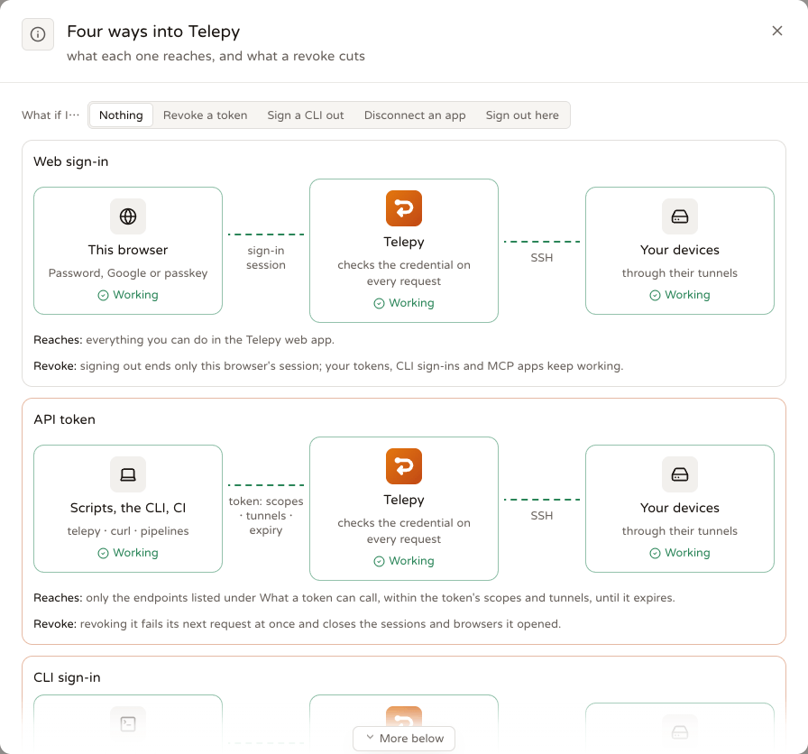
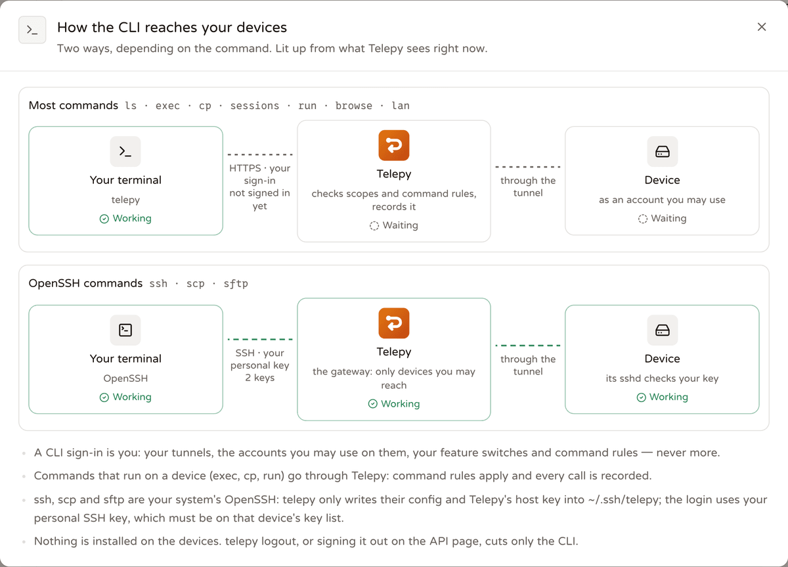

# The `telepy` command line and personal API tokens

<p align="center"><b>English</b> | <a href="./cli.zh-TW.md">繁體中文</a> | <a href="./cli.ja.md">日本語</a></p>

`telepy` is Telepy from your terminal: list tunnels, `ssh` / `scp` / `sftp` straight into a device, run a command
on one device or on every device with a label, copy files, see and end live sessions, play terminal recordings and
run toolbox snippets. Scripts and CI use the same commands with a **personal API token** instead of a browser sign-in.

Source: `src/cli/` (a crate of its own; the server build does not depend on it). Backend: `auth/api_tokens.rs`,
`api/api_tokens.rs`, `db/api_tokens.rs`, `db/api_calls.rs` + `api_calls.rs` (the call log), the REST exec routes in
`api/ai.rs`, the scripted-browser routes in `api/browser.rs`.

Tokens are managed on the **API** page (`/tunnels/api`, sidebar "Developers" → API), in four tabs: **CLI sign-ins** (every
computer you ran `telepy login` on), **Your tokens**, **What a token can call** (every endpoint, with copy-ready `curl` and
the matching `telepy` command) and **Activity** (what your tokens and CLI sign-ins did).

## Four ways in, four keys



```
 this browser ───────────────── web sign-in session ─────────────────────┐
                                                                         │
 scripts / CI ───────────────── API token (scopes · tunnels · expiry) ───┤
                                                                         │
 telepy on your computer ────── CLI sign-in (OAuth, one per computer) ───├──▶ Telepy ──── SSH through the tunnel ───▶ your devices
                                                                         │
 an MCP app ─────────────────── OAuth grant (you approved this app) ─────┘

 Revoke the API token:
 scripts / CI ─────────────✂── (refused at once; its open exec sessions close)
 this browser, CLI sign-ins, MCP apps ── keep working
```

The same picture, live, is behind the **API** page's **Four ways in** button (with a "What if I…" switch: revoking a
token, signing a CLI out, disconnecting an app or signing out of the web each cuts only its own lane), and per token
behind **Your tokens → How it works**.

- A token **is you**: your tunnels, the accounts you may use on them, the feature switches an admin set for you and
  command rules all apply. It never gets more than you have.
- It can't sign in to the web, change your password or two-step settings, or create more tokens: only the REST routes
  in the allow-list `auth::api_tokens::ROUTES` are open to it, each needing one scope. The API page's **What a token
  can call** tab is built from that same table (`GET /api/auth/tokens/routes`), so it can't disagree with the server.
- Tunnels that ask you to confirm it's you (**step-up**) refuse tokens, exactly like MCP agents.
- Every token expires (at most a year). Revoking takes effect at once.
- Admins can turn the **API tokens** feature off for everyone, a user group or one person (Admin → Users & access →
  Feature permissions, `/tunnels/admin/access`): that person's tokens then stop working. Other features they turn off
  for you (web terminal, file manager, …) are refused to your tokens too (403 `feature_disabled`).
- If an admin disables your account, your tokens and CLI sign-ins are suspended, not revoked: they are refused
  while the account is off and work again once it is enabled.

## Scopes

| Scope | Lets the token | CLI commands |
| --- | --- | --- |
| `tunnels:read` | list tunnels, status, uptime, accounts, the generated ssh config, live sessions | `ls`, `status`, `ssh`, `scp`, `sftp`, `config install`, `sessions`, `lan ls` |
| `ssh:exec` | open exec sessions and run commands (command rules apply), read recordings and snippets | `exec`, `run`, `recordings`, `snippets` |
| `ssh:files` | every SFTP operation | `cp` |
| `network:scan` | LAN scans (MCP `lan_scan`, the scan REST route) | — |
| `browser:use` | scripted browsers through a device: the MCP browser tools and `/api/browser/sessions*` | `browse` |
| `tunnels:manage` | create / change / delete / share tunnels, labels, LAN hosts, end sessions (tokens only) | `sessions end`, `lan add` / `rm` |

`tunnels:read` also lists the LAN hosts behind a device (`telepy lan ls`, `GET /api/reverse/lan/topology`).

`ssh` / `scp` / `sftp` only need `tunnels:read`: they fetch the ssh config and then your system OpenSSH logs in
with **your personal SSH key** through the gateway, as the web's SSH config dialog does.

## Install

The web has a **CLI** page (`/tunnels/cli`, sidebar "Developers" → CLI) with the install command for your computer
(picked from the browser), the sign-in command for your server, and examples filled in with your own tunnels,
accounts, labels, groups and snippets. The same commands by hand:

Every Telepy release from `v2.8.0` on carries the CLI for macOS arm64 / x86_64, Linux x86_64 / arm64 (static, musl) and
Windows x86_64, built from the same tag and reporting the same version (`telepy --version`). The file names carry
no version, so `releases/latest/download/…` is always the newest:

```sh
# macOS / Linux
TARGET=aarch64-apple-darwin   # x86_64-apple-darwin, x86_64-unknown-linux-musl, aarch64-unknown-linux-musl
curl -fsSL "https://github.com/NatLee/telepy/releases/latest/download/telepy-$TARGET.tar.gz" | tar xz telepy
sudo mkdir -p /usr/local/bin && sudo install -m 755 telepy /usr/local/bin/ && rm telepy
telepy --version
```

```powershell
# Windows: unpacks into %LOCALAPPDATA%\telepy and adds it to your PATH once
$dir = "$env:LOCALAPPDATA\telepy"
Invoke-WebRequest https://github.com/NatLee/telepy/releases/latest/download/telepy-x86_64-pc-windows-msvc.zip -OutFile "$env:TEMP\telepy.zip"
Expand-Archive "$env:TEMP\telepy.zip" $dir -Force
$p = [Environment]::GetEnvironmentVariable("Path", "User")
if (($p -split ";") -notcontains $dir) { [Environment]::SetEnvironmentVariable("Path", "$p;$dir", "User") }
$env:Path += ";$dir"
telepy --version
```

Each archive has a `.sha256` next to it, and every release a `SHA256SUMS`
(`curl -fsSL …/telepy-$TARGET.tar.gz.sha256 | sha256sum -c`; `shasum -a 256 -c` on macOS). A specific version:
`…/releases/download/v2.11.0/telepy-$TARGET.tar.gz`. The binary carries no Apple or Microsoft signature: downloaded
with a browser instead of `curl`, macOS needs `xattr -d com.apple.quarantine telepy` first.

### Checking where a download came from

Two things prove a release file is Telepy's, both without any account:

- **Build provenance.** Every file of a release is attested by the build itself (GitHub artifact attestations):
  `gh attestation verify telepy-$TARGET.tar.gz --repo NatLee/telepy` says which commit and which workflow run produced
  exactly these bytes.
- **The signed checksum list.** `SHA256SUMS` is signed with Telepy's release key (an OpenSSH ed25519 key; the public
  half is in [`src/backend-api/src/release_key.rs`](../src/backend-api/src/release_key.rs)) as `SHA256SUMS.sig`, in
  OpenSSH's signature format. To check it with nothing but OpenSSH:

  ```sh
  echo "telepy-release $(sed -n 's/^ *"\(ssh-ed25519 [^"]*\)".*/\1/p' release_key.rs | head -1)" > allowed_signers
  ssh-keygen -Y verify -f allowed_signers -I telepy-release -n telepy-release -s SHA256SUMS.sig < SHA256SUMS
  sha256sum -c --ignore-missing SHA256SUMS
  ```

  (Or paste the key line from the file by hand; `allowed_signers` is one line: `telepy-release <the key>`.)

`telepy update` and the backend's carrier fetch do this check themselves and refuse a release whose `SHA256SUMS` is
missing or not signed with a Telepy release key. `TELEPY_RELEASE_KEYS` (one or more public key lines, separated by
newlines or `;`) replaces the built-in keys for a mirror that re-signs releases with its own key.

Or build it yourself (Rust 1.88 or newer): `cargo install --locked --git https://github.com/NatLee/telepy telepy-cli`
(reports Cargo.toml's `0.1.0`; set `TELEPY_VERSION` while building to stamp another). `ssh`, `scp` and `sftp` also
need the system OpenSSH client on your PATH (`telepy doctor` checks).

**Maintainers:** publishing a GitHub release (`gh release create v2.7.0 …`) runs `.github/workflows/release-cli.yml`:
the five targets are built from that tag with `TELEPY_VERSION` = the tag without its `v`, smoke-tested
(`telepy --version` must print it), attested, and attached to the release with their `.sha256` files and a `SHA256SUMS`
signed with the `RELEASE_SIGNING_KEY` secret (an OpenSSH ed25519 private key; without it the release job fails). Run it
by hand from the Actions tab with a tag to (re)attach to an existing release, or without one for a trial build whose
files stay as the run's artifacts. A tag from before version stamping (such as `v2.8.0`) can be given builds the same way; its
CLI reports Cargo.toml's `0.1.0`. Every Telepy release from `v2.8.0` on carries the CLI built from it; there are no
separate CLI tags.

### Updating

```sh
telepy update --check        # is a newer release out?
telepy update                # download it, check it against the release's signed SHA256SUMS and replace this telepy
telepy update --to v2.9.0    # a given release (also to go back)
```

`telepy update` downloads this platform's archive from the release, refuses it when `SHA256SUMS` is not signed with a
Telepy release key or the archive's SHA-256 doesn't match it, writes the new binary next to the old one, moves the old one aside, and runs the new one's `--version`;
if that fails, the old one is put back. It needs write access to the folder telepy is in (`sudo telepy update` for
`/usr/local/bin`); a telepy installed with `cargo install` or Homebrew is left to those tools. On Windows the old
`.exe` is renamed (a running file can't be deleted) and cleaned up on the next run.

Release builds also look for a newer release on their own: at most once a day, in the background with a two-second
timeout, and only when stderr is a terminal and `CI` is not set. When there is one, a single line after a successful
command says so. `TELEPY_NO_UPDATE_CHECK=1` turns that off; `TELEPY_RELEASES_URL` points both at a mirror of
`https://github.com/NatLee/telepy/releases` (the latest tag is read from the `/latest` redirect, so no GitHub API
rate limit applies). `telepy doctor` prints the version and whether a newer one is out (a warning, never a failure).
A locally built telepy (version from Cargo.toml) never checks on its own.

## Sign in

```sh
telepy login https://telepy.example.com                 # browser: OAuth + PKCE, loopback callback
telepy login https://telepy.example.com --scope "tunnels:read ssh:exec ssh:files network:scan"
telepy login https://telepy.example.com --no-browser    # print the sign-in URL instead of opening a browser
telepy login https://telepy.example.com --token tpt_…   # a personal API token (the API page → Your tokens); --with-token works too
telepy whoami                                           # who, and with which token / app, scopes, tunnels and expiry
telepy logout
```

After you approve, the browser lands on Telepy's "signed in" page (`/oauth/done`: what the CLI may do now and a few
commands to try; it follows the approval page's look from Site settings → Sign-in). An older Telepy server without
that page gets a small page drawn by the CLI itself.

The browser sign-in uses the same OAuth approval as MCP apps — that is why the approval page looks alike — but the
CLI is not an MCP app: it is listed on the **API page → CLI sign-ins** (one per computer, with its calls in the API
activity), never among MCP apps, and you sign it out there or with `telepy logout`. Running `telepy login` again on
the same computer offers to replace its earlier sign-in, and at most 10 CLI sign-ins are kept per person: an 11th
signs out the least recently used one. Browser sign-in follows the **MCP apps** feature an admin can turn off (Admin →
Users & access → Feature permissions); a token keeps working without it. The CLI stores the access + refresh tokens. Credentials live in
the macOS Keychain or the Windows Credential Manager; on Linux (and with `TELEPY_NO_KEYRING=1`, or when the keyring
fails) in `credentials.json` with mode 0600 in the config directory (`TELEPY_CONFIG_DIR`, else
`$XDG_CONFIG_HOME/telepy` or `~/.config/telepy`; Windows `%APPDATA%\telepy`). `logout` forgets the sign-in and
revokes a browser sign-in on the server; a token stays valid until you revoke it on the API page.

In CI there is nothing to store: set `TELEPY_URL` and `TELEPY_TOKEN` (or pass `--server` / `--token`).

In a terminal, `telepy login` and a clean `telepy doctor` show Tapi, Telepy's little ghost, next to the result (never when the
output is piped; `NO_COLOR` draws it without colour). The text beside it is wrapped to the terminal's width; in a narrow
terminal it goes below Tapi, and in a very narrow one Tapi is left out. Set `TELEPY_NO_MASCOT=1` to leave it out.

## Commands



```sh
telepy ls                                  # NAME  HEALTH  LATENCY  ACCOUNTS  LABELS  GROUP  SEEN
telepy ls --label env=prod --online --json
telepy ls --group "Lab"
telepy status box                          # health, uptime, device facts and warnings

telepy ssh box                             # the tunnel's default account
telepy ssh box@pi -- uname -a              # <tunnel>@<account> (pi@box works too)
telepy ssh box -L 8080:localhost:80        # forward a port; -D 1080 for SOCKS
telepy ssh box -i ~/.ssh/id_work           # a specific key for both hops
telepy ssh box --ssh-opt "-o ServerAliveInterval=30"   # any other ssh option (repeatable; scp / sftp take it too)
telepy ssh box --via ssh                   # straight to Telepy's SSH port instead of the web port (see "Which port" below)
telepy config fallback always              # this server: use the SSH port without asking when the web port can't be reached
telepy scp ./build.tar.gz box@pi:/tmp/
telepy scp -r box@pi:/var/log/app ./logs
telepy sftp box@pi
telepy config install box nas              # the web dialog's install command, done for you (~/.ssh/config, marked blocks, backup)
telepy config install --all --print        # every tunnel you can use; print the blocks instead of writing (--file <path> writes elsewhere)
telepy config tidy                         # simplify ~/.ssh/config: shows what changes + the diff, asks, keeps config.bak
telepy config tidy --check                 # report only; exit 1 when it could be simpler or has lines worth a look (dotfiles CI)

telepy exec box -- systemctl is-active nginx
telepy exec --label env=prod -- uptime     # every tunnel with the label, in parallel, "name | " prefixes
telepy exec --group Lab -u root --timeout 300 -- apt-get -y upgrade   # a tunnel group of yours, one account, timeout ≤ 600 s
telepy exec box nas --json -- df -h /
telepy exec box --wait-approval -- sudo reboot   # keep waiting while a command rule holds it for approval

telepy cp box@pi:/var/log/syslog ./syslog
telepy cp ./config.yml box@pi:/etc/app/

telepy sessions                            # live sessions on your tunnels
telepy sessions end 42
telepy recordings ls --tunnel box
telepy recordings play 17 --speed 2        # with its timing, pauses capped at 2 s (--idle-limit 0 keeps every pause)
telepy snippets ls --tunnel box
telepy run "restart service" box --var svc=nginx   # -y skips the "ask first" confirmation

telepy lan ls box                          # the LAN hosts Telepy knows behind a device
telepy lan add box 192.168.1.20 --label nas --user pi --port 22
telepy lan rm box nas                      # by id, address or label

ID=$(telepy browse box http://192.168.1.1/)   # a browser on the device's network (browser:use); prints its id
telepy browse text "$ID" --selector main
telepy browse shot "$ID" -o router.png
telepy browse click "$ID" --text "Status"
telepy browse type "$ID" "#q" "uptime" --enter
telepy browse go "$ID" http://192.168.1.1/logs
telepy browse ls
telepy browse close "$ID"

telepy api tokens                          # your tokens: scopes, expiry, last use, calls 24 h / 7 d, errors
telepy api activity                        # the last 50 calls made with your tokens and CLI sign-ins
telepy api activity --api-token ci --status 4xx --since 2h
telepy api activity --method DELETE --limit 200 --json
telepy api activity --follow               # like tail -f: new calls every 2 s, Ctrl+C stops
telepy api activity --all --user bob       # admins: everyone's, or one person's

telepy doctor                              # server, sign-in, scopes, expiry, ssh / scp / sftp
```

`ssh` / `scp` / `sftp` write `~/.ssh/telepy/<alias>.conf` (the generated config with the ProxyCommand pointing back at
that file) and `~/.ssh/telepy/known_hosts-<server>` (Telepy's gateway host key, pinned), then run the system OpenSSH
with `-F` (`TELEPY_SSH_DIR` moves that folder). Your own `~/.ssh/config` is untouched unless you run
`telepy config install`, which keeps a `config.bak`, saves the host keys to `~/.ssh/telepy_known_hosts` and, like the
web dialog, leaves alone same-named devices that belong to another Telepy server (set a name prefix, `ssh_alias_prefix`,
to have both).

`config tidy` needs no sign-in and never sends the file anywhere. It applies the web's **SSH config editor** rules (same
engine, kept identical by shared test cases): lines several hosts share are written once in a `Host a b c` block after
them (a host that sets its own value keeps it), `HostName web1.example.com` under `Host web1` becomes
`HostName %h.example.com`, and repeats ssh never reads are dropped. Every name the file lists is resolved again and must
read exactly as before, nothing is moved across `Match` / `Include`, and Telepy's own blocks keep their markers. It also
lists lines that never take effect and options ssh doesn't know. `--wildcards` allows `Host web-*` where no other name in
the file would match; `--yes` writes without asking; `--file <path>` simplifies another file.

`exec` opens a short-lived session per tunnel through the backend (`POST /api/ai/sessions`, then
`POST /api/ai/sessions/{id}/exec`, then closes it): the same reaper, command rules and audit as MCP agents. The
commands appear on the **AI activity** page under the token's name (or the CLI's app name after a browser sign-in);
other REST writes made with a token (sharing, labels, LAN hosts, ending sessions…) leave a `token_call` entry in the
tunnel's Logs.

`browse` drives a **scripted browser**: a real Chromium that browses as if it sat on the device, so it sees the
device's LAN, its localhost and its public IP — a router's admin page, an intranet dashboard, a site that only allows
that IP or region. One action at a time, each bounded to 30 s; each browser is a full Chromium counted against your
per-person session limit (`ai_max_sessions_per_user`), so it suits scripted checks, screenshots and small scraping
jobs, not a high-volume crawler. Browsers close themselves when idle; every action is in the AI activity log (typed
text by its length unless `--show`), and step-up tunnels refuse them.

Exit codes: `exec` / `run` on a single target exit with the remote command's code (124 when it timed out and was
killed, 255 when Telepy refused or could not run it); several targets exit 1 when any failed. `ssh` / `scp` / `sftp`
exit with OpenSSH's code. Other errors from Telepy exit 1 and print the server's message.

### Which port `ssh / scp / sftp` use

They reach Telepy through its **web port** by default: `telepy` itself is the ProxyCommand of the hop to Telepy and
carries the SSH inside a WebSocket (`/ws/gateway/`, no python3 needed). The SSH inside is the same — your key, the
pinned host key, the device's own sshd — but Telepy now records your real address, which something in front of the
SSH port (OrbStack's or Docker's port forwarding, a NAT) often hides. The SSH hop sends a keepalive every 30 s so a
proxy in front of the web port (a CDN, a load balancer) does not close an idle session.

When the web port can't be reached, `telepy` only uses the SSH port with your consent:

| `--fallback` / `telepy config fallback` | What happens |
| --- | --- |
| `ask` (default) | Asks in the terminal: **y** this time, **a** always for this server (saved), **N** no. Without a terminal (CI, scripts) it does not fall back and says how to allow it. |
| `always` | Uses the SSH port and says so on stderr. |
| `never` | Fails with the reason. |

The setting is saved per server in `<config dir>/prefs.json` (`telepy config fallback` without a value shows it);
`--fallback` or `TELEPY_SSH_FALLBACK` overrides it for one run, and `--via ssh` / `TELEPY_SSH_VIA=ssh` skips the web
port altogether. `telepy doctor` shows both.

## Using a token with curl or an MCP client

```sh
curl -H "Authorization: Bearer $TELEPY_TOKEN" https://telepy.example.com/api/reverse/server/dashboard
```

```json
{ "mcpServers": { "telepy": { "url": "https://telepy.example.com/mcp", "headers": { "Authorization": "Bearer tpt_…" } } } }
```

On `/mcp` a token works like an OAuth app token (same tools, scopes and tunnel limit) as long as the **MCP apps**
feature is on for you (besides **API tokens**). See [mcp.md](mcp.md) for the tools.

The **What a token can call** tab gives a `curl` for every endpoint with the base URL filled in and the secret as
`$TELEPY_TOKEN` (export it once; the page never shows a real secret again). Path variables are shell variables too
(`$TUNNEL_ID`, `$ID`, `$HOST_ID`).

## The call log

Every REST request made with a personal API token or an OAuth app's token (the CLI's browser sign-in) is logged —
reads included — and so is every MCP tool call made with a personal token (MCP apps' tool calls are already in
the AI activity log). A row is: when, who, which token / app, method + **route template** (never the query string),
tunnel, status, duration, IP; MCP rows are `MCP <tool>` with 200 or 400 (the tool returned an error) and the start of
the error. Refused requests (`token_route`, `token_scope`, `404` outside the token's tunnels) are logged too.

- **API → Activity** shows your own calls, day by day, filtered by token or CLI sign-in (the **Calls** button on a token
  or a CLI sign-in jumps there),
  status (OK / 4xx / 5xx), method and search. Admins see everyone's on **Admin → All API activity** (filter by person;
  the Manage-user dialog links there). `GET /api/auth/tokens/calls?scope=mine|all&token_id=&grant_id=&user_id=&username=&status=&method=&limit=&before=`.
- **`telepy api activity`** prints the same list in the terminal (newest first: time in your local zone, token or app,
  method, route, tunnel, status, duration, IP). Filters: `--api-token <name|id|prefix>` (the global `--token` is the
  sign-in override, so the filter has its own name), `--status ok|4xx|5xx|error`, `--method GET…|MCP`,
  `--since 30m|2h|7d|<RFC 3339>`, `--limit N` (default 50, at most 1000; older pages are fetched with `before`).
  `--all` / `--user <name|id>` is the admin view (anyone else gets "Only admins can see other people's API
  activity"). `--follow` prints the recent calls oldest first, then each new one as it arrives (every 2 s; with
  `--json` one object per line); its own polling of the log is left out. `telepy api tokens` is the token list with
  the same per-token summary. Tokens and the CLI's browser sign-in may read these two endpoints (`GET /api/auth/tokens`,
  `GET /api/auth/tokens/calls`) without any extra scope; creating and revoking tokens stays in the web app.
- **Your tokens** shows calls in the last 24 h / 7 days, errors and the total for each token (`call_count` keeps
  counting after the log rows age out).
- Writes are batched in the background (a full queue drops calls and counts them; requests never wait). Rows are kept
  90 days and 200,000 rows at most, and go with a deleted user. The log is not hash-chained (it is high-volume and
  per-user deletion would break a chain); writes made with a token still leave a chained `token_call` gateway event
  in the tunnel's Logs.
