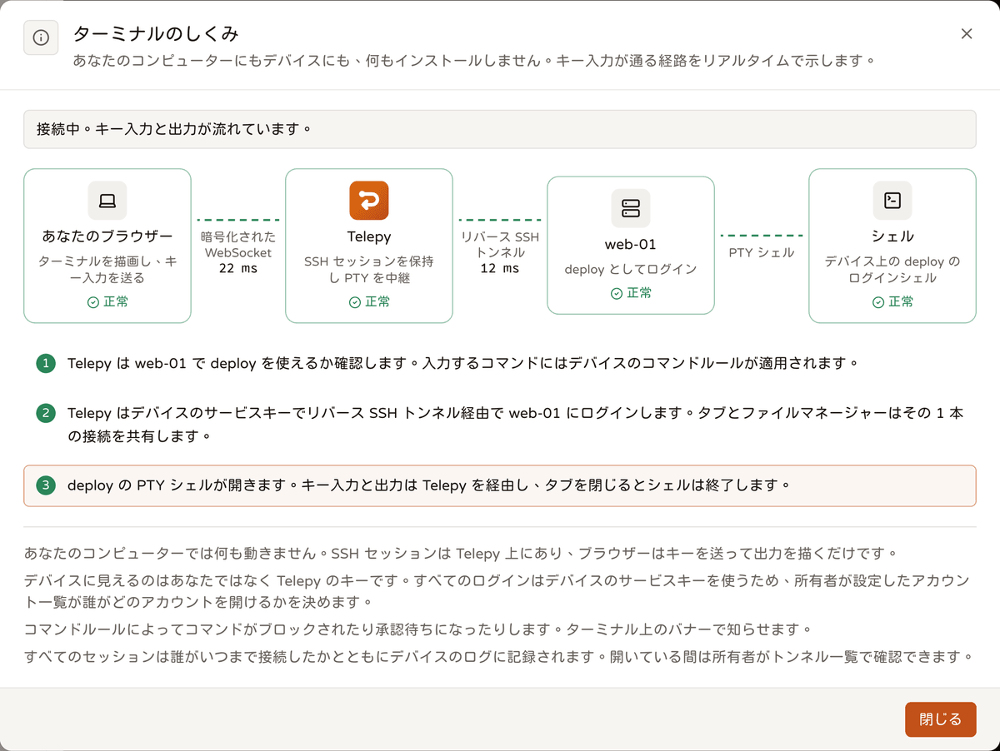
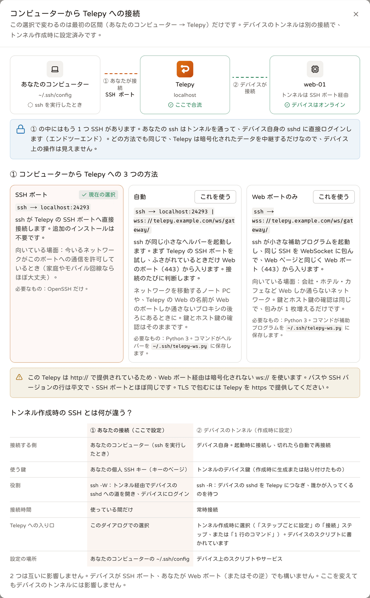
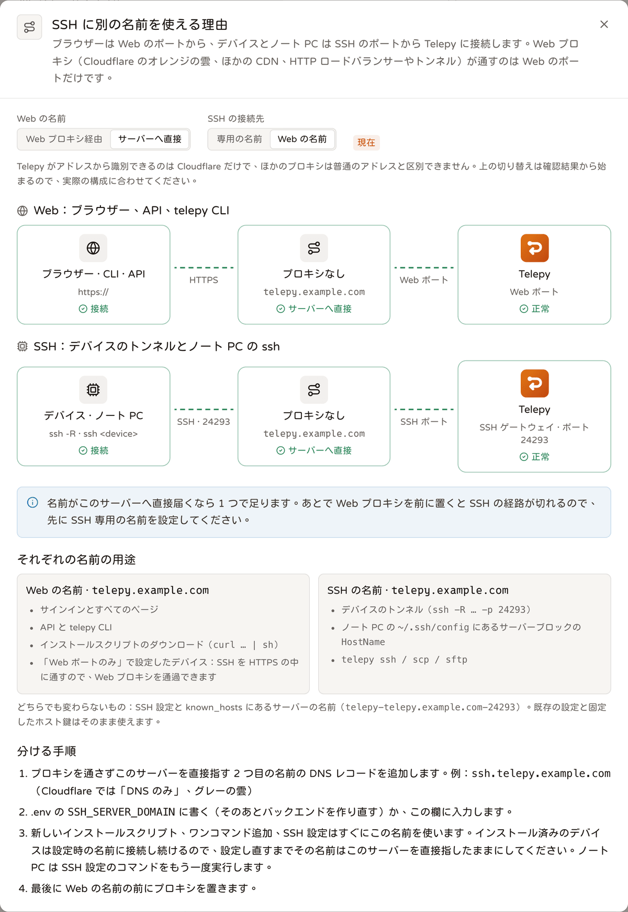

# バックエンドがデバイスに接続する仕組み：共有接続とポート

<p align="center"><a href="./device-connections.md">English</a> | <a href="./device-connections.zh-TW.md">繁體中文</a> | <b>日本語</b></p>

> このドキュメントは、現在の接続経路、ポートの使いどころ、「トンネル + OS アカウント」ごとに接続を共有する設計、そして未実装の部分をまとめたものです。
> コード：`gateway/mod.rs`、`gateway/proxy_protocol.rs`、`ws/gateway.rs`、`ssh/device.rs`、`ssh/pool.rs`、`ssh/sftp_watch.rs`、
> `ssh/resolve.rs`、`ssh/terminal.rs`、`ssh/socks.rs`、`ssh/bridge.rs`、`ssh/host_keys.rs`、`ssh/tunnel_keys.rs`。
> テスト：`tests/terminal_e2e.rs`、`tests/socks_e2e.rs`、`tests/device_pool.rs`、`tests/ssh_topology.rs`、`tests/gateway_ws.rs`、
> `tests/proxy_protocol.rs`（すべて `tests/common/lab.rs` の上に作られています）。

## 1. 今はどう接続する？以前と同じ？



**デバイス側は今も OpenSSH の `-R` です。** デバイスはトンネル鍵を使って
`ssh / autossh -NR '*:0:localhost:22' telepy@<server> -p 24242` を実行します。現在のスクリプトは必ず `-R 0` を要求し、gateway が鍵からトンネルを特定します
（第 10 節）。gateway のホスト鍵は `StrictHostKeyChecking=yes` + `HostKeyAlias=telepy-<host>-<port>` で固定します。以前の、
ポート番号を書いた古いスクリプトも引き続き動きます。Web ポートしか外に出られないネットワークは WebSocket 経由になります（第 9 節）が、中身は同じ SSH です。サーバー側では以前は
OpenSSH コンテナがこの接続を受けていましたが、今はバックエンドのプロセス内にある gateway（russh）が受けます。

```
デバイス                                       Telepy バックエンド（単一プロセス）
┌──────────────┐  ssh -NR（トンネル鍵）       ┌─────────────────────────────────────────────────────────────────────────────────────┐
│ sshd :22     │◀════════════════════════════▶│ gateway :2222（外部 24242）                                                         │
└──────────────┘                              │   forward テーブル：reverse_port → このデバイスの接続（ローカルのポートは使わない） │
       ▲                                      │                                                                                     │
       │ 各 channel = トンネル内の            │ 接続プール（ssh::pool）：同じデバイス・同じ OS アカウントで SSH 接続 1 本           │
       │ forwarded-tcpip channel 1 本。       │   ├ Web ターミナル：タブごとに PTY channel 1 本                                     │
       │ デバイスの ssh クライアントが        │   ├ ファイル管理 / SFTP：sftp channel を共有（exec 代替はコマンドごとに 1 本）      │
       └ localhost:22 につなぐ ───────────────│   ├ リモートブラウザー：プロセス内 SOCKS5、CONNECT ごとに direct-tcpip 1 本         │
                                              │   └ LAN ホストの中継：direct-tcpip 1 本（最後の 1 ホップは OpenSSH）                │
                                              │ AI セッション、LAN スキャン：それぞれ専用の接続（channel はプロセス内で開く）       │
                                              │ ノート PC：ssh -W <トンネル名>:22 telepy@server（ユーザー鍵）→ channel              │
                                              └─────────────────────────────────────────────────────────────────────────────────────┘
```

どの経路でも、最終的には**デバイスの sshd への SSH ログイン 1 回**になります。バックエンドはそのトンネル専用のサービス鍵（第 8 節）を使い、ノート PC はユーザー自身の鍵を使います。

| 経路 | 以前（Django + OpenSSH コンテナ） | 現在 |
|---|---|---|
| デバイス → サーバー | ssh コンテナへ `ssh -NR` | 同じく `ssh -NR`（`-R 0`）で、バックエンド内蔵の gateway へ。`/ws/gateway/` の WebSocket で包むこともできる |
| Web ターミナル | バックエンド → ssh コンテナ（1 回目の SSH）→ デバイス（2 回目） | プール接続上の PTY channel。同じデバイス・同じアカウントのタブとファイルマネージャーは **1 回**の SSH ログインを共有 |
| ファイルマネージャー / SFTP | 操作ごとに `ssh` / `scp` を起動し、それぞれ SSH 2 回 | SFTP REST とすべてのファイルマネージャーが、プール接続上の **1 本**の sftp channel を共有。sftp サブシステムがないときはファイルマネージャーが exec channel で `ls -la` を実行 |
| リモートブラウザー | `ssh -D` の子プロセス | バックエンド自身の SOCKS5（CONNECT のみ）。CONNECT 1 回 = プール接続上の direct-tcpip |
| LAN ホストのターミナル | ssh コンテナ経由の `ProxyCommand ssh -W` | プール接続上の direct-tcpip を使い捨てのローカル入口（`ssh::bridge`）につなぐ。最後の 1 ホップは OpenSSH（パスワードを尋ねられる） |
| デバイス鍵リスト（`device_keys`） | なし | 同じプールから接続を借り、SFTP で `~/.ssh/authorized_keys` を読み書き |
| ノート PC | ssh コンテナ経由の `ProxyCommand ssh -W` | 同じ。gateway 経由 |

## 2. ポートはどこで使われる？足りなくなる？

| ポート | 用途 | 数 | 足りなくなる？ |
|---|---|---|---|
| 24242、8787 | 外部向け：デバイスのトンネル、Web（WebSocket のデバイスも Web ポートを使う） | 固定 | いいえ |
| `reverse_port` | トンネルごとの**番号** 1 つ。デバイスが `-R` で指定し、gateway がこれで接続を探す。**ローカルのポートは一切バインドしない** | トンネル 1 本につき 1 つ | 番号の上限はおよそ 64,500 トンネル |
| SOCKS ポート | リモートブラウザーのセッションごとに 1 つ（kasm コンテナが接続してくる。Chromium の SOCKS は認証情報に対応しないため共有できない） | セッション上限で制限 | いいえ |
| LAN ホストの使い捨て入口 | LAN ホストのターミナルを開くたびに `127.0.0.1:<一時ポート>` が接続を 1 本待つ（30 秒誰も来なければ閉じる） | 開いている LAN ターミナルの数 | いいえ |
| リモートデスクトップの逆接続ポート | RDP / VNC セッションごとに使い捨ての listener が 1 つ（ランダムなポート、guacd のアドレスだけ受け付ける）。guacd が接続するとデバイスの direct-tcpip につながり、listener は閉じる | 開いているデスクトップセッションの数 | いいえ |

バックエンドがデバイスに接続するときは loopback TCP を一切通らないので、一時ポートや TIME_WAIT の問題もありません。`reverse_port` はただの番号で、
コンテナ内の何かと衝突することはなく、割り当て時に発行済みの番号を避けるだけです（`monitor::find_free_port`）。

## 3. 「トンネル + OS アカウント」ごとの接続共有（`ssh::pool`）

- **キー**：`(reverse_port, OS アカウント)`。同じアカウントの利用を許可された Telepy ユーザー同士は 1 本の接続を共有し、それぞれ独立した
  channel を使います。権限は従来どおり、取得の前に `permissions::allowed_usernames` が確認します。
- **確立**：最初に使うときに接続します。トランスポートはプロセス内です。`Gateway::open_stream(port)` がデバイスのトンネル上に forwarded-tcpip
  channel を開き、russh がその上で直接デバイスの sshd とハンドシェイクします。同じキーに同時に複数のリクエストが来ても、ハンドシェイクは 1 回だけで、残りはそれを待ちます。
- **枠の勘定は session channel だけ**：OpenSSH の MaxSessions が制限するのは session channel（shell、exec、sftp）だけで、
  direct-tcpip は対象外なので、プールもそれだけを数えます。
  - session channel（ターミナルのタブ、exec、デバイス鍵リスト、macOS の名前解決）はすべて `DevicePool::session_channel` 経由で開きます。
  - 1 接続あたり同時に最大 8 本の session channel。sshd の MaxSessions の既定は 10 なので 2 つ余らせています。デバイスは私たちの
    close を処理し終えて（shell はまず終了する必要があります）から枠を解放するため、返却した直後の枠をすぐ再利用すると拒否されることがあるからです。
  - デバイスが MaxSessions をもっと小さくして channel の作成を拒否した場合、プールはその接続がそのとき保持できる数を覚え、同じキーに対して
    もう 1 本接続を開きます。学習した上限は 2 分で失効します。拒否は一時的なものかもしれず、接続をずっと小さいままにしないためです。
  - direct-tcpip だけを開く用途（リモートブラウザーの SOCKS、リモートデスクトップ / RustDesk、LAN の中継ホップ）は `DevicePool::acquire` で「トランスポート」lease を借ります。
    枠は使わず、接続が回収されないようにするだけです。以前はそれぞれが 1 枠を使っていたため、リモートブラウザーとリモートデスクトップを開いていると
    ターミナルのタブが 2 枠分少なくなっていました。
- **SFTP は 1 本の channel を共有**：SFTP のリクエストには番号が付いているので、複数人が同時に同じ channel を使っても問題ありません。そのため接続ごとに sftp channel は 1 本だけ開き、
  SFTP REST とすべてのファイルマネージャーがそれを使います（`DevicePool::sftp`）。
  - 利点：SFTP REST がリクエストのたびに channel を開き直し、サブシステムを要求し、INIT を行う（トンネル上で何往復もかかる）必要がなくなります。ファイルマネージャーをいくつ開いても
    枠は 1 つだけです。
  - 代償：デバイスの sftp-server は一度に 1 つのリクエストしか処理しないため、1 つのリクエストが詰まると（たとえば応答しなくなったネットワークドライブ）全員が待たされます。
    そこで `ssh::sftp_watch` が channel のストリームを包み、送ったリクエストと受け取った応答を数えます。channel が閉じた場合、またはリクエストが待機中なのに
    15 秒間何も受信しない場合は壊れたものとみなし、次に借りる人には新しい channel を渡します。ファイルマネージャーはディレクトリ一覧の取得に失敗すると、自分で channel を取り替えて 1 回だけ再試行します。
  - 5 分間誰にも使われなければ閉じて枠を返します（接続自体がまだ使われているときも同じです）。
- **回収**：lease がなく 5 分以上アイドルの接続は reaper が閉じます（30 秒ごとに確認）。デバイスが切断すると接続は自分で無効になり、
  開いているターミナルのタブは閉じられ、次に使うときに再接続します。
- **ターミナル**：タブ = channel で、タブを閉じるとその channel だけが閉じます。以前あった、killpg が ControlMaster に当たってすべてのタブが一斉に落ちる
  という種類の問題はもうありません。デバイスがオフラインなら、タイムアウトを待たずにすぐ 4005 を返します。
- **sftp サブシステムが拒否された場合**：デバイスの返事を待ち、拒否されたらすぐ exec に切り替えます。SFTP 初期化の 10 秒のタイムアウトを待つことはありません。
- **macOS デバイスと名前（`ssh::resolve`）**：Apple の `sshd-session` は、ターゲットが**名前**の direct-tcpip を受け取ると、
  privsep の子プロセスが fork の後に getaddrinfo を呼んで abort し、SSH 接続全体が落ちます。Chromium は SOCKS で常に名前を送るので、
  リモートブラウザーはページを開いた途端にこれを引き起こします。共有接続では、同じデバイス・同じアカウントのターミナルのタブとファイルマネージャーも一緒に落ちます。そこで、
  SOCKS と LAN の中継ホップが direct-tcpip を開く前に次のことを行います。
  - 接続ごとに OS を 1 回確認します（`uname -s`）。
  - Darwin の場合：**デバイス上で** `/usr/bin/dscacheutil` を使って名前を IP に解決し（IPv4 優先。内部名と `.local` の名前も従来どおり使えます）、
    その IP に対して channel を開きます。
    - 同じ名前の同時問い合わせは 1 回だけ実行します。同時に最大 2 件まで（それぞれプールから session channel を 1 本借りるので、枠に数えられます）。
    - キャッシュ：解決できたら 60 秒、できなければ 10 秒。
    - 解決できなければその CONNECT を失敗させます。名前を Apple の sshd に渡すことは**絶対に**ありません。
  - その他の OS：従来どおり名前をデバイスに渡して解決させます（`ssh -D` と同じ）。
- **効果**：同じデバイス・同じアカウントなら、2 回目の操作からハンドシェイクは発生しません。テストで測った数値：
  - ディレクトリ一覧を 5 回連続：ログイン 1 回、sftp channel 1 本
  - 同時 12 リクエスト：ログイン 1 回、sftp channel 1 本
  - ターミナルのタブ 3 つとファイルマネージャー：ログイン 1 回
  - トランスポート lease 10 個と session 8 本：ログイン 1 回

## 4. 未実装のこと

- **AI セッションと LAN スキャンは今も専用の接続を使います**（`ssh::device::connect`）。1 つの AI セッションは同時に最大 4 本の channel（コマンドと
  対話シェルで共用）に加えて SFTP を開くので、1 セッションとして数えるとプールがデバイスの MaxSessions 使用量を過小評価してしまいます。すでにプロセス内で channel を開いており（ポートは使いません）、
  接続を共有しても省けるのはハンドシェイク 1 回だけなので、今のところ移していません。
- **`reverse_port` の上限**：トンネルはすでに鍵で特定されており（第 10 節）、デバイスが `-R` でどの番号を要求しても関係なく、ノート PC も `ssh -W <トンネル名>:22` を使います。
  ただし `reverse_port` は今もトンネルごとの内部番号（u16）です。6 万本を超えるトンネルになったら、もっと大きな整数に広げる必要がありますが、これは型とアロケーターだけの変更で、
  デバイスにもノート PC にも手を入れる必要はありません。

## 5. テストの方法

- `tests/terminal_e2e.rs`：
  - PTY とエコー（マルチバイト文字を含む）、resize が window-change としてデバイスに送られること、バイナリの pong
  - 独立した 5 つのタブ。1 つ閉じても残りは普通に動く
  - タブが 1 回のログインを共有する。MaxSessions が 2 でも 3 つ目のタブが開ける
  - デバイスが切断するとタブが閉じ、再接続後に再び開ける。オフラインならすぐ 4005
  - LAN ホストの中継ホップ。ファイルマネージャーの SFTP と exec のフォールバックが接続を共有する
- `tests/socks_e2e.rs`：
  - 本物の SOCKS5 CONNECT がデバイス経由でその LAN 内のサービスに届くこと。複数の CONNECT の同時実行と、到達できないターゲットも含む
  - stop の後にプロキシのポートが閉じる。オフライン時は `device_offline` を返す
  - 偽の macOS デバイス（lab の `pretend_darwin` は名前の direct-tcpip で接続を切り、Apple のクラッシュを再現します）：名前を使った
    CONNECT も通り、同じ接続上のターミナルのタブは生きたまま
- `tests/device_pool.rs`：
  - 接続と sftp channel の共有（デバイスの sshd のログイン記録と sftp の起動回数を数える）
  - MaxSessions が 8 より小さいときは 2 本目を開く。トランスポート lease は枠を使わない
  - 壊れた共有 sftp は交換され、使われなくなったものは閉じられる。ファイルマネージャーは自分で取り替える
  - sftp サブシステムが拒否されたときは channel が閉じる（デバイスに残って MaxSessions を消費しない）
  - デバイスの再接続、アイドル時の回収、使用中の接続は回収されない
- `tests/ssh_topology.rs`：同じデバイスに複数ユーザー・複数の OS アカウントがある場合と、複数ホップの経路。
- `tests/gateway_ws.rs`：デバイスが `/ws/gateway/` 経由で接続する（本物の `telepy-ws.py` を ProxyCommand に使うケースを含む）。`tests/proxy_protocol.rs`：
  L4 プロキシの PROXY ヘッダー（第 9 節を参照）。
- 新しい SSH 経路は必ず `tests/common/lab.rs` の上に作ります（説明は `.claude/CLAUDE.md` の Code Conventions を参照）。

## 6. デバイスのホスト鍵の固定

バックエンドはデバイスに接続するたび（`ssh::device::connect`）、デバイスの sshd が提示するホスト鍵を照合します。そのトンネルの最初の接続で記録し（TOFU。
通常はデバイスの参加直後のバックエンド自身の確認ログインです）、以降は異なる鍵を提示されるとハンドシェイクを拒否して確認待ちとして記録し、所有者と共有された人に通知します。所有者 / ADMIN は
トンネルの詳細の「鍵と識別」タブにある「デバイスの識別」でフィンガープリントを確認して「この鍵を信頼」を押すか、「消去」を押して次の接続でやり直しの記録をさせます。理由：デバイスは Telepy の
ユーザーを区別できず、サービス鍵だけを認識します。トンネル鍵を手に入れた人は `-R` を自分の sshd に向けてデバイスになりすまし、ターミナルの入力、アップロードされたファイル、リモートデスクトップの
パスワードを横取りできてしまいます。固定しておけば、そうしたなりすましはハンドシェイクの段階で止まり、サービス鍵のログインも送られません。テスト：`tests/host_keys.rs`。

ノート PC も同様です。生成される ssh config のデバイスブロックは、`UserKnownHostsFile ~/.ssh/telepy_known_hosts` +
`HostKeyAlias <サーバーのエイリアス>-device-<トンネル id>` でデバイスのホスト鍵を照合します。Telepy が固定済みなら `StrictHostKeyChecking yes` で、固定された行はサーバーのものと同じファイルに入ります（インストールコマンド、
`telepy config install`、`telepy ssh` がまとめて保存します）。まだ固定されていなければ
`accept-new` で、ノート PC は最初の接続時に自分で鍵を記録し、以降は異なる鍵を拒否します。以前のデバイスブロックは `StrictHostKeyChecking no` だったため、トンネル鍵を持つ人が
トンネルを自分の sshd につなぐと、ノート PC の `ssh <デバイス>` がそのまま入り込んでしまいました。所有者が新しい鍵を信頼したあとは、ノート PC でインストールコマンドを 1 回再実行してください。
テスト：`tests/laptop_device_host_key.rs`（偽の sshd と、旧形式との比較を含む）。

## 7. 1 台のマシンに所有者は 1 人（ホスト鍵 = マシンの識別）

デバイスは Telepy のユーザーを区別できません。全員が同じサービス鍵でログインするので、トンネルをその sshd に向けられる人（`-R <port>:<そのマシン>:22`。そのマシンのローカルの
どのアカウントからでも、同じ LAN や VPN からでも可）は、「自分のトンネル」のアカウントリストで root を含めてログインできてしまいます。これを防いでいるのが固定されたホスト鍵で、
ホスト鍵は「このマシン」の識別でもあります。

- **固定する前に、同じ鍵を他に誰が信頼しているかを確認**（`db::host_keys::claimants`）：別アカウントのトンネル → ハンドシェイクを拒否（エラーは
  `device managed by another account` で始まり、API / リモートデスクトップのエラーコードは `device_claimed`）。拒否されたトンネルには `claim_refused` を、そのマシンのトンネルには
  `claim_attempt` を記録し、`DEVICE-CLAIM-ATTEMPT` を所有者と ADMIN の共有先に送ります（同じ鍵につき 1 回だけ）。「新しい鍵を信頼」と
  「消去してから再接続」も同じルールを通るため、これで回避することはできません。自分の別のトンネル → 通常どおり固定され、`GET …/host-key` の `same_machine` に表示されます。
- **参加スクリプトは登録時にホスト鍵を送ります**（localhost への `ssh-keyscan` → `host_keys`）：別アカウントのマシンはトンネルを作る前に拒否されます（409。メッセージは
  所有者に共有を依頼するか、複製した VM ならホスト鍵を作り直すよう案内します）。自分の別のトンネルなら `SAME_MACHINE_AS` が返り、チケットに `same_machine_as` が入って
  Web で知らせます。新しいトンネルのホスト鍵はすぐに固定され（`source = join`）、最初の接続で見えたものをそのまま信じることはなくなりました。再参加のときは、まだ固定がない場合か、
  少なくとも 1 つが一致する場合にだけ固定を追加します。すべて入れ替わっている場合は、接続時の照合に拒否を任せます。
- **デバイス鍵はサイト全体で一意**（`api::reverse_keys::device_key_problem`）：コメントは見ず、誰のものかも問わず、誰かの個人鍵やサービス
  鍵であってもいけません（gateway は鍵だけを見るので、先に登録されたトンネルがその鍵のデバイスとして扱われてしまいます）。
- **gateway の direct-tcpip**：許可されたアカウントが 1 つもない共有先は、デバイスの sshd への channel を開けません（許可リストが唯一の境界です。
  ADMIN はリストを管理するので例外です）。
- トンネルを削除するとその固定も消え、マシンは所有者のない状態になって、次にそのマシンを指した人が固定します。削除時には、そのトンネル自身のサービス鍵は必ずデバイスから取り除かれます（第 8 節）。
  デバイスに古い共有鍵が残っている場合は「サービス鍵を削除」にチェックを入れてください（そのマシンの最後のトンネルでは最初からチェック済み）。そうしてはじめてマシンが本当に Telepy から離れます。

テスト：`tests/machine_identity.rs`（他人のマシンを指す、2 通りの回避、自分の 2 本目、削除後の解放）、`tests/join_api.rs`
（登録時の拒否 / 同一マシンの通知 / 即時の固定）、`tests/rest_api.rs`（デバイス鍵の重複排除）、`tests/ssh_topology.rs`（許可アカウントのない
共有先）。

## 8. トンネルごとに 1 つのサービス鍵（`ssh::tunnel_keys`）

第 7 節は「他人のマシン」を防ぎます。ここでは根本を断ちます。以前はサイト全体でサービス鍵が 1 つ（`SSH_IDENTITY`）しかなく、すべてのデバイスがそれを信頼していました。今は各トンネルが
最初に必要になったときに ed25519 の鍵ペアを生成します。秘密鍵は vault（`SECRET_KEY` から派生）で封印されて `telepy_tunnel_service_key` に保存され、公開鍵
（`… telepy-tunnel-<id>`）はウィザード、ワンコマンド参加、docker スクリプト、トンネルの詳細（`service_key`）に渡されます。デバイスが承認するのはこの鍵だけです。

- **ログインの順序**（`ssh::device`）：まずトンネル鍵を試し、デバイスにまだなければ共有鍵に戻ります。トンネル鍵でログインできたら、そのアカウントを「検証済み」として記録します
  （`telepy_tunnel_key_account`）。
- **古いデバイスの移行**（`device_keys::sync_tunnel`）：トンネル鍵はすべてのログインアカウントの wanted に含まれ、同期時にインストールされます。次の接続からそれを使います。
  共有鍵は、**同じマシン上でそのアカウントを登録しているすべてのトンネル**が自分の鍵でログインした後に、はじめてそのアカウントから取り除かれます
  （`tunnel_keys::shared_removable`、イベント `service_key_migrated`）。鍵パネルは共有鍵を legacy と表示します。管理者も同じ
  ルールのもとで手動で削除できます。サイト設定 → サーバーの「デバイスの共有サービス鍵を残す」（または `.env` の `KEEP_SHARED_SERVICE_KEY=true`）がオンのときは、
  共有鍵は決して取り除かれません（自動でも手動でも）。移行期間中、以前の Telepy が同じ鍵で同じデバイス群にまだログインしている場合に使います（トンネル鍵も
  同様にインストールされ、先にそちらが試されます）。
- **トンネルの削除**：そのトンネルの鍵は必ずデバイスから取り除かれます。「サービス鍵を削除」のオプションが扱うのは共有鍵だけになりました。
- **衝突しない**：トンネルのサービス公開鍵は、デバイス鍵や個人鍵として登録できません（`device_key_problem` / `checked_key`）。
- **`SECRET_KEY` の変更**：暗号文を開けなくなる → 共有鍵に戻ります。`doctor` の `tunnel keys` が、開けなくなった鍵の数を知らせます。共有鍵がすでに取り除かれている
  デバイスは再承認が必要です（ウィザードのステップ 3 またはワンコマンド参加）。

テスト：`tests/tunnel_service_keys.rs`（新しいデバイスはトンネル鍵だけを信頼、古いデバイスの移行、同じマシンのすべてのトンネルを待つこと、削除時の取り除き）。

## 9. デバイスが gateway に届くまで：TCP、WebSocket、PROXY protocol





- **TCP（既定）**：外部向けは `REVERSE_SERVER_SSH_PORT`（24242、コンテナ内では 2222）。
  - 接続先の名前は `SSH_SERVER_DOMAIN`（サイト設定 → サーバー → SSH ホスト）で、未設定なら Web と同じ名前です。Web の名前が Web ポートしか通さないプロキシ（Cloudflare のオレンジの雲、他の CDN、HTTP ロードバランサー）の後ろにある場合、その名前では SSH のポートに届かないため、サーバーに直接つながる別の名前を SSH 用に用意します。known_hosts のエイリアス（`telepy-<ドメイン>-<port>`）は引き続きドメインを使うので、SSH ホストを変えても「別のサーバー」にはなりません。すでにインストール済みのデバイスは、設定したときの名前に接続し続けます。設定ページは両方の名前を解決し、Cloudflare のアドレスを見分けます（他のプロキシは見分けられません）。`doctor` の `ssh_host` チェックも同様です。SSH の名前で Web を開けるべきではありません。`PUBLIC_URL` が設定されていて SSH ホストが別の名前の場合、SSH の名前で届いたサインインはすべて 421（`ssh_host`）で拒否され、フロントエンドは説明ページに差し替えて正しいアドレスへ誘導します。保存時には、自分が今使っている名前は入力できません（自分が締め出されてしまうため）。これが防ぐのは間違ったアドレスの利用と設定ミスで、`Host` の偽装を防ぐには origin をプロキシにだけ開ける必要があります。
- **WebSocket**（`ws/gateway.rs`）：Web ポートしか許可しないネットワーク（社内ネットワーク、ホテル、4G ルーター）向けです。デバイスの ssh に
  `ProxyCommand python3 telepy-ws.py wss://<host>/ws/gateway/` を付けると、小さなプログラム（Python 標準ライブラリのみ、`GET /api/join/telepy-ws.py`）が
  バイト列をバイナリフレームに包んで Web ポートへ送ります。中身は**同じ** SSH セッションです。同じホスト鍵、同じ鍵認証と forward ルールで、
  余計に信頼するものはなく、最初の auth メッセージもありません（認証は中の SSH で行います）。ウィザードの接続ステップかワンコマンド参加で選びます（`transport: websocket`）。
- **自動**（`transport: auto`。ウィザードとワンコマンド参加の既定）：プログラムに `--tcp <SSH ホスト>:<port>` が付き、接続のたびにまず SSH のポートに直接つなぎ、gateway の `SSH-` バナーが見えて初めて成功とみなします。つながらなければ（ファイアウォール、または Web ポートしか通さないプロキシの後ろにある Web の名前）、上の WebSocket に切り替えます。WebSocket で成功した場合は 30 分間記憶され（一時ディレクトリの小さなファイル）、その後はまた SSH のポートを先に試します。どちらを通ったかは stderr（サービスのログ）に書かれます。python3 のないデバイスは従来どおり SSH のポートだけを使います。ワンコマンド参加は `--auto` で、登録時に実際にインストールした方式を報告し（`facts.transport`）、`way_in` として保存されます。
  - 送信元 IP は転送ヘッダー（`X-Forwarded-For`）から取ります。どの区間がプロキシかは、サイト設定 → サーバーの「信頼するプロキシ」または `TRUSTED_PROXY_HOPS` で決まります
    （既定の `auto` は右端の内部アドレスをすべてプロキシとして扱います）。ポートは 0 として記録され、接続情報、`accepted` イベント、
    一覧の `endpoint.transport` には `websocket` と記録されます。接続数の上限（`GATEWAY_MAX_CONNECTIONS`）は 2 つの入口をまとめて数えます。
  - ノート PC もこの方法で接続できます。SSH config ダイアログの「Telepy への接続方法」で「Web ポートのみ」（または「自動」= `--tcp` 付きで、先に SSH のポートを試す）を選ぶと、
    サーバーブロックに ProxyCommand の行が 1 行増えます（先に `telepy-ws.py` を `~/.ssh/telepy-ws.py` に保存します）。`telepy ssh / scp / sftp` はこのプログラムを使わず、
    既定で Web ポートを通ります（[cli.ja.md](./cli.ja.md) を参照）。
- **PROXY protocol**（`gateway/proxy_protocol.rs`）：gateway の前に L4 プロキシ（nginx stream、HAProxy の `mode tcp`、クラウドの NLB）があると、
  gateway から見える送信元はすべてそのプロキシになります。プロキシをサイト設定 → サーバーの「SSH ゲートウェイの PROXY protocol 送信元」か、`.env` の `GATEWAY_PROXY_PROTOCOL_FROM` に登録すると
  （IP / CIDR をカンマまたは空白で区切る。空 = オフ。`.env` に設定があればそちらが優先され、ページ上ではロックされます）、プロキシが送る v1 / v2
  ヘッダー内の送信元がピアの代わりに使われます。イベント、endpoint、誰が使っているか、IP 変更アラートのすべてでこれを使います。
  - ヘッダーは**あってもなくてもよく、自動判別**です。最初の 1 バイトをのぞき見し（SSH は必ず `S` で始まり、ヘッダーは `P` / `\r` で始まります）、5 秒間何も送られてこなければ、バナーを待つ直接接続のクライアントとして扱います。
    読み取りはちょうどヘッダーの終わりで止まり、その後の SSH には 1 バイトも触れません。そのため、設定を間違えても直接接続のデバイスを締め出すことはありません。
  - v1 の `UNKNOWN` / v2 の `LOCAL` はピアをそのまま使います。不正な形式、または 5 秒以内に送り終わらないヘッダーは拒否して `refused_proxy` イベントを記録します。接続してすぐ切る場合（ヘルスチェック）は記録しません。
  - 登録されていない送信元は、ヘッダーを**決して**読みません。そうしないと誰でも好きな IP を名乗れてしまい、IP 変更アラートの意味がなくなります。デバイス側のスクリプトを変更する必要はありません。

テスト：`tests/gateway_ws.rs`、`tests/proxy_protocol.rs`（lab は `Lab::start_with(|config| …)` でプロキシのアドレスを設定します）。

## 10. トンネルは鍵で特定される（ポートはただの番号）

gateway は公開鍵認証の時点でどのトンネルかを把握している（`Identity::Tunnel`）ので、`tcpip-forward` はデバイスが要求した番号を見なくなりました。0 を要求しても
他人の番号を要求しても同じで、forward はそのトンネル自身の `reverse_port` で記録され、デバイスに返される番号もそれです（デバイスが要求した番号と異なる場合は、`forward`
イベントにその旨が記されます）。ユーザー鍵ではトンネルを特定できないため、従来どおり、自分が所有するトンネルの番号だけを開けます。

ノート PC の `direct-tcpip` は `localhost:<番号>` に加えて `<トンネル名>:<任意のポート>` も受け付けます（名前はサイト全体で一意）。生成される ssh config の
デバイスブロックは `HostName <名前>` / `Port 22` になり、`ProxyCommand ssh -W %h:%p <サーバーブロック>` で中継されます。古い設定ファイルも引き続き動きます。
名前は**大文字小文字を区別せず**照合します。OpenSSH は `HostName` を小文字にしてから `%h` に入れるため（`MyBox` は gateway に着くとき `mybox` になります）です。完全一致を優先し、
なければこの鍵で到達できるものを選びます。以前は完全一致だったため、大文字を含む名前のトンネルは拒否されていました（`administratively prohibited`）。
トンネル名そのものも OpenSSH のホスト名の規則に従います。使えるのは英数字と `.` `_` `-` だけ、先頭は英字か数字、最大 63 文字で、大文字小文字を区別せず一意です
（`tunnel_name.rs`）。空白は ssh_config では 1 つの名前を 2 つに分けてしまい、コマンドラインでは OpenSSH 9.6 から即座に拒否されます。`%` は `%h` のように
展開され、`* ? ! ,` はパターン文字、`#` はコメント、`@` と `:` は Telepy 自身の `<トンネル>@<アカウント>` / `<トンネル>:<パス>` に使われます。この規則ができる前からあった、規則に合わない
名前も引き続き使えます。生成される設定ではそれらを `HostName localhost` / `Port <番号>` に書き換え、Web で所有者に名前の変更を促します。
サーバーブロックのエイリアスは `telepy-<ドメイン>-<port>`（`HostKeyAlias` と同じ文字列）で、Telepy ごとに 1 つずつなので、同じ config に複数入っていても干渉しません。
以前の共有 `telepy-ssh-server` ブロックは、それがこのサーバーのものだと確実で、他に使っているものがない場合にインストールコマンドが取り除きます。
2 つの Telepy に同じ名前のデバイスがある場合、インストールコマンドは同名ブロックの ProxyCommand がどのサーバーに飛ぶかを見ます。別のサーバーのものなら上書きせずに残し、その名前を一覧表示します。
どちらか一方に「名前の接頭辞」（個人設定の `ssh_alias_prefix`。たとえば `work-` → `ssh work-pi`）を設定すれば、両方を共存させられます。
アクセスルールは以前と同じです（所有者、ADMIN、または許可アカウントを 1 つ以上持つ共有先。機密性の高いトンネルは先に Web で確認が必要です）。個人鍵の有効期限が切れた場合（`expired_key`
イベントとして記録）、アカウントが無効にされた場合、または管理者がその人の「個人 SSH 鍵」機能をオフにした場合、gateway は認証の時点でその鍵を拒否します。

デバイス側のスクリプトは常に `-R 0` と書きます（Docker 版は `SSH_TUNNEL_PORT=0`、ワンコマンド参加も同様）。番号はサーバー内にしか存在しません。Web でトンネルを削除するときの削除スクリプトは、
そのトンネルのものを**鍵**で見分けるようになりました（コマンドラインやファイル内の `-i <鍵ファイル>`、`IdentityFile`、docker の `KEY_FILE=` / `<path>:/id_rsa`、コンテナが
`/id_rsa` にマウントした鍵。隣の `.pub` か `ssh-keygen -y` がトンネル鍵を出せる必要があります）。ポート番号を書いた古いスクリプトは従来どおり番号で見分けます。
ワンコマンド参加のバックグラウンドループを再実行するときは、そのトンネル自身の known_hosts ファイル（`telepy-<インストール id>.known_hosts`）で古い ssh を探します。番号では見分けられず、
鍵ファイルは別の Telepy のトンネルでも使われている可能性があるためです（第 11 節を参照）。
`reverse_port` の u16 という上限は完全に内部のものなので、本当に近づいたときに型を広げます。テスト：`tests/key_identified.rs`、`tests/tunnel_delete.rs`。

## 11. デバイス上の名前：インストール id、調査、オフラインにならない名前変更（`device_install/`）

**問題**：以前デバイスにインストールされていたものの一部には、人やサーバーの名前が入っていました。hdre 移行スクリプトの `telepy-natlee.service` /
`info.natlee.telepy` / `telepy_natlee_known_hosts`、ワンコマンド参加の unit の説明に入るトンネル名、すべてのトンネルで共通の `telepy-tunnel.service`
（同じマシンの 2 本のトンネルが互いを上書きしていました）、そして `~/.ssh/telepy_known_hosts`（2 台目のサーバーが参加すると 1 台目のホスト鍵を上書きしていました）です。他の人の
マシンに `telepy-natlee` と出ていれば、誰がそのサーバーを運用しているかを教えてしまうことになります。また、Telepy は何をインストールしたのか把握していなかったため、削除のときは推測するしかありませんでした。

**インストール id**：各トンネルは最初に必要になったときに 8 文字のランダムな id を引きます（`[a-hj-km-np-z2-9]`、`telepy_device_install`、サイト全体で一意、トンネルと一緒に削除）。
デバイス上の名前はすべてこれから作られます。`telepy-<id>.service`（systemd。system / --user、autossh のサービスも同じ）、`com.telepy.tunnel.<id>`
（launchd）、`~/.ssh/telepy-<id>.sh`（バックグラウンドループ）、`telepy-<id>.known_hosts`、`telepy-<id>-uninstall.sh`、`telepy-<id>-ws.*`、
Docker コンテナ `telepy-<id>`。unit の説明は `Telepy reverse tunnel <id>` とだけ書きます。id にはユーザー、ドメイン、トンネル名が含まれないので、トンネルの名前を変えてもデバイスに手を入れる必要はなく、
トンネルのページで id を検索すればそのトンネルが見つかります。ハッシュは使いません。記録がなければ元の名前に戻せませんし、`SECRET_KEY` を変えるとすべて変わってしまいます。ランダム + 記録のほうがすっきりしています。
`telepy-` という接頭辞は残します。デバイスの管理者がそれが何かを見分けられますし、出所の分からないサービスが SSH で外に接続し続けているほうが、むしろマルウェアのように見えるからです。ssh コマンド自体には
接続先のサーバー名が書かれます（`telepy@<ドメイン>`、`HostKeyAlias`）。接続そのものに必要だからです。

**調査（survey）**：削除に使う `remove_tunnel.sh` に `T_MODE=survey` が加わりました。何も変更せず、`found` の項目だけを報告します（unit / plist のパス、
ループ、実行中の ssh とその所有者 `owner <pid> <アカウント> <ホーム>`、crontab の行、コンテナ、鍵、known_hosts）。結果は
`telepy_device_install.survey` に保存され、ワンコマンド参加の検証後、device_info の毎日の巡回（未調査または 7 日以上経過した場合）、詳細の「再確認」を押したときに更新されます。
Windows のスクリプトは削除しかできず、調査はまだ実装されていません（プラットフォームだけ返します）。

**ログインアカウントが読めないファイル**：root で動く unit は鍵を `/root/.ssh` に置くことが多く、ログインアカウント（たとえば `ubuntu`）に読めないと、それがこのトンネルのものだと見分けられません。
ログインアカウントに `sudo -n` があれば、鍵、unit、ループスクリプトは `sudo -n cat` / `test -f` / `ssh-keygen -y -P ''` で読みます（読み取り専用で、同じファイルは 1 回だけ問い合わせます）。
本番サイトの最初の調査はまさにここでつまずき、鍵がたまたま `/home/ubuntu` にあった 1 台だけを見分けられました。

**鍵を書いていないサービス**：hdre 移行スクリプトは、古いトンネルに `-i` の指定がなければ新しい unit にも書かないため、ssh は実行アカウントの既定の鍵
（`~/.ssh/id_ed25519`、`id_ecdsa`、`id_rsa`…）を使います。コマンドが鍵ファイルを指定せず、この gateway のポートに明示的に接続し、`-R` があるときは、実行アカウント
（プロセスの所有者。unit の `User=`、plist の `UserName`。システムレベルで指定がなければ root。それ以外はログインアカウント）の既定の鍵と照合します。既定の鍵はその人自身の
ファイルなので、削除しても消えません。

**plist と OpenWrt**：launchd の plist は引数をそれぞれ独立した `<string>` に入れるため、照合の前に 1 行に連結します（`text_of`）。そうしないと `-p` も `-i` も読み取れません。
OpenWrt の procd スクリプト（`/etc/init.d/*`。`/etc/rc.common` があるときだけ対象）と `/etc/rc.local` の行も同じルールで見分けます。削除のとき init スクリプトは
`disable` したあと、停止スクリプトが `stop` して削除します。rc.local は該当の行だけを取り除きます。init スクリプトは自動では名前を変えません（`unsupported`）。1 行コマンドで参加し直すと、非公開の名前が使われます。

**コマンドの長さ**：OpenWrt のルーターは dropbear を使うことが多く、9000 文字を超える exec コマンドを受け付けませんが、このスクリプトは 25KB あります。6000 文字を超えるスクリプトは
`printf >> <一時ファイル>` で分割して送り、最後の exec でそれを実行して削除します（`exec::script_commands` / `run_script`）。これならどの sshd でも受け付けられ、BusyBox ash（Alpine）でも
動作を確認しています。

**別のサーバーにつながるものには触れない**：同じ鍵が 2 つの Telepy サーバーに使われていることがあり（hdre と新しいサイトがそうです）、以前の「鍵で照合」では hdre の unit まで一緒に壊していました。
今は、ファイルまたはコマンドラインにポート（`-p N`、`'-p' 'N'`、`Port=N`、`SSH_REMOTE_PORT=N`）が書かれていて、そのどれもがこの gateway の
`REVERSE_SERVER_SSH_PORT` でなければ、別のサーバーのもの（`kept other-server`）として、削除、調査、名前変更のすべてでスキップします。ポートが書かれていないものは従来どおり見分けます。

**名前変更：先に新しい方をつなぎ、それから古い方を外す**：コマンド自体がこのトンネルを通って送られるので、先に古い方を止めると、実行中のものを自分で切ってしまいます。そこで：
1. 再調査します。`plan::plan` が、実行中の ssh（`parse_ssh`：`-i`、`-p`、`-R` のターゲット、`user@host`、ProxyCommand）と見つかった古いサービスから計画を立てます。
   方式は同じ（systemd system → 元の `User=` の system unit。--user / LaunchAgent / ループ → それを動かしているアカウント。システムレベルには
   root か `sudo -n` が必要）、鍵、サーバー、ポート、forward のターゲットも同じで、known_hosts はこの gateway のホスト鍵に書き換えます。進められない理由（Windows、
   root が必要、コマンドが読み取れない、鍵の相対パス…）は `blocker` として返され、Web が説明します。
2. gateway が `arm_handover(port)` を実行します。この間、同じトンネル（同じトンネル鍵で特定）の 2 本目の接続の `tcpip-forward` は拒否されず、
   **スタンバイ**（`standby`）として記録されます（成功を返すので、新しい ssh の `ExitOnForwardFailure` で終了しません）。forward は引き続き古い接続にあります。イベント `standby_forward`。
3. 古い接続を通してインストールスクリプトを実行します（`plan::install_script`：ファイルは先に隣に書いてから名前を変え、新しいサービスを起動）。
4. スタンバイが現れるのを待ちます（既定 45 秒）。`device::connect_standby` がスタンバイ経由で 1 回ログインします。
5. `promote`：forward が新しい接続に移ります（イベント `handover`、新しい endpoint を記録）。古い接続はまだ生きていますが、トンネルはもう運びません。
6. **新しい**接続を通して削除スクリプトの `T_MODE=relabel` を実行します。削除と同じようにこのトンネルのものを見つけますが、id で名付けられたもの（`kept_new`）はスキップし、鍵は残します。
   古い unit / plist / ループ / crontab の行 / 古い known_hosts（他に使うものがなければ）/ 古い uninstall スクリプトを取り除き、停止スクリプトは従来どおりバックグラウンドで動かします。
7. `finish_relabel`：古い接続が切れ、forward が新しい接続にあり、13 秒以内に他の接続が現れない（古いものを再起動しているものがある場合に現れます）ことを確認します。そのあと再調査して保存します。
   イベント `service_renamed`。

手順 2〜5 のどこかで失敗すると、古い接続を通して `undo_script` を実行し、インストールしたばかりのものを取り除いて、引き継ぎを解除します。古いものには一切触れておらず、トンネルは常にオンラインのままです。途中で古い接続が
たまたま自分で切れた場合は、スタンバイが自動的に引き継ぐ（`on_disconnect`）ので、その場合もオフラインにはなりません。代償として、古い接続が閉じるとき、このデバイスで開いている Web ターミナルとファイルマネージャーは 1 回再接続します
（それらの channel は古い TCP 接続の上にあるためです）。

**どの名前を変えるか**：「Telepy が付けたものではない」名前（手作業や移行スクリプトで作られたもの。たとえば `telepy-natlee.service`、`info.natlee.telepy`）だけが
変更対象として扱われ、一覧に印が付きます。Telepy 自身のこれまでの標準名（ワンコマンド参加の `telepy-tunnel-<n>.service` / `com.telepy.tunnel.<n>` /
`telepy-tunnel-<n>.sh`、autossh の `telepy-tunnel.service`、コンテナ `telepy-tunnel`）は人名を含まず、削除スクリプトも見分けられるので、「Telepy の以前の
名前」と表示されるだけで、変更するかどうかは任意です（`plan::earlier_name`）。

**1 台のマシンに複数人・複数サーバー**：異なる Telepy アカウントが同じマシンにトンネルを向けることはできません（第 7 節）。OS アカウントが異なる場合や別々のサーバーに接続する場合、以前は互いを上書きしていたシステム共通の名前（`telepy-tunnel.service`、コンテナ `telepy-tunnel`、`/etc/ssh/telepy_known_hosts`、`~/.ssh/telepy_known_hosts`、
そしてトンネル番号で名付けられた `telepy-tunnel-<n>`。2 台のサーバーのデータベースがコピーなら番号が同じになります）は、すべて id による名前に置き換わりました。同じ OS アカウントが**同じ鍵**で 2 台のサーバーに接続する場合、削除のときは、
別のサーバーにつながるもの（unit、スクリプト、実行中の ssh）がその鍵を使っている限り、`~/.ssh/telepy_tunnel_*` は残されます
（`kept key … another server`）。ワンコマンド参加のループは自分の ssh だけを止めます（鍵ではなく known_hosts ファイルで見分けます）。調査は別のサーバーにつながるものを
`kept other-server "<ファイルまたは ssh> (port N)"`、共有鍵を `note key-shared <パス>` として返し、Web の「このデバイスの接続先」図（`DeviceMap`）はこれらをもとにサーバーごとに 1 行描きます。注意：データベースをまるごとコピーして 2 台目の
サーバーを動かすと、インストール id もまったく同じになり、2 台が同じデバイスにインストールするものが同じ名前になってしまいます。

**削除は id で片付ける**：削除用の削除スクリプトには `T_INSTALL` が渡され、新しい名前の unit / label / ループ / uninstall / ws ファイルと
`telepy-<id>.known_hosts` を見分けます。known_hosts は、unit、plist、ループ、`~/.ssh/config`、CLI の設定のいずれもまだ使っていない場合にだけ削除されます（デバイスは誰かの
ノート PC でもあることが多く、`~/.ssh/telepy_known_hosts` はそのノート PC の ssh config のものかもしれないためです）。

ワンコマンド参加を再実行したとき、同じトンネルの古い名前のインストール（`telepy-tunnel-<id>`）が見つかった場合は、先にそれを止めて取り除いてから新しいものをインストールするので、2 つが同じトンネルを奪い合うことはありません。

**余分なコピー（名前ではなく証拠で判断）**：本番サイトの GL-AR750S ルーター（トンネル #34）の調査で `/etc/init.d/telepy-6m35fshq` が見つかり、「名前変更が必要」と判定されましたが、
init スクリプトが `unsupported` のため名前変更はできませんでした。実際には、削除されたトンネル #33 が残したものでした（その削除は init.d 対応より前でした）。そして再参加が新しい鍵を
**同じ** `~/.ssh/telepy_tunnel_ed25519` に書いたため、これはまさに #34 の鍵を使っていました。再起動すると 2 つの init スクリプトがどちらも起動し、このトンネルを奪い合います。名前だけでは
「人が付けた名前」と「別のインストール id」を区別できない（`telepy-natlee` も id のように見えます）ので、判断を 3 つの質問に改め、名前に関係するのは最後の 1 つだけにしました。
1. **このトンネルのものか**：このトンネルの鍵を使い、この gateway に接続しているか（従来からこの方法で見分けていました）。
2. **どれが動いているか**：調査で見えた ssh がすべて id で名付けられたもの（コマンドラインに `telepy-<id>.known_hosts` がある）だけなら、同じトンネルの他のサービス / コンテナは
   名前が何であれ、すべて**余分**（`Part.extra`、`plan::mark_extras`）です。これは「名前変更が必要」には当たらず、名前変更の `plan` は `extra` を返します。
3. **名前から人が分かるか**：id で付けられた名前だけが非公開です。**台帳** `telepy_device_install_retired`：トンネルを削除するとき、その id、名前、所有者を記録します
   （`db::device_install::retire`。新しい id がこれらと重複することはありません）。名前の中の `telepy-<x>` / `com.telepy.tunnel.<x>`（`plan::id_in_name`。あくまで候補）が
   台帳と一致したときだけ「削除されたトンネル X が残したもの」と表示します（`Part.retired`。トンネル名は同じ所有者にだけ表示します）。Telepy のこれまでの標準名（`earlier_name`）は
   Telepy 自身がかつて生成した版なので、その一覧はコード内に置いています。

**余分なものの削除**（`POST …/device-install/tidy`、`device_install::tidy`）：引き継ぎは不要です。余分なものは接続中のものではないからです。再調査（`plan::tidy_check`：
余分なものがあり、Windows ではなく、システムレベルのものには root のログインが必要）→ **現在の**接続を通して `T_MODE=relabel` を実行（id で名付けられたものはすべてスキップし、鍵は残します。init スクリプトは
`disable` したあと停止スクリプトが `stop` して削除し、それが使っている known_hosts だけが一緒に削除されます）→ `finish_tidy` が 13 秒間監視します：接続が維持され、forward が動かず、他の接続が現れない
→ 再調査して確認。イベント `service_extra_removed`。削除スクリプトは `~/.ssh/telepy-*.sh` もスキャンし、このトンネルの鍵でこのサーバーに接続するループはこのトンネルのものとして扱います
（動いていないものも含む）。そのため、削除されたトンネルが残した動いていないループも見つかります。

テスト：`tests/device_install.rs`（本物の `/bin/sh` のデバイス、古いサービスとしての本物の再接続ループ、`<home>/bin` に置いた偽の crontab / ssh。
名前変更中に forward が一度も解放されないこと。新しいサービスが接続できないときの自動ロールバック。削除されたトンネルが残したループが余分なものとして認識され、台帳が出所を示し、取り除いてもトンネルが切れないこと）。ユニットテストは `device_install/plan.rs`、`names.rs` にあります。
