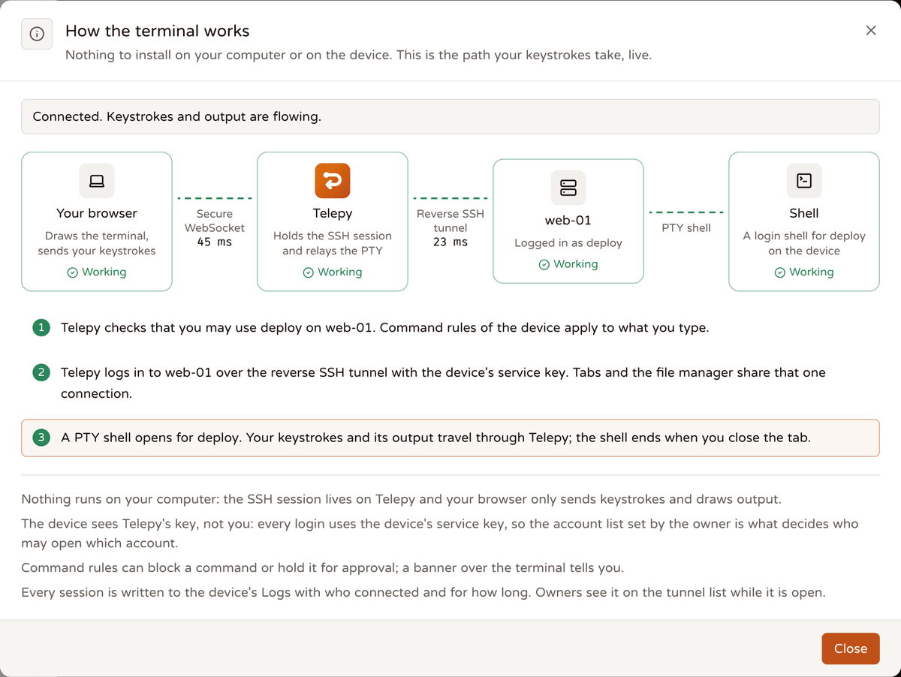
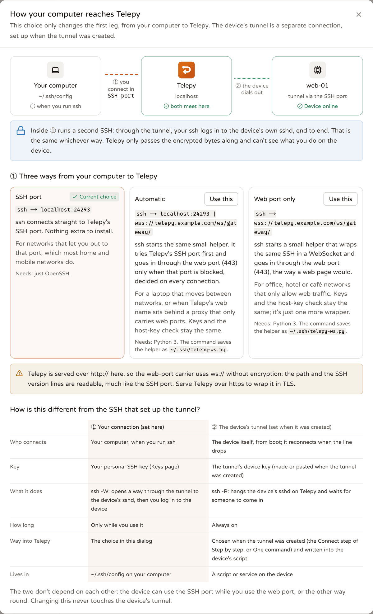
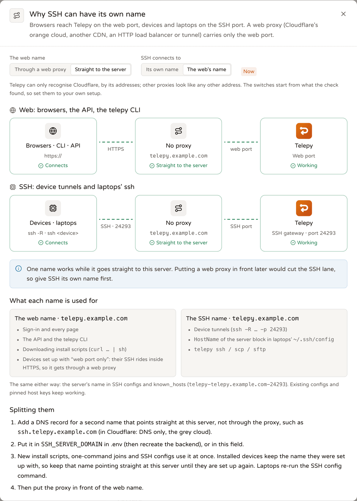

# How the backend reaches devices: shared connections and ports

<p align="center"><b>English</b> | <a href="./device-connections.zh-TW.md">繁體中文</a> | <a href="./device-connections.ja.md">日本語</a></p>

> This document covers the current connection paths, where ports are used, the design that shares one connection per "tunnel + OS account", and what is not done yet.
> Code: `gateway/mod.rs`, `gateway/proxy_protocol.rs`, `ws/gateway.rs`, `ssh/device.rs`, `ssh/pool.rs`, `ssh/sftp_watch.rs`,
> `ssh/resolve.rs`, `ssh/terminal.rs`, `ssh/socks.rs`, `ssh/bridge.rs`, `ssh/host_keys.rs`, `ssh/tunnel_keys.rs`;
> tests: `tests/terminal_e2e.rs`, `tests/socks_e2e.rs`, `tests/device_pool.rs`, `tests/ssh_topology.rs`, `tests/gateway_ws.rs`,
> `tests/proxy_protocol.rs` (all built on `tests/common/lab.rs`).

## 1. How does it connect now? Is it the same as before?



**The device side is still OpenSSH `-R`.** The device runs
`ssh / autossh -NR '*:0:localhost:22' telepy@<server> -p 24242` with its tunnel key. Current scripts always ask for `-R 0`, and the gateway recognises the tunnel by its key
(section 10). They pin the gateway's host key with `StrictHostKeyChecking=yes` + `HostKeyAlias=telepy-<host>-<port>`; older scripts that
carry a port number keep working. Networks that only let web ports out go over a WebSocket instead (section 9), carrying the very same SSH. On the server side the connection used to be
accepted by an OpenSSH container; now it is the gateway (russh) inside the backend process.

```
Device                                         Telepy backend (single process)
┌──────────────┐  ssh -NR (tunnel key)        ┌───────────────────────────────────────────────────────────────────────────────────┐
│ sshd :22     │◀════════════════════════════▶│ gateway :2222 (public 24242)                                                      │
└──────────────┘                              │   forward table: reverse_port -> this device's connection (binds no local port)   │
       ▲                                      │                                                                                   │
       │ each channel = one forwarded-tcpip   │ connection pool (ssh::pool): one SSH connection per device + OS account           │
       │ channel in the tunnel; the device's  │   ├ web terminal: one PTY channel per tab                                         │
       │ ssh client attaches it to            │   ├ file manager / SFTP: one shared sftp channel (exec fallback: one per command) │
       └ localhost:22 ────────────────────────│   ├ remote browser: in-process SOCKS5, one direct-tcpip per CONNECT               │
                                              │   └ LAN host hop: one direct-tcpip (last hop is still OpenSSH)                    │
                                              │ AI sessions, LAN scans: one connection each (channels also opened in-process)     │
                                              │ laptop: ssh -W <tunnel name>:22 telepy@server (user key) -> channel               │
                                              └───────────────────────────────────────────────────────────────────────────────────┘
```

Whichever path is used, the end result is **one SSH login to the device's sshd**: the backend uses the tunnel's own service key (section 8), a laptop uses the user's own key.

| Path | Before (Django + OpenSSH container) | Now |
|---|---|---|
| Device → server | `ssh -NR` to the ssh container | Still `ssh -NR` (`-R 0`), to the gateway built into the backend; can also be wrapped in a WebSocket at `/ws/gateway/` |
| Web terminal | backend → ssh container (first SSH) → device (second) | A PTY channel on a pooled connection; tabs and the file manager for the same device and account share **one** SSH login |
| File manager / SFTP | Every operation spawned `ssh` / `scp`, two SSH hops each | SFTP REST and every file manager share **one** sftp channel on the pooled connection; without an sftp subsystem the file manager runs `ls -la` over an exec channel |
| Remote browser | `ssh -D` child process | The backend's own SOCKS5 (CONNECT only); each CONNECT is a direct-tcpip on the pooled connection |
| LAN host terminal | `ProxyCommand ssh -W` through the ssh container | A direct-tcpip on the pooled connection, attached to a one-shot local entry point (`ssh::bridge`); the last hop is OpenSSH (can ask for a password) |
| Device key lists (`device_keys`) | None | Borrows a connection from the same pool and reads / writes `~/.ssh/authorized_keys` over SFTP |
| Laptop | `ProxyCommand ssh -W` through the ssh container | Same, through the gateway |

## 2. Where are ports used? Can they run out?

| Port | Purpose | Count | Can it run out? |
|---|---|---|---|
| 24242, 8787 | Public: device tunnels, the web UI (devices that use WebSocket use the web port too) | Fixed | No |
| `reverse_port` | One **number** per tunnel: the device names it in `-R`, and the gateway uses it to find that connection. **It binds no local port.** | 1 per tunnel | The number space allows about 64,500 tunnels |
| SOCKS port | One per remote browser session (the kasm container connects in; Chromium's SOCKS has no credentials, so one cannot be shared) | Limited by the session cap | No |
| LAN host one-shot entry | For each LAN host terminal opened, `127.0.0.1:<ephemeral port>` waits for one connection (closed after 30 seconds if nobody comes) | Number of open LAN terminals | No |
| Remote desktop call-back port | One one-shot listener per RDP / VNC session (random port, accepts only guacd's address); when guacd connects it is joined to the device's direct-tcpip and the listener closes | Number of open desktop sessions | No |

The backend no longer goes through any loopback TCP to reach a device, so there are no ephemeral ports and no TIME_WAIT problems. `reverse_port` is only a number,
so it cannot collide with anything in the container; when allocating one, just avoid numbers already handed out (`monitor::find_free_port`).

## 3. One connection per "tunnel + OS account" (`ssh::pool`)

- **Key**: `(reverse_port, OS account)`. Different Telepy users who are allowed to use the same account share one connection; each gets its own
  channel. Permissions are still checked by `permissions::allowed_usernames` before anything is borrowed.
- **Setup**: connects on first use. The transport is in-process: `Gateway::open_stream(port)` opens a forwarded-tcpip
  channel on the device's tunnel, and russh does the handshake with the device's sshd directly on top of it. When several requests for the same key arrive at once, only one handshake runs and the others wait for it.
- **The budget counts session channels only**: OpenSSH's MaxSessions limits only session channels (shell, exec, sftp), not
  direct-tcpip, so the pool counts only those.
  - Every session channel (terminal tabs, exec, device key lists, the macOS name resolver) is opened through `DevicePool::session_channel`.
  - At most 8 session channels per connection at once. sshd's default MaxSessions is 10, so 2 are left spare: the device has to finish handling our
    close (a shell must exit first) before it frees the slot, and reusing a slot the instant it is returned can be refused.
  - When a device sets MaxSessions lower and refuses to open a channel, the pool remembers how many that connection can actually hold, and opens a second
    connection for the same key. The learned limit expires after 2 minutes: a refusal may be momentary, so the connection should not stay shrunk.
  - Uses that open only direct-tcpip (the remote browser's SOCKS, remote desktop / RustDesk, the LAN hop) borrow a "transport" lease through `DevicePool::acquire`:
    it takes no slot and only keeps the connection from being reclaimed. They used to take one slot each, so having a remote browser and a remote desktop open
    left the terminal tabs two slots short.
- **SFTP shares one channel**: SFTP requests are numbered, so many people can use one channel at once. Each connection therefore opens just one sftp channel,
  and SFTP REST and every file manager go through it (`DevicePool::sftp`).
  - Benefit: SFTP REST no longer reopens a channel, requests the subsystem and runs INIT for every request (several round trips over the tunnel); however many file managers are open, they occupy
    one slot.
  - Cost: the device's sftp-server handles one request at a time, so one stuck request (for example on a hung network drive) makes everyone wait.
    That is why `ssh::sftp_watch` wraps the channel's stream and counts requests sent and replies received: if the channel closes, or requests are waiting and
    nothing has arrived for 15 seconds, it counts as broken and the next borrower gets a fresh one; when a file manager's directory listing fails it swaps in a new channel and retries once.
  - After 5 minutes of nobody using it, it is closed and the slot returned (even if the connection itself is still in use).
- **Reclaiming**: connections with no lease that have been idle for more than 5 minutes are closed by the reaper (checked every 30 seconds). When the device disconnects, the connection invalidates itself,
  open terminal tabs are closed, and the next use reconnects.
- **Terminal**: tab = channel, and closing a tab closes only that channel. The old class of problem where `killpg` hit the ControlMaster and kicked every tab at once
  no longer exists. An offline device is answered with 4005 immediately, with no waiting for a timeout.
- **sftp subsystem refused**: it waits for the device's answer and falls back to exec the moment it is refused, instead of waiting out SFTP initialisation's 10-second timeout.
- **macOS devices and names (`ssh::resolve`)**: when Apple's `sshd-session` receives a direct-tcpip whose target is a **name**,
  the privsep child calls getaddrinfo after fork and aborts, taking the whole SSH connection down. Chromium always sends names through SOCKS,
  so the remote browser triggers it as soon as it opens a page; on a shared connection the terminal tabs and file manager for the same device and account would drop too. So before the
  SOCKS proxy and the LAN hop open a direct-tcpip:
  - Each connection asks the OS once (`uname -s`).
  - Darwin: the name is resolved to an IP **on the device** with `/usr/bin/dscacheutil` (IPv4 first; internal and `.local` names work as usual),
    and the channel is opened to the IP.
    - The same name looked up at the same time runs only once; at most 2 lookups at once (each borrows a session channel from the pool, counted in the budget).
    - Cache: 60 seconds when found, 10 seconds when not.
    - If it cannot be resolved, that CONNECT fails; the name is **never** handed to Apple's sshd.
  - Other OSes: the name is still handed to the device to resolve (same as `ssh -D`).
- **Effect**: for the same device and account, there is no handshake from the second operation on. Numbers measured in tests:
  - 5 directory listings in a row: 1 login, 1 sftp channel
  - 12 simultaneous requests: 1 login, 1 sftp channel
  - 3 terminal tabs plus the file manager: 1 login
  - 10 transport leases plus 8 sessions: 1 login

## 4. Not done yet

- **AI sessions and LAN scans still use their own connection** (`ssh::device::connect`). One AI session opens up to 4 channels at once (commands and
  interactive shells share them) plus SFTP, and counting it as a single session would make the pool underestimate the device's MaxSessions usage. It already opens its channel in-process (no port used),
  so sharing a connection would save only one handshake; it has not been moved.
- **The `reverse_port` ceiling**: the tunnel is already identified by its key (section 10), it does not matter which number the device asks for in `-R`, and laptops use `ssh -W <tunnel name>:22`;
  but `reverse_port` is still a per-tunnel internal number (u16). Beyond 60 thousand tunnels it has to widen to a larger integer, which is purely a type and allocator change,
  with no change needed on devices or laptops.

## 5. How to test

- `tests/terminal_e2e.rs`:
  - PTY and echo (including multi-byte characters), resize sent to the device as window-change, binary pong
  - Five independent tabs; closing one leaves the rest working
  - Tabs share one login; with MaxSessions 2 a third tab still opens
  - Tabs are closed when the device disconnects and reopen after it reconnects; offline answers 4005 straight away
  - The LAN host hop; the file manager's SFTP and exec fallback share the connection
- `tests/socks_e2e.rs`:
  - A real SOCKS5 CONNECT through the device to a service on its LAN, including several CONNECTs at once and an unreachable target
  - The proxy port closes after stop; `device_offline` is returned when offline
  - A fake macOS device (the lab's `pretend_darwin` drops the connection on a direct-tcpip to a name, simulating Apple's crash): CONNECT by name
    still works, and a terminal tab on the same connection stays alive
- `tests/device_pool.rs`:
  - Connection and sftp channel sharing (counting the device sshd's login records and sftp start-ups)
  - A second connection when MaxSessions is below 8; transport leases take no slot
  - A broken shared sftp is replaced and an unused one is closed; the file manager swaps in its own
  - When the sftp subsystem is refused the channel is closed (it does not stay on the device using MaxSessions)
  - Device reconnect, idle reclaim, and a connection in use is not reclaimed
- `tests/ssh_topology.rs`: several users and OS accounts on one device, and multi-hop paths.
- `tests/gateway_ws.rs`: a device connecting through `/ws/gateway/` (including the real `telepy-ws.py` as ProxyCommand); `tests/proxy_protocol.rs`:
  the PROXY header from an L4 proxy (see section 9).
- New SSH paths are always built on `tests/common/lab.rs` (see Code Conventions in `.claude/CLAUDE.md`).

## 6. Pinning the device's host key

Every time the backend connects to a device (`ssh::device::connect`) it compares the host key the device's sshd presents: the first connection of a tunnel records it (TOFU;
usually the backend's own verification login right after the device joins), and afterwards a different key is refused at the handshake, recorded as pending, and the owner and sharees are notified. The owner / ADMIN
checks the fingerprint under "Device identity" in the "Keys & identity" tab of the tunnel details and clicks "Trust this key", or "Forget" so the next connection records it afresh. Why: the device cannot tell Telepy
users apart and recognises only the service key, and whoever holds a tunnel key can point its `-R` at their own sshd to impersonate the device, catching terminal input, uploaded files and
the remote desktop's password; with pinning, that impersonation is stopped at the handshake and the service-key login is never sent. Test: `tests/host_keys.rs`.

Laptops work the same way: in the generated ssh config, the device block checks the device's host key with `UserKnownHostsFile ~/.ssh/telepy_known_hosts` +
`HostKeyAlias <server alias>-device-<tunnel id>`. Once Telepy has pinned it that is `StrictHostKeyChecking yes`, and the pinned lines sit in the same file as the server's (the install command,
`telepy config install` and `telepy ssh` all save them together); before it has pinned, it is
`accept-new`, so the laptop records the key itself on the first connection and refuses a different one afterwards. The device block used to be `StrictHostKeyChecking no`, so whoever held a tunnel key could
connect the tunnel to their own sshd and a laptop's `ssh <device>` would go straight in. After the owner trusts a new key, laptops have to re-run the install command once.
Test: `tests/laptop_device_host_key.rs` (including a fake sshd and a comparison with the old form).

## 7. One owner per machine (host key = machine identity)

A device cannot tell Telepy users apart: everyone logs in with the same service key, so whoever can point a tunnel at that sshd (`-R <port>:<that machine>:22`, from any account on it,
or from the same LAN or VPN) can log in with the account list of "their own tunnel", root included. What stops this is the pinned host key,
which is also the identity of "this machine".

- **Before pinning, check who else trusts the same key** (`db::host_keys::claimants`): another account's tunnel → the handshake is refused (error starts with
  `device managed by another account`, API / remote-desktop error code `device_claimed`); the refused tunnel records `claim_refused`, the machine's own tunnel
  records `claim_attempt` and `DEVICE-CLAIM-ATTEMPT` goes to the owner and ADMIN sharees, once per key. "Trust a new key" and
  "forget, then reconnect" both follow the same rule, so neither is a way around it. Your own other tunnel → pinned as usual, and `GET …/host-key` lists it as `same_machine`.
- **The join script sends the host key at registration** (`ssh-keyscan` on localhost → `host_keys`): a machine that belongs to another account is refused before the tunnel is created (409, the message
  tells them to ask the owner for a share, or to regenerate the host key if it is a cloned VM); your own other tunnel comes back as `SAME_MACHINE_AS`, and the ticket carries `same_machine_as`
  for the web UI to point out; the new tunnel's host key is pinned at once (`source = join`), so the first connection no longer trusts whatever it sees. On rejoin it adds a pin only if none exists yet or
  at least one matches; if everything has changed, the comparison at connect time refuses it.
- **Device keys are unique across the site** (`api::reverse_keys::device_key_problem`): regardless of comment or owner, and never anyone's personal key or a service
  key (the gateway recognises only keys, so the tunnel registered first would be treated as that key's device).
- **The gateway's direct-tcpip**: a sharee who has no allowed account at all cannot open a channel to the device's sshd (the allow-list is the only boundary;
  ADMINs manage the list, so they are the exception).
- When a tunnel is deleted its pin goes too, leaving the machine with no owner, and the next person to point at it pins it. On delete the tunnel's own service key is always removed from the device (section 8);
  if the old shared key is still on the device, tick "Remove the service key" (pre-ticked for the last tunnel on a machine) so the machine really leaves Telepy.

Tests: `tests/machine_identity.rs` (pointing at someone else's machine, two ways around it, your own second tunnel, release after delete), `tests/join_api.rs`
(refusal at registration / same-machine note / immediate pin), `tests/rest_api.rs` (device key de-duplication), `tests/ssh_topology.rs` (a sharee with no allowed
account).

## 8. One service key per tunnel (`ssh::tunnel_keys`)

Section 7 stops "someone else's machine"; this pulls out the root of the problem: there used to be one service key for the whole site (`SSH_IDENTITY`), and every device trusted it. Now each tunnel
generates an ed25519 key pair the first time it needs one; the private key is sealed with the vault (derived from `SECRET_KEY`) and stored in `telepy_tunnel_service_key`, and the public key
(`… telepy-tunnel-<id>`) goes to the wizard, the one-command join, the docker scripts and the tunnel details (`service_key`); the device authorises only that one.

- **Login order** (`ssh::device`): the tunnel key first, falling back to the shared key only if the device does not have it yet; a success with the tunnel key marks that account as "verified"
  (`telepy_tunnel_key_account`).
- **Migrating old devices** (`device_keys::sync_tunnel`): the tunnel key counts in every login account's wanted set and is installed on sync; the next connection uses it;
  the shared key is removed from an account only after **every tunnel on the same machine that lists that account** has logged in with its own key
  (`tunnel_keys::shared_removable`, event `service_key_migrated`). The key panel marks the shared key as legacy; managers can remove it by hand under the same
  rule. When Site settings → Server → "Keep the shared service key on devices" (or `KEEP_SHARED_SERVICE_KEY=true` in `.env`) is on,
  the shared key is never removed (neither automatically nor by hand): use it during a move, when the previous Telepy still logs in to the same devices with that same key (the tunnel key is still
  installed and still tried first).
- **Deleting a tunnel**: its key is always removed from the device; the "Remove the service key" option now concerns only the shared one.
- **No collisions**: a tunnel's service public key cannot be registered as a device key or a personal key (`device_key_problem` / `checked_key`).
- **Changing `SECRET_KEY`**: the ciphertext can no longer be opened → it falls back to the shared key; `doctor`'s `tunnel keys` reports how many cannot be opened. Devices whose shared key has already been removed
  have to be authorised again (wizard step 3 or the one-command join).

Test: `tests/tunnel_service_keys.rs` (a new device trusts only the tunnel key, migrating an old device, waiting for every tunnel on the same machine, removal on delete).

## 9. How devices reach the gateway: TCP, WebSocket, PROXY protocol





- **TCP (default)**: public `REVERSE_SERVER_SSH_PORT` (24242, 2222 inside the container).
  - The name it connects to is `SSH_SERVER_DOMAIN` (Site settings → Server → SSH host), or the same name as the web UI if unset. When the web name sits behind a proxy that carries only web ports (Cloudflare's orange cloud, another CDN, an HTTP load balancer), that name cannot reach the SSH port, so SSH needs its own name that goes straight to the server. The known_hosts alias (`telepy-<domain>-<port>`) still uses the domain, so changing the SSH host does not make it look like "another server". Devices already installed keep connecting to the name they were set up with. The settings page resolves both names and recognises Cloudflare's addresses (it cannot recognise other proxies), and so does `doctor`'s `ssh_host` check. The SSH name should not serve the web UI: when `PUBLIC_URL` is set and the SSH host is a different name, any sign-in that arrives under the SSH name is answered with 421 (`ssh_host`), and the frontend swaps in an explanation page pointing back to the proper address; on save you cannot enter the name you are currently using (it would lock you out). This guards against using the wrong address and misconfiguration; forging `Host` has to be stopped by locking the origin to the proxy.
- **WebSocket** (`ws/gateway.rs`): for networks that allow only web ports (corporate networks, hotels, 4G routers). The device's ssh gets
  `ProxyCommand python3 telepy-ws.py wss://<host>/ws/gateway/`, and the small program (Python standard library only, `GET /api/join/telepy-ws.py`)
  wraps the bytes in binary frames and sends them to the web port. Inside is the **same** SSH session: the same host key, the same key authentication and forward rules,
  nothing extra is trusted, and there is no first auth message (authentication happens in the SSH inside). Choose it in the wizard's connection step or in the one-command join (`transport: websocket`).
- **Automatic** (`transport: auto`, the default in the wizard and the one-command join): the program gets `--tcp <SSH host>:<port>`; each connection first tries the SSH port directly and counts it only once it sees the gateway's `SSH-` banner; if that fails (a firewall, or a web name behind a proxy that carries only web ports) it falls back to the WebSocket above. A working WebSocket is remembered for 30 minutes (a small file in the temp directory), and after that the SSH port is tried first again; which way it took is written to stderr (the service's log). A device without python3 uses only the SSH port, as before. The one-command join uses `--auto`, reports what it actually installed at registration (`facts.transport`), and that is stored as `way_in`.
  - The source IP comes from the forwarding header (`X-Forwarded-For`; which entries are proxies is set by Site settings → Server → "Trusted proxies" or `TRUSTED_PROXY_HOPS`:
    the default `auto` treats every internal address at the right end as a proxy), and the port is recorded as 0; the connection info, the `accepted` event and
    the list's `endpoint.transport` say `websocket`. The connection cap (`GATEWAY_MAX_CONNECTIONS`) counts both entry points together.
  - Laptops can connect this way too: in the SSH config dialog, choose "Web port only" (or "Automatic" = with `--tcp`, SSH port first) under "Reach Telepy via",
    and the server block gains one ProxyCommand line (after saving `telepy-ws.py` to `~/.ssh/telepy-ws.py`). `telepy ssh / scp / sftp` do not use this helper;
    they go through the web port by default (see [cli.md](./cli.md)).
- **PROXY protocol** (`gateway/proxy_protocol.rs`): when an L4 proxy sits in front of the gateway (nginx stream, HAProxy `mode tcp`, a cloud NLB),
  every source the gateway sees is the proxy. Put the proxy in Site settings → Server → "PROXY protocol sources for the SSH gateway" or `GATEWAY_PROXY_PROTOCOL_FROM` in `.env`
  (IPs / CIDRs, separated by commas or spaces; empty = off; if `.env` sets it, it wins and the page locks the field), and the source inside the v1 / v2 header it sends
  replaces the peer: events, endpoint, who is using it and IP-change alerts all use it.
  - The header is **optional and auto-detected**: it peeks at the first byte (SSH always starts with `S`, the header with `P` / `\r`), and if nothing is sent for 5 seconds it treats the peer as a direct client waiting for the banner;
    reading stops exactly at the end of the header and does not touch a single byte of the SSH after it. So a wrong setting never locks out a direct device.
  - v1 `UNKNOWN` / v2 `LOCAL` keep the peer; a malformed header, or one not finished within 5 seconds, is refused and recorded as a `refused_proxy` event; connect-and-close (a health check) is not recorded.
  - Sources that are not listed **never** have a header read: otherwise anyone could claim any IP and the IP-change alert would mean nothing. Scripts on the device need no change.

Tests: `tests/gateway_ws.rs`, `tests/proxy_protocol.rs` (the lab sets the proxy address with `Lab::start_with(|config| …)`).

## 10. The tunnel is identified by its key (the port is just a number)

The gateway already knows which tunnel it is at public-key authentication (`Identity::Tunnel`), so `tcpip-forward` no longer looks at the number the device asks for: asking for 0 or
someone else's number makes no difference, the forward is recorded under the tunnel's own `reverse_port`, and that is the number returned to the device (when the number the device asked for differs, the `forward`
event notes it). A user key cannot identify a tunnel, so as before it may only open the numbers of tunnels it owns.

A laptop's `direct-tcpip` accepts `<tunnel name>:<any port>` as well as `localhost:<number>` (names are unique site-wide): the device block in the generated ssh config
becomes `HostName <name>` / `Port 22`, hopping through `ProxyCommand ssh -W %h:%p <server block>`; older config files keep working.
Names are matched **ignoring case**: OpenSSH lowercases `HostName` before putting it in `%h` (`MyBox` arrives at the gateway as `mybox`). An exact match comes first,
otherwise the one this key can reach is chosen; matching used to be exact, so a tunnel with capitals in its name was refused (`administratively prohibited`).
Tunnel names themselves follow OpenSSH's host name rules: only letters, digits and `.` `_` `-`, starting with a letter or digit, at most 63 characters, and unique ignoring case
(`tunnel_name.rs`). A space splits one name into two in ssh_config and is refused outright on the command line since OpenSSH 9.6; `%` would be expanded like `%h`,
`* ? ! ,` are pattern characters, `#` is a comment, and `@` `:` are Telepy's own `<tunnel>@<account>` / `<tunnel>:<path>`. Names that existed before the rule and break it
keep working: the generated config rewrites them as `HostName localhost` / `Port <number>`, and the web UI prompts the owner to rename.
The server block's alias is `telepy-<domain>-<port>` (the same string as `HostKeyAlias`), one per Telepy, so several can live in one config without interfering;
the older shared `telepy-ssh-server` block is removed by the install command when it is sure the block is this server's and nothing else uses it.
When two Telepy servers have a device with the same name, the install command looks at which server the same-named block's ProxyCommand hops to: if it is another server's, it is kept and not overwritten, and the names are listed;
once the user sets a "name prefix" for one of them (the personal setting `ssh_alias_prefix`, for example `work-` → `ssh work-pi`), both can coexist.
Access rules are the same as before (the owner, an ADMIN, or a sharee with at least one allowed account; a sensitive tunnel needs a confirmation in the web UI first). The gateway refuses a personal key at authentication when it has expired (recorded as an `expired_key`
event), when the account is disabled, or when an administrator has turned off the "Personal SSH keys" feature for that person.

Scripts on the device always write `-R 0` (`SSH_TUNNEL_PORT=0` in the Docker flavours, and in the one-command join too): the number exists only on the server. The removal script used when a tunnel is deleted from the web UI
now recognises a tunnel's things by its **key** (`-i <key file>` or `IdentityFile` in a command line or file, docker's `KEY_FILE=` / `<path>:/id_rsa`, a key the container
mounts at `/id_rsa`; the `.pub` next to it, or `ssh-keygen -y`, has to produce the tunnel key), while older scripts that carry a port number are still recognised by the number;
when the one-command join's background loop is re-run, it uses this tunnel's own known_hosts file (`telepy-<install id>.known_hosts`) to find the old ssh: the number cannot identify it,
and the key file may also be used by a tunnel on another Telepy (see section 11).
The u16 ceiling of `reverse_port` is purely internal, and the type will be widened when it really gets close. Tests: `tests/key_identified.rs`, `tests/tunnel_delete.rs`.

## 11. Names on the device: install id, survey, renaming without going offline (`device_install/`)

**The problem**: some of what used to be installed on devices carried a person's or a server's name: the hdre migration script's `telepy-natlee.service` /
`info.natlee.telepy` / `telepy_natlee_known_hosts`, the tunnel name in the one-command join unit's description, `telepy-tunnel.service` shared by all tunnels
(two tunnels on one machine overwrote each other) and `~/.ssh/telepy_known_hosts` (a second server joining overwrote the first one's host key). Seeing `telepy-natlee` on someone else's
machine tells them who runs the server; and Telepy did not know what had been installed, so on delete it could only guess.

**The install id**: each tunnel draws an 8-character random id the first time it needs one (`[a-hj-km-np-z2-9]`, `telepy_device_install`, unique site-wide, deleted with the tunnel),
and every name on the device is derived from it: `telepy-<id>.service` (systemd, whether system, --user or the autossh service), `com.telepy.tunnel.<id>`
(launchd), `~/.ssh/telepy-<id>.sh` (the background loop), `telepy-<id>.known_hosts`, `telepy-<id>-uninstall.sh`, `telepy-<id>-ws.*`,
the Docker container `telepy-<id>`; the unit's description says only `Telepy reverse tunnel <id>`. The id contains no user, domain or tunnel name, so renaming a tunnel does not touch the device;
searching for the id on the tunnels page finds that tunnel. No hash is used: without a record you cannot get back to the original name, and a changed `SECRET_KEY` would change them all; random plus a record is just as clean.
The `telepy-` prefix stays: the device's administrator can see what it is, and a service of unknown origin that keeps dialling out over SSH looks more like malware. The ssh command itself still
names the server it connects to (`telepy@<domain>`, `HostKeyAlias`), because the connection itself needs it.

**Survey**: the `remove_tunnel.sh` used for deletion gained `T_MODE=survey`: it changes nothing and only reports `found` items (paths of units / plists,
loops, running ssh processes with their owner `owner <pid> <account> <home>`, crontab lines, containers, keys, known_hosts). The result is stored in
`telepy_device_install.survey`, and refreshed after a verified one-command join, in device_info's daily pass (when never surveyed or older than 7 days), and when the details' "Check again" is clicked.
The Windows script only removes; the survey is not done yet (it returns just the platform).

**Files the login account cannot read**: a unit running as root often keeps its key in `/root/.ssh`, and when the login account (for example `ubuntu`) cannot read it, it cannot tell the key belongs to this tunnel.
When the login account has `sudo -n`, keys, units and loop scripts are read with `sudo -n cat` / `test -f` / `ssh-keygen -y -P ''` (read-only, each file asked once);
the first survey on the production site got stuck right here, and recognised only the machine whose key happened to sit in `/home/ubuntu`.

**Services that name no key**: when the hdre migration script found the old tunnel with no `-i`, the new unit does not write one either, and ssh uses the running account's default keys
(`~/.ssh/id_ed25519`, `id_ecdsa`, `id_rsa`…). When a command names no key file, explicitly connects to this gateway's port, and has `-R`, it is matched against the running account's default keys
(the process owner; the unit's `User=`, the plist's `UserName`, root when a system-level unit writes none; otherwise the login account). A default key is that person's own
file, so delete never removes it.

**plist and OpenWrt**: a launchd plist puts each argument in its own `<string>`, so they are joined into one line before matching (`text_of`); otherwise neither `-p` nor `-i` can be read.
OpenWrt's procd scripts (`/etc/init.d/*`, looked at only if `/etc/rc.common` exists) and lines in `/etc/rc.local` are recognised by the same rules: on delete an init script is
`disable`d and then `stop`ped and removed by the stop script, and for rc.local only that line is removed. Init scripts are not renamed automatically (`unsupported`): re-running the one-line join uses the private name.

**Command length**: OpenWrt routers often use dropbear, which does not accept an exec command over 9000 characters, and this script is 25 KB. A script over 6000 characters is sent
in pieces with `printf >> <temp file>`, and a final exec runs it and deletes it (`exec::script_commands` / `run_script`), which any sshd accepts; it has also been run in BusyBox ash
(Alpine).

**Things that connect to another server are left alone**: the same key may serve two Telepy servers (hdre and the new site do), and matching "by key" used to take down hdre's unit as well.
Now if a file or command line names a port (`-p N`, `'-p' 'N'`, `Port=N`, `SSH_REMOTE_PORT=N`) and none of them is this gateway's
`REVERSE_SERVER_SSH_PORT`, it belongs to another server (`kept other-server`), and delete, survey and rename all skip it. Anything that names no port is recognised as before.

**Renaming: connect the new one first, then remove the old**: the command itself travels through this tunnel, so stopping the old service first would cut off the very thing that is running it. So:
1. Survey again. `plan::plan` works out a plan from the running ssh (`parse_ssh`: `-i`, `-p`, the `-R` target, `user@host`, ProxyCommand) and the old services found:
   the same method (systemd system → a system unit with the original `User=`; --user / LaunchAgent / loop → the account that runs it; system level needs
   root or `sudo -n`), the same key, server, port and forward target, with known_hosts rewritten to this gateway's host keys. Reasons it cannot go ahead (Windows,
   needs root, a command it cannot parse, a relative key path…) come back as a `blocker`, and the web UI explains them.
2. The gateway runs `arm_handover(port)`: for this period, a second connection of the same tunnel (recognised by the same tunnel key) does not have its `tcpip-forward` refused; it is recorded as a
   **standby** (`standby`; success is returned, so the new ssh's `ExitOnForwardFailure` does not make it quit), and the forward stays on the old connection. Event `standby_forward`.
3. The install script runs over the old connection (`plan::install_script`: files are written beside the old ones then renamed, and the new service is started).
4. Wait for the standby to appear (45 seconds by default); `device::connect_standby` logs in once through the standby.
5. `promote`: the forward moves to the new connection (event `handover`, recording the new endpoint). The old connection is still alive but no longer carries the tunnel.
6. Over the **new** connection, run the removal script's `T_MODE=relabel`: it finds this tunnel's things as delete does, but skips those named with the id (`kept_new`) and keeps the key;
   the old unit / plist / loop / crontab line / old known_hosts (if nothing else uses it) / old uninstall script are removed, and the stop script runs in the background as usual.
7. `finish_relabel`: the old connection is gone, the forward is still on the new connection, and no other connection appears within 13 seconds (which would mean something is restarting the old one); then it surveys again and stores the result.
   Event `service_renamed`.

If any of steps 2–5 fails, `undo_script` runs over the old connection to take away what was just installed, and the handover is disarmed: the old one was never touched and the tunnel stayed online throughout. If the old connection happens to drop
midway, the standby takes over automatically (`on_disconnect`), so that does not go offline either. The cost: when the old connection closes, web terminals and file managers open on this device reconnect once
(their channels were on the old TCP connection).

**Which names get renamed**: only names "not given by Telepy" (created by hand or by a migration script, for example `telepy-natlee.service`, `info.natlee.telepy`) are flagged as
needing a rename and get a marker in the list. Telepy's own earlier standard names (the one-command join's `telepy-tunnel-<n>.service` / `com.telepy.tunnel.<n>` /
`telepy-tunnel-<n>.sh`, autossh's `telepy-tunnel.service`, the container `telepy-tunnel`) carry no person's name and the delete script recognises them; they only show "Telepy's earlier
name", and renaming them is optional (`plan::earlier_name`).

**Several people and several servers on one machine**: different Telepy accounts cannot point tunnels at the same machine (section 7). With different OS accounts, or connections to different servers, the system-wide names that used to overwrite each other (`telepy-tunnel.service`, the container `telepy-tunnel`, `/etc/ssh/telepy_known_hosts`, `~/.ssh/telepy_known_hosts`,
and `telepy-tunnel-<n>` named by tunnel number, where two servers whose databases were copied share the same numbers) are now all named by the id. When the same OS account connects to two servers **with the same key**: on delete, as long as
something that connects to another server (a unit, a script, a running ssh) uses that key, `~/.ssh/telepy_tunnel_*` is left in place
(`kept key … another server`); the one-command join's loop stops only its own ssh (matched by the known_hosts file, not the key). The survey returns things that connect to another server as
`kept other-server "<file or ssh> (port N)"` and a shared key as `note key-shared <path>`, and the web UI's "Who this device connects to" diagram (`DeviceMap`) draws one row per server from these. Note: when the database is copied whole to run a second
server, the install ids are identical too, so what the two install on the same device gets the same names.

**Delete cleans up by id**: the removal script for delete receives `T_INSTALL` and recognises the new names' unit / label / loop / uninstall / ws files and
`telepy-<id>.known_hosts`; known_hosts is deleted only when no unit, plist, loop, `~/.ssh/config` or CLI config still uses it (a device is often someone's
laptop too, and `~/.ssh/telepy_known_hosts` may be the laptop's ssh config's).

When the one-command join is re-run and finds an install of the same tunnel under an older name (`telepy-tunnel-<id>`), it stops and removes that first and then installs the new one, so the two never fight over the same tunnel.

**The extra copy (judge by evidence, not by name)**: the survey of the production GL-AR750S router (tunnel #34) showed `/etc/init.d/telepy-6m35fshq`, flagged "needs rename",
but the rename could not be done because init scripts were `unsupported`. In fact it was left behind by the deleted tunnel #33 (that delete predated init.d support), and the rejoin wrote the new key into the
**same** `~/.ssh/telepy_tunnel_ed25519`, so it used exactly #34's key: on reboot both init scripts start and fight over the tunnel. The name alone cannot tell
"a name a person chose" from "another install id" (`telepy-natlee` also looks like an id), so the decision became three questions, and only the last one has anything to do with the name:
1. **Is it this tunnel's?** It uses this tunnel's key and connects to this gateway (this was already how it was recognised).
2. **Which one is running?** When every ssh the survey saw is the one named by the install id (its command line carries `telepy-<id>.known_hosts`), every other service / container of the same tunnel is
   **extra** (`Part.extra`, `plan::mark_extras`), whatever it is called. It is not "needs rename", and the rename `plan` answers `extra`.
3. **Does the name reveal a person?** Only names made from the id are private. The **ledger** `telepy_device_install_retired`: when a tunnel is deleted its id, name and owner are recorded
   (`db::device_install::retire`; new ids never repeat them), and a `telepy-<x>` / `com.telepy.tunnel.<x>` in a name (`plan::id_in_name`, only a candidate)
   is marked "left behind by deleted tunnel X" only if it matches the ledger (`Part.retired`; the tunnel name is shown only to the same owner). Telepy's earlier standard names (`earlier_name`) are
   versions Telepy itself once produced, and that list lives in the code.

**Removing the extra ones** (`POST …/device-install/tidy`, `device_install::tidy`): no handover is needed, because the extra one is not the one that is connected. Survey again (`plan::tidy_check`:
there must be an extra one, it must not be Windows, and a system-level one needs a root login) → run `T_MODE=relabel` over the **current** connection (it skips everything named by the id and keeps the key; an init script is
`disable`d and then `stop`ped and removed by the stop script, and only a known_hosts it uses is deleted too) → `finish_tidy` watches for 13 seconds: the connection stays, the forward does not move, and no other connection appears
→ survey again to confirm. Event `service_extra_removed`. The removal script also scans `~/.ssh/telepy-*.sh`, and a loop that connects to this server with this tunnel's key counts as this tunnel's
(even one that is not running), so a loop left behind by a deleted tunnel and not running is found too.

Tests: `tests/device_install.rs` (a real `/bin/sh` device, a real reconnect loop as the old service, a fake crontab / ssh in `<home>/bin`;
the forward is never released once during a rename; automatic undo when the new service cannot connect; a loop left by a deleted tunnel is recognised as extra, the ledger shows where it came from, and the tunnel does not drop when it is removed), with unit tests in `device_install/plan.rs` and `names.rs`.
