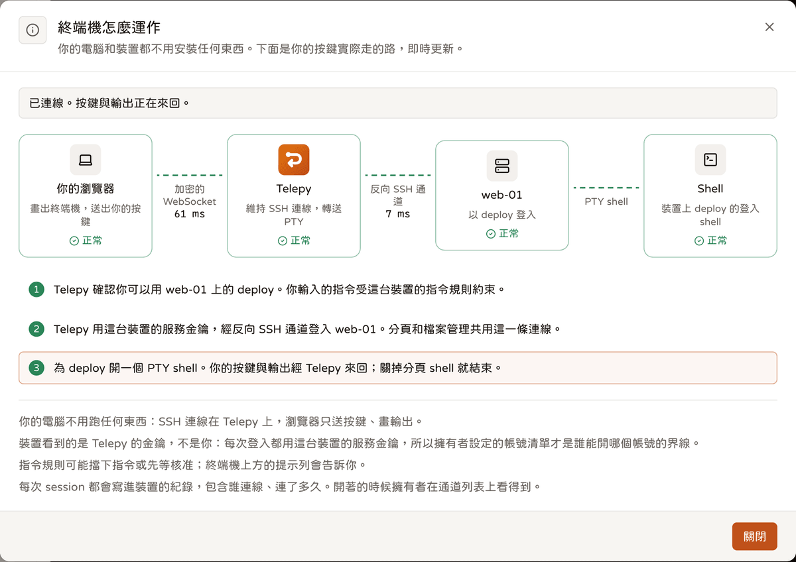
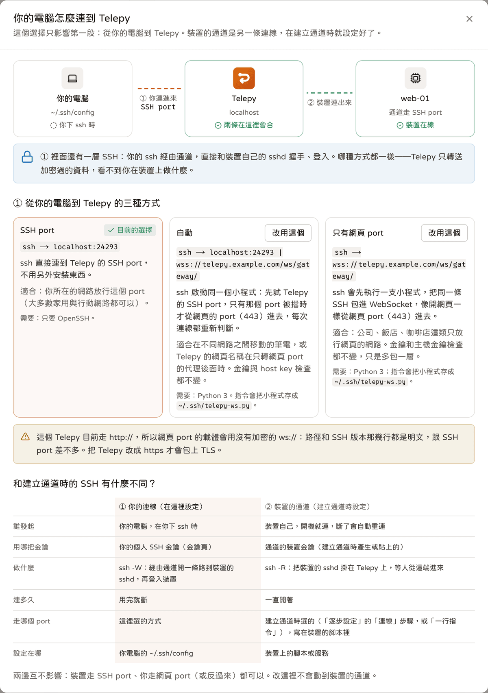
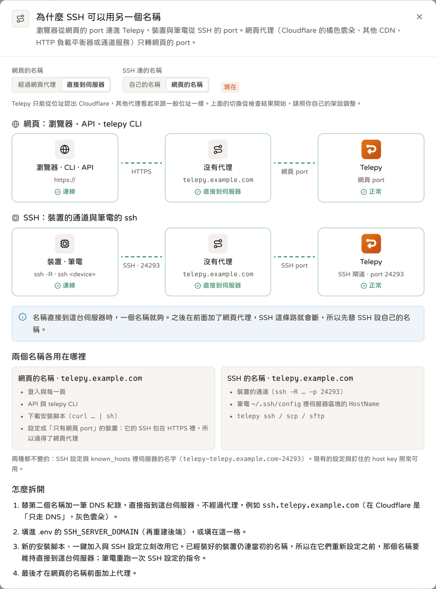

# 後端怎麼連到裝置

<p align="center"><a href="./device-connections.md">English</a> | <b>繁體中文</b> | <a href="./device-connections.ja.md">日本語</a></p>

這是使用說明裡最技術的一篇。它跟著一條連線，從 Telepy 後端一路走到裝置的 sshd：裝置有哪幾種方式連進來、後端怎麼確定連到的是對的機器、連線怎麼共用、用到哪些連接埠，以及在裝置上留下了什麼。

寫給想搞懂內部怎麼運作、或想查出哪裡壞掉的管理員。如果你是帶著問題來的，通常是下面這幾節：

- 網頁的名稱放在 Cloudflare 或其他網頁代理後面，裝置連不到 SSH：[替 SSH 另取一個名稱](#替-ssh-另取一個名稱)。
- 每台裝置看起來都是從負載平衡器的位址連進來：[前面有 L4 代理：PROXY protocol](#前面有-l4-代理proxy-protocol)。
- 裝置的主機金鑰變了，或看到 `device_claimed`：[釘選裝置的主機金鑰](#釘選裝置的主機金鑰)與[一台機器一個主人](#一台機器一個主人)。
- 裝置上的服務被標成「待改名」或「多出來的」：[裝置上的名稱](#裝置上的名稱)。

## 全貌



裝置這端就是一般的 OpenSSH。裝置用自己的通道金鑰執行 `ssh / autossh -NR '*:0:localhost:22' telepy@<server> -p 24242`。

- 現在的腳本一律要求 `-R 0`，由閘道依金鑰認出是哪條通道、自己決定號碼（見[用金鑰認通道](#用金鑰認通道)）。
- 腳本用 `StrictHostKeyChecking=yes` 和 `HostKeyAlias=telepy-<host>-<port>` 釘住閘道的主機金鑰。以前寫著連接埠號碼的舊腳本照樣能用。
- 只能從網頁埠出去的網路，同一條 SSH 改包在 WebSocket 裡走（見[網頁埠](#網頁埠websocket)）。

伺服器這端接住連線的是閘道（gateway），也就是內建在後端程序裡的 SSH 伺服器。（以前是另外一個 OpenSSH 容器。）

```
裝置
  sshd :22
     ▲
     │ 用通道金鑰跑 ssh -NR；通道裡的每條 channel 都接到 localhost:22
     ▼
Telepy 後端（單一程序）
  閘道 :2222（對外 24242）
     │ forward 表：reverse_port → 這台裝置的連線（不綁任何本機連接埠）
     │
     ├─ 連線池：每台裝置、每個 OS 帳號一條 SSH 連線
     │    ├ 網頁終端機：每個分頁一條 PTY channel
     │    ├ 檔案管理 / SFTP：共用一條 sftp channel（exec 備援：每個指令一條）
     │    ├ 遠端瀏覽器：內建 SOCKS5，每個 CONNECT 一條 direct-tcpip
     │    └ 區網主機那一跳：一條 direct-tcpip（最後一跳仍是 OpenSSH）
     ├─ AI session、區網掃描：各自一條連線（channel 一樣在後端裡開）
     └─ 筆電：ssh -W <通道名稱>:22 telepy@server（使用者金鑰）→ 一條 channel
```

不管功能走哪條路，最後都是**對裝置 sshd 的一次 SSH 登入**。後端用這條通道自己的服務金鑰登入（見[每條通道一把服務金鑰](#每條通道一把服務金鑰)），筆電用使用者自己的金鑰。

| 功能 | 怎麼到裝置 |
|---|---|
| 裝置 → 伺服器 | `ssh -NR`（`-R 0`）連到後端內建的閘道；也可以包在 `/ws/gateway/` 的 WebSocket 裡 |
| 網頁終端機 | 共用連線上的一條 PTY channel。同一台裝置、同一個帳號的分頁與檔案管理，共用**一次** SSH 登入 |
| 檔案管理 / SFTP | SFTP REST 和所有檔案管理，共用那條連線上的**一條** sftp channel。裝置沒有 sftp 子系統時，檔案管理改用 exec channel 跑 `ls -la` |
| 遠端瀏覽器 | 後端自己的 SOCKS5 代理（只做 CONNECT），每個 CONNECT 是共用連線上的一條 direct-tcpip |
| 區網主機終端機 | 共用連線上的一條 direct-tcpip，經一次性的本機入口交給 OpenSSH。最後一跳是 OpenSSH，所以可以問密碼 |
| 裝置金鑰清單 | 向同一個連線池借連線，用 SFTP 讀寫 `~/.ssh/authorized_keys` |
| 筆電 | 經閘道的 `ProxyCommand ssh -W` |

改用 Rust 後端之前，這些全都要經過那個 OpenSSH 容器，每個檔案操作都自己啟動一次 `ssh` 或 `scp`，每次兩跳 SSH。

## 裝置怎麼連到閘道



裝置可以走 SSH 埠，可以把 SSH 包在 WebSocket 裡走網頁埠，也可以先試 SSH 埠、不通再改走網頁埠。不管從哪裡進來，裡面都是同一條 SSH，金鑰與規則也都一樣。

### SSH 埠

這是預設的方式。裝置連到 `REVERSE_SERVER_SSH_PORT`（24242；容器內是 2222）。

裝置連的名稱是 `SSH_SERVER_DOMAIN`，也可以在網站設定 →「伺服器」的「SSH 主機」設定。留空就跟網頁同一個名稱。

### 替 SSH 另取一個名稱



網頁的名稱放在只轉網頁埠的代理後面時（Cloudflare 的橘色雲朵、其他 CDN、HTTP 負載平衡器），那個名稱就連不到 SSH 埠。這時要替 SSH 另外設一個直接通到伺服器的名稱。

- known_hosts 的別名（`telepy-<網域>-<port>`）仍然用網頁的網域，所以換 SSH 主機不會讓 Telepy 看起來像另一台伺服器。
- 已經裝好的裝置，繼續連當初設定的名稱。
- 設定頁會解析兩個名稱，也認得出 Cloudflare 的位址，但認不出其他代理。`doctor` 的 `ssh_host` 檢查也一樣。

SSH 的名稱不該開得到網頁。`PUBLIC_URL` 有設、而且 SSH 主機是另一個名稱時：

- 用 SSH 名稱進來的登入一律回 421（`ssh_host`），前端換成一頁說明，指回正式的網址；
- 設定頁不讓你存入你正在使用的名稱，免得把自己鎖在外面。

這擋的是走錯網址和設定失誤，擋不住偽造的 `Host` header；要擋那個，得把 origin 鎖成只有代理連得到。

### 網頁埠（WebSocket）

給只放行網頁埠的網路用：公司內網、飯店、4G 路由器。

裝置的 ssh 會加上 `ProxyCommand ~/.ssh/telepy-<安裝代號>-ws.sh`。這個小小的包裝腳本會執行**載體**：一支把 ssh 的位元組包成 WebSocket 二進位 frame、送到網頁埠的程式。

裡面是同一條 SSH session：同一把主機金鑰、同樣的金鑰登入與 forward 規則。沒有多信任任何東西，也沒有另外的認證訊息，因為認證是在裡面那條 SSH 做的。

在精靈的連線步驟或一行指令加入時選它（`transport: websocket`）。裝了哪一種，會以 `carrier` 事實顯示在「裝置」分頁：`binary <target>`、`python3` 或 `none`。

#### 裝置拿到哪一種載體

1. **預編的 `telepy-carrier`**（優先）：Rust 寫的靜態執行檔，每次 release 都會為 x86_64、aarch64、armv7、armv6 的 Linux，以及 macOS、Windows 各編一份。
2. **`python3` 加 `telepy-ws.py`**（只用標準函式庫，從 `GET /api/join/telepy-ws.py` 下載）：給沒有預編執行檔的 CPU，例如 MIPS 路由器。

加入腳本的 `--carrier binary|python` 可以指定其中一種。

執行檔怎麼送到裝置上：

- 裝置從你自己的伺服器 `GET /api/join/carrier/<target>` 下載，並用伺服器在 `…/sha256` 公布的 sha256 核對。
- 那個 sha256 來自 release 的 `SHA256SUMS`，而且伺服器只接受帶有 Telepy 發行金鑰有效簽章（`SHA256SUMS.sig`）的那一份。
- 某個平台第一次有裝置來要時，伺服器才去 release 頁抓，並快取在 `CARRIER_DIR`（`<DATA_DIR>/carriers`）。`telepy-server fetch-carriers` 可以先全部抓好。
- 網站設定「自動更新裝置載體」打開時（預設開），伺服器每天看一次 release 頁，在背景把較舊的換掉，並通知每位管理員與全站 webhook（`carriers.updated` / `carriers.update_failed`）。
- 在「伺服器狀態 → 相依服務 → 裝置載體」看得到每個平台的版本，也能手動更新。

裝置有設 HTTP CONNECT 代理時，兩種載體都會走它（`HTTPS_PROXY` 或 `--proxy`，`NO_PROXY` 照樣有效）。加入腳本會把執行當下環境裡的代理寫進包裝腳本，因為服務沒有自己的環境變數。

#### 閘道看到什麼

- 來源 IP 取自 `X-Forwarded-For`。哪幾段算代理，由網站設定 →「伺服器」的「信任的代理層數」（或 `TRUSTED_PROXY_HOPS`）決定；預設的 `auto` 會把右邊的內部位址都當成代理。
- 連接埠記成 0。連線資訊、`accepted` 事件，以及通道清單的 `endpoint.transport` 都記為 `websocket`。
- 連線上限（`GATEWAY_MAX_CONNECTIONS`）是兩個入口合起來算。

#### 筆電走網頁埠

筆電也能這樣連。在 SSH 設定對話框的「連到 Telepy 的方式」選「只有網頁 port」，或選「自動」（加上 `--tcp`，先試 SSH 埠）。把 `telepy-ws.py` 存到 `~/.ssh/telepy-ws.py` 之後，伺服器區塊就會多一行 ProxyCommand。

`telepy ssh / scp / sftp` 不用這支小程式，它們預設就走網頁埠（見 [cli.zh-TW.md](./cli.zh-TW.md)）。

### 自動：先試 SSH 埠

`transport: auto` 是精靈與一行指令加入的預設。

- 載體會拿到 `--tcp <SSH 主機>:<port>`。每次連線都先直接連 SSH 埠，看到閘道的 `SSH-` banner 才算數。
- 連不上（防火牆擋住，或網頁名稱在只轉網頁埠的代理後面），就改走 WebSocket。
- WebSocket 走通後會記住 30 分鐘（暫存目錄裡的一個小檔案），之後又會先試 SSH 埠。
- 走了哪條路會寫到 stderr，也就是服務的 log 裡。
- 完全沒有載體的裝置（它的 CPU 沒有預編執行檔，也沒有 python3）只走 SSH 埠，加入時會說明。

一行指令加入用的是 `--auto`，註冊時回報實際裝了什麼（`facts.transport`、`facts.carrier`），Telepy 把它存成這條通道的連入方式（`way_in`）。

### 內建的 SSH client

有些裝置的 SSH client 跟閘道談不來（原廠 OpenWrt 的 dbclient），或根本沒有 SSH client。這時由同一支 `telepy-carrier` 自己跑整條通道。裝置沒有 OpenSSH client 時，一行指令加入會選它（`--client builtin`）：

```
telepy-carrier tunnel --identity <key> --known-hosts <file> --server <SSH host>:<port> [--ws <url>] --forward 0:<sshd>
```

- 它自己跟閘道講 SSH：釘住主機金鑰、用金鑰登入、`tcpip-forward` 0。
- 閘道開過來的每條 channel，它都接到裝置的 sshd。
- 它有自己的 30 秒 keepalive；連線一斷就結束，交給服務管理器重新啟動。
- 連入方式（SSH 埠、網頁埠或自動）與 CONNECT 代理都跟上面一樣。服務直接執行 `~/.ssh/telepy-<安裝代號>-ws.bin`。

細節與限制見 [device-join](device-join.zh-TW.md#一之二內建的-ssh-clienttelepy-carrier-tunnel)。

### 自備載體

Telepy 的載體只是小幫手，不是必要條件。任何能把 ssh 的 stdin / stdout 接成一條到閘道的 TCP 連線的程式，都能當裝置的 `ProxyCommand`。

遇到連網頁埠都過不去的網路（依 SNI 過濾、TCP 被限速），通用的通道工具如 [wstunnel](https://github.com/erebe/wstunnel) 不必改 Telepy 就能補上：

1. 在後端的網路上多跑一個 `wstunnel server` 容器，加上 `--restrict-to backend:2222`（再用 `--restrict-http-upgrade-path-prefix` 設一條暗號路徑）。
2. 在 Traefik 把一條路徑導給它。
3. 裝置端寫 `ProxyCommand wstunnel client -L stdio://backend:2222 wss://<host>/<path>`。

裡面仍然是 Telepy 的 SSH：同一組金鑰、同樣的主機金鑰釘選與 forward 規則。

會失去的：

- 閘道看到的對端是 wstunnel 容器，裝置的公網位址只能等每天的探測補上，會晚一點。
- 連入方式的標示會是 SSH，而不是 SSH over WSS。
- 「裝置」分頁不認得你手動裝的服務。

必須做對的：

- wstunnel server 預設全部放行。沒加 `--restrict-to`，就等於開了一個通往 compose 內網的中繼，guacd 和遠端瀏覽器的 session 管理程式都摸得到。
- Telepy 不內建、也不管理它。wstunnel 的協定在大版本之間會變，所以每台裝置上的 client 得跟著容器一起升級。

### 前面有 L4 代理：PROXY protocol

閘道前面有 L4 代理時（nginx stream、HAProxy `mode tcp`、雲端的 NLB），每條連線看起來都是從代理來的。

把代理列進網站設定 →「伺服器」的「SSH 閘道的 PROXY protocol 來源」，或 `.env` 的 `GATEWAY_PROXY_PROTOCOL_FROM`：

- 填 IP 或 CIDR，用逗號或空白分隔。留空就是關閉。
- `.env` 有設的話以 `.env` 為準，頁面上的欄位會鎖住。
- 之後代理送來的 v1 / v2 header 裡的來源，會在所有地方取代原本的對端：事件、endpoint、誰在使用這條通道、IP 變更告警。

閘道怎麼處理：

- **可有可無、自動判斷**：閘道先偷看第一個 byte。SSH 一定以 `S` 開頭，PROXY header 則是 `P` 或 `\r`。5 秒內什麼都沒收到，就當成在等 banner 的直連客戶端。
- **一個 byte 都不多讀**：讀到 header 結尾就停，後面的 SSH 完全不碰，所以設錯也不會把直連的裝置擋在外面。
- v1 `UNKNOWN` 和 v2 `LOCAL` 沿用原本的對端。header 格式錯，或 5 秒內沒送完，就拒絕並記一筆 `refused_proxy` 事件。只連上就斷的（健康檢查）不記。
- **沒列出的來源，從不讀 header**：否則任何人都能自稱任何 IP，IP 變更告警就沒有意義了。

裝置端的腳本不用改。

## 用金鑰認通道

金鑰一登入，閘道就知道是哪條通道。所以裝置要求 forward 時，它要的是哪個號碼並不重要：

- 要 0，或要別人的號碼，結果都一樣：forward 一律記在通道自己的號碼（`reverse_port`）下，回給裝置的也是這個號碼。
- 裝置要求的號碼不同時，`forward` 事件會註明。
- 使用者金鑰認不出通道，所以跟以前一樣，只能 forward 自己擁有的通道的號碼。

裝置端的腳本一律寫 `-R 0`（Docker 版是 `SSH_TUNNEL_PORT=0`，一行指令加入也一樣）。號碼只存在伺服器上。

刪除通道時的移除腳本，也是用**金鑰**找出這條通道的東西：命令列或檔案裡的 `-i <金鑰檔>` 或 `IdentityFile`、Docker 的 `KEY_FILE=` 或 `<path>:/id_rsa`、容器掛在 `/id_rsa` 的金鑰。旁邊的 `.pub`，或 `ssh-keygen -y` 算出來的，必須是通道金鑰。以前寫著連接埠號碼的舊腳本，照舊用號碼認。

一行指令加入的背景迴圈重跑時，是用這條通道自己的 known_hosts 檔（`telepy-<安裝代號>.known_hosts`）找出舊的 ssh：號碼認不出它，金鑰檔又可能同時給別台 Telepy 伺服器的通道用（見[不碰別台伺服器的東西](#不碰別台伺服器的東西)）。

### 筆電用通道名稱連線

筆電的 `direct-tcpip` 除了 `localhost:<號碼>`，也接受 `<通道名稱>:<任意 port>`；通道名稱全站唯一。所以產生的 ssh config 裡，裝置區塊就是單純的 `HostName <名稱>` / `Port 22`，經 `ProxyCommand ssh -W %h:%p <伺服器區塊>` 跳過去。舊的設定檔照樣能用。

名稱比對不分大小寫，因為 OpenSSH 會先把 `HostName` 轉成小寫才放進 `%h`（`MyBox` 到閘道時是 `mybox`）。完全相同的優先，否則挑這把金鑰連得到的那條。以前是精確比對，名稱有大寫的通道會被拒絕（`administratively prohibited`）。

誰能連沒有變：擁有者、ADMIN，或至少有一個允許帳號的分享對象；敏感的通道要先在網頁上確認身分。遇到下面這些情況，閘道在登入時就拒絕個人金鑰：

- 金鑰過期（記一筆 `expired_key` 事件）；
- 帳號被停用；
- 管理員替這個人關掉了「個人 SSH 金鑰」功能。

### 通道名稱照 OpenSSH 的規矩

通道名稱同時是 ssh_config 裡的主機名稱，所以照 OpenSSH 的規矩來：只能用英文字母、數字和 `.` `_` `-`，以字母或數字開頭，最多 63 個字元，而且不分大小寫唯一。其他字元不行的原因：

- 空白在 ssh_config 會把一個名字拆成兩個，OpenSSH 9.6 起在命令列上也直接拒絕。
- `%` 會被當成 `%h` 那樣展開。
- `* ? ! ,` 是樣式符號，`#` 是註解。
- `@` 和 `:` 是 Telepy 自己要用的：`<通道>@<帳號>`、`<通道>:<路徑>`。

規則出來之前就存在的名稱照樣能用。產生的設定會把它們寫成 `HostName localhost` / `Port <號碼>`，網頁也會提醒擁有者改名。

### 一份 ssh config 裡有好幾台 Telepy

- 伺服器區塊的別名是 `telepy-<網域>-<port>`（跟它的 `HostKeyAlias` 是同一個字串），每台 Telepy 伺服器各一個，所以好幾台可以放在同一份設定裡互不干擾。
- 舊版共用的 `telepy-ssh-server` 區塊，安裝指令只在確定它屬於這台伺服器、又沒有別的東西在用時才拿掉。
- 兩台伺服器都有同名的裝置時，安裝指令會看既有區塊的 ProxyCommand 經過哪台伺服器。是別台的就保留、不覆蓋，並列出保留了哪些名稱。
- 替其中一台設「名稱前綴」（個人設定 `ssh_alias_prefix`，例如 `work-` → `ssh work-pi`），兩邊就能並存。

## 確認連到的是對的機器

裝置分不出 Telepy 的使用者，它只看得到一把自己信任的服務金鑰。所以有三件事得由 Telepy 自己確認：另一端的機器跟上次是同一台、這台機器只屬於一個帳號，而且它只信任自己這條通道的金鑰。

### 釘選裝置的主機金鑰

後端每次連到裝置，都會核對裝置 sshd 出示的主機金鑰。

- **第一次連線**：記下這把金鑰（第一次使用就信任，TOFU）。通常就是裝置加入後，後端自己做的那次驗證登入。
- **之後換了一把**：拒絕握手，把新的金鑰記成待確認，並通知擁有者與分享對象。
- **該怎麼做**：擁有者或 ADMIN 打開通道詳細資訊，到「金鑰與身分」→「裝置身分」，跟裝置上的指紋核對後按「改信任這把金鑰」。按「忘掉」則清掉釘選，讓下一次連線重新記。

為什麼要這麼麻煩：拿到通道金鑰的人，可以把 `-R` 指到自己的 sshd 冒充裝置，接走終端機輸入、上傳的檔案和遠端桌面的密碼。釘選之後，冒牌貨在握手時就被擋下，服務金鑰的登入根本不會送出去。

筆電也用同樣的方式核對裝置。產生的 ssh config 裡，裝置區塊用 `UserKnownHostsFile ~/.ssh/telepy_known_hosts` 和 `HostKeyAlias <伺服器別名>-device-<通道 id>`：

- Telepy 已經釘住時，區塊寫的是 `StrictHostKeyChecking yes`，釘住的那幾行跟伺服器的放在同一個檔案。安裝指令、`telepy config install` 和 `telepy ssh` 都會一起存。
- Telepy 還沒釘住時，區塊寫 `accept-new`：筆電第一次連線時自己記下，之後換了就拒絕。
- 擁有者改信任新的金鑰之後，筆電要重跑一次安裝指令。

以前裝置區塊寫的是 `StrictHostKeyChecking no`，通道一旦被指到別人的 sshd，筆電的 `ssh <裝置>` 就會直接連過去。

### 一台機器一個主人

裝置信任共用服務金鑰的時候（一開始每台都是，比較舊的裝置現在仍是），誰能把通道指到某台機器的 sshd，誰就能用「自己通道」的帳號清單登入它，連 root 都行。要指過去並不難：從那台機器上的任何帳號，或從同一個區網、VPN 跑 `-R <port>:<那台機器>:22` 就好。擋住這件事的是釘選的主機金鑰，因為它同時也是這台機器的身分。

**釘選之前，Telepy 會先看還有誰信任同一把金鑰。**

- 別的帳號的通道：拒絕握手。錯誤訊息以 `device managed by another account` 開頭，API 與遠端桌面回報的錯誤碼是 `device_claimed`。
- 被拒的通道記一筆 `claim_refused`。那台機器自己的通道記一筆 `claim_attempt`，並發 `DEVICE-CLAIM-ATTEMPT` 通知給擁有者與 ADMIN 分享對象，同一把金鑰只通知一次。
- 「改信任這把金鑰」和「忘掉再重連」都照同一條規則，兩條路都繞不過。
- 你自己的另一條通道：照常釘選，`GET …/host-key` 會在 `same_machine` 列出它。

**加入腳本在註冊時就把主機金鑰送上來**（在裝置本機跑 `ssh-keyscan`）。

- 屬於別的帳號的機器，在通道建立之前就被拒絕（409）。訊息會建議向擁有者要分享，或者如果這台是複製出來的 VM，就重新產生主機金鑰。
- 你自己的另一條通道會回 `SAME_MACHINE_AS`，網頁上會提醒。
- 新通道的主機金鑰立刻釘選，第一次連線不再是看到什麼就信什麼。
- 重新加入時，只在還沒有釘選、或至少有一把對得上時才補上。全部換掉的，交給連線時的核對去拒絕。

**同樣精神的其他規則：**

- 裝置金鑰全站唯一，不看註解、也不管是誰的。裝置金鑰不能是別人的個人金鑰（你自己的可以：你平常用的電腦本身也可以是一台裝置），也不能是服務金鑰，因為閘道只認金鑰，先登記的那條通道會被當成這把金鑰的裝置。
- 筆電經閘道連 SSH，至少要有一個允許的帳號：一個都沒有的分享對象，開不了通往裝置 sshd 的 channel。允許清單是唯一的邊界；ADMIN 負責管這份清單，所以是例外。

通道刪掉後，釘選也跟著消失。這台機器又沒有主人了，下一條指過來的通道會釘選它。刪除時，通道自己的服務金鑰一定會從裝置上移除。裝置上還留著舊的共用金鑰的話，在刪除對話框勾選「也把共用的 Telepy 金鑰從 … 移除」（這台機器的最後一條通道會預先勾好），這台機器才算真正離開 Telepy。

### 每條通道一把服務金鑰

釘選擋住的是別人的機器；每條通道各一把金鑰，則是把問題連根拔起。以前全站只有一把服務金鑰（`SSH_IDENTITY`），每台裝置都信任它。現在：

- 每條通道第一次需要時，產生自己的 ed25519 金鑰對。
- 私鑰用從 `SECRET_KEY` 衍生的金鑰密封，存在資料庫裡。
- 公鑰（`… telepy-tunnel-<id>`）交給精靈、一行指令加入、Docker 腳本和通道詳細資訊。裝置只授權這一把。

實際上會這樣運作：

- **登入順序**：先用通道金鑰；只有裝置還沒裝它的時候，才退回共用金鑰。用通道金鑰登入成功，就把那個帳號記為已驗證。
- **舊裝置的遷移**：下一次金鑰同步時，通道金鑰會裝進每個登入帳號，下一條連線就改用它。共用金鑰要等到**同一台機器上、每條列了這個帳號的通道**都用自己的金鑰登入過，才會從那個帳號移除（事件 `service_key_migrated`）。
- **手動移除**：裝置金鑰面板把共用金鑰標成「共用 · 舊」，管理者可以在同一條規則下手動移除。
- **搬家期間**：網站設定 →「伺服器」的「在裝置上保留共用服務金鑰」（或 `.env` 的 `KEEP_SHARED_SERVICE_KEY=true`）會讓共用金鑰留在每台裝置上，自動或手動都不移。舊的 Telepy 伺服器還在用這把金鑰登入同一批裝置時就打開它。通道金鑰照樣會裝、照樣優先使用。
- **刪除通道**：一定把它自己的金鑰從裝置移除。刪除對話框裡關於服務金鑰的選項，現在只管共用的那一把。
- **不會撞**：通道的服務公鑰，不能登記成裝置金鑰或個人金鑰。

> [!WARNING]
> 換掉 `SECRET_KEY` 之後，密封的金鑰就解不開了，那些通道會退回共用金鑰。`doctor` 的 `tunnel keys` 檢查會指出有幾把解不開。共用金鑰已經被移除的裝置，必須重新授權（精靈的第 3 步，或一行指令加入）。

## 每台裝置、每個帳號共用一條連線

每按一下就重新 SSH 登入一次會很慢，所以後端替**每條通道、每個 OS 帳號維持一條 SSH 連線**，在上面開 channel。

- 被允許使用同一個 OS 帳號的 Telepy 使用者，共用同一條連線，各自用自己的 channel。權限一樣在借用之前就會檢查。
- 連線在第一次用到時才建立，整個在後端裡完成：在裝置的通道上開一條 forwarded-tcpip channel，再在上面跟裝置的 sshd 握手。好幾個請求同時來時只握手一次，其他的等它。

### Session 上限（MaxSessions）

OpenSSH 的 MaxSessions 只限制 session channel（shell、exec、sftp），不限 direct-tcpip，所以連線池也只數這一種。

- session channel 包括終端機分頁、exec、裝置金鑰清單和 macOS 的名稱解析。
- 一條連線同時最多 8 條。sshd 預設的 MaxSessions 是 10，留 2 條備用：裝置要處理完我們的關閉（shell 還得先結束）才會放出名額，名額一還回來馬上再用，有可能被拒。
- 裝置把 MaxSessions 設得更小、拒絕開 channel 時，連線池會記下那條連線實際撐得住幾條，再開第二條連線。學到的上限 2 分鐘後失效，因為被拒可能只是一時的。
- 只開 direct-tcpip 的功能（遠端瀏覽器的 SOCKS、遠端桌面和 RustDesk、區網那一跳）改用租約（lease）：只讓連線不被回收，不占名額。以前它們每個都占一格，開著遠端瀏覽器加遠端桌面，終端機分頁就少兩格。

### 檔案共用一條 sftp channel

SFTP 的請求有編號，很多人同時用同一條 channel 也沒問題。所以每條連線只開一條 sftp channel，SFTP REST 和所有檔案管理都走它。

- **好處**：不必每個請求都重開 channel、要求子系統、做 INIT，那在通道上要來回好幾趟。檔案管理開再多，也只占一格。
- **代價**：裝置的 sftp-server 一次只處理一個請求，一個卡住的請求（例如卡在掛掉的網路磁碟）會讓大家一起等。
- **安全網**：後端會數送出的請求與收到的回覆。channel 關了，或有請求在等、卻 15 秒都沒收到任何東西，就當作壞掉，下一個借用的人拿到新的一條。檔案管理列目錄失敗時，會自己換一條再試一次。
- **閒置**：5 分鐘沒人用，就關掉 sftp channel、還回名額，即使連線本身還有人在用。
- **沒有 sftp 子系統**：裝置拒絕時，檔案管理一收到拒絕就改用 exec，不再等 SFTP 啟動的 10 秒逾時。

### 閒置連線、分頁與離線的裝置

- 沒有人在借用、而且閒置超過 5 分鐘的連線會被關掉（每 30 秒檢查一次）。
- 裝置斷線時，它的連線自己失效，開著的終端機分頁會被關掉，下次用到時重新連線。
- 一個終端機分頁就是一條 channel，關分頁只關那一條。以前一個 `killpg` 可能打到共用的 ControlMaster，把所有分頁一起關掉。效率很高，只是方向錯了。
- 裝置離線時，馬上回 close code 4005，不必等逾時。

### Mac 與主機名稱

Apple 的 `sshd-session` 有個地雷：收到目標是**名稱**的 direct-tcpip 時，它的權限分離子程序在 fork 之後呼叫 getaddrinfo 就會 abort，整條 SSH 連線跟著斷。

Chromium 經 SOCKS 一律送名稱，所以遠端瀏覽器一打開網頁就會踩到。在共用連線上，同一台裝置、同一個帳號的終端機分頁和檔案管理也會一起斷。因此在 SOCKS 代理或區網那一跳開 direct-tcpip 之前，後端會：

- 每條連線先問一次作業系統（`uname -s`）；
- 是 Darwin 的話，**在裝置上**用 `/usr/bin/dscacheutil` 把名稱解析成 IP（IPv4 優先；內網與 `.local` 名稱照常可用），再對 IP 開 channel；
- 其他系統照舊把名稱交給裝置解析，跟 `ssh -D` 一樣。

Mac 上的細節：

- 同一個名稱同時查詢只跑一次，同時最多 2 個查詢。每個查詢都會借一條 session channel，所以也算在上面的上限裡。
- 查得到的結果快取 60 秒，查不到的快取 10 秒。
- 解析不了的話，那個 CONNECT 就失敗。名稱**絕不**交給 Apple 的 sshd。

### 共用省下多少

同一台裝置、同一個帳號，從第二個操作起就不再握手。測試量到的數字：

- 連續 5 次列目錄：1 次登入、1 條 sftp channel
- 同時 12 個請求：1 次登入、1 條 sftp channel
- 3 個終端機分頁加檔案管理：1 次登入
- 10 個租約加 8 條 session channel：1 次登入

## 連接埠：用在哪、會不會用完？

| 連接埠 | 用途 | 數量 | 會不會用完 |
|---|---|---|---|
| 24242、8787 | 對外：裝置的通道與網頁（走網頁埠的裝置也用 8787） | 固定 | 不會 |
| `reverse_port` | 每條通道一個**號碼**，閘道把裝置的 forward 記在它底下。**不綁任何本機連接埠** | 每條通道 1 個 | 號碼空間大約夠 64,500 條通道 |
| SOCKS 連接埠 | 每個遠端瀏覽器 session 一個，由瀏覽器容器連進來。Chromium 的 SOCKS 不支援帳密，所以沒辦法共用 | 受 session 上限限制 | 不會 |
| 區網主機的一次性入口 | 每開一個區網主機終端機，`127.0.0.1:<臨時連接埠>` 就等一條連線（30 秒沒人來就關） | 開著的區網終端機數 | 不會 |
| 遠端桌面的回連埠 | 每個 RDP / VNC session 一個一次性的 listener（隨機連接埠，只接受 guacd 的位址）。guacd 連進來後就接到裝置的 direct-tcpip，listener 隨即關掉 | 開著的桌面 session 數 | 不會 |

後端連裝置完全不經過 loopback TCP，所以沒有臨時連接埠會用完，也不會堆一堆 TIME_WAIT。`reverse_port` 只是個號碼，不會跟容器裡任何東西衝突；發號碼時只要跳過已經發出去的就好。

## 裝置上的名稱

### 為什麼要改名稱

以前裝到裝置上的東西，有些帶著人或伺服器的名字：

- 一支手寫遷移腳本裝的 `telepy-natlee.service`、`info.natlee.telepy` 和 `telepy_natlee_known_hosts`；
- 一行指令加入的 unit 說明裡寫著通道名稱；
- 所有通道共用的 `telepy-tunnel.service`，同一台機器上的兩條通道會互相覆蓋；
- `~/.ssh/telepy_known_hosts`，第二台伺服器加入時會把第一台的主機金鑰蓋掉。

別人的機器上出現 `telepy-natlee`，等於告訴他這台伺服器是誰在管。而且 Telepy 不知道當初裝了什麼，刪除時只能用猜的。

### 安裝代號

每條通道在第一次需要時，從 `[a-hj-km-np-z2-9]` 抽一個 8 個字元的隨機代號。它全站唯一，跟著通道一起刪除。裝置上的每個名稱都從它來：

| 東西 | 名稱 |
|---|---|
| systemd unit（system、`--user`，或 autossh 服務） | `telepy-<id>.service` |
| launchd 工作 | `com.telepy.tunnel.<id>` |
| 背景迴圈 | `~/.ssh/telepy-<id>.sh` |
| 主機金鑰 | `telepy-<id>.known_hosts` |
| 解除安裝腳本 | `telepy-<id>-uninstall.sh` |
| 網頁埠載體 | `telepy-<id>-ws.*` |
| Docker 容器 | `telepy-<id>` |

unit 的說明只寫 `Telepy reverse tunnel <id>`。

- 代號裡沒有使用者、網域或通道名稱，所以通道改名不必動到裝置。在通道頁搜尋代號，就找得到那條通道。
- 用隨機而不用雜湊：沒有紀錄的話本來就算不回原名，而且雜湊會跟著 `SECRET_KEY` 一起變。
- `telepy-` 前綴留著，讓裝置的管理員看得出這是什麼。一個看不出來歷、一直往外連 SSH 的服務，看起來實在很像惡意程式，這可不是你想留給別人家管理員的第一印象。
- ssh 指令本身仍會寫出它連的伺服器（`telepy@<網域>`、`HostKeyAlias`），因為連線本身需要。

### 盤點裝了什麼

刪除時用的移除腳本，也有盤點模式。它什麼都不改，只回報找到的東西：unit 和 plist 的路徑、背景迴圈、正在跑的 ssh 程序與它們的擁有者、crontab 行、容器、金鑰和 known_hosts 檔。

結果會存起來，並在這些時候更新：

- 一行指令加入驗證成功之後；
- 每天的裝置檢查，在從沒盤點過、或上次盤點超過 7 天時；
- 在通道詳細資訊「裝置」分頁的「裝置上的安裝」按「重新檢查」時。

Windows 的腳本只會移除，盤點還沒做，只回報平台。

盤點會處理這些情況：

- **登入帳號讀不到的檔案**：以 root 跑的 unit 常把金鑰放在 `/root/.ssh`，像 `ubuntu` 這樣的帳號讀不到。登入帳號有 `sudo -n` 時，金鑰、unit 和迴圈腳本改用 `sudo -n cat` / `test -f` / `ssh-keygen -y -P ''` 讀（只讀不寫，同一個檔案只問一次）。
- **沒寫金鑰的服務**：指令沒寫金鑰檔、明確連到這台閘道的連接埠、又有 `-R` 時，就拿執行它的帳號的預設金鑰（`~/.ssh/id_ed25519`、`id_ecdsa`、`id_rsa`…）來比對。執行帳號依序是：程序的擁有者、unit 的 `User=`、plist 的 `UserName`、沒寫的系統層 unit 算 root，其他情況則是登入帳號。預設金鑰是那個人自己的檔案，所以刪除時絕不會刪。
- **launchd 的 plist**：plist 把每個參數放在各自的 `<string>`，所以比對前會先接成一行，不然 `-p` 和 `-i` 都讀不到。
- **OpenWrt**：procd 的 init 腳本（`/etc/init.d/*`，有 `/etc/rc.common` 才看）和 `/etc/rc.local` 裡的行，照同樣的規則辨認。刪除時，init 腳本先 disable，再由停止腳本 stop 並刪掉；rc.local 只拿掉那一行。
- **Dropbear 的指令長度限制**：OpenWrt 路由器常用 Dropbear，它不收超過 9000 字元的 exec 指令，而這支腳本有 25 KB。超過 6000 字元的腳本會分段送（`printf >> <暫存檔>`），最後一個 exec 執行它並刪掉。任何 sshd 都收得下，也在 BusyBox ash（Alpine）上跑過。

### 不碰別台伺服器的東西

同一把金鑰可能同時服務兩台 Telepy 伺服器，以前光看金鑰比對，曾經把另一台伺服器的 unit 一起拆掉。所以現在檔案或命令列寫了連接埠（`-p N`、`'-p' 'N'`、`Port=N`、`SSH_REMOTE_PORT=N`），而且沒有一個是這台閘道的 `REVERSE_SERVER_SSH_PORT`，就算是別台伺服器的（`kept other-server`）。刪除、盤點、改名都會跳過它。沒寫連接埠的，照舊辨認。

### 改名不離線

不是 Telepy 取的名稱（手寫或遷移腳本建立的，例如 `telepy-natlee.service`）會被標成「待改名」，通道清單上也會出現「服務名稱待改」的標記。按「在裝置上改名」就會換成私人的名稱。

麻煩的是，改名的指令本身就是經這條通道送過去的。先停舊的服務，等於自己拔掉自己正在用的網路線。所以要先讓新的服務接上，再拆舊的：

1. **排計畫**：重新盤點，根據正在跑的 ssh（它的 `-i`、`-p`、`-R` 目標、`user@host`、ProxyCommand）和找到的舊服務排出計畫。用跟原本一樣的方式：systemd 的 system unit 還是 system unit，沿用原本的 `User=`；`--user` unit、LaunchAgent 和迴圈，由現在跑它的那個帳號來跑；系統層需要 root 或 `sudo -n`。金鑰、伺服器、連接埠和轉發目標都不變，known_hosts 改寫成這台閘道的主機金鑰。擋住計畫的原因（Windows、需要 root、看不懂的指令、相對路徑的金鑰…）會在網頁上說明。
2. **準備交接**：在這段時間內，同一條通道（用同一把通道金鑰認出來）的第二條連線不會被拒絕。它的 forward 記成備援，並回報成功，讓新 ssh 的 `ExitOnForwardFailure` 不會讓它退出。forward 仍留在舊連線上（事件 `standby_forward`）。
3. **安裝**：經舊連線執行。檔案先寫在舊檔旁邊再改名，然後啟動新服務。
4. **等待**：等備援出現（預設 45 秒），再經由它登入一次。
5. **切換**：forward 移到新連線（事件 `handover`）。舊連線還活著，但已經不帶這條通道。
6. **拆掉舊的**：經**新**連線執行，用的是跟刪除一樣的搜尋，只是跳過所有用代號取名的東西，金鑰也留著。舊的 unit、plist、迴圈、crontab 行、舊的 known_hosts（沒有別人在用的話）和舊的解除安裝腳本都會拿掉；停止腳本照舊在背景執行。
7. **確認**：舊連線已經斷了，forward 還在新連線上，而且 13 秒內沒有冒出別的連線（有的話，代表還有東西在重啟舊服務）。最後再盤點一次（事件 `service_renamed`）。

第 2 到第 5 步任何一步失敗，Telepy 就經舊連線把剛裝的拆掉，取消交接。舊服務完全沒被動過，通道一直在線上。如果舊連線剛好在途中自己斷了，備援會自動接手，所以那樣也不會離線。

唯一的代價：舊連線關掉時，這台裝置上開著的網頁終端機和檔案管理會重連一次，因為它們的 channel 在舊的 TCP 連線上。

有兩種名稱不需要這麼做：

- **Telepy 以前自己的名稱**（一行指令加入的 `telepy-tunnel-<n>.service` / `com.telepy.tunnel.<n>` / `telepy-tunnel-<n>.sh`、autossh 的 `telepy-tunnel.service`、容器 `telepy-tunnel`）不帶人名，刪除時也認得。它們顯示為「Telepy 先前的名稱」，要不要改隨你（「還是改名」）。
- **`/etc/rc.local` 裡的一行**，Telepy 不會自己替換（改名會回 `unsupported`）。請手動改，或重跑一次一行指令加入，它會用私人名稱重新安裝。至於 OpenWrt 的 init 腳本，則跟其他服務一樣可以改名。

### 同一台機器上有多人、多台伺服器

- 不同的 Telepy 帳號，不能把通道指到同一台機器（見[一台機器一個主人](#一台機器一個主人)）。
- 不同的 OS 帳號，或連到不同伺服器時，以前會撞到共用的名稱：`telepy-tunnel.service`、容器 `telepy-tunnel`、`/etc/ssh/telepy_known_hosts`、`~/.ssh/telepy_known_hosts`，以及用通道編號取名的 `telepy-tunnel-<n>`（兩台伺服器的資料庫是複製來的話，編號會一樣）。現在這些全都改用安裝代號命名了。
- 同一個 OS 帳號用**同一把金鑰**連兩台伺服器時：刪除時，只要還有連到另一台伺服器的東西（unit、腳本、正在跑的 ssh）在用 `~/.ssh/telepy_tunnel_*`，它就會留著（`kept key … another server`）。一行指令加入的迴圈只停自己的 ssh，靠的是它的 known_hosts 檔，而不是金鑰。
- 盤點會把連到別台伺服器的東西回報成 `kept other-server "<file or ssh> (port N)"`，共用的金鑰回報成 `note key-shared <path>`。「裝置」分頁的「這台裝置連到哪裡」圖，就照這些一台伺服器畫一列。

> [!NOTE]
> 如果把整份資料庫複製去跑第二台伺服器，安裝代號也會一起複製，兩台在同一台裝置上裝的東西就會同名。

### 刪除時的清理

- 刪除時認得新名稱的 unit、launchd 標籤、迴圈、解除安裝腳本、載體檔案和 `telepy-<id>.known_hosts`。
- known_hosts 檔只在沒有任何 unit、plist、迴圈、`~/.ssh/config` 或 CLI 設定還在用時才刪。裝置常常也是某人的筆電，`~/.ssh/telepy_known_hosts` 可能是那台筆電 ssh config 的。
- 一行指令加入重跑時，如果看到同一條通道用舊名稱裝的東西（`telepy-tunnel-<id>`），會先停掉、拿掉，再裝新的，兩個不會搶同一條通道。

### 多出來的一份

光看名字，分不出「人取的名字」和「另一個安裝代號」：`telepy-natlee` 長得也像代號。這件事真的在一台路由器上發生過。盤點把一支 init 腳本標成要改名，但它其實是一條已刪除的通道留下的；而重新加入時，新金鑰被寫進了**同一個**金鑰檔。所以那份遺留的服務用的正是新通道的金鑰，一重開機，兩個都會起來搶這條通道。

所以 Telepy 會問三個問題，只有最後一個跟名字有關：

1. **是不是這條通道的？** 用這條通道的金鑰，而且連到這台閘道。
2. **正在跑的是哪一個？** 盤點看到的 ssh 全都是用安裝代號取名的那個（命令列帶著 `telepy-<id>.known_hosts`）時，這條通道的其他服務或容器，不管叫什麼，都是**多出來的**。它不算要改名，改名會回 `extra`。
3. **名字看不看得出是誰？** 只有用安裝代號取的名字才是私人的。通道刪除時，它的代號、名稱和擁有者會記進一本帳本，新的代號絕不會跟它們重複。名稱裡的 `telepy-<x>` 或 `com.telepy.tunnel.<x>`，要跟帳本對得上，才會標成那條已刪除通道留下的；通道名稱只顯示給同一位擁有者。Telepy 以前的標準名稱，則是一份固定的清單。

在「裝置」分頁按「拿掉多出來的」（或呼叫 `POST …/device-install/tidy`）不需要交接，因為多出來的那份不是正連著的那個：

1. 重新盤點。必須真的有多出來的一份、裝置不是 Windows，系統層的那份還需要 root 登入。
2. 經**現在的**連線，跑跟改名時一樣的清理：跳過所有用代號取名的東西，金鑰留著。init 腳本先 disable，再由停止腳本 stop 並刪掉；known_hosts 檔只有那份用的才會一起刪。
3. 觀察 13 秒：連線一直在、forward 沒有移動，也沒有冒出別的連線。
4. 再盤點一次確認（事件 `service_extra_removed`）。

移除腳本也會掃 `~/.ssh/telepy-*.sh`。用這條通道的金鑰連這台伺服器的迴圈，即使沒在跑，也算這條通道的，所以已刪除的通道留下、沒在跑的迴圈也找得到。

## 還沒做的

- **AI session 和區網掃描仍然各自開一條連線。** 一個 AI session 同時最多跑 4 條 channel（指令和互動 shell 共用），再加上 SFTP；只算成一個 session 的話，連線池會低估它對裝置 MaxSessions 的用量。它本來就在後端裡開 channel、不占連接埠，共用連線只能省一次握手，所以還沒搬過去。
- **`reverse_port` 的上限。** 通道已經用金鑰辨認，裝置在 `-R` 要哪個號碼都無所謂，筆電也用 `ssh -W <通道名稱>:22`。不過 `reverse_port` 仍是每條通道一個 16 位元的內部號碼，超過大約 6 萬條通道時，得改成更大的整數。那只是型別和分配器的改動，裝置和筆電都不用改。這種煩惱，我們很樂意有。

## 測試

<details>
<summary>端對端測試涵蓋了什麼（給貢獻者）</summary>

這裡的每條 SSH 路徑，都在 `tests/common/lab.rs` 的 SSH lab 上做端對端測試：真的閘道、sshd 機器，以及真的 OpenSSH client。新的 SSH 路徑也一樣建在它上面。

- `tests/terminal_e2e.rs`：
  - PTY 與回顯（含多位元組字元）、resize 以 window-change 送到裝置、二進位的 pong。
  - 五個獨立的分頁，關掉一個其餘照常。
  - 分頁共用一次登入；MaxSessions 為 2 時，第三個分頁也開得起來。
  - 裝置斷線時分頁被關掉、重連後再開；離線時直接回 4005。
  - 區網主機那一跳；檔案管理的 SFTP 與 exec 備援共用連線。
- `tests/socks_e2e.rs`：
  - 真正的 SOCKS5 CONNECT 經裝置連到它區網裡的服務，包括同時好幾條，以及連不到的目標。
  - stop 之後代理埠會關閉；離線時回 `device_offline`。
  - 假的 macOS 裝置，對名稱的 direct-tcpip 會斷線，模擬 Apple 的當機：用名稱 CONNECT 一樣通，同一條連線上的終端機分頁也還活著。
- `tests/device_pool.rs`：
  - 連線與 sftp channel 的共用，從裝置 sshd 的登入次數與 sftp 啟動次數來數。
  - MaxSessions 小於 8 時會開第二條連線；租約不占名額。
  - 壞掉的共用 sftp 會被換掉，沒人用的會被關掉；檔案管理會自己換一條。
  - sftp 子系統被拒時，裝置上不會留下 channel。
  - 裝置重連、閒置回收，以及使用中的連線不會被回收。
- `tests/ssh_topology.rs`：同一台裝置上的多個使用者與 OS 帳號、多跳路徑，以及沒有允許帳號的分享對象。
- `tests/gateway_ws.rs`：裝置經 `/ws/gateway/` 連線，用真的 `telepy-ws.py` 當 ProxyCommand。
- `tests/proxy_protocol.rs`：L4 代理送來的 PROXY header（lab 用 `Lab::start_with(|config| …)` 設定代理位址）。
- `tests/key_identified.rs`、`tests/tunnel_delete.rs`：用金鑰認通道，以及刪除時在裝置上找到什麼。
- `tests/host_keys.rs`：主機金鑰釘選。
- `tests/laptop_device_host_key.rs`：筆電這一端，含冒牌的 sshd，以及跟舊設定的對照。
- `tests/machine_identity.rs`：把通道指到別人的機器、兩種繞過規則的方法、自己的第二條通道、刪除後釋出。
- `tests/join_api.rs`：註冊時的拒絕、同一台機器的提醒、立刻釘選。
- `tests/rest_api.rs`：裝置金鑰去重複。
- `tests/tunnel_service_keys.rs`：新裝置只信任通道金鑰、舊裝置的遷移、等同一台機器上的每條通道、刪除時移除。
- `tests/device_install.rs`：真的 `/bin/sh` 裝置，用真的重連迴圈當舊服務，`<home>/bin` 裡放假的 `crontab` / `ssh`。
  - 改名過程中 forward 一次都沒有釋放；新服務連不上時會自動復原。
  - 已刪除通道留下的迴圈會被認成多出來的一份，透過帳本查出來源，拿掉時通道不會斷線。
  - 計畫與命名的程式碼另有單元測試。

</details>
