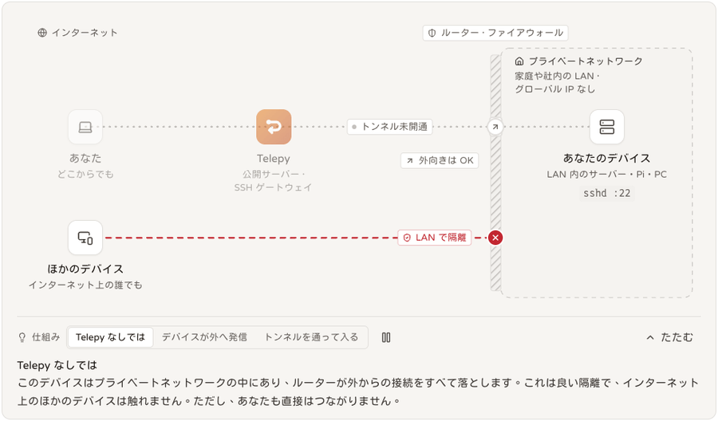
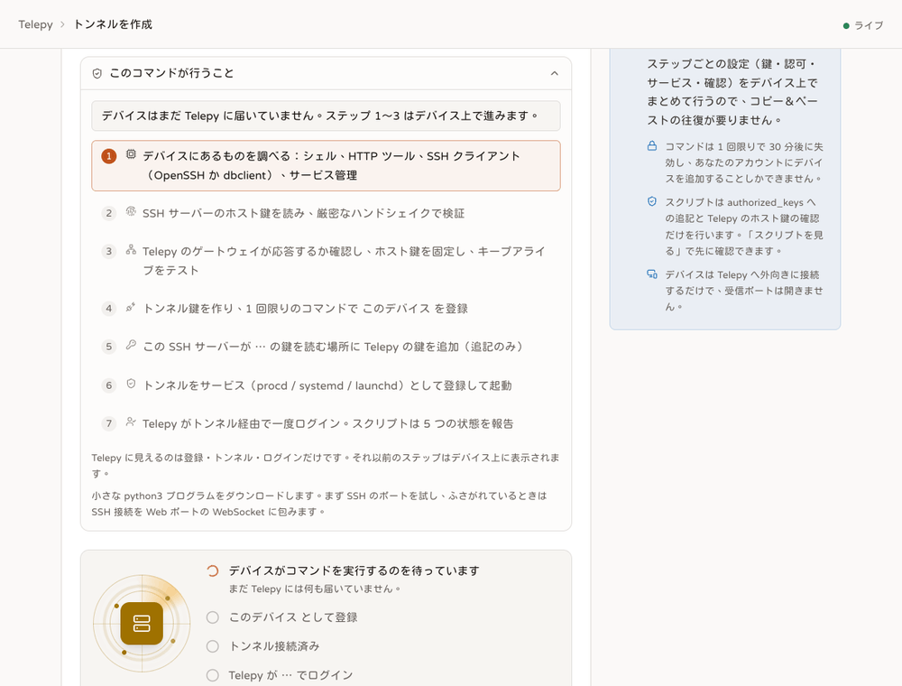

# ワンコマンドでデバイスを追加：スクリプトの動作、対応プラットフォーム、診断方法

<p align="center"><a href="./device-join.md">English</a> | <a href="./device-join.zh-TW.md">繁體中文</a> | <b>日本語</b></p>



対象：`src/backend-api/templates/join_install.sh`（`GET /api/join/install.sh`）、`api/join.rs`、`join/mod.rs`。
フロントエンドは `components/tunnels/JoinPanel.tsx` / `JoinScriptFlow.tsx`、`lib/joinScript.ts`。
テスト：`tests/join_api.rs`（API）、`tests/join_script.rs`（本物の `/bin/sh` でスクリプトを実行し、lab の gateway に対して動かす）。
Docker による実プラットフォームでの検証は第 5 節にあります。

## 1. スクリプトはデバイスの「実際の能力」で動作を決める



スクリプトは、デバイスに bash、GNU ツール、python、curl、完全な OpenSSH があるとは仮定しません。各ステップで**何を見つけ、なぜそれを選んだか**を表示します。

| 見るもの | 判定方法 | 素直なやり方をしない理由 |
|---|---|---|
| shell | `sh --help` の 1 行目に BusyBox とあれば ash、なければ bash / dash / sh | スクリプト自体は POSIX sh だけを使い（BusyBox ash で検証済み）、shell の種類では分岐しません |
| HTTP ツール | `curl` → `wget`（`--post-data` に対応していること）→ `uclient-fetch` | 標準の OpenWrt には curl がなく、`wget` の実体は uclient-fetch です。`--header` がなく、ステータスコードが見えず、エラー時には body も保存されません。そのためデバイス向けのエンドポイントはすべて `?soft=1`（常に 200、1 行目が `STATUS=<元のステータスコード>`）を受け付け、登録も Content-Type を見ません |
| SSH client | `ssh` と `dbclient` のそれぞれに `-V` を実行：`OpenSSH_` と出れば OpenSSH、`Dropbear` と出れば dbclient | 標準の OpenWrt の `/usr/bin/ssh` は dropbear へのリンクです。`command -v ssh` が成功しても OpenSSH とは限りません |
| OpenSSH のオプション | トンネルが使うオプションすべてを付けて `ssh -G` で一度解析する | 未知のオプションは、接続後に気づくのではなく、その場でエラーになります |
| dbclient の機能 | `dbclient -o help` に `ExitOnForwardFailure`（2016.73 以降）が載っていること、`-h` に `-K` と `-R` があること | dbclient は未知の `-o` に対して `Ignoring unknown configuration option` を 1 行出すだけで、**そのまま実行して exit 0 になります**（2022.82 で確認）。終了コードは当てになりません |
| 鍵ツール | OpenSSH → `ssh-keygen`、dbclient → `dropbearkey` | dbclient 2022.82 は OpenSSH 形式の秘密鍵を読めません（`Exited: String too long`、実測）。2 種類の client の鍵ファイルは別です：`telepy_tunnel_ed25519`（OpenSSH）、`telepy_tunnel_dropbear`（Dropbear）。`dropbearconvert` があれば相互に変換して同じトンネルを使い続けます。なければ新しい鍵は Telepy から見て新しいデバイスになり、スクリプトがそう伝えます |
| SSH server | まず `/proc/net/tcp` で、そのポートを誰がどのアドレスで待ち受けているかを見る。次に `nc -w 3` でバナー（`SSH-2.0-dropbear_2022.82` / `OpenSSH_9.6`）を読む。nc がなければ `ssh -v` の `remote software version` を使う | Dropbear が LAN インターフェースだけに bind している場合（`option Interface 'lan'`）、127.0.0.1 は応答しません。host key の確認も、トンネルの折り返し先 `-R 0:<アドレス>:<ポート>` も、その LAN アドレス（同じエンドポイント）を使います |
| host key | 候補：root の `dropbearkey -y /etc/dropbear/*_host_key`、`/etc/ssh/ssh_host_*_key.pub`、`ssh-keyscan`（**`-T` は付けない**）、最後に OpenSSH が loopback 経由で `accept-new` により一度だけ学習。どの候補も、`StrictHostKeyChecking=yes` とその鍵だけを入れた known_hosts で一度ハンドシェイクし、`Permission denied` まで進んだものだけを採用します | ファイルがあることは、今待ち受けているサーバの鍵であることを意味しません。また ppoll に問題のある機器では `ssh-keyscan -T` が鍵を 1 つも出力しません（事例 A）。どの候補も通らなかったときのメッセージは「到達できるが鍵を読めない／何も待ち受けていない」であり、openssh-server のインストールを勧めることはなくなりました |
| authorized_keys の場所 | OpenWrt + Dropbear + root → `/etc/dropbear/authorized_keys`（OpenWrt のパッチ）。`sshd -T` を読める OpenSSH → 最初の `AuthorizedKeysFile`（`%h` `%u` を展開）。それ以外は `~/.ssh/authorized_keys`。`--authorized-keys` で上書き可能 | 「~/.ssh」は候補にすぎず、事実ではありません |
| サービス管理 | root で `/sbin/procd` が動いていて `/etc/rc.common` がある → procd。systemd（system / `--user`）。launchd。それ以外はバックグラウンドのループ + `@reboot` の crontab | どれもインストール後に**もう一度確認**します：procd の `running` / `enabled`、`systemctl is-active` / `is-enabled`、`launchctl print`、`pgrep` + crontab の内容 |
| 永続ストレージ | `/proc/mounts` で `--ssh-dir` があるファイルシステムを調べ、tmpfs / ramfs なら警告する | OpenWrt の `/tmp` は再起動で消えます |
| パッケージマネージャ | PATH 上にあるもの：opkg / apk / apt / dnf / yum / zypper / pacman / brew / pkg（tailscale の install.sh と同様、ディストリビューション名は見ない） | 「X がありません」というメッセージを、そのマシンでそのままコピーできるコマンド（`opkg install dropbear && /etc/init.d/dropbear start`、`apk add openssh-client openssh-keygen` など）で書くためだけに使います。スクリプト自身は何もインストールしません |

タイムアウト：`timeout` があればそれを使い、なければ（標準の OpenWrt、macOS）自前の watchdog を使います（バックグラウンドで実行してタイマーで kill。watchdog 自身の出力は閉じます。閉じないと `$(...)` がそれを待ち続けます）。検証待ちは実時間ではなくループ回数（60 × 2 秒）で数えます。ルーターが起動後に NTP で時刻が飛んでも、いつまでも待ち続けたり、すぐ諦めたりしません。

## 2. gateway の事前チェックと keepalive（事例 B / C）

登録（token を消費する）の前に、スクリプトは公開エンドポイント `GET /api/join/gateway` から gateway のアドレス、ポート、アカウント、host key を取得し、それを固定して 2 回ハンドシェイクします。

1. `-o ServerAliveInterval=30 -o ServerAliveCountMax=3` を付ける。
2. 付けない。

2 回とも同じ gateway・同じオプションで、違いは ServerAlive だけです。どちらも鍵は送らず（`PubkeyAuthentication=no`）、完全な鍵交換が `Permission denied` で終われば成功とみなします。gateway にはイベントが残りません。結果の読み方：

| 1 回目 | 2 回目 | 結論 |
|---|---|---|
| ok | — | `keepalive=ssh`（デフォルト、従来どおり） |
| timeout | ok | この版の ssh は、タイムアウトを設定した途端にすぐタイムアウトします（OpenWrt #12574：fortify-headers の `ppoll` が 64 ビットの `time_t` を 32 ビットとして読み、big-endian の ath79 では 30 秒が 30 ナノ秒になる。GL-AR750S）。自動的に **compat モード**に切り替えます：`ServerAliveInterval=0 -o TCPKeepAlive=yes`、`facts.compat = ["no_server_alive"]`。Web 画面とイベントにも表示されます。`--no-compat` は自動切り替えを禁止し（エラーにして説明する）、`--compat-no-server-alive` は強制します |
| timeout / unreachable | timeout / unreachable | gateway に到達できません。外向きの TCP が遮断されています（`--auto` / `--via-web` を使うと、ヘルパー経由で Web ポートから入ります。ヘルパーはデバイスの CPU 向けのビルド済み `telepy-carrier`、なければ python3）。compat は適用**しません** |
| hostkey | — | gateway の host key が、gateway が申告した内容と一致しません：中止します |

compat モードの制約はデバイス上に表示され、`facts` とインストール記録にも残ります。SSH 層のハートビートが無効なので、切断は TCP keepalive（カーネルのデフォルトは 2 時間であることが多い）でしか検知されません。procd / systemd は ssh が終了した後にしか再起動しないため、プロセスが存在していてもトンネルが使えるとは限りません。これは下層パッケージの修正ではなく、回避策です。
dbclient は独自の `-K 30`（3 回応答がなければ切断）を使い、この問題の影響を受けないため、compat も適用しません。

## 3. デバイスに残るもの、復旧方法、削除方法

- `~/.ssh/telepy_tunnel_ed25519[.pub]` または `telepy_tunnel_dropbear[.pub]`（鍵）、`telepy-<id>.known_hosts`（OpenSSH が gateway を固定）、`telepy-<id>.install`（**インストール記録**：ID、トンネル、サーバ、インストールした人／実行アカウント／ログインアカウント、shell、client、server、authorized_keys のパス、サービスの種類とファイル、keepalive、compat、作成したファイルの一覧。token も秘密鍵も含みません）、`telepy-<id>-uninstall.sh`。
- サービス：`/etc/init.d/telepy-<id>`（procd：`respawn 3600 10 0`、stdout / stderr は `logread` へ、`env HOME=`、root 以外では `user`）、`telepy-<id>.service`、`com.telepy.tunnel.<id>`、または `~/.ssh/telepy-<id>.sh` + crontab。
- dbclient には `UserKnownHostsFile` がありません。gateway の host key は実行アカウントの `~/.ssh/known_hosts`（`<gateway host> <type> <key>`）に書き込みます。**コメントは付けられません**（dbclient は行の残りを鍵としてデコードするため、コメントを付けると mismatch になる。実測）。追加した行は記録の `KNOWN_HOSTS_LINE=` に残り、uninstall とトンネル削除時の削除スクリプトはその行だけを消します。同じホスト名にすでに同じ種類の別の鍵がある場合は、止まって説明します（dbclient が比較するのはホスト名だけで、ポートは比較しません）。
- ダウンロードの破損：サーバはスクリプトの末尾に `# telepy-sha256: <hex>` を付け、ファイルから実行する場合はスクリプト自身が検証します。本文が欠けていれば「ダウンロードが壊れています。もう一度ダウンロードしてください」と伝えます。先頭が欠ける場合（2 行目が `in this machine as a device…` になった事例）や、CRLF / BOM で sh が 1 行目で止まる場合は、スクリプトが何かを説明する前に終わってしまいます。そのため Web 画面の「ダウンロードして `sh -n` で検査してから実行」するコマンドは、まず `sh -n` で止めます（`curl | sh` は自分自身を読めないので何も止められません）。curl がない環境向けの wget 版もあります。`--check` は token を消費しません。
- 登録のレスポンスが失われた場合：スクリプトは POST を再送しません。`GET /api/join/<token>/status` を確認し、すでに registered 以上なら `GET /api/join/<token>/config` で同じ設定をもう一度取得します（同じチケット、同じトンネル）。そうでなければもう一度実行するよう伝えます（チケットはまだ waiting のままです）。
- 再実行：同じ鍵 = 同じトンネルです（サーバは鍵で識別します）。旧名称のインストール（`telepy-tunnel-<n>`）は削除されます。
- 5 つの状態を別々に報告します：files installed / starts at boot / process running / tunnel connected / login verified。サーバが実際にログインできて初めて Done になります。
- トンネルの削除（`remove_tunnel.sh`）は、`/etc/init.d` の init スクリプト（`disable` した後、停止スクリプトが `stop` してファイルを削除）、インストール記録、dbclient の known_hosts の行を認識します。棚卸し（survey）はこれらを `initd` / `record` / `known_hosts` として一覧にします。

## 3b. 実機テストで初めて分かった 2 つの落とし穴（どちらも対処済み）

- **Dropbear は exec コマンドを 9000 バイトに制限しています（`MAX_CMD_LEN`）**：棚卸し／削除スクリプト（`remove_tunnel.sh`、約 25 KB）を `sh -c '…'` に入れると、Dropbear が channel をそのまま閉じます（Telepy 側では `the script stopped early (exit None)` と表示）。長い POSIX スクリプトは、現在は分割してデバイスの一時ファイルに書き込んでから実行します（`ssh::exec::script_commands` / `run_script`：各コマンドは `MAX_COMMAND` = 6000 文字以下、`printf '%s' … >> "${TMPDIR:-/tmp}/telepy-script-<tag>.sh"`、`umask 077`、最後のコマンドが `sh` で実行して削除。短いスクリプトは従来どおり 1 回の `sh -c`）。鍵リストを exec で書き込む場合も同様に分割します（`exec::upload_commands` → `device_keys::remote::write_commands`）。lab の偽 sshd は `sh -c` しか扱えないので、この経路は cargo のテストでも通ります。
- **russh（gateway）が Dropbear の strict kex を誤判定する**：OpenWrt 23.05 は Terrapin 対策（`kex-strict-c-v00@openssh.com`）を Dropbear 2022.82 にバックポートしました。一方、Dropbear の kex リストは `kexguess2@matt.ucc.asn.au` で始まり、常に `first_kex_packet_follows` の推測パケットを付けます。russh 0.64.1 は外れた推測パケットを無視した後、本物の `KEX_ECDH_INIT` がシーケンス番号 2 に来るため、`validate_client_msg_strict_kex` が strict kex 違反と判断して（`strict kex violated at sequence no. 2, message type: 30`）切断します。**どの** Dropbear クライアントも（新しい 2024.86 も推測し、strict kex にも対応）russh サーバには接続できません。OpenSSH クライアントは推測しないので、これまで問題になりませんでした。これは russh のバグです（RFC 4253 §7.1 は推測を許可しており、OpenSSH サーバは常に Dropbear を受け入れてきました）。修正は、推測パケットを飛ばした後にシーケンス番号の検査を 1 つずらすことで、約 20 行です。上流に [Eugeny/russh PR #805](https://github.com/Eugeny/russh/pull/805)（issue [#804](https://github.com/Eugeny/russh/issues/804)）として提出済みで、この修正を当てた gateway で、Docker 上の標準 OpenWrt の dbclient 2022.82 が connected → verified になることを確認しました。Telepy はこの修正を**自前では抱えず**（fork も vendor もしない）、上流のリリースを待ちます。上流が修正を出すまでは、**dbclient だけのデバイスは「gateway の修正待ち」**です。token を消費する前の gateway 事前チェックが `closed` を受け取り、「gateway が鍵交換中に接続を閉じました。Telepy を更新するか、OpenSSH client をインストールして `--client openssh` を使ってください」と表示します。OpenSSH client を持つ OpenWrt（2 台の GL ルーターとも）は影響を受けません。
- **`/usr/bin/ssh` は固定ではありません**：標準の OpenWrt では `ssh` は dropbear へのリンクですが、後から `opkg install openssh-client` すると OpenSSH に置き換わります。dbclient のサービスには `/usr/bin/dbclient` 自体を書く必要があります。そうしないと、OpenSSH をインストールした後に procd が dbclient の引数で OpenSSH を起動してしまいます（`-K 30 -I 0` が別のオプションと解釈され、`0.0.0.30` に接続しようとする）。

## 4. 追加した後：この種のデバイスでの他の機能

| 機能 | Dropbear / BusyBox デバイス |
|---|---|
| ターミナル | 利用可能（PTY shell、ash） |
| ファイルマネージャー / SFTP | sftp-server がない場合（OpenWrt では `opkg install openssh-sftp-server`）、ファイルマネージャーは exec によるフォールバックを使います。SFTP REST には sftp が必要です |
| 鍵リスト（共有時に相手の鍵をインストール） | `device_keys/remote.rs`：sftp サブシステムがなければ exec（`cat`、一時ファイル + `mv -f`）を使います。OpenWrt + Dropbear の root は `/etc/dropbear/authorized_keys`（追加スクリプトと同じファイル）に書きます |
| デバイス情報（device facts）、LAN スキャン | スクリプトは POSIX / BusyBox 互換です（`ip` に `-o` がなければ `ifconfig` にフォールバック。`getent` がなければ名前解決はしない） |
| デバイス上での名前変更（device_install rename） | procd は未対応です（blocker）。削除と棚卸しには対応しています |
| リモートデスクトップ / ブラウザー | デバイスの sshd の direct-tcpip を通ります。Dropbear はデフォルトで許可しています |
| Windows ネイティブ | ワンコマンド追加は未対応です（手順を追って設定）。第 6 節を参照してください |

## 5. 検証（どの種類のものか）

**ユニット / 統合（cargo、CI のたびに実行）**
- `join::tests`、`device_keys::remote::tests`：facts の許可リスト、soft レスポンス、チェックサム、exec での書き込みコマンド。
- `tests/join_api.rs`：soft、`/api/join/gateway`、`/config` による復旧、form の content-type、facts がチケット／イベント／device-install に入ること。
- `tests/join_script.rs`：サーバが返すスクリプト（チェックサム込み）を本物の `/bin/sh` で実行し、lab の本物の gateway と本物の HTTP listener に対して動かします。lab のマシンがデバイスの sshd の役です。壊れたファイル／CRLF の検出、`--check` が token を消費しないこと、間違ったポートのメッセージ、verified までの実際の追加（サービス鍵は lab の sshd が読むファイルに書かれる）、記録の内容、uninstall 後にトンネルが切れること。

**実プラットフォーム（Docker、手動。コマンドは下記）** — 2026-10-30 の結果：
- 標準の OpenWrt 23.05.5 rootfs（x86-64 を OrbStack 上でエミュレート。ash、BusyBox 1.36、Dropbear 2022.82 の server + dbclient、uclient-fetch、procd を `/sbin/init` として起動、`--privileged`）：`--check` が通過（host key は `dropbearkey -y` 由来で、2 つとも厳格なハンドシェイクで検証済み。gateway の 2 つの host key を固定）。実際の追加は **connected → verified**（root、`/etc/dropbear/authorized_keys` 経由）。**コンテナ再起動後は procd が自力でトンネルを復帰**させました。サーバ再起動後は、dbclient が `-K 30` で約 1 分以内に切断を検知し、procd が 10 秒後に再接続。鍵リスト（共有時の鍵インストール）は exec のフォールバックを通り、`installed` / `verified`、パネルには `/etc/dropbear/authorized_keys` が表示されました。棚卸しは `procd` のサービス、プロセス、鍵、記録を見つけました。uninstall 後は init.d / rc.d とプロセスが消え、鍵は残り、gateway の forward は解放されました。
- 同じ rootfs に `opkg install openssh-client openssh-keygen` を追加（Dropbear server + OpenSSH 9.8 client、ssh-keyscan なし）：`--check` が通過し、host key は同じく `dropbearkey -y` 由来で、keepalive には OpenSSH の ServerAlive を使いました。
- Alpine 3.20（ash + Dropbear 2024.85 server + OpenSSH 9.7 client、procd なし）：`--check` が通過（keyscan と dropbearkey の両方のソースを検証）。バックグラウンドのループ + crond の `@reboot` として実際に追加して **verified**。uninstall 後はプロセスと crontab の行が消えました。
- cargo：`tests/join_script.rs`（macOS /bin/sh、OpenSSH 10.3、lab gateway）が全件通過。壊れたファイル、間違ったポート、`--check` がファイルを書かず登録もしないこと、実際の追加、記録、uninstall を含みます。`tests/join_api.rs` の 2 つのテストも通過。

**実機（2026-10-30、prod の `telepy exec` 経由で実行、dev サーバは同じ LAN 内）**：
- GL-AR750S（OpenWrt 22.03.4、mips、BusyBox 1.35、OpenSSH 8.9p1 client、Dropbear 2022.82 server、curl）：`--check` が通過。`dropbearkey -y` 由来の 2 つの host key は正しく、`/etc/ssh/*.pub` 由来の 2 つは「今待ち受けているサーバではない」と正しく判定されて無視されました。gateway の探査は **ServerAlive ありでタイムアウト、なしでは成功 → 自動的に compat モードへ**（事例 B / C を実機で再現）。実際の追加：procd サービス `telepy-caqgap9k`、**connected → verified**（root、compat）。uninstall 後は prod の `telepy-47xzwr2e`（まだ running）だけが残り、dev サーバの forward は解放され、鍵と authorized_keys の行は設計どおり残りました（dev 側の行は手動で削除）。dropbear やネットワーク設定には一切触れていません。
- GL-MT3000（GL 21.02-SNAPSHOT、aarch64、BusyBox 1.33、OpenSSH 8.4p1、Dropbear 2024.86）：`--check` が通過。keepalive は SSH のまま（ServerAlive のハンドシェイクは正常）、host key は `dropbearkey -y` 由来（ecdsa を含む）。事前チェックのみで、追加は行っていません。
- 2 台とも BusyBox の `nc` に `-w` がなく（usage を表示）、バナーは `ssh -v` から取得しました。スクリプトは `-w` が失敗したら、watchdog 配下で `nc` をもう一度実行するように修正済みです。

Docker での手順（`~/Library/Caches/telepy-join-e2e/env.sh` がネイティブの telepy-server を起動：API 18872、gateway 24872、`SERVER_DOMAIN=host.docker.internal`）：

```sh
docker run -d --platform linux/amd64 --privileged --cgroupns=host --name telepy-wrt openwrt/rootfs:x86-64-23.05.5 /sbin/init
docker exec telepy-wrt sh -c 'wget -O /root/j.sh http://host.docker.internal:18872/api/join/install.sh && sh /root/j.sh --check'
docker exec telepy-wrt sh /root/j.sh --token tpj_…        # 標準：dbclient + procd
docker exec telepy-wrt sh -c 'opkg update && opkg install openssh-client openssh-keygen' && docker exec telepy-wrt sh /root/j.sh --check
```

## 6. 既知の制限

- **dbclient だけのデバイス（OpenSSH client なし）は、当面 gateway に接続できません**：russh の strict-kex のシーケンス検査が Dropbear の推測パケットを許容しないためです（第 3b 節）。スクリプトは token を消費する前にこれを検出して説明します（OpenSSH client をインストールすれば解決します）。上流の russh が修正を出し、Telepy がそれに更新されれば、スクリプトを変えなくても dbclient が使えるようになります。
- Windows ネイティブ（PowerShell、タスクスケジューラ、ACL）は引き続き「手順を追って設定」です。ワンコマンド追加のスクリプトは Windows では動きません。未実装または未検証の機能は、対応しているとは謳いません。
- dbclient：known_hosts はホスト名だけを比較するため、同じホスト名に同じ種類の鍵を 2 つ持てません。`UserKnownHostsFile` / `HostKeyAlias` もありません。標準の OpenWrt には `dropbearconvert` がないので、client を切り替えるときに鍵を相互変換できません。WebSocket 経由は `-J` で同じヘルパーのラッパーを使います（ビルド済み `telepy-carrier`、なければ python3）。
- compat モードは回避策であって修正ではありません：SSH のハートビートが無効なので、切断の検知が遅くなります。
- root 以外の OpenWrt：`/etc/dropbear/*_host_key` が読めず、`/etc/ssh/*.pub` も ssh-keyscan もない場合、host key の取得元がなくなり、スクリプトは止まって説明します。
- デバイス上での名前変更と接続方法の切り替えは procd に対応しています（`/etc/init.d/telepy-<id>`、ワンコマンド追加がインストールするものと同じ形。OpenWrt 23.05 rootfs で検証済み）。`/etc/rc.local` に手書きされた行は、引き続き自動では切り替わりません。ARM ルーター（aarch64、armv7、armv6）にはビルド済み `telepy-carrier` があります。ほかの CPU（MIPS）で python3 もないルーターにはヘルパーがないため、「自動に変更」すると SSH ポートだけを使う新しいサービスがインストールされ、その旨が表示されます（`no_carrier`）。
- スクリプトは、デバイスの SSH server の bind アドレスをトンネルの折り返し先として使います。server が loopback 以外の複数のアドレスに bind している場合は、最初のものを使います。
