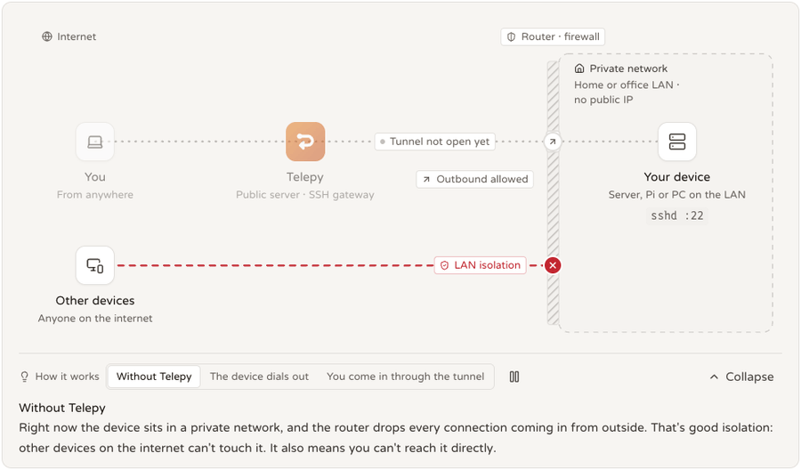
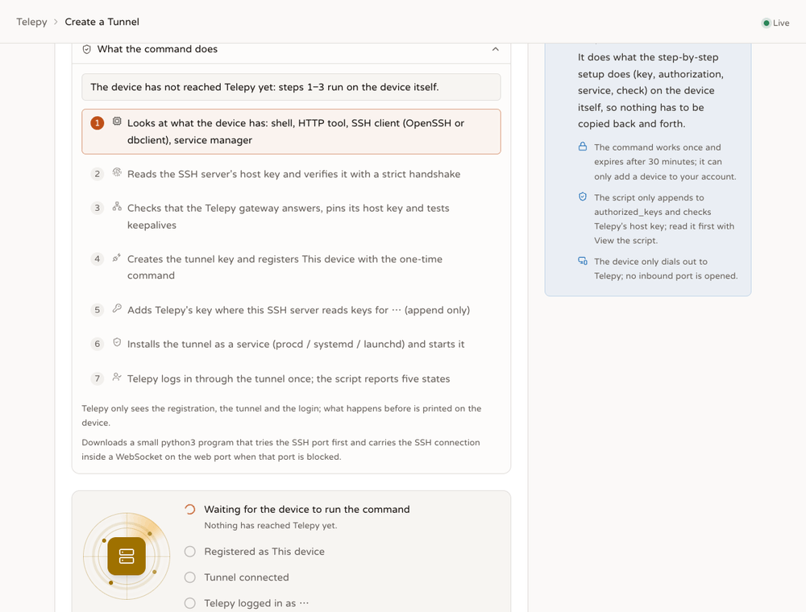

# One-command device join: what the script does, which platforms work, how to diagnose

<p align="center"><b>English</b> | <a href="./device-join.zh-TW.md">繁體中文</a> | <a href="./device-join.ja.md">日本語</a></p>



Covers `src/backend-api/templates/join_install.sh` (`GET /api/join/install.sh`), `api/join.rs` and `join/mod.rs`,
and on the frontend `components/tunnels/JoinPanel.tsx` / `JoinScriptFlow.tsx` and `lib/joinScript.ts`.
Tests: `tests/join_api.rs` (API) and `tests/join_script.rs` (a real `/bin/sh` runs the script against the lab's gateway).
Verification on real platforms with Docker is in section 5.

## 1. The script decides by what the device actually has



The script does not assume the device has bash, GNU tools, python, curl or a full OpenSSH. Every step prints **what it found and why it chose what it did**.

| What it looks at | How it decides | Why not the obvious way |
|---|---|---|
| shell | The first line of `sh --help` mentions BusyBox → ash; otherwise bash / dash / sh | The script itself uses only POSIX sh (verified on BusyBox ash); it never branches on the shell |
| HTTP tool | `curl` → `wget` (must support `--post-data`) → `uclient-fetch` | Stock OpenWrt has no curl, and its `wget` is uclient-fetch: no `--header`, no visible status code, and it does not even keep the body on an error. So the device endpoints all take `?soft=1` (always 200, first line `STATUS=<real status code>`), and registration ignores the Content-Type |
| SSH client | Run `-V` on both `ssh` and `dbclient`: `OpenSSH_` means OpenSSH, `Dropbear` means dbclient | Stock OpenWrt's `/usr/bin/ssh` is a link to dropbear; `command -v ssh` succeeding does not mean OpenSSH |
| OpenSSH options | Parse every option the tunnel will use once with `ssh -G` | An unknown option fails right away instead of surfacing after the connection is up |
| dbclient capabilities | `dbclient -o help` must list `ExitOnForwardFailure` (2016.73+), and `-h` must show `-K` and `-R` | For an unknown `-o`, dbclient prints one `Ignoring unknown configuration option` line and then **runs normally with exit 0** (measured on 2022.82), so the exit code cannot be trusted |
| Key tool | OpenSSH → `ssh-keygen`; dbclient → `dropbearkey` | dbclient 2022.82 cannot read an OpenSSH-format private key (`Exited: String too long`, measured). The two clients keep separate key files: `telepy_tunnel_ed25519` (OpenSSH) and `telepy_tunnel_dropbear` (Dropbear). With `dropbearconvert` present the key is converted and the same tunnel is kept; without it a new key is a new device in Telepy's eyes, and the script says so |
| SSH server | First look in `/proc/net/tcp` for who listens on that port and on which address; then read the banner with `nc -w 3` (`SSH-2.0-dropbear_2022.82` / `OpenSSH_9.6`); without nc, use the `remote software version` line of `ssh -v` | If Dropbear is bound to the LAN interface only (`option Interface 'lan'`), 127.0.0.1 does not answer: both the host key check and the tunnel's loopback target `-R 0:<address>:<port>` then use that LAN address (the same endpoint) |
| Host key | Candidates: root's `dropbearkey -y /etc/dropbear/*_host_key`, `/etc/ssh/ssh_host_*_key.pub`, `ssh-keyscan` (**without `-T`**), and finally OpenSSH learning it once over loopback with `accept-new`. Each candidate gets one handshake with `StrictHostKeyChecking=yes` and a known_hosts holding only that key; it is accepted only if the handshake gets as far as `Permission denied` | A file existing does not mean it is the key of the server that is listening now; and `ssh-keyscan -T` prints no key at all on machines with the ppoll problem (incident A). When no candidate passes, the message says "reachable but the key cannot be read / nothing is listening", and no longer tells people to install openssh-server |
| authorized_keys location | OpenWrt + Dropbear + root → `/etc/dropbear/authorized_keys` (an OpenWrt patch); OpenSSH where `sshd -T` is readable → the first `AuthorizedKeysFile` (with `%h` `%u` expanded); otherwise `~/.ssh/authorized_keys`; `--authorized-keys` overrides | "~/.ssh" is only a candidate, not a fact |
| Service manager | root with `/sbin/procd` running and `/etc/rc.common` → procd; systemd (system / `--user`); launchd; otherwise a background loop + an `@reboot` crontab | Each one is **checked again** after installing: procd `running` / `enabled`, `systemctl is-active` / `is-enabled`, `launchctl print`, `pgrep` + the crontab contents |
| Persistent storage | Look up the filesystem holding `--ssh-dir` in `/proc/mounts`; warn on tmpfs / ramfs | OpenWrt's `/tmp` is gone after a reboot |
| Package manager | Whichever is on PATH: opkg / apk / apt / dnf / yum / zypper / pacman / brew / pkg (like tailscale's install.sh, without looking at the distribution name) | Used only to write a "X is missing" message as a command this machine can copy (`opkg install dropbear && /etc/init.d/dropbear start`, `apk add openssh-client openssh-keygen`, ...); the script installs nothing itself |

Timeouts: `timeout` is used when present; without it (stock OpenWrt, macOS) the script uses its own watchdog (run in the background, kill on timer, with the watchdog's own output closed, or `$(...)` would wait for it). The wait for verification counts loop iterations (60 × 2 s) rather than wall-clock time, so a router whose NTP sync jumps the clock after boot neither waits forever nor gives up at once.

## 2. Gateway preflight and keepalive (incidents B / C)

Before registering (which uses up the token), the script asks the public `GET /api/join/gateway` for the gateway address, port, account and host keys, pins them, and does two handshakes:

1. with `-o ServerAliveInterval=30 -o ServerAliveCountMax=3`;
2. without.

Both go to the same gateway with the same options, differing only in ServerAlive. Neither sends a key (`PubkeyAuthentication=no`); a full key exchange that ends in `Permission denied` counts as success, and the gateway keeps no event of it. How to read the result:

| First | Second | Conclusion |
|---|---|---|
| ok | — | `keepalive=ssh` (default, as before) |
| timeout | ok | This ssh build times out immediately as soon as a timeout is set (OpenWrt #12574: fortify-headers' `ppoll` reads a 64-bit `time_t` as 32-bit, so on big-endian ath79 30 seconds becomes 30 nanoseconds; GL-AR750S). The script switches to **compat mode** automatically: `ServerAliveInterval=0 -o TCPKeepAlive=yes`, `facts.compat = ["no_server_alive"]`, shown in the web UI and the events. `--no-compat` forbids the automatic switch (it errors and explains instead), `--compat-no-server-alive` forces it |
| timeout / unreachable | timeout / unreachable | The gateway cannot be reached: outbound TCP is blocked (or use `--auto` / `--via-web`, which goes through the web port when python3 is present). Compat is **not** applied |
| hostkey | — | The gateway's host key does not match what it announced: stop |

The limits of compat mode are printed on the device and recorded in `facts` and the install record: the SSH-level heartbeat is off, so a dropped connection is only noticed by TCP keepalive (the kernel default is often 2 hours), and procd / systemd only restart ssh after it exits, so a running process does not mean the tunnel works. This is a workaround for the underlying package bug, not a fix.
dbclient uses its own `-K 30` (disconnects after three unanswered probes), is unaffected by this problem, and does not get compat.

## 3. What is left on the device, how to recover, how to remove

- `~/.ssh/telepy_tunnel_ed25519[.pub]` or `telepy_tunnel_dropbear[.pub]` (the key), `telepy-<id>.known_hosts` (OpenSSH pins the gateway), `telepy-<id>.install` (**the install record**: id, tunnel, server, who installed / run-as account / login account, shell, client, server, authorized_keys path, service kind and files, keepalive, compat, the list of files created; no token, no private key) and `telepy-<id>-uninstall.sh`.
- The service: `/etc/init.d/telepy-<id>` (procd: `respawn 3600 10 0`, stdout / stderr into `logread`, `env HOME=`, `user` when not root), `telepy-<id>.service`, `com.telepy.tunnel.<id>`, or `~/.ssh/telepy-<id>.sh` + crontab.
- dbclient has no `UserKnownHostsFile`: the gateway's host key goes into the run-as account's `~/.ssh/known_hosts` (`<gateway host> <type> <key>`, **no comment allowed**: dbclient decodes the rest of the line as the key, and a comment gives a mismatch, measured). The lines added are recorded in the record's `KNOWN_HOSTS_LINE=`, and the uninstall and the tunnel-delete removal script remove only those lines. If the same host name already has another key of the same type, the script stops and explains (dbclient compares host names only, not ports).
- Broken download: the server appends `# telepy-sha256: <hex>` to the end of the script, and when run from a file the script checks it itself; if text is missing it says "the download is corrupt, download again". A truncated start (the incident where line 2 became `in this machine as a device…`) or CRLF / a BOM makes sh stop on the first line before the script can say anything, so the web UI's "download, `sh -n`, then run" command blocks it with `sh -n` first (`curl | sh` cannot read itself and blocks nothing); there is a wget variant for machines without curl; `--check` does not use up the token.
- Lost registration response: the script does not resend the POST. It asks `GET /api/join/<token>/status`; if that is already registered or beyond, it fetches the same settings again with `GET /api/join/<token>/config` (same ticket, same tunnel), otherwise it tells the user to run it again (the ticket is still waiting).
- Running it again: the same key = the same tunnel (the server identifies by key); an install under the old name (`telepy-tunnel-<n>`) is cleaned up.
- Five states are reported separately: files installed / starts at boot / process running / tunnel connected / login verified. Only a real login by the server counts as Done.
- Deleting a tunnel (`remove_tunnel.sh`) knows `/etc/init.d` init scripts (`disable`, then the stop script does `stop` + deletes the file), the install record and dbclient's known_hosts lines; the survey lists them as `initd` / `record` / `known_hosts`.

## 3b. Two pitfalls found only by testing (both handled)

- **Dropbear caps an exec command at 9000 bytes (`MAX_CMD_LEN`)**: putting the survey / delete script (`remove_tunnel.sh`, about 25 KB) into `sh -c '…'` makes Dropbear close the channel outright (Telepy sees `the script stopped early (exit None)`). Long POSIX scripts are now written to a temp file on the device in pieces and then run (`ssh::exec::script_commands` / `run_script`: each command ≤ `MAX_COMMAND` = 6000 characters, `printf '%s' … >> "${TMPDIR:-/tmp}/telepy-script-<tag>.sh"`, `umask 077`, and a final command runs it with `sh` and deletes it; short scripts still use a single `sh -c`). Writing the key list over exec is split the same way (`exec::upload_commands` → `device_keys::remote::write_commands`). The lab's fake sshd only does `sh -c`, so this path is also exercised in the cargo tests.
- **russh (the gateway) misjudges Dropbear's strict kex**: OpenWrt 23.05 backported the Terrapin fix (`kex-strict-c-v00@openssh.com`) to Dropbear 2022.82, and Dropbear's kex list starts with `kexguess2@matt.ucc.asn.au` and always carries a `first_kex_packet_follows` guess packet. After ignoring the wrongly guessed packet, russh 0.64.1 sees the real `KEX_ECDH_INIT` at sequence number 2, `validate_client_msg_strict_kex` treats it as a strict kex violation (`strict kex violated at sequence no. 2, message type: 30`) and disconnects. **Any** Dropbear client (the newer 2024.86 also guesses and also supports strict kex) cannot connect to a russh server. OpenSSH clients do not guess, so it never came up. This is a bug in russh (RFC 4253 §7.1 allows guessing; OpenSSH servers have always accepted Dropbear). The fix is to shift the sequence check by one after skipping a guess packet, about 20 lines, in [`docs/russh-dropbear-strict-kex.patch`](russh-dropbear-strict-kex.patch); a gateway with this patch was tested with dbclient 2022.82 on stock OpenWrt in Docker: connected → verified. Telepy does **not** carry this patch itself (no fork, no vendoring) and reports it upstream to Eugeny/russh instead. Until upstream ships a fix, **devices with only dbclient wait for a gateway fix**: the script's gateway preflight, before the token is used, gets `closed` and prints "the gateway closed the connection during key exchange; update Telepy, or install the OpenSSH client and use `--client openssh`". OpenWrt devices with an OpenSSH client (both GL routers) are not affected.
- **`/usr/bin/ssh` is not fixed**: on stock OpenWrt `ssh` is a link to dropbear; a later `opkg install openssh-client` replaces it with OpenSSH. The dbclient service must name `/usr/bin/dbclient` itself, otherwise after OpenSSH is installed procd runs OpenSSH with dbclient's arguments (`-K 30 -I 0` is read as other options and it connects to `0.0.0.30`).

## 4. After joining: other features on these devices

| Feature | Dropbear / BusyBox devices |
|---|---|
| Terminal | Works (PTY shell; ash) |
| File manager / SFTP | Without a sftp-server (on OpenWrt, `opkg install openssh-sftp-server`) the file manager falls back to exec; the SFTP REST API needs sftp |
| Key list (installing someone's key when sharing) | `device_keys/remote.rs`: without the sftp subsystem it goes through exec (`cat`, temp file + `mv -f`); root on OpenWrt + Dropbear writes `/etc/dropbear/authorized_keys` (the same file the join script uses) |
| Device facts, LAN scan | The scripts are POSIX / BusyBox compatible (fall back to `ifconfig` when `ip` has no `-o`; no name resolution without `getent`) |
| Renaming on the device (device_install rename) | procd is not supported yet (a blocker); delete and survey are supported |
| Remote desktop / browser | Goes through the device sshd's direct-tcpip, which Dropbear allows by default |
| Native Windows | One-command join is not supported (step by step); see section 6 |

## 5. Verification (which kind it was)

**Unit / integration (cargo, every CI run)**
- `join::tests`, `device_keys::remote::tests`: facts allow-list, soft responses, checksum, exec write commands.
- `tests/join_api.rs`: soft, `/api/join/gateway`, `/config` recovery, form content-type, facts into the ticket / event / device-install.
- `tests/join_script.rs`: a real `/bin/sh` runs the script the server sends (checksum included) against the lab's real gateway and a real HTTP listener, with a lab machine as the device's sshd: broken files / CRLF are caught, `--check` does not use up the token, the message for a wrong port, a real join through to verified (the service key is written into the file the lab sshd reads), the record contents, and the tunnel dropping after uninstall.

**Real platforms (Docker, manual; commands below)** — results of 2026-10-30:
- Stock OpenWrt 23.05.5 rootfs (x86-64 emulated under OrbStack; ash, BusyBox 1.36, Dropbear 2022.82 server + dbclient, uclient-fetch, procd started as `/sbin/init`, `--privileged`): `--check` passes (host keys from `dropbearkey -y`, both verified with strict handshakes; the gateway's two host keys pinned); a real join **connected → verified** (root, via `/etc/dropbear/authorized_keys`); **after a container restart procd brought the tunnel back by itself**; after a server restart dbclient noticed the drop within about a minute with `-K 30` and procd reconnected 10 seconds later; the key list (installing keys when sharing) went through the exec fallback: `installed` / `verified`, with the panel showing `/etc/dropbear/authorized_keys`; the survey found the `procd` service, process, key and record; after uninstall the init.d / rc.d entries and the process were gone, the key stayed, and the gateway's forward was released.
- The same rootfs plus `opkg install openssh-client openssh-keygen` (Dropbear server + OpenSSH 9.8 client, no ssh-keyscan): `--check` passes, the host keys again come from `dropbearkey -y`, and keepalive uses OpenSSH's ServerAlive.
- Alpine 3.20 (ash + Dropbear 2024.85 server + OpenSSH 9.7 client, no procd): `--check` passes (both the keyscan and dropbearkey sources verified), a real join as a background loop + crond `@reboot` → **verified**, and after uninstall the process and the crontab line were gone.
- cargo: `tests/join_script.rs` (macOS /bin/sh, OpenSSH 10.3, lab gateway) passes in full, including broken files, wrong port, `--check` writing no files and not registering, a real join, the record and uninstall; the two tests in `tests/join_api.rs` pass.

**Real devices (2026-10-30, run through prod's `telepy exec`, the dev server on the same LAN)**:
- GL-AR750S (OpenWrt 22.03.4, mips, BusyBox 1.35, OpenSSH 8.9p1 client, Dropbear 2022.82 server, curl): `--check` passes; the two host keys from `dropbearkey -y` are right, and the two from `/etc/ssh/*.pub` are correctly judged "not the server listening now" and ignored; the gateway probe **timed out with ServerAlive and succeeded without it → switched to compat mode automatically** (incidents B / C reproduced on real hardware). A real join: the procd service `telepy-caqgap9k`, **connected → verified** (root, compat); after uninstall only prod's `telepy-47xzwr2e` remained (still running), the dev server's forward was released, and the key and the authorized_keys line stayed by design (the dev one was removed by hand). Nothing in dropbear or the network settings was touched.
- GL-MT3000 (GL 21.02-SNAPSHOT, aarch64, BusyBox 1.33, OpenSSH 8.4p1, Dropbear 2024.86): `--check` passes, keepalive stays SSH (the ServerAlive handshake works), host keys from `dropbearkey -y` (ecdsa included). Preflight only, no join.
- On both, BusyBox `nc` has no `-w` (it prints usage), so the banner came from `ssh -v`; the script now retries `nc` under the watchdog when `-w` fails.

Docker recipe (`~/Library/Caches/telepy-join-e2e/env.sh` starts a native telepy-server: API 18872, gateway 24872, `SERVER_DOMAIN=host.docker.internal`):

```sh
docker run -d --platform linux/amd64 --privileged --cgroupns=host --name telepy-wrt openwrt/rootfs:x86-64-23.05.5 /sbin/init
docker exec telepy-wrt sh -c 'wget -O /root/j.sh http://host.docker.internal:18872/api/join/install.sh && sh /root/j.sh --check'
docker exec telepy-wrt sh /root/j.sh --token tpj_…        # stock: dbclient + procd
docker exec telepy-wrt sh -c 'opkg update && opkg install openssh-client openssh-keygen' && docker exec telepy-wrt sh /root/j.sh --check
```

## 6. Known limits

- **Devices with only dbclient (no OpenSSH client) cannot reach the gateway for now**: russh's strict-kex sequence check does not tolerate Dropbear's guess packet (section 3b). The script detects and explains this before using the token (installing the OpenSSH client is enough); once upstream russh ships a fix and Telepy upgrades, dbclient works without script changes.
- Native Windows (PowerShell, scheduled tasks, ACLs) is still "step by step"; the one-command script does not run on Windows. Capabilities not implemented or verified are not claimed as supported.
- dbclient: known_hosts compares host names only, so one host name cannot hold two keys of the same type; there is no `UserKnownHostsFile` / `HostKeyAlias`; stock OpenWrt has no `dropbearconvert`, so keys cannot be converted when switching clients. The WebSocket transport uses `-J` (still needs python3).
- Compat mode is a workaround, not a fix: the SSH heartbeat is off and drops are detected slowly.
- Non-root OpenWrt: when `/etc/dropbear/*_host_key` is unreadable and there are no `/etc/ssh/*.pub` or ssh-keyscan, the host key has no source and the script stops and explains.
- Renaming on the device and switching the way in support procd (`/etc/init.d/telepy-<id>`, the same as the one-command join installs; tested on the OpenWrt 23.05 rootfs); a hand-written line in `/etc/rc.local` is still not switched automatically. Routers usually have no python3, so "change to automatic" installs a new service that uses only the SSH port and says so (`no_python`).
- The script uses the device's SSH server bind address as the tunnel's loopback target; if the server is bound to several non-loopback addresses, the first is taken.
