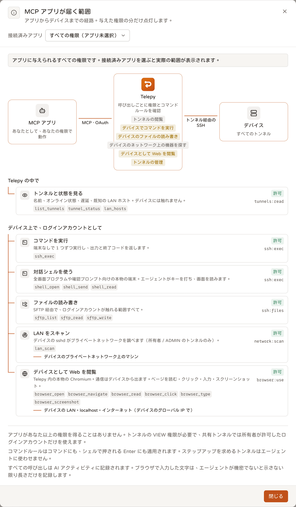
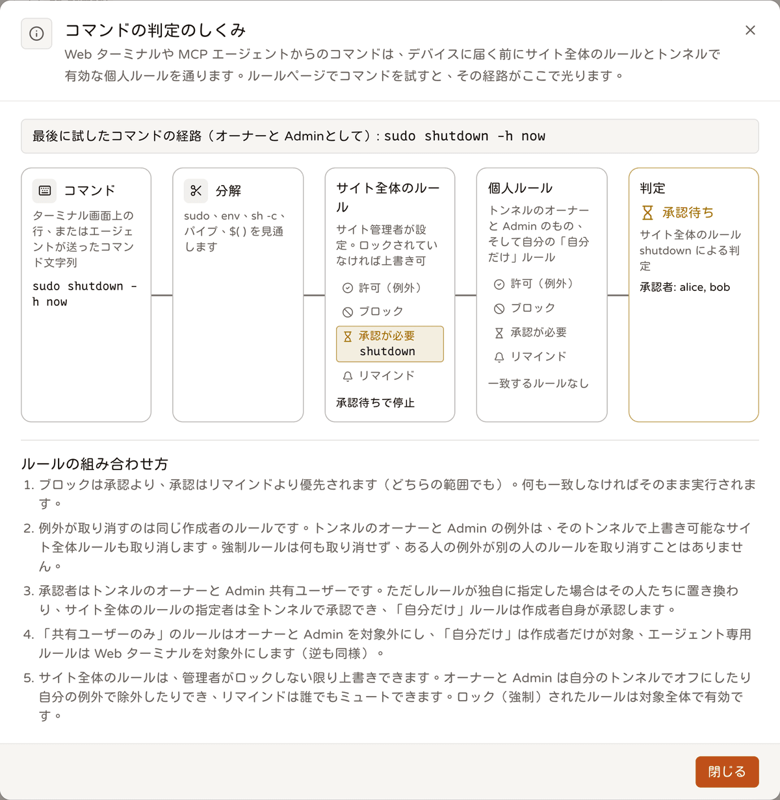

# AI ツール（MCP）

<p align="center"><a href="./mcp.md">English</a> | <a href="./mcp.zh-TW.md">繁體中文</a> | <b>日本語</b></p>

Telepy は MCP サーバーとしても動きます。MCP に対応した AI ツール（Claude Code、Claude Desktop / claude.ai、Cursor など）をつなぐと、あなた自身の権限の範囲で、あなたのデバイスを操作できるようになります。それ以上の権限を持つことはありません。

エージェントにできること：

- どのトンネルがオンラインか、デバイスの調子はどうかを確認する
- 自動で閉じる SSH セッションを開き、その中でコマンドを実行する
- 対話シェルで TUI を操作する
- ファイルを読み書きする
- デバイスの背後にある LAN をスキャンする
- デバイス経由でネットに出るブラウザを開く

このうちどれをアプリに許可するか、どのトンネルに触れさせるかは、承認ページであなたが決めます。

## クライアントを接続する

MCP のエンドポイントは `https://<あなたのホスト>/mcp`（Streamable HTTP）です。

本番環境では `.env` に `PUBLIC_URL`（例：`https://telepy.example.com`）を設定してください。OAuth の issuer も MCP の resource もこの値から決まります。

未設定の場合は、リクエストごとの `X-Forwarded-Proto` / `X-Forwarded-Host` / `Host` ヘッダーから導き出します。

| クライアント | 設定 |
| --- | --- |
| Claude Code | `claude mcp add --transport http telepy https://telepy.example.com/mcp` を実行し、その後、会話の中で `/mcp` を実行して認可を完了します |
| Claude Desktop / claude.ai | Settings → Connectors → Add custom connector で、URL に `https://telepy.example.com/mcp` を入力します |
| Cursor など | `mcp.json`：`{"mcpServers": {"telepy": {"url": "https://telepy.example.com/mcp"}}}` |

トークンを貼り付ける必要はありません。最初の呼び出しで 401 が返ってくると、クライアントは空気を読んで、[アプリを承認する](#アプリを承認する) で説明するサインインを自分で進めます。

どの URL を入れればいいか迷ったら、サイドバーの **AI → MCP** を開いてください。

そこには、実際に入力するエンドポイント（`PUBLIC_URL` に追従します）、上の 3 種類のクライアント用の、コピーしてそのまま使える設定、権限ごとに使えるツール、セッションが閉じる条件、接続済みの MCP アプリが表示されます。

### ブラウザがない場合は API トークンで

ブラウザを開けないエージェントや CI ジョブは、代わりに個人用 API トークン（`tpt_…`）を Bearer トークンとして送れます。トークンはサイドバーの **API** ページで作成します。

```json
{"mcpServers": {"telepy": {"url": "https://telepy.example.com/mcp", "headers": {"Authorization": "Bearer tpt_…"}}}}
```

- `/mcp` でトークンが使えるツール、スコープ、トンネルの制限は、OAuth アプリと同じです。
- その人の「API トークン」と「MCP アプリ」の両方の機能がオンである必要があります。
- そのトークンで開いたセッション、シェル、ブラウザは、そのトークンだけのものです。監査上のアプリ名は `API token "<名前>"` になります。
- ツール呼び出しは、API ページの「アクティビティ」にも `MCP <tool>` として記録されます。ステータスは 200、ツールがエラーを返したときは 400 です。
- トークンを失効させると、開いているセッションはすぐに閉じます。

## アプリを承認する

クライアントが初めて接続すると、ブラウザで Telepy の承認ページが開きます。

サインインしていない場合は、先にサインインページが表示されます。このページはあえて通常のサインインページとは違う見た目にしてあり、サインイン前の時点で、どのアプリが要求しているか、どこに戻るか、どの権限を求めているかを表示します。気が進まなければ、その場でキャンセルできます。

承認ページでは次のことを行います。

- アプリ名と戻り先のアドレスを確認する
- サインイン中のアカウントを確認する（「別のアカウントですか？」→「アカウントを切り替え」）
- アプリに渡す権限（スコープ）にチェックを入れる。渡したくないものはチェックを外す
- すべてのトンネルを許可するか、一部だけにするかを選ぶ
- 必要なら「以前の接続を置き換える」にチェックを入れ、同じアプリの以前の接続を無効にする。クライアントが新しいトークンを受け取った時点で、古いほうは失効します。

その後、クライアントはアクセストークン（有効期間 1 時間）とリフレッシュトークン（30 日、交換のたびにローテーション）を受け取り、それを使って `/mcp` を呼び出します。

<details>
<summary>OAuth 2.1 フローの詳細</summary>

```
MCP client ── POST /mcp ──────────────────────────────▶ 401 + WWW-Authenticate: Bearer resource_metadata="…/.well-known/oauth-protected-resource/mcp"
           ── GET /.well-known/oauth-protected-resource/mcp   （RFC 9728：authorization_servers）
           ── GET /.well-known/oauth-authorization-server     （RFC 8414：エンドポイント、S256）
           ── POST /api/oauth/register                        （RFC 7591 動的登録、公開）
           ── ブラウザを開く → /oauth/authorize（フロントエンドの同意ページ。未ログインなら先に /oauth/login へ。通常のログインページとは見た目が異なり、
                 ログイン前でも公開の GET /api/oauth/authorize/preview でアプリ、戻り先、権限を表示し、そのままキャンセルできる）
                 ユーザーは Web のログイン状態で承認する：アプリ名と戻り先、現在のアカウント（別のアカウントに切り替え可）を確認し、権限にチェックを入れ、使えるトンネルを制限する。
                 同じアプリの以前の接続は「置き換え」にチェックでき、クライアントが新しいトークンを受け取った時点で以前のものは失効する
                 フロントエンドが POST /api/oauth/authorize → {redirect_to: <redirect_uri>?code=…&state=…&iss=…}
           ── POST /api/oauth/token  (authorization_code + PKCE S256) → アクセストークン（1 時間）+ リフレッシュトークン（30 日、交換のたびにローテーション）
           ── POST /mcp  Authorization: Bearer <アクセストークン>
```

- アクセストークンは `token_type: "mcp_access"` の JWT です。Web のサインインのトークンでは `/mcp` を呼べません。
- REST API が MCP のアクセストークンを受け付けるのは、トークンで呼べるルートだけです（[cli.ja.md](cli.ja.md) を参照）。`telepy` コマンドラインのブラウザサインインは、この形で使っています。

</details>

### スコープ

| スコープ | 承認ページでの表示 | 使えるようになるツール |
| --- | --- | --- |
| `tunnels:read` | トンネルの閲覧 | `list_tunnels`、`tunnel_status`、`lan_hosts` |
| `ssh:exec` | デバイスでコマンドを実行 | `ssh_session_open`、`ssh_exec`、`shell_open` / `shell_send` / `shell_read` / `shell_resize` / `shell_close` |
| `ssh:files` | デバイスのファイルの読み書き | `ssh_session_open`、`sftp_list` / `sftp_read` / `sftp_write` |
| `network:scan` | デバイスのネットワーク上の機器を探す | `lan_scan`（自分が所有する、または ADMIN のトンネルのみ） |
| `browser:use` | デバイスとして Web を閲覧 | `browser_open` / `browser_navigate` / `browser_read` / `browser_screenshot` / `browser_click` / `browser_type` / `browser_close` |

承認ページでは、`ssh:exec`、`ssh:files`、`browser:use` に「変更可能」、残りの 2 つに「読み取りのみ」のタグが付きます。

### `telepy login` は MCP アプリに数えない

`telepy` コマンドラインのブラウザサインインも同じ OAuth を通り、承認ページには CLI からの要求だと表示されます。ただし、Telepy は MCP アプリとは分けて扱います。

- サインインのたびに `telepy CLI (<コンピューター名>)` として登録されます。この名前はクライアント自身の申告で、Telepy は一覧の分類にだけ使います。
- これらは API ページの「CLI のサインイン」タブに一覧されます。MCP ページ、環境設定、AI アクティビティページの MCP アプリ一覧には出てきません。
- 同じコンピューターでもう一度サインインすると、以前のものを置き換えるか確認されます。
- CLI のサインインは 1 人あたり最大 10 件まで保持され、11 件目では最も長く使われていないものがサインアウトされます。
- CLI のサインインも「MCP アプリ」機能のスイッチに従います。詳しくは [cli.ja.md](cli.ja.md) を参照してください。

## エージェントにできること



以下のツールは、それを使えるようにするスコープごとにまとめてあります。MCP ページの「アプリはどこまで届く？」ボタンを押すと、選んだ接続済みアプリについてこの図が描かれます。アプリ ─ Telepy ─ デバイス ─ LAN / インターネットの順に並び、そのアプリのスコープで届く枝が点灯します。

### トンネルを見る（`tunnels:read`）

| ツール | 内容 |
| --- | --- |
| `list_tunnels` | 見えるトンネル：id、名前、オンラインかどうか、レイテンシ、自分の権限、使えるターゲットの username、このアプリが開いているセッション |
| `tunnel_status(tunnel_id)` | 健全性、レイテンシ、24 時間の稼働率、デバイスの `facts` と `warnings`、直近 10 件のゲートウェイイベント |
| `lan_hosts(tunnel_id)` | デバイスの背後の LAN ホスト（スキャンで見つかったものと手動で追加したもの）：アドレス、名前、開いているポート、SSH バナー、ラベル、ログインアカウント |

- 健全性は online、degraded（トンネルは生きているが、デバイスの sshd が応答しない）、offline のいずれかです。
- `facts` には、OS、カーネル、稼働秒数、CPU、メモリとルートディスク（KB）、負荷、ssh のバージョン、再起動が必要かどうかが入ります。デバイスにログインできる人にだけ返します。

### コマンドを実行する（`ssh:exec`）

すべてはセッションから始まります。`ssh_session_open` が `session_id` を返し、ほかのツールはそれを受け取ります。

| ツール | 内容 |
| --- | --- |
| `ssh_session_open(tunnel_id, username?, idle_timeout_s?, max_lifetime_s?)` | セッションを開き `session_id` を返す。`username` を省略するとトンネルのデフォルトを使う（1 つしかなければ自動で選ぶ） |
| `ssh_exec(session_id, command, timeout_s?, max_output_bytes?)` | コマンドを TTY なしで実行し、`exit_code`、`stdout`、`stderr`、`timed_out`、`truncated` を返す |
| `ssh_session_list` | このアプリが開いているセッションと、それぞれの残り時間 |
| `ssh_session_close(session_id)` | セッションを閉じる |
| `shell_open(session_id, cols?, rows?)` | 対話シェルを開き（PTY、`xterm-256color`、デフォルトは 120×40）、`shell_id` を返す。1 セッションにつき最大 2 つ |
| `shell_send(shell_id, input, press_enter?)` | `input` をそのまま入力する。制御文字も可（`\u0003` = Ctrl+C、`\u001b` = Esc）。`press_enter` で Enter を 1 つ追加。1 回あたり 64 KiB まで |
| `shell_read(shell_id, timeout_ms?, max_bytes?, screen?)` | 新しい生の出力 `output`、現在の画面 `screen`、`cursor`、`size`、`more`、`exited` を返す。新しい出力がなければ最大 `timeout_ms` 待つ（デフォルト 1.5 秒、上限 10 秒） |
| `shell_resize(shell_id, cols, rows)` / `shell_close(shell_id)` | シェルのサイズ変更 / 閉じる |

シェルの細かい動きは [対話シェル](#対話シェル) を参照してください。

### ファイルを読み書きする（`ssh:files`）

これらも、`ssh_session_open` で開いたセッションの中で使います。

| ツール | 内容 |
| --- | --- |
| `sftp_list(session_id, path?)` | ディレクトリを一覧する（`~` = ホームディレクトリ） |
| `sftp_read(session_id, path, offset?, max_bytes?)` | ファイルを読む。テキストは UTF-8、それ以外は base64 で返す。分割して読める |
| `sftp_write(session_id, path, content, encoding?, append?)` | ファイルを書く、または追記する（`encoding`：`utf-8` / `base64`） |

### LAN をスキャンする（`network:scan`）

| ツール | 内容 |
| --- | --- |
| `lan_scan(tunnel_id, username?, subnets?, ports?)` | デバイスの sshd 経由で LAN をスキャンし、見つかったものをホスト一覧に保存する |

- 対象はプライベートレンジのみ、最大 1024 アドレスで、1 回およそ 1 分かかります。
- 自分が所有する、または ADMIN のトンネルでのみ使えます。
- 結果は `lan_hosts` で読みます。

### ブラウザを使う（`browser:use`）

| ツール | 内容 |
| --- | --- |
| `browser_open(tunnel_id, username?, url?, idle_timeout_s?, max_lifetime_s?)` | デバイス経由でリモートブラウザ（Chromium）を開き、`browser_id` を返す。同時に `url` を開ける |
| `browser_navigate(browser_id, url)` | URL に移動する（http / https のみ。省略時は `https://` を補う）。ページの読み込みを待ち、最終的な URL とタイトルを返す |
| `browser_read(browser_id, selector?)` | ページのテキスト：タイトル、URL、見えているテキスト（最大 10 万文字）、リンク。`selector` で一部だけ読める |
| `browser_screenshot(browser_id)` | PNG のスクリーンショット（幅 1280 px まで縮小）を、MCP の image content block として返す |
| `browser_click(browser_id, selector? \| text?)` | CSS セレクターまたは見えているテキスト（リンク、ボタン、ラベル）でクリックする。本物のマウスイベントを使う |
| `browser_type(browser_id, selector, text, press_enter?, sensitive?)` | フィールドに入力する。Enter で送信もできる。`sensitive` のデフォルトは true で、監査には長さだけを記録する |
| `browser_close(browser_id)` | ブラウザを閉じる |

ブラウザの通信はデバイスから出ていくので、デバイスの LAN、localhost、グローバル IP が見えます。詳しくは [エージェントのブラウザ](#エージェントのブラウザ) を参照してください。

## セッションと上限

セッション 1 つは、デバイスへの SSH 接続 1 本です。すべてのコマンドで共有するので、コマンドごとにハンドシェイクし直すことはありません。コマンドはそれぞれチャネルを 1 本開き、1 セッションにつき同時に最大 4 本です。

エージェントは後片付けが得意とは限らないので、セッションはすべて自動で閉じます。

### 上限

| 項目 | デフォルト | 補足 |
| --- | --- | --- |
| アイドルタイムアウト（`ai_session_idle_timeout`） | 600 秒 | 実行中のコマンドはアイドルに数えない |
| 最大存続時間（`ai_session_max_lifetime`） | 7200 秒 | 達したら必ず閉じる |
| 1 人あたりのセッション数（`ai_max_sessions_per_user`） | 3 | すべてのアプリの合計。SSH セッションとエージェントのブラウザを合わせて数える。0 = エージェントによるセッションの作成を許可しない |
| コマンドのタイムアウト | 60 秒 | 最大 600 秒。タイムアウトすると `KILL` を送ってチャネルを閉じる |
| 出力ストリームごとの保持量 | 64 KiB | 最大 1 MiB。超えた場合は先頭の 1/4 と末尾の 3/4 を残す |

- エージェントはより短い `idle_timeout_s` / `max_lifetime_s` を要求できますが、サイト設定を超えることはできず、10 秒より短くもできません。
- 上の 3 つは、管理者が **サイト設定 → AI アクセス（MCP）**（同じページに MCP エンドポイントの URL も表示されます）で設定します。変更は新しく開くセッションから有効です。
- セッションは MCP の接続ではなく資格情報に紐づきます。MCP 2026-07-28 版にはトランスポートセッションがないためです。各セッションはどれか 1 つの OAuth grant か個人用 API トークンのもので、別のアプリやトークンのセッションは互いに見えません。

### セッションが閉じるとき

| 閉じる条件 | 理由（通知と監査の `reason`） |
| --- | --- |
| エージェントが `ssh_session_close` を呼ぶ | `closed_by_agent` |
| ユーザー、トンネルの所有者、管理者が Web で閉じる（AI アクティビティまたはライブセッション、`DELETE /api/ai/sessions/{id}`）。または管理者がその人の「MCP アプリ」機能をオフにする | `closed_by_user` |
| `ai_session_idle_timeout` を超えてアイドル | `idle` |
| `ai_session_max_lifetime` を超えて存続 | `max_lifetime` |
| デバイスがオフラインになる、接続が切れる | `device_offline` / `disconnected` |
| grant または個人用 API トークンが失効・期限切れになる、アカウントが無効化される | `revoked` |
| トンネルが削除される | `tunnel_deleted` |
| 権限や username が取り除かれる（共有解除、共有の期限切れ、許可リストの縮小など） | `permission_removed` |

Telepy は 30 秒ごとに確認します。grant やトークンを失効させたときは即座に閉じ、共有解除や権限の変更などがあったときもすぐに再確認します。

## 対話シェル

シェルがあれば、エージェントはあなたがターミナルでするのと同じように作業できます。プロンプトに答えたり、TUI を操作したり、画面の変化を追ったりできます。

- シェル 1 つは、セッションの既存の接続上の PTY チャネル 1 本です。`ssh_exec` とセッションのチャネル枠 4 本を共有し、シェルは 1 セッションにつき最大 2 つです。
- Telepy は出力を常にバックグラウンドで読み取っている（画面モデルと録画に流す）ので、エージェントが読むのをやめてもデバイスが詰まることはありません。
- `shell_read` の `screen` は、ターミナルの vt100 モデルから作られます。1 行 1 行のプレーンテキストです。
- 誰も読んでいない出力は 256 KiB まで保持します。超えると古いものから捨て、捨てた量を `dropped_bytes` で知らせます。
- シェルが閉じるのは、`shell_close` を呼んだとき、属するセッションが（理由を問わず）閉じたとき、またはセッションの `idle_timeout` を超えて send / read がなかったときです（30 秒ごとに確認）。
- シェルを使っている間はセッションも使用中とみなされるので、シェルの作業中にセッションがアイドルで閉じることはありません。
- **録画**：トンネルで「Web ターミナルを録画」がオンなら、エージェントのシェルも asciicast として録画されます（`kind: agent`、ターミナル録画ページでは「MCP agent」と表示）。
- **ライブセッション** ページでは、エージェントのセッションの行に開いているシェルの数が表示されます（`/api/sessions` と `/api/ai/sessions` の `shells`）。

シェルのプロンプトで押される Enter も、すべてコマンドルールのチェックを通ります。[対話シェルもチェック対象](#対話シェルもチェック対象) を参照してください。

## エージェントのブラウザ

エージェントのブラウザは、通常のリモートブラウザのセッションそのものです。ブラウザコンテナ内の Chromium がデバイス経由でネットに出て、`remote_browser_max_sessions` に数えられます。違うのは、操作するのがエージェントだという点だけです。

- エージェントは、ブラウザコンテナ内のセッションマネージャーを通して操作します。バックエンドが Chromium の DevTools に直接接続することはありません。詳しくは [remote-browser.ja.md](remote-browser.ja.md) を参照してください。
- SSH セッションと 1 人あたりの上限 `ai_max_sessions_per_user` を共有し、アイドルと存続時間の制限も同じです。
- デバイスのオフライン、grant の失効、権限や username の削除、リモートブラウザのセッションの消失で閉じます。
- ステップアップが必要なトンネルでは拒否されます。
- トンネルの「接続中」の一覧とライブセッションページに表示され（kind `browser`、client = アプリ名）、そこから終了できます。終了後のツール呼び出しは「ended by <誰>」を返します。
- 開くときと閉じるときに、トンネルの Logs に `browser_open` / `browser_close` イベントを書きます。
- 通知は `AI-SESSION-OPENED` / `AI-SESSION-CLOSED` を流用し、`kind: "browser"` が加わります。webhook `mcp.session_*` の data にも `kind` が入ります。
- 監査には URL とセレクターを記録します。`browser_type` で入力したテキストは、エージェントが `sensitive: false` を渡さない限り長さだけを記録します。スクリーンショット自体は保存しません。

## ガードレール

### Web と同じルール

エージェントが得られる権限は、あなたが Web アプリで得られるものとまったく同じです。

- そのトンネルの VIEW 権限が必要です。
- ターゲットの username は、あなたの許可リストに入っている必要があります。共有されたトンネルでは、共有時に許可された username だけが使えます。Web ターミナルと同じです。
- **機能の権限**（管理 → ユーザーとアクセス → 機能の権限）も適用されます。管理者がある人の機能をオフにすると、対応するツールはその旨のエラー（`isError`）を返します。

| ツール | 必要な機能 |
| --- | --- |
| `ssh:exec` のツール | Web ターミナル |
| `ssh:files` のツール | ファイルマネージャー |
| `lan_hosts`、`lan_scan` | LAN 探索 |
| `browser:use` のツール | リモートブラウザ |

アプリにスコープが与えられていないだけの場合は、再接続してそのスコープを承認してもらうよう、エラーがエージェントに伝えます。

### ステップアップが必要なトンネル

トンネルによっては、セッションの前に毎回、第二要素での確認を全員に求めます。エージェントにはこれができないので、こうしたトンネルでは SSH セッションもブラウザも開けず、`lan_scan` も実行できません。

`list_tunnels` が `requires_step_up` を返すので、エージェントは試す前にわかります。

### コマンドルール（`ssh_exec`）



**コマンドルール** ページのルールは、エージェントのコマンドにも適用されます。MCP エージェントだけを対象にしたルールも作れます（`via: agents`）。

#### 2 種類のルール

- **個人ルール**：各自が自分で書きます。対象が「全員」または「共有ユーザーのみ」の場合は、作者が「現在」所有者または ADMIN であるトンネルでだけ有効です。
  - 「自分だけ」は作者自身のコマンドだけが対象で、作者が使うどのトンネルでも有効です。他の人のトンネルで動く自分のエージェントへの歯止めに便利です。「自分だけ」のルールは他の人には見えません。
- **サイト全体のルール**：管理者が書きます（管理 → ルールと通知 → コマンドルール）。デフォルトでは上書き可能で、トンネルの所有者または ADMIN は、自分が管理するトンネルでオフにできます。管理者が「ユーザーによる上書きを許可」をオフにすると強制になり、誰もオフにできません。

#### アクションごとの動作

1 つのコマンドが複数のルールに一致した場合は、ブロック > 承認が必要 > リマインドの順に優先されます。

- **ブロック**：実行しません。ツールはエラー（`isError`）を返し、どのルールか、そのルールの説明を伝えます。
- **承認が必要**：Telepy が承認リクエストを出し、そのツール呼び出しは最大 45 秒待ちます。承認されれば通常どおり実行して結果を返します。拒否された場合や、誰も承認しないままリクエストの期限が切れた場合はエラーを返します。
- **リマインド**：通常どおり実行し、`ssh_exec` の結果に `reminder`（ルールの説明。説明がなければ一致パターン）が加わります。エージェントはそれをあなたに伝えるべきです。REST 版の `POST /api/ai/sessions/{id}/exec` も同じです。
- **許可（例外）**：一致するコマンドを、同じ作者の「ブロック」と「承認が必要」のルールの対象から外します。

承認について：

- 承認者はルールで指定された人です。指定がなければトンネルの所有者と ADMIN、「自分だけ」のルールなら作者本人です。
- 承認者には Web アプリの右下にリクエストが表示され、コマンドルールページでも処理できます。
- 45 秒以内に誰も判断しなかった場合は「待機中」というエラーになります。エージェントからあなたに伝えてもらい、承認後に **まったく同じコマンド** でもう一度呼び出してもらってください。
- 承認は 10 分以内に 1 回だけ使えます（同じアプリ、トンネル、アカウント、コマンドの場合）。
- エージェントがトンネルの所有者として動く場合でも、承認ボタンは所有者本人が押す必要があります。自分の答案を自分で採点することはできません。エージェントも例外ではありません。

リマインドと例外について：

- リマインドは誰も待たず、コマンドルールページの「履歴」にも載りません。管理者が強制にしていなければ、各自が自分用にミュートできます。
- サイト全体の例外はサイト全体のルールを、個人の例外は同じ人のルールだけを免除します。
- トンネルの所有者または ADMIN の例外は、その人が管理するトンネルでは上書き可能なサイト全体のルールも免除します。強制のものは免除しません。
- 他の人の例外で、あなたのルールが覆ることはありません。

ブロック、待機、拒否されたコマンドは、すべて AI の監査に失敗した `ssh_exec` として記録されます。リクエストとその結果は、コマンドルールページの「履歴」にも並びます。

#### 対話シェルもチェック対象

エージェントが `shell_send` でシェルのプロンプトに Enter を押すたびに、Telepy は Web ターミナルと同じやり方で画面からその行を読み取り、照合します。

- **ブロック**：代わりに Ctrl+C を送り、ツールはエラーを返します。
- **承認が必要**：`ssh_exec` と同じく最大 45 秒待ち、承認されれば Enter を送ります。待機中はその行がプロンプトに残ります。承認後にエージェントが `input: ""` と `press_enter: true` を送ると実行されます（これも 10 分以内に 1 回）。
- 送られなかった Enter の後に入力された内容は破棄され、ツールが何バイト捨てたかを伝えます。
- **リマインド**：その行は通常どおり送られ、`shell_send` の結果に `reminders`（ルールごとに 1 文）が付きます。
- 全画面プログラム（vim、less）の中で押された Enter はチェックしません。

## 通知と監査

セッションが開いたり閉じたりすると、`/ws/notifications` がセッションのユーザーとトンネルの所有者に `AI-SESSION-OPENED` / `AI-SESSION-CLOSED` を送ります。中身は `details`、`tunnel_id`、`session_id`、`by`、`client` で、閉じるときは `reason` も付きます。

つまり、トンネルを共有した相手がエージェントでそこに接続すれば、あなたにわかります。

ツール呼び出しのたびに、監査に 1 行記録されます。

- 誰が、どのアプリで、どのトンネルと username で
- コマンドまたはパス（最大 2000 文字）
- 終了コード、所要時間、出力バイト数、エラー、接続元 IP

最大 10 万行を保持し、各行は 90 日後に削除されます。ハッシュチェーンで改ざんを検出できるようにしてあります。

> [!WARNING]
> コマンドの原文はそのまま記録されます。監査ログは記憶力が抜群なうえ、気を利かせて伏せてはくれません。エージェントにコマンドラインへパスワードを含めさせないでください。

確認できる場所：

- **AI アクティビティ**：自分の呼び出し、開いているセッション、MCP アプリ。
- **全体の AI アクティビティ**：全員の分。管理エリアにあります。
- API：`GET /api/ai/activity` と `GET /api/ai/sessions` はデフォルトで `?scope=mine` です（管理者も同じ）。自分の分に加えて、自分が所有するトンネルの分が返ります。
- `scope=all` はすべてを返し、管理者だけが使えます（それ以外は 403 `admin_only`）。`activity` は `tunnel_id`、`user_id`、`grant_id` でも絞り込めます。

## アクセスの取り消し

- アプリは、**MCP** ページ、**環境設定 → MCP アプリ**、AI アクティビティページの「あなたの MCP アプリ」から失効させられます。管理者は「ユーザーを管理」ダイアログから、誰のものでも失効させられます。
- `/mcp` へのリクエストのたびに grant とユーザーを確認し直すので、失効は即座に効きます。そのアプリが開いている SSH セッション、シェル、ブラウザもすぐに閉じます。
- 個人用 API トークンを失効させた場合も、開いているセッションはすぐに閉じます。
- **アカウントの無効化**：grant と個人用 API トークンは失効せず、一時停止になります。`/mcp` は即座に拒否し、開いているセッションは閉じます。アカウントを再度有効にすれば、そのまま使えます。
- **「MCP アプリ」機能のオフ**：その人のすべてのアプリが、失効したときと同じく 401 を受け取り、開いているエージェントのセッションも終了します。機能をオンに戻せば元どおり使えます。

## MCP を使わない場合：REST と CLI

同じ操作は REST API にもあります。`telepy exec` と `telepy browse` はこれを使っています（[cli.ja.md](cli.ja.md) を参照）。

- コマンド：`/api/ai/sessions*`。
- リモートブラウザ：`/api/browser/sessions*`。下の表のとおりです。

| リクエスト | 内容 |
| --- | --- |
| `POST /api/browser/sessions {tunnel_id, username?, url?}` | ブラウザを開く → `{id, …}` |
| `POST …/{id}/navigate {url}` | URL に移動 |
| `GET …/{id}/text?selector=` | ページのテキスト |
| `GET …/{id}/screenshot` | スクリーンショット（image/png） |
| `POST …/{id}/click {selector \| text}` | クリック |
| `POST …/{id}/type {selector, text, press_enter?, sensitive?}` | 入力 |
| `DELETE …/{id}` | 閉じる |
| `GET /api/browser/sessions` | 開いているブラウザの一覧 |

- 上限、接続中の表示、ライブセッション、自動で閉じる仕組み、監査は、MCP 経由のときとすべて同じです。
- 個人用 API トークンや OAuth アプリのトークンには `browser:use` が必要です。Web のサインインからも呼べます（クライアント名は「Telepy web sign-in」）。
- ブラウザは、開いた資格情報だけのものです。
- ステップアップが必要なトンネルは 403 `step_up_refused` を返します。

## セキュリティ上の注意

アプリを承認する前に、次の点を頭に入れておいてください。

- アプリがあなた以上の権限を持つことはなく、使えるのはあなたが承認したスコープとトンネルだけです。
- `ssh:exec`、`ssh:files`、`browser:use` は変更を加えられます。デバイス経由で開いたブラウザは、そのデバイスの LAN と localhost に届きます。
- コマンドの原文はすべて監査ログに残ります。パスワードはコマンドラインに載せないでください。
- コマンドルールは `ssh_exec` とシェルのプロンプトでの Enter をすべてチェックしますが、vim や less のような全画面プログラムの中の Enter はチェックしません。
- ステップアップが必要なトンネルには、エージェントは入れません。
- 誰かのエージェントがあなたの所有するトンネルに接続すると、通知が届きます。
- `telepy CLI (<コンピューター名>)` という名前はクライアントの自己申告です。ラベルとして見るにとどめてください。何かの証明にはなりません。

## 手動での確認

```bash
# 401 が返り、discovery がメタデータを指す
curl -si -X POST https://telepy.example.com/mcp -H 'content-type: application/json' -d '{}' | grep -i www-authenticate
curl -s https://telepy.example.com/.well-known/oauth-protected-resource/mcp
curl -s https://telepy.example.com/.well-known/oauth-authorization-server
```

<details>
<summary>自動テスト（コントリビューター向け）</summary>

- `tests/oauth_api.rs`：OAuth フロー。
- `tests/mcp_api.rs`：偽のデバイス sshd を使ったエンドツーエンドのテスト。exec、SFTP、タイムアウト、切り詰め、スコープ、上限、失効、自動で閉じる仕組み、共有の通知、対話シェル（画面、制御文字、録画、コマンドルール）、偽のセッションマネージャーを使ったエージェントのブラウザを扱います。
- `tests/api_tokens.rs` と `tests/api_token_calls.rs`：個人用 API トークンでの `/mcp` と REST の呼び出し、呼び出しログ。
- `tests/features.rs`：機能の権限によるツールのブロック。
- `docker/kasm-browser/tests/test_cdp.py`：セッションマネージャー側のブラウザ操作。

</details>
