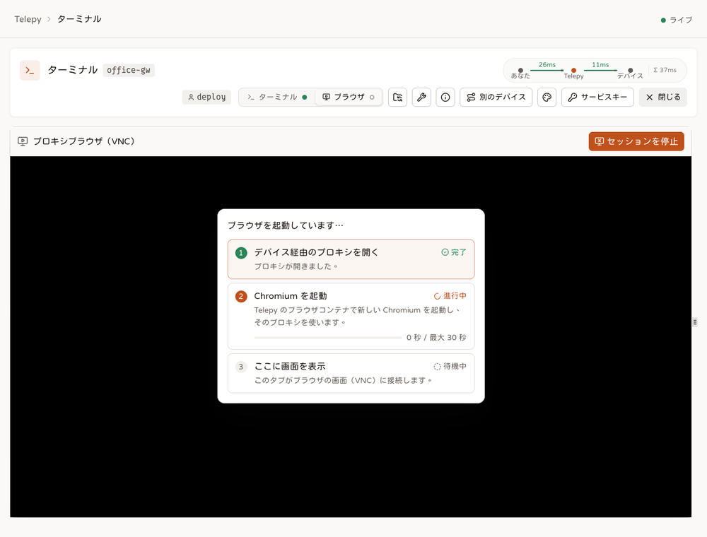

# リモートブラウザ

<p align="center"><a href="./remote-browser.md">English</a> | <a href="./remote-browser.zh-TW.md">繁體中文</a> | <b>日本語</b></p>

リモートブラウザは本物の Chromium です。Telepy のタブから操作しますが、そのリクエストはすべて手元のデバイスのどれかから出ていきます。サイトから見えるのはそのデバイスのアドレスで、`localhost` もデバイス自身を指します。

Chromium そのものは Telepy 側のブラウザコンテナで動きます。デバイスは SSH サーバーを貸すだけで、実際の接続はそこから出ていきます。デバイスには何もインストールしません。

## 何に使えるか

- **ネットワークの中からしか開けない管理画面**：`192.168.1.1` のルーター、NAS、プリンター、スイッチなど。インターネットの存在を知らずに育ち、これからも知るつもりのないページたちです。
- **デバイス自身の `localhost` で動くサービス**：たとえば `http://localhost:8080` の、外に出すつもりのなかったダッシュボード。デバイスの前に座っているのと同じように開けます。
- **デバイスから見たウェブ**：同じグローバル IP、同じ所在地、同じ DNS です。

## 開いてみる

1. トンネル一覧で、デバイスの「ブラウザ」をクリックします。ターミナルページがブラウザの画面で開きます。
2. ページ上部でログインアカウントを選びます。ブラウザはそのアカウントの SSH ログインを通ってネットに出ます。
3. 「ブラウザを起動」をクリックします（パネル中央の「クリックして初期化」でも同じです）。

起動は 3 つのステップで進み、パネルに 1 つずつ表示されます。

- **デバイス経由のプロキシを開く**：Telepy がそのアカウントでデバイスにログインし、その SSH で SOCKS プロキシを開きます。
- **Chromium を起動**：Telepy のブラウザコンテナで新しい Chromium を起動し、そのプロキシを使わせます。
- **ここに画面を表示**：このタブがブラウザの画面に接続します。



どこかのステップで失敗すると、一覧はそこで止まって理由を表示します。「もう一度試す」で最初からやり直せます。プロキシの最初の試行は接続が温まっていないぶん遅くなりがちなので、既定で 1 回は自動で再試行します。

## 中で起きること

- **毎回まっさら**：セッションごとに新しいブラウザプロファイルを作り、停止すると削除します。履歴も Cookie も保存したパスワードも残りません。
- **ホームページと言語**：サイト設定で決まります。変更していなければ Google と `zh-TW` です。画面サイズの既定は `1280x720` です。
- **日本語や中国語の入力**：手元の IME がそのまま使えます。パネルのヘッダーにある「IME」ボタンでこのモードを切り替えられ、既定ではオンです。
- **ダウンロードはブロック**：ファイルは誰も取り出せないコンテナの中に落ちるだけだからです。究極のプライバシーですが、あなた自身にも見えません。
- **ウィンドウが消えたとき**：最小化したウィンドウは、リモートデスクトップ上部のタスクバーから戻せます。閉じてしまった場合は、そのバーにある「Open Browser」ランチャーか、デスクトップの右クリックメニューの「Open Browser / 開啟瀏覽器」を使ってください。既存のウィンドウがあればそれを呼び戻し、なければ新しく開きます。
- **Chromium が落ちたとき**：数秒待ってください。ウォッチドッグが 10 秒ごとに確認し、自動で起動し直します。ブラウザのないリモートブラウザは、ちょっと高価な壁紙でしかありません。

## 誰が開けるか

- そのトンネルの **VIEW** 権限と、そのトンネルで使えるログインアカウントが少なくとも 1 つ必要です。ブラウザはそのうちのどれかのアカウントとして動きます。
- 機能「リモートブラウザ」がオンになっている必要があります。管理者が「機能の権限」ページで設定します。
- 「要確認」（ステップアップ）が付いたトンネルでは、起動の前に 2 つ目の要素で本人確認を求められます。
- サイトが 2 段階認証を必須にしている場合は、アカウントで設定を済ませておく必要があります。
- サイト全体で同時に動かせるブラウザは `remote_browser_max_sessions` 個まで（既定 10 個）です。MCP エージェントやスクリプトが開いたものも数えます。

使っている間は、トンネルの所有者と ADMIN 権限の共有相手から、トンネル一覧の「N 人が使用中」ボタンと「ライブセッション」ページであなたが見えます。Telepy は `browser_open` と `browser_close`（所要時間付き）をそのトンネルの「ログ」に書き、`session.started` の webhook イベントを所有者と ADMIN に送ります（あなた自身には送りません）。

## セッションが終わるとき

- **自分で閉じたとき**：「セッションを停止」、パネルを閉じる、タブを閉じる。プロキシもブラウザもプロファイルも、まとめて片付きます。
- **接続が消えたとき**：バックエンドは 20 秒ごとにタブへ ping を送り、40 秒何も返ってこなければ去ったものとみなします。ノート PC のスリープやネットワークの切り替えで、セッションがいつまでも残ることはありません。
- **誰かが「ライブセッション」ページから終了させたとき**：クローズコード 4009 で、reason にはその人の名前が入ります。
- **権限を失ったとき**：トンネルの共有解除、許可リストからのアカウントの削除、機能「リモートブラウザ」のオフ、アカウントの無効化などです。セッションは 4009、reason `Telepy (access changed)` で閉じます。`browser_close` に理由が残り、あなたには `SESSION-ENDED` 通知が届きます。
- **セッションが応答しなくなったとき**：パネルは別に 15 秒ごとに生存を知らせます。裏のプロキシが死んでいれば Telepy がセッションを片付け、パネルには「セッションが見つからないか期限切れです」と表示されます。
- **定期的な掃除に引っかかったとき**：Telepy は 10 秒ごとに、デバイスとの接続が切れたセッションと、`remote_browser_session_idle_timeout` に 30 秒を足した時間だけ生存の知らせがないセッションも片付けます。
- **Telepy が再起動したとき**：動いていたセッションは引き継がれません。Telepy は起動時に、コンテナに残ったブラウザをすべて止めます。

## サイトにボット扱いされたら

本物の人間が VNC で操作し、しかもデバイス自身の IP から出ていく。これ以上の変装はなかなかありません。Telepy はそのうえで、ブラウザが自動化されているように見えないよう Chromium のフラグをいくつか足しています。効果はありますが、フラグでは手の届かないブロックもあります。

### Telepy がしていること

- `--disable-blink-features=AutomationControlled` で `navigator.webdriver` を false にします。
- `--lang` と `--accept-lang` で、空でなく一貫した言語をブラウザに渡します。`navigator.languages` が空なのは典型的なボットの特徴です。
- `--accept-lang` には q 値のない、きれいな言語タグ（`zh-TW,zh,en`）を渡します。Chromium はこの値から `Accept-Language` ヘッダーと `navigator.languages` の両方を決め、q 値は自分で付けます。以前の版は q 値を先に入れてしまい、本物のブラウザなら絶対に送らない値になっていました。
  - `Accept-Language` が `zh-TW,zh;q=0.9,zh;q=0.9;q=0.8,en;q=0.8;q=0.7` に（q が二重）
  - `navigator.languages` が `['zh-TW','zh;q=0.9','en;q=0.8']` に（q が混入）

  その結果、どこへ行っても CAPTCHA でした。きれいなタグなら、ヘッダーは `zh-TW,zh;q=0.9,en;q=0.8`、`navigator.languages` は `['zh-TW','zh','en']` になります。
- `--enable-unsafe-swiftshader` を、これだけ付けて WebGL を動かしています。コンテナには GPU がなく、このフラグがないと `canvas.getContext("webgl")` は null を返します。「WebGL がまったくない」のは強いボットのシグナルで、YouTube の「ログインしてボットでないことを確認してください」もここを見ます。このフラグは WebGL だけをソフトウェア描画（SwiftShader）にフォールバックさせ、コンポジタには触れません。

> [!WARNING]
> 「WebGL を確実に動かすため」に `--use-gl=angle --use-angle=swiftshader` を足すのは絶対にやめてください。コンポジタ全体がソフトウェア描画になり、動画がなめらかに再生できなくなります。実際の VP9（640x480）で測ると、強制版は 4 フレーム落ち、単独のフラグとフラグなしはどちらも 0 フレームで、WebGL も同じように動きました。720p や 1080p では、強制版はまともに再生できません。

WebGL のレンダラーは本物の GPU ではなく SwiftShader と表示されます。弱いシグナルですが、隠すにはレンダラー文字列を偽装する必要があり、Telepy はそこまでしていません。

### フラグでは解決できないこと

フラグが扱えるのはブラウザのフィンガープリントだけです。YouTube のようなブロックを決めるのは、別の 2 つです。

1. **デバイスの IP の評判**：通信はデバイスの IP から出ます。それがデータセンター、クラウド、VPN のアドレスだったり、大量の自動アクセスに使われてきたアドレスだったりすると、ブラウザがどれだけ人間らしくても YouTube や Cloudflare はブロックします。対策は、家庭用回線につながったデバイスに替えることだけです。
2. **Cookie がなければ信頼もない**：セッションは毎回まっさらなプロファイルで始まりますが、サイトはログイン済みで履歴のあるブラウザをずっと信頼します。Cookie のない真新しいブラウザは、YouTube から見ればどう見てもボットです。実際、その手の訪問者はたいていボットなので。

毎回まっさらにするのはプライバシーのための意図的な選択で、ときどきログインを求められるのはその代償です。ブロックが問題になってきたら、まず家庭用 IP のデバイスに替えてください。

<details>
<summary>コントリビューター向け：プロファイルをまっさらに保つ理由</summary>

コミット 967ea75 でプロファイルを使い捨てにしたあと、Cookie が溜まらなくなったせいで「YouTube にログインを求められる」という退行が出ました。折衷案として、Cookie とログイン状態だけを残し、閲覧履歴は残さない方法も検討しました。プロジェクトのオーナーはプライバシーを優先し（2026-07-04 決定）、そもそも出口 IP のほうが影響は大きいという判断です。この決定を見直すまでは、プロファイルの永続化を戻さないでください。

</details>

## MCP エージェントとスクリプトからの操作

同じブラウザを、誰も画面を見ていない状態で操作することもできます。

- **MCP エージェント**：`browser:use` スコープを持つエージェントは `browser_*` ツールを使えます。[MCP](mcp.ja.md) を参照してください。
- **スクリプト**：`/api/browser/sessions*` 以下の REST ルートを使います。開く（`{tunnel_id, username?, url?}`）、`navigate`、`text?selector=`、`screenshot`（image/png）、`click`、`type`、`DELETE`、一覧です。個人 API トークンには `browser:use` スコープが必要で、ウェブのサインインからも呼べます。
- **コマンドライン**：`telepy browse` です。[CLI](cli.ja.md) を参照してください。

```bash
ID=$(telepy browse box http://192.168.1.1/)   # a browser on the device's network (browser:use); prints its id
telepy browse shot "$ID" -o router.png
telepy browse close "$ID"
```

これらは通常のリモートブラウザのセッションです。同じプロキシ、同じブラウザコンテナを使い、`remote_browser_max_sessions` にも数えます。違うのは次の点です。

- ブラウザは、それを開いた認証情報（MCP アプリ、API トークン、ウェブのサインイン）に属します。その人のエージェントの SSH セッションと合わせて `ai_max_sessions_per_user` に数えます。
- アイドル、寿命、取り消し、権限の喪失、デバイスのオフラインは、エージェントのセッションのルールで扱います。このルールは、アプリの承認やトークンがまだ有効かどうかも確認します。ウェブのセッションを終わらせる変更があったときも、この確認がすぐに走ります。
- 「ライブセッション」ページにアプリ名付きで表示され、そこから終了させられます。以降の操作には、誰が終了させたかが返ります。
- 開閉は `browser_open` / `browser_close` として記録され、操作のたびに AI アクティビティのログに 1 件残ります。`type` で送ったテキストは、呼び出しで `sensitive: false` を指定しない限り長さだけを記録します。
- ステップアップが必要なトンネルでは常に拒否されます（403 `step_up_refused`、MCP ではツールエラー）。
- 機能「リモートブラウザ」がオフだと、誰も開くことも操作することもできません。一覧と終了はそのまま使えます。

各操作の内容です。

- `navigate`：http と https のみです。コンテナ自身のファイルを読まれないよう、`file:` などはバックエンドが拒否します。
- `screenshot`：幅 1280 px 以下の PNG です。
- `read` / `text`：ページに見えているテキストとリンクです。CSS セレクターで範囲を絞れます。
- `click`：セレクターか見えているテキストで指定する、本物のマウスクリックです。
- `type`：フィールドにフォーカスしてテキストを入力し、Enter も押せます。

操作の対象は、ブラウザのタブのうち最初の通常のウェブページです。タブがすべて閉じていれば空白ページを 1 つ開きます。1 操作の持ち時間は 30 秒です。

<details>
<summary>操作が Chromium に届くまで</summary>

```
MCP ツール（browser_navigate / read / click / type / screenshot）または REST /api/browser/sessions/{id}/…
  → バックエンド
  → session manager：POST /sessions/<id>/cdp（X-Internal-Token）
  → cdp.py → ws://127.0.0.1:<CDP_BASE + display>（chromium --remote-debugging-port、コンテナ内の loopback のみ）
```

- DevTools のポートはコンテナ内の 127.0.0.1 でしか待ち受けていません。バックエンドが直接つなぐことはなく、session manager に頼み、session manager が小さなアダプター（`cdp.py`）に操作を渡します。
- 1 操作の上限は `CDP_ACTION_TIMEOUT`（30 秒）です。
- スクリーンショットは CDP の clip scale で縮小し、クリックは本物の `Input.dispatchMouseEvent` イベント、入力は `Input.insertText` です。
- 対象のタブは `/json/list` の最初の通常ページで、なければ `about:blank` を開きます。
- `cdp.py` は Python の標準ライブラリだけを使い、最小限の WebSocket クライアントも自前です。テストはブラウザコンテナの `tests/test_cdp.py` にあります。

</details>

## 内部の仕組み

### 構成要素

- **あなたのタブ**：Telepy に同梱した KasmVNC 純正のウェブクライアントを動かし、リモートの画面を描きます。
- **バックエンド**：あなたが誰かを確認し、タブとブラウザコンテナの間で画面を中継します。セッションごとに小さな SOCKS プロキシも動かします。
- **ブラウザコンテナ**（`kasm-browser`）：セッションごとに仮想ディスプレイ（KasmVNC の Xkasmvnc）、ウィンドウマネージャー（openbox）、Chromium を動かします。
- **session manager**：コンテナ内の小さな HTTP サービスです。バックエンドの依頼で上の 3 つを起動・停止し、共有の `INTERNAL_API_TOKEN` を持つ呼び出ししか受け付けません。
- **デバイスの SSH サーバー**：ウェブサイトへの実際の接続を行います。

```
あなたのタブ ──wss /ws/remote-browser/<session>/──▶ バックエンド ──ws──▶ kasm-browser コンテナ
                                                                  （Xkasmvnc + openbox + Chromium）

Chromium ──SOCKS5──▶ バックエンド ──トンネル上のチャネル──▶ デバイスの sshd ──▶ ウェブサイト
```

Chromium は `--proxy-server` でバックエンドのプロキシを指して起動します。Chromium が開く接続は 1 本ずつ、Telepy がすでにデバイスと結んでいる SSH 接続上のチャネルになり、そこからデバイスの sshd が先へつなぎます。`ssh -D` と同じ仕組みで、別プロセスがないだけです。

この SSH ログインは共有されます。同じデバイス・同じアカウントでウェブターミナルやファイルマネージャーがすでに開いていれば、ブラウザも同じ接続に相乗りします。プロキシは CONNECT しか扱わず、パスワードもなく、Telepy の Docker ネットワークの中からしか届きません。

接続先がホスト名で、デバイスが Mac の場合、Telepy はまずデバイス上で名前を IP に解決してから接続します。Apple の sshd は、名前への転送を頼まれると SSH 接続ごと切ってしまうからです。

<details>
<summary>パネルが呼んでいる API</summary>

- `POST /api/reverse/server/{id}/remote-browser/start`（本文 `{username?}`）：機能、VIEW、ステップアップ、アカウント（省略時はトンネルの既定アカウント、それもなければ使える最初のもの）、セッションの上限を確認します。続いてプロキシを開き、session manager にブラウザを頼み、`{session_id, ws_path}` を返します。
- プロキシを開けなかったときは 500 と `code: device_offline` を返し、パネルが独自のメッセージに置き換えます。トンネルがまったくないデバイスは、試行を待たずにすぐ失敗します。
- `POST /api/reverse/server/remote-browser/{sid}/ping`：15 秒ごとです。まずそのセッションのプロキシがまだ待ち受けているかを確かめ、いなければセッションを片付けて 404 を返します。
- `POST /api/reverse/server/remote-browser/{sid}/stop`：パネルを閉じたときやタブがアンロードされるときに呼びます。画面のソケットが切れた場合も同じ経路です。
- 画面のソケットがつながっている間は、バックエンド自身も 20 秒ごとにセッションを延長します。バックグラウンドタブがスロットリングされても切れません。
- セッションはバックエンドのメモリ上にあります。小さなテーブルにも記録していますが、それは再起動後に、コンテナでまだ動いているブラウザを止めるためだけです。

</details>

### localhost がデバイスを指す理由

Chromium には「ループバックアドレスはプロキシを通さない」という組み込みのルールがあります。ここではそのせいで、`http://localhost:8080` がコンテナ自身のループバック、つまり何も動いていない場所へ行ってしまいます。「リモートブラウザが localhost にすら届かない」という報告の原因がこれでした。

Telepy は Chromium を `--proxy-bypass-list='<-loopback>'` 付きで起動します。このトークンが組み込みの例外を取り除くので、ループバックもプロキシを通り、デバイスの sshd がデバイス自身の `127.0.0.1` へつなぎます。

この例外の対象は `localhost`、`*.localhost`、`[::1]`、`127.0.0.1/8`、`169.254/16`、`[FE80::]/10` なので、リンクローカルアドレスもデバイスのネットワークへ向かいます。まさに狙いどおりです。通常の閲覧は変わりません。画面の転送も KasmVNC 独自の websocket で、Chromium の通信ではないので影響を受けません。

Chromium のコマンドラインを編集するときは、シングルクォートを残してください。コマンド全体はもう一度シェルに解釈され（コンテナの起動スクリプトにある `sh -c "$BROWSER_CMD"`）、引用符のない `<` や `>` はリダイレクトになってしまいます。

### 画面をタブに届けるまで

KasmVNC は素の VNC（RFB）から離れてしまいました。websocket しか開かず、従来の VNC ポートもなく、標準の noVNC では接続できません（画面が真っ黒になります）。そのためタブでは KasmVNC 独自フォークの noVNC クライアントを使い、バックエンドは websocket から websocket へ、メッセージ単位で中身を解析せずに中継します。

- タブは `/ws/remote-browser/<session_id>/` に接続し、最初のメッセージでサインインのトークンを送ります。
- バックエンドは機能「リモートブラウザ」を確認し（オフなら 4012）、セッションのトンネルに VIEW 権限があるかを改めて確かめます。
- VNC サーバーは自分から先に話すので、最初の挨拶を取りこぼせません。順番は、タブが `auth` を送る、バックエンドが上流に接続して `ready` を返す、タブがソケットを VNC クライアントに渡して `begin` を返す、そこで初めてバックエンドが転送を始める、です。
- ハートビートは 20 秒ごとの WebSocket ping です。ping のあと 40 秒何も返ってこなければセッションを終えます。

<details>
<summary>コントリビューター向けの KasmVNC の事実（実測済み。調べ直さないこと）</summary>

| 項目 | 値 |
|---|---|
| 標準の noVNC と互換？ | **互換なし**。kasmtech/noVNC フォークを使う（サーバー 1.4.0 ↔ クライアント 1.3.0） |
| トランスポート | プレーンな ws（`-sslOnly` は既定でオフ）。エンドポイントは `/websockify`、サブプロトコルは `binary` |
| `Sec-WebSocket-Origin` | 必須（Hixie 時代のヘッダーで、値は検証されない）。ないと 401 ではなく 404 "failed websocket checks" |
| Basic Auth | 既定でオン。`-disableBasicAuth` は 1.4.0 では効かない。`kasmvncpasswd` でユーザーを作り、接続時に `Authorization: Basic` を付ける |
| パスワードファイル | 固定パス `-KasmPasswordFile /etc/kasmvnc/kasmpasswd`。`$HOME` に頼らないこと。ビルド時と実行時で HOME が違い、毎回 401 になる |
| ws_port | `8443 + display`（`WS_BASE` で調整可） |

同梱のクライアントは `src/frontend/src/vendor/kasm-novnc/`（kasmtech/noVNC v1.3.0）にあります。その README に、マウスボタンのマッピング設定や `compositionend` 後のリセットなど、組み込みに必要なことがまとまっています。パネルを触る前に読んでください。

KasmVNC へ移行した経緯は[エンジニアリングノート](engineering/articles/2026-07-03-kasmvnc-migration-warstory.md)（繁体字中国語）にあります。

</details>

### ブラウザコンテナの中

セッションごとに専用のディスプレイ（`:N`、websocket ポートは `8443 + N`）、専用のウィンドウマネージャーと Chromium、専用の一時プロファイルディレクトリを持ちます。コンテナの PID 1 は tini（`init: true`）で、行き場をなくしたプロセスを回収します。

<details>
<summary>コントリビューター向けのコンテナの詳細</summary>

- **プロファイルは絶対に共有しない**：Chromium の SingletonLock のせいで、同時に動く 2 つ目の Chromium は 1 つ目に処理を渡して終了し（`Opening in existing browser session.`）、両方のセッションが失敗します。ブラウザの `HOME` もプロファイルディレクトリを指すので、dotfile もセッションと一緒に消えます。
- **起動スクリプトは 1 本だけ**：タスクバーのランチャー、デスクトップの右クリックメニュー、ウォッチドッグは、どれも同じ `open-browser.sh` を実行します。Debian 既定の openbox メニューにあった「Web browser」は素の `x-www-browser` で、root かつサンドボックスなしなので即座に終了し、「クリックしても何も起きない」ように見えていました。そのメニューは差し替え済みです。
- **ブラウザのコマンドは 2 つの経路で渡す**：環境変数と、ディスプレイごとのファイル `/tmp/telepy-browser-<display>.env`（セッション停止時に削除）です。環境変数が空なら、スクリプトは `$DISPLAY` をもとにそのファイルを読みます。古い openbox は環境変数を渡さず、そのメニューからブラウザを開くと `BROWSER_CMD not set` になっていました。
- **何度実行しても大丈夫**：ランチャーは既存のウィンドウにフォーカスするか元に戻し、ウィンドウがないときだけ新しい Chromium を起動します。バックグラウンドモードで残ったプロセスも片付けます。これがないと「Opening in existing browser session」と出るだけで、ウィンドウは開きません。
- **ウォッチドッグ**：10 秒ごとに、`--user-data-dir` を手がかりにセッションの Chromium を探し、いなければ起動し直します。セッション開始後 15 秒は待ち、再起動の間隔は最低 30 秒です。`REMOTE_BROWSER_RESPAWN=0` でオフにできます。セッションに戻ったら空のデスクトップしかなく、機能ごと壊れたと思ったユーザーがいたので作りました。
- **ウィンドウ**：openbox は専用の設定で起動します（タイトルバーなし、最大化）。Chromium 自身の `--start-maximized` では 1050×720 にしかならず、余白とタイトルバーが残りました。
- **ダウンロード**：Chromium の管理ポリシー（`DownloadRestrictions: 3`）でブロックしています。許可するなら、容量の上限とファイルを取り出す手段の両方が必要です。
- **サンドボックス**：Chromium はコンテナ内で root として動き、Docker 既定の seccomp プロファイルが非特権のユーザー名前空間をブロックするので、`--no-sandbox` が必要です。`--test-type` は黄色い警告バーを隠しますが、JavaScript のフィンガープリントは変わらず、警告バーもページからは見えません。本物のサンドボックスには、compose からカスタムの seccomp プロファイルをマウントする必要があります。これは実施しておらず、隔離の境界はコンテナです。
- **停止**：プロセスは `killpg(p.pid)` でグループごと終了させます（`start_new_session` によりグループ ID が pid と同じになります）。`getpgid` は使わないでください。グループリーダーが先に死ぬと例外になり、孤立したプロセスが残ります。

</details>

## 設定

### サイト設定

「サイト設定 → リモートブラウザ」にあります。アイドルタイムアウトだけはすぐに反映され、それ以外の変更は次にブラウザを開いたときから有効です。

| 設定 | 既定値 | 内容 |
|---|---|---|
| `remote_browser_session_idle_timeout` | 60 | 生存の知らせがないまま何秒（さらに猶予 30 秒）でセッションを片付けるか |
| `remote_browser_max_sessions` | 10 | サイト全体で同時に動かせるブラウザの数。エージェントやスクリプトのものも含む。0 = 無制限 |
| `remote_browser_geometry` | `1280x720` | 各ブラウザの画面サイズ |
| `remote_browser_ssh_timeout` / `remote_browser_ssh_attempts` | 30 / 2 | プロキシを開くときの 1 回あたりの秒数と試行回数 |
| `remote_browser_kasm_create_timeout` | 30 | コンテナがディスプレイと Chromium を起動し終えるまで待つ秒数 |
| `remote_browser_homepage` / `remote_browser_language` | Google / `zh-TW` | ホームページと言語。空欄ならコンテナの環境変数の既定値 |

2 つの `remote_browser_ssh_*` という名前は、プロキシが独立した `ssh -D` プロセスだった頃の名残です。今はバックエンドの中で動いていますが、名前だけが残りました。

### 環境変数

どれも既定値があるので、普通は何も設定しなくて構いません。バックエンド側：

- `KASM_BROWSER_API`（既定 `http://kasm-browser:7000`）：session manager です。
- `KASM_BROWSER_HOST`（既定 `kasm-browser`）：KasmVNC の websocket があるホストです。
- `INTERNAL_API_TOKEN`：バックエンドが `X-Internal-Token` として session manager に送る秘密の値です。

ブラウザコンテナ側、または両方で共有するもの：

| 変数 | 既定値 | 用途 |
|---|---|---|
| `KASM_WS_USER` / `KASM_WS_PASSWORD` | `telepy` / `telepyvnc` | KasmVNC の web 層の Basic Auth。コンテナのビルド時に作成し、バックエンドが接続時に送る。1 つの `.env` で両方を決める |
| `KASM_WS_SCHEME` / `KASM_WS_PATH` / `KASM_WS_SUBPROTOCOL` | `ws` / `/websockify` / `binary` | 中継が最初に試す値（だめなら自動で他の組み合わせを試す） |
| `KASM_PASSWORD_FILE` | `/etc/kasmvnc/kasmpasswd` | パスワードファイルの固定パス |
| `REMOTE_BROWSER_HOMEPAGE` / `REMOTE_BROWSER_LANG` | Google / `zh-TW` | サイト設定が空のときのホームページと言語（言語は `navigator.languages` に効く） |
| `REMOTE_BROWSER_PROFILE_TMP` / `WS_BASE` | `/tmp` / `8443` | 一時プロファイルの親ディレクトリ / 最初の websocket ポート |
| `CDP_BASE` / `CDP_ACTION_TIMEOUT` | `9300` / `30` | エージェント用 DevTools ポートの基数（ポート = `CDP_BASE + display`、127.0.0.1 のみ）/ 1 操作あたりの秒数 |

## トラブルシューティング

### メッセージとクローズコード

起動に失敗すると、パネルは失敗したステップで止まります。

- **デバイス経由のプロキシを開く**で「デバイスがオフラインです」：トンネルが接続されていません。デバイスで接続スクリプトを実行してから、もう一度試してください。
- **デバイス経由のプロキシを開く**で「時間内に応答しませんでした」：デバイスかトンネルが遅いのです。`remote_browser_ssh_timeout` か `remote_browser_ssh_attempts` を上げてください。
- **Chromium を起動**：ブラウザコンテナが起動できませんでした。`kasm-browser` が動いていて、バックエンドと同じ `INTERNAL_API_TOKEN` を使っているか確認してください。サーバーが遅い・混んでいるなら `remote_browser_kasm_create_timeout` を上げます。
- **ここに画面を表示**：画面の接続が先に閉じました。理由は下のクローズコードでわかります。
- 「The Proxy Browser has reached its maximum concurrent user limit.」と出たら、すでに `remote_browser_max_sessions` 個のブラウザが動いています。どれかが閉じるのを待つか、上限を上げてください。

`/ws/remote-browser/<sid>/` のクローズコード：

| コード | 意味 |
|---|---|
| 4000 / 4001 | 最初のメッセージの認証に失敗（形式 / トークン） |
| 4007 | サイトが 2 段階認証を必須にしているが、このアカウントは未設定 |
| 4012 | 機能「リモートブラウザ」があなたに対してオフ（reason = 機能 id） |
| 4404 | セッションが存在しない、またはまだ準備できていない。パネルには「セッションが見つからないか期限切れです」 |
| 4403 | このトンネルの VIEW 権限がない。パネルには「このトンネルへの権限がありません」 |
| 4011 | バックエンドがブラウザコンテナ内の KasmVNC に接続できない。パネルには「VNC ブラウザバックエンドに接続できません」 |
| 4013 | KasmVNC が接続を閉じた、またはデータを受け付けなくなった。パネルには「VNC 接続が閉じられました」 |
| 4009 | 「ライブセッション」から終了された、または権限を失った（reason = 誰が、または `Telepy (access changed)`） |
| 4010 | このブラウザのウェブサインインがサインアウトされた（reason = user / admin / logout / reuse / disabled） |

### サーバー側での確認

**Chromium が起動直後に消える**（SIGTRAP、exit 133。ウォッチドッグが 30 秒ごとに起動し直しても、すぐまた落ちる）。これは Debian の chromium 150.0.7871.46 のパッケージングのバグです（[#1141488](https://bugs.debian.org/1141488)、2026 年 7 月）。Telepy のイメージではすでに回避しています。ブラウザのイメージに手を入れる場合は、下の 2 つの回避策を必ず残してください。

<details>
<summary>Debian chromium のバグの詳細</summary>

あるパッチが `{google:searchSource}` トークンの処理を削除したのに、Chromium 組み込みの Google 検索テンプレートにはそのトークンが残っていました。展開した瞬間に `NOTREACHED()` に当たり、Chromium は音もなく落ちます。`--v=1` を付けても FATAL は出ません。

このコンテナで発生した条件：

- `--no-first-run` とまっさらなプロファイルの組み合わせ。毎セッションがまっさらなので、つまり毎回です。
- Chromium を `--headless=new` で動かしたとき。
- ユーザーが既定の検索を組み込みの Google に戻して検索したとき。

回避策（以降のバージョンでも害はないので、修正版が出ても残してください）：

1. 既定のブラウザコマンドから `--no-first-run` を外しました。Debian のビルドには初回起動ウィザードがなく、このフラグはクラッシュさせる以外に何もしていませんでした。戻さないでください。
2. Chromium のポリシーファイルで、既定の検索をきれいなテンプレートの Google に固定しています（`DefaultSearchProvider*`、`{searchTerms}` だけを使用）。組み込みのテンプレートを通らず、そのビルドの既定だった DuckDuckGo も Google に戻し、クラッシュする項目をユーザーが選べないようにもします。このポリシーは消さないでください。

最終手段：chromium を 149.0.7827.196-1~deb12u1（snapshot.debian.org 20260703T000000Z）に固定し戻す方法もありますが、セキュリティ更新が止まるのでおすすめしません。

</details>

ほかによくあること：

- `404 failed websocket checks`：`Sec-WebSocket-Origin` ヘッダーがありません。プローブスクリプトもバックエンドの中継も、このヘッダーを送っています。
- `401`：認証情報かパスワードファイルの問題です。`ls -l /etc/kasmvnc/kasmpasswd; wc -c` でファイルが空でないか確認してください。
- websocket はつながっているのにタブが真っ黒：クライアントが Kasm のフォークではないか、同梱クライアントの組み込み要件（マウスボタンのマッピング、`compositionend` のリセット）を満たしていません。
- 生きている Chromium のプロセスを探すとき、`pgrep -f` は自分の外側のシェルのコマンドラインにもマッチします。`ps ax | grep "[c]hromium"` という括弧のテクニックを使ってください。

上流の websocket に接続できないときは、単独の Xkasmvnc とプローブスクリプトを起動して調べます。セッションと違って自動では片付けられません。

```bash
docker compose exec kasm-browser bash -lc \
  'Xkasmvnc :20 -geometry 1280x720 -depth 24 -SecurityTypes None \
   -KasmPasswordFile /etc/kasmvnc/kasmpasswd -websocketPort 8463 \
   -httpd /usr/share/kasmvnc/www -interface 0.0.0.0 & sleep 3'
docker compose cp docker/kasm-browser/probe_kasmvnc.py kasm-browser:/tmp/probe.py
docker compose exec kasm-browser python3 /tmp/probe.py --port 8463 \
  --user telepy --password telepyvnc
```

<details>
<summary>テストの実行</summary>

```bash
# バックエンドのテスト(実スタック):
(cd src/backend-api && cargo test)   # tests/remote_browser_api.rs を含む: SSH lab 上の本物のデバイス(プロセス内 SOCKS)+ 偽の session-manager + 偽の KasmVNC ws によるエンドツーエンド。tests/socks_e2e.rs は SOCKS 自体をテスト
# session-manager のテスト(標準ライブラリのみ):
cd docker/kasm-browser && python3 -m unittest discover -s tests -p "test_*.py"
```

</details>
