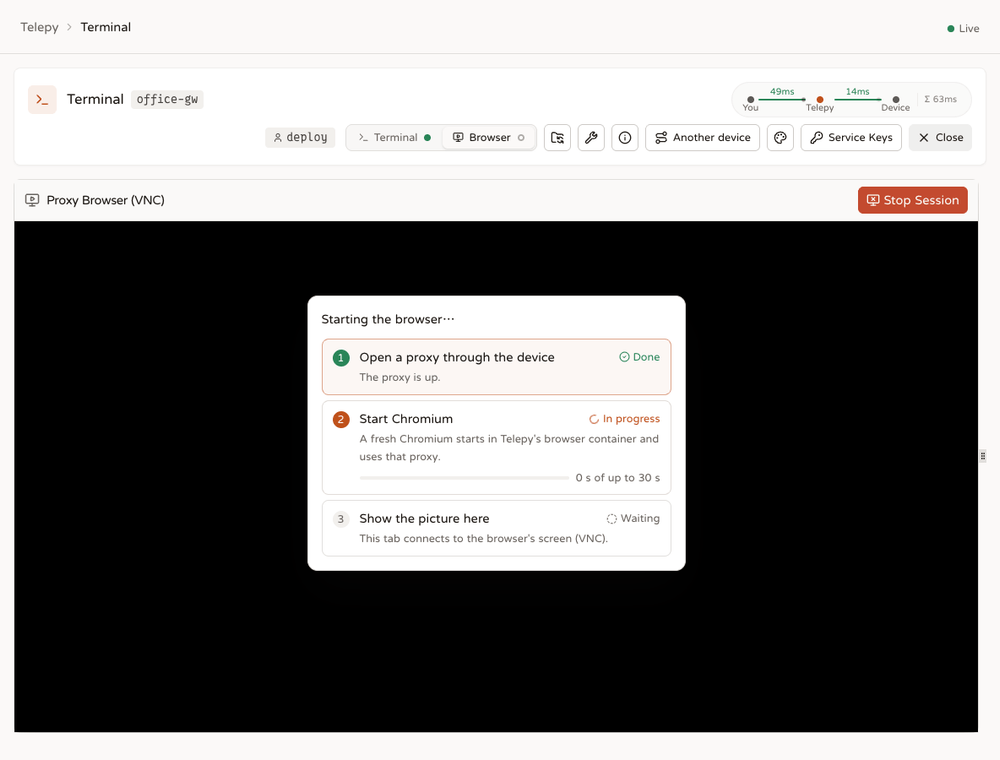

# Remote browser

<p align="center"><b>English</b> | <a href="./remote-browser.zh-TW.md">繁體中文</a> | <a href="./remote-browser.ja.md">日本語</a></p>

The remote browser is a real Chromium that you drive from a tab in Telepy, while every request it makes leaves through one of your devices. Websites see the device's address, and `localhost` means the device itself.

Chromium runs on Telepy's side, in a browser container. The device only lends its SSH server, which makes the actual connections. Nothing gets installed there.

## What it's good for

- **Admin pages that only answer inside a network**: the router at `192.168.1.1`, a NAS, a printer, a switch. The kind of page that has never heard of the internet and would like to keep it that way.
- **Services on the device's own `localhost`**: a dashboard on `http://localhost:8080` that was never meant to be exposed. You reach it as if you were sitting at the device.
- **The web as the device sees it**: same public IP, same location, same DNS.

## Opening one

1. In the tunnel list, click **Browser** on a device. The terminal page opens on its browser view.
2. Pick the login account at the top of the page. The browser goes online as that account's SSH login.
3. Click **Start Browser** (or **Click to Initialize** in the middle of the panel).

Starting takes three steps, and the panel shows each one as it happens:

- **Open a proxy through the device**: Telepy logs in to the device as that account and opens a SOCKS proxy over its SSH.
- **Start Chromium**: a fresh Chromium starts in Telepy's browser container and uses that proxy.
- **Show the picture here**: your tab connects to the browser's screen.



If a step fails, the list stops on it with the reason, and **Try again** starts over. The first attempt at the proxy can be slow on a cold connection, so Telepy retries it once by default.

## What to expect inside

- **A clean slate every time**: each session gets a brand-new browser profile, deleted when the session stops. No history, cookies or saved passwords survive.
- **Start page and language**: set in the site settings, Google and `zh-TW` unless your admin changed them. The screen is `1280x720` by default.
- **Typing Chinese or Japanese**: use your own input method. The **IME** button in the panel header switches that mode; it is on by default.
- **Downloads are blocked**: a downloaded file would land inside the container, where nobody can fetch it. Very private, including from you.
- **Lost the window?** A minimised window comes back from the taskbar at the top of the remote desktop. If you closed it, click the **Open Browser** launcher on that bar, or right-click the desktop and pick **Open Browser**. It brings back the existing window, or starts a fresh one if there is none.
- **Chromium crashed?** Wait a few seconds. A watchdog checks every 10 seconds and starts it again. A remote browser without a browser is just very expensive wallpaper.

## Who can open one

- You need **VIEW** on the tunnel and at least one login account you may use there. The browser runs as one of those accounts.
- The **Remote browser** feature must be on for you. Admins set this under **Feature permissions**.
- Tunnels marked **Confirm first** (step-up) ask you to confirm with a second factor before the browser starts.
- If the site requires two-step sign-in, your account must have it set up.
- The whole site runs at most `remote_browser_max_sessions` browsers at once (10 by default), counting the ones opened by MCP agents and scripts.

While you use it, the tunnel's owner and its ADMIN sharees see you in the tunnel list's "using" button and on the **Live sessions** page. Telepy writes `browser_open` and `browser_close` (with the duration) to the tunnel's **Logs**, and sends the `session.started` webhook event to the owner and ADMINs (not to you).

## How a session ends

- **You close it**: **Stop Session**, closing the panel, or closing the tab. Everything goes at once: the proxy, the browser, its profile.
- **Your connection disappears**: the backend pings the tab every 20 seconds. If nothing comes back within 40 seconds, it treats you as gone. A sleeping laptop or a switched network doesn't leave a session hanging.
- **Someone ends it** from the **Live sessions** page (close code 4009, with their name as the reason).
- **You lose access**: the tunnel is unshared, the account leaves your allow-list, the Remote browser feature is turned off, or your account is disabled. The session closes with 4009 and the reason `Telepy (access changed)`. `browser_close` records why, and you get a `SESSION-ENDED` notification.
- **The session stops answering**: the panel also checks in every 15 seconds. If the proxy behind the session has died, Telepy cleans it up and the panel says *Session not found or expired*.
- **The sweep finds it**: every 10 seconds Telepy also removes sessions whose device connection dropped, and sessions with no check-in for `remote_browser_session_idle_timeout` plus 30 seconds.
- **Telepy restarts**: running sessions don't survive. On start, Telepy stops any browsers left behind in the container.

## When sites think you're a robot

A real person driving over VNC, from the device's own IP, is already the best disguise there is. Telepy adds a few Chromium flags on top so the browser doesn't look automated. They help, but some blocks they can't touch.

### What Telepy does about it

- `--disable-blink-features=AutomationControlled` makes `navigator.webdriver` false.
- `--lang` and `--accept-lang` give the browser a real, consistent language. An empty `navigator.languages` is a classic bot signature.
- `--accept-lang` gets clean language tags without q-values (`zh-TW,zh,en`). Chromium uses this value for both the `Accept-Language` header and `navigator.languages`, and adds the q-values itself. An older version passed q-values in, which produced headers no real browser sends:
  - `Accept-Language` became `zh-TW,zh;q=0.9,zh;q=0.9;q=0.8,en;q=0.8;q=0.7` (doubled q)
  - `navigator.languages` became `['zh-TW','zh;q=0.9','en;q=0.8']` (q leaking in)

  The result was CAPTCHAs everywhere. With clean tags the header is `zh-TW,zh;q=0.9,en;q=0.8` and `navigator.languages` is `['zh-TW','zh','en']`.
- `--enable-unsafe-swiftshader`, and only that one, keeps WebGL working. The container has no GPU, so without it `canvas.getContext("webgl")` returns null. "No WebGL at all" is a strong bot signal; YouTube's "sign in to confirm you're not a bot" checks it. This flag lets just WebGL fall back to software (SwiftShader) and leaves the compositor alone.

> [!WARNING]
> Never add `--use-gl=angle --use-angle=swiftshader` "to make sure WebGL works". It pushes the whole compositor onto software rendering and video stops playing smoothly. Measured with real VP9 at 640x480: the forced version dropped 4 frames, the single flag and the baseline dropped none, and WebGL worked just as well. At 720p or 1080p the forced version can't play at all.

WebGL still reports SwiftShader as its renderer rather than a real GPU. That is a weak signal; hiding it would mean spoofing the renderer string, which Telepy doesn't do.

### What no flag can fix

The flags only deal with the browser fingerprint. For blocks like YouTube's, two other things decide:

1. **The device's IP reputation.** Traffic leaves from the device's IP. If that is a datacenter, cloud or VPN address, or one that lots of automated traffic has used, YouTube and Cloudflare block it no matter how human the browser looks. The only fix is a device on a residential connection.
2. **No cookies, no trust.** Every session starts with a fresh profile, and sites trust signed-in browsers with a history far more. To YouTube, a brand-new browser with no cookies looks like a robot, mostly because it usually is one.

Starting fresh every time is a deliberate privacy choice: being asked to sign in now and then is the price. If blocks become a problem, move to a device with a residential IP first.

<details>
<summary>For contributors: why the profile stays fresh</summary>

A "YouTube asks me to sign in" regression appeared after commit 967ea75 made the profile ephemeral, because no cookies accumulate any more. Keeping only cookies and sign-ins (and still no history) was considered as a compromise. The project owner chose privacy first (decided 2026-07-04), and the exit IP matters more anyway. Don't bring profile persistence back without that decision being revisited.

</details>

## Driving it from an MCP agent or a script

The same browser can be driven without anyone watching the screen:

- **MCP agents** with the `browser:use` scope get the `browser_*` tools. See [MCP](mcp.md).
- **Scripts** use the REST routes under `/api/browser/sessions*`: open (`{tunnel_id, username?, url?}`), `navigate`, `text?selector=`, `screenshot` (image/png), `click`, `type`, `DELETE`, and list. A personal API token needs the `browser:use` scope; a web sign-in works too.
- **The command line** has `telepy browse`. See [the CLI](cli.md).

```bash
ID=$(telepy browse box http://192.168.1.1/)   # a browser on the device's network (browser:use); prints its id
telepy browse shot "$ID" -o router.png
telepy browse close "$ID"
```

These are ordinary remote-browser sessions: same proxy, same browser container, and they count toward `remote_browser_max_sessions`. The differences:

- A browser belongs to the credential that opened it: an MCP app, an API token or a web sign-in. It counts toward `ai_max_sessions_per_user` together with that person's agent SSH sessions.
- Idle time, lifetime, revoked access, lost permission and offline devices are handled by the agent session rules, which also check that the app's approval or the token is still valid. A change that ends web sessions runs that check at once too.
- They show on **Live sessions** with the app's name, and can be ended there. Later actions then answer with who ended it.
- Opening and closing write `browser_open` and `browser_close`. Every action writes an entry to the AI activity log. Text sent with `type` is logged only by its length, unless the call says `sensitive: false`.
- Tunnels that require step-up always refuse (403 `step_up_refused`, or a tool error for MCP).
- With the Remote browser feature off, nobody can open or act. Listing and closing still work.

What each action does:

- `navigate`: http and https only. The backend refuses things like `file:`, so nobody reads the container's own files.
- `screenshot`: a PNG at most 1280 px wide.
- `read` / `text`: the page's visible text and links, optionally under a CSS selector.
- `click`: by selector or by visible text, as a real mouse click.
- `type`: focuses the field, types the text, and can press Enter.

Actions apply to the first ordinary web page among the browser's tabs. If every tab is closed, a blank one is opened. Each action has 30 seconds.

<details>
<summary>How an action reaches Chromium</summary>

```
MCP tool (browser_navigate / read / click / type / screenshot) or REST /api/browser/sessions/{id}/…
  → backend
  → session manager: POST /sessions/<id>/cdp (X-Internal-Token)
  → cdp.py → ws://127.0.0.1:<CDP_BASE + display> (chromium --remote-debugging-port, container loopback only)
```

- The DevTools port listens only on the container's 127.0.0.1. The backend never talks to it directly; it asks the session manager, which hands the action to a small adapter (`cdp.py`).
- Each action is capped by `CDP_ACTION_TIMEOUT` (30 s).
- Screenshots are scaled with CDP's clip scale; clicks are real `Input.dispatchMouseEvent` events; typing is `Input.insertText`.
- The tab chosen is the first ordinary page in `/json/list`; with none, an `about:blank` is opened.
- `cdp.py` uses only Python's standard library, including its own minimal WebSocket client. Its tests are in the browser container's `tests/test_cdp.py`.

</details>

## How it works inside

### The pieces

- **Your tab** runs KasmVNC's own web client, bundled with Telepy, and draws the remote screen.
- **The backend** checks who you are, relays the screen between your tab and the browser container, and runs a small SOCKS proxy for each session.
- **The browser container** (`kasm-browser`) runs, per session, a virtual display (KasmVNC's Xkasmvnc), a window manager (openbox) and Chromium.
- **The session manager** is a small HTTP service inside that container. It starts and stops those three on the backend's request, and only accepts calls that carry the shared `INTERNAL_API_TOKEN`.
- **The device's SSH server** makes the actual connections to websites.

```
your tab ──wss /ws/remote-browser/<session>/──▶ backend ──ws──▶ kasm-browser container
                                                                 (Xkasmvnc + openbox + Chromium)

Chromium ──SOCKS5──▶ backend ──channel over the tunnel──▶ device's sshd ──▶ the website
```

Chromium starts with `--proxy-server` pointing at the backend's proxy. Each connection it opens becomes a channel on the SSH connection Telepy already keeps to the device, and the device's sshd connects onward. It's the same mechanism as `ssh -D`, just without a separate process.

That SSH login is shared: if a web terminal or the file manager is already open on the same device and account, the browser rides on the same connection. The proxy only does CONNECT, has no password, and can only be reached inside Telepy's Docker network.

When the destination is a host name and the device is a Mac, Telepy resolves the name on the device first and connects to the IP. Apple's sshd drops the entire SSH connection when asked to forward to a name.

<details>
<summary>What the panel calls</summary>

- `POST /api/reverse/server/{id}/remote-browser/start` with `{username?}` checks the feature, VIEW, step-up, the account (left out = the tunnel's default account, else the first one you may use) and the session limit. It then opens the proxy and asks the session manager for a browser, and answers `{session_id, ws_path}`.
- When the proxy can't be opened, the answer is 500 with `code: device_offline`, which the panel turns into its own message. A device with no tunnel at all fails at once instead of waiting for the attempts.
- `POST /api/reverse/server/remote-browser/{sid}/ping` every 15 seconds. It first checks that the session's proxy is still listening; if not, the session is cleaned up and the answer is 404.
- `POST /api/reverse/server/remote-browser/{sid}/stop` when the panel closes or the tab unloads. A dropped screen socket takes the same path.
- While the screen socket is connected, the backend also renews the session itself every 20 seconds, so background-tab throttling can't starve it.
- Sessions live in the backend's memory. One small table remembers them only so that, after a restart, Telepy can stop the browsers the container still runs.

</details>

### Why localhost means the device

Chromium has a built-in rule: loopback addresses never go through a proxy. Here that would send `http://localhost:8080` to the container's own loopback, where nothing runs, and people reported that the remote browser "couldn't even reach localhost".

Telepy starts Chromium with `--proxy-bypass-list='<-loopback>'`. That token removes the built-in exception, so loopback goes through the proxy too, and the device's sshd connects to `127.0.0.1` on the device itself.

The exception covers `localhost`, `*.localhost`, `[::1]`, `127.0.0.1/8`, `169.254/16` and `[FE80::]/10`, so link-local addresses now reach the device's network as well. That is exactly the point. Ordinary browsing is unchanged, and so is the screen stream, which is KasmVNC's own websocket and not Chromium's traffic.

If you edit the Chromium command line, keep the single quotes. The whole command is parsed by a shell a second time (`sh -c "$BROWSER_CMD"` in the container's launcher script), and an unquoted `<` or `>` becomes a redirection.

### Getting the picture to your tab

KasmVNC has drifted away from plain VNC (RFB). It only opens a websocket, no classic VNC port, and stock noVNC can't talk to it: you get a black screen. So the tab uses KasmVNC's own fork of the noVNC client, and the backend relays websocket to websocket, message by message, without parsing anything.

- Your tab connects to `/ws/remote-browser/<session_id>/` and sends its sign-in token as the first message.
- The backend checks the Remote browser feature (4012 if it's off) and, again, VIEW on the session's tunnel.
- VNC servers speak first, so the greeting must not be lost. The order is: the tab sends `auth`, the backend connects upstream and answers `ready`, the tab hands the socket to the VNC client and sends `begin`, and only then does the backend start forwarding.
- The heartbeat is a WebSocket ping every 20 seconds; 40 seconds of silence after a ping ends the session.

<details>
<summary>KasmVNC facts for contributors (measured, don't look them up again)</summary>

| Item | Value |
|---|---|
| Stock noVNC compatible? | **No.** Use the kasmtech/noVNC fork (server 1.4.0 ↔ client 1.3.0) |
| Transport | Plain ws (`-sslOnly` is off by default); endpoint `/websockify`; subprotocol `binary` |
| `Sec-WebSocket-Origin` | Required (a Hixie-era header; the value isn't checked). Without it: 404 "failed websocket checks", not 401 |
| Basic Auth | On by default; `-disableBasicAuth` does nothing in 1.4.0. Create a user with `kasmvncpasswd` and send `Authorization: Basic` |
| Password file | Fixed path `-KasmPasswordFile /etc/kasmvnc/kasmpasswd`. Don't rely on `$HOME`: it differs between build and run time, and you get 401 every time |
| ws_port | `8443 + display` (adjustable with `WS_BASE`) |

The bundled client lives in `src/frontend/src/vendor/kasm-novnc/` (kasmtech/noVNC v1.3.0). Its README lists what embedding it requires, such as setting a mouse button mapper and resetting after `compositionend`. Read it before touching the panel.

The story of the move to KasmVNC is in [an engineering note](engineering/articles/2026-07-03-kasmvnc-migration-warstory.md) (Traditional Chinese).

</details>

### Inside the browser container

Each session gets its own display (`:N`, websocket port `8443 + N`), its own window manager and Chromium, and its own temporary profile directory. The container's PID 1 is tini (`init: true`), which reaps stray processes.

<details>
<summary>Container details for contributors</summary>

- **Profiles are never shared**: Chromium's SingletonLock would make a second concurrent Chromium hand over to the first and exit (`Opening in existing browser session.`), and both sessions would fail. The browser's `HOME` also points into the profile directory, so dotfiles go with the session.
- **One launcher script**: the taskbar launcher, the desktop's right-click menu and the watchdog all run the same `open-browser.sh`. Debian's default openbox menu offered "Web browser", a bare `x-www-browser` that exits at once as root without a sandbox, so it looked like "nothing happens when I click". That menu was replaced.
- **The browser command travels two ways**: in the environment, and in a per-display file `/tmp/telepy-browser-<display>.env` (deleted when the session stops). The script reads the file by `$DISPLAY` when its environment is empty. An older openbox didn't pass the environment, and opening the browser from its menu printed `BROWSER_CMD not set`.
- **The launcher is idempotent**: it focuses or restores an existing window, and only starts a fresh Chromium when there is none. It also clears a leftover background-mode process, which otherwise just prints "Opening in existing browser session" and opens nothing.
- **Watchdog**: every 10 seconds it looks for the session's Chromium by its `--user-data-dir`, and relaunches it if gone. It waits 15 seconds after the session starts and 30 seconds between restarts. `REMOTE_BROWSER_RESPAWN=0` turns it off. It exists because a user came back to an empty desktop and concluded the whole feature was broken.
- **Window**: openbox starts with its own config (no title bar, maximised). Chromium's own `--start-maximized` only gave 1050×720, with margins and a title bar.
- **Downloads**: blocked by Chromium's managed policy (`DownloadRestrictions: 3`). Allowing them would need both a quota and a way to fetch the files.
- **Sandbox**: `--no-sandbox` is needed because Chromium runs as root in the container and Docker's default seccomp profile blocks unprivileged user namespaces. `--test-type` hides the yellow warning bar; it doesn't change the JavaScript fingerprint, and pages can't see the bar. A real sandbox would need a custom seccomp profile mounted from compose. That isn't done: the container is the isolation boundary.
- **Stopping**: processes are killed as a group with `killpg(p.pid)` (`start_new_session` makes the group id equal to the pid). Don't use `getpgid`: it raises when the group leader dies first, and leaves orphans behind.

</details>

## Settings

### Site settings

These are under **Site settings → Remote Browser**. Changes apply the next time a browser is opened, except the idle timeout, which applies at once.

| Setting | Default | What it does |
|---|---|---|
| `remote_browser_session_idle_timeout` | 60 | Seconds without a check-in (plus 30 s grace) before a session is cleaned up |
| `remote_browser_max_sessions` | 10 | Browsers running at once across the site, agents and scripts included. 0 = no limit |
| `remote_browser_geometry` | `1280x720` | Screen size of each browser |
| `remote_browser_ssh_timeout` / `remote_browser_ssh_attempts` | 30 / 2 | Seconds per attempt, and attempts, to bring up the proxy |
| `remote_browser_kasm_create_timeout` | 30 | Seconds to wait for the container to start the display and Chromium |
| `remote_browser_homepage` / `remote_browser_language` | Google / `zh-TW` | Start page and language. Empty = the container's environment defaults |

The two `remote_browser_ssh_*` settings are named after the days when the proxy was a separate `ssh -D` process. Today it runs inside the backend, but the names stayed.

### Environment variables

Everything has a default, so you usually set nothing. On the backend:

- `KASM_BROWSER_API` (default `http://kasm-browser:7000`): the session manager.
- `KASM_BROWSER_HOST` (default `kasm-browser`): where the KasmVNC websockets are.
- `INTERNAL_API_TOKEN`: the secret the backend sends to the session manager as `X-Internal-Token`.

In the browser container, or shared by both:

| Variable | Default | Purpose |
|---|---|---|
| `KASM_WS_USER` / `KASM_WS_PASSWORD` | `telepy` / `telepyvnc` | Basic Auth for KasmVNC's web layer. Created when the container is built, sent by the backend; one `.env` sets both |
| `KASM_WS_SCHEME` / `KASM_WS_PATH` / `KASM_WS_SUBPROTOCOL` | `ws` / `/websockify` / `binary` | What the relay tries first (it falls back to other combinations by itself) |
| `KASM_PASSWORD_FILE` | `/etc/kasmvnc/kasmpasswd` | Fixed path of the password file |
| `REMOTE_BROWSER_HOMEPAGE` / `REMOTE_BROWSER_LANG` | Google / `zh-TW` | Start page and language when the site settings are empty (the language feeds `navigator.languages`) |
| `REMOTE_BROWSER_PROFILE_TMP` / `WS_BASE` | `/tmp` / `8443` | Parent folder of the temporary profiles / first websocket port |
| `CDP_BASE` / `CDP_ACTION_TIMEOUT` | `9300` / `30` | DevTools port base for agents (port = `CDP_BASE + display`, 127.0.0.1 only) / seconds per action |

## Troubleshooting

### Messages and close codes

When starting fails, the panel stops on the step that failed:

- **Open a proxy through the device**, *the device is offline*: its tunnel isn't connected. Run the connection script on the device and try again.
- **Open a proxy through the device**, *didn't answer in time*: the device or its tunnel is slow. Raise `remote_browser_ssh_timeout` or `remote_browser_ssh_attempts`.
- **Start Chromium**: the browser container couldn't start it. Check that `kasm-browser` is running and shares the backend's `INTERNAL_API_TOKEN`. On a slow or busy server, raise `remote_browser_kasm_create_timeout`.
- **Show the picture here**: the screen connection closed first. The close code below says why.
- *The Proxy Browser has reached its maximum concurrent user limit.* means `remote_browser_max_sessions` browsers are already running. Wait for one to close, or raise the limit.

Close codes on `/ws/remote-browser/<sid>/`:

| Code | Meaning |
|---|---|
| 4000 / 4001 | The first message failed authentication (format / token) |
| 4007 | The site requires two-step sign-in and this account hasn't set it up |
| 4012 | The Remote browser feature is off for you (reason = the feature id) |
| 4404 | The session doesn't exist, or isn't ready. The panel says *Session not found or expired* |
| 4403 | No VIEW on this tunnel. The panel says *Permission denied for this tunnel* |
| 4011 | The backend can't reach KasmVNC in the browser container. The panel says *Could not reach the VNC browser backend* |
| 4013 | KasmVNC closed the connection or stopped accepting data. The panel says *VNC connection closed* |
| 4009 | Ended from Live sessions, or access was lost (reason = who, or `Telepy (access changed)`) |
| 4010 | This browser's web sign-in was signed out (reason = user / admin / logout / reuse / disabled) |

### Checks on the server

**Chromium disappears right after starting** (SIGTRAP, exit 133; the watchdog restarts it every 30 seconds and it dies again). This was a packaging bug in Debian's chromium 150.0.7871.46 ([#1141488](https://bugs.debian.org/1141488), July 2026). Telepy's image already works around it. If you change the browser image, keep both workarounds.

<details>
<summary>The Debian chromium bug in detail</summary>

A patch removed the handling of the `{google:searchSource}` token, but Chromium's built-in Google search template still contains it. Expanding it hits `NOTREACHED()` and Chromium dies silently, without a FATAL line even at `--v=1`.

In this container it fired when:

- `--no-first-run` met a fresh profile. That's every session, since every profile is fresh.
- Chromium ran with `--headless=new`.
- A user switched the default search back to the built-in Google entry and searched.

The workarounds, harmless on later versions, so keep them after a fixed build ships:

1. The default browser command no longer has `--no-first-run`. The Debian build has no first-run wizard, so the flag did nothing but crash. Don't add it back.
2. Chromium's policy file pins the default search to a Google entry with a clean template (`DefaultSearchProvider*`, only `{searchTerms}`). It bypasses the built-in template, moves that build's DuckDuckGo default back to Google, and stops users from picking the crashing entry. Don't remove these policies.

Last resort: pin chromium back to 149.0.7827.196-1~deb12u1 (snapshot.debian.org 20260703T000000Z). That freezes security updates, so it isn't recommended.

</details>

Other things that go wrong:

- `404 failed websocket checks`: the `Sec-WebSocket-Origin` header is missing. The probe script and the backend relay both send it.
- `401`: a credentials or password file problem. Check with `ls -l /etc/kasmvnc/kasmpasswd; wc -c` that the file isn't empty.
- Black screen in the tab although the websocket is up: the client isn't the Kasm fork, or the bundled client's embedding requirements (mouse button mapper, `compositionend` reset) aren't met.
- Looking for live Chromium processes: `pgrep -f` also matches your own outer shell's command line. Use the bracket trick `ps ax | grep "[c]hromium"`.

Can't reach the upstream websocket? Start a standalone Xkasmvnc and the probe script. Unlike a session, this one isn't cleaned up for you:

```bash
docker compose exec kasm-browser bash -lc \
  'Xkasmvnc :20 -geometry 1280x720 -depth 24 -SecurityTypes None \
   -KasmPasswordFile /etc/kasmvnc/kasmpasswd -websocketPort 8463 \
   -httpd /usr/share/kasmvnc/www -interface 0.0.0.0 & sleep 3'
docker compose cp docker/kasm-browser/probe_kasmvnc.py kasm-browser:/tmp/probe.py
docker compose exec kasm-browser python3 /tmp/probe.py --port 8463 \
  --user telepy --password telepyvnc
```

<details>
<summary>Running the tests</summary>

```bash
# Backend tests (real stack):
(cd src/backend-api && cargo test)   # includes tests/remote_browser_api.rs: end to end with a real device on the SSH lab (in-process SOCKS) + a fake session-manager + a fake KasmVNC ws; tests/socks_e2e.rs tests the SOCKS itself
# session-manager tests (pure stdlib):
cd docker/kasm-browser && python3 -m unittest discover -s tests -p "test_*.py"
```

</details>
