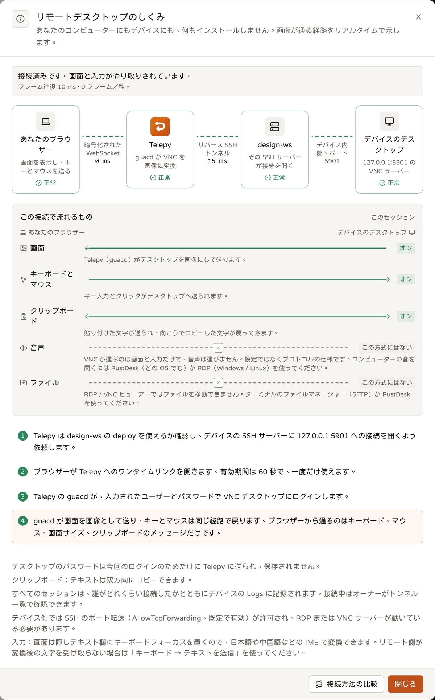
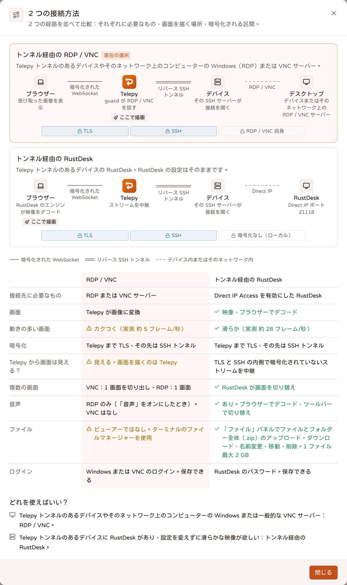

# リモートデスクトップ（ブラウザーで RDP / VNC / RustDesk）

<p align="center"><a href="./remote-desktop.md">English</a> | <a href="./remote-desktop.zh-TW.md">繁體中文</a> | <b>日本語</b></p>

> デバイス（またはその LAN 内のコンピューター）の RDP / VNC デスクトップをブラウザーで見て操作でき、RustDesk にもトンネル経由で接続できます。デバイス側には何もインストールしません。接続は
> デバイス自身の sshd が中継し、RDP / VNC の画面は guacd が Guacamole プロトコルに変換し、RustDesk はブラウザー内の RustDesk コアがデコードします。コード：
> `src/backend-api/src/desktop/`、`api/desktop.rs`、`ws/desktop.rs`（RustDesk：`rustdesk/`、`api/rustdesk.rs`、
> `ws/rustdesk.rs`）。フロントエンド `app/tunnels/desktop/`、`components/desktop/`、`hooks/useDesktopPage.ts`、`lib/desktop.ts`。
> テスト `tests/desktop_api.rs`、`tests/rustdesk_api.rs`。
>
> 入口：`/tunnels/desktop?tunnel=<id>[&lanHost=<id>]`（サイドバー、トンネルのメニュー、LAN ホストのパネル、トンネル一覧の「リモートデスクトップ」ボタン）。フォームの先頭は
> ターミナルページと共通の経路図ピッカーです（`DesktopPathPicker`：接続先、プロトコル、ポートは最後のノードの中）。その下に画質、クリップボード、音声、ログインが並びます。
> 機能全体は機能権限 `remote_desktop` で管理されます（オフ = REST は 403 `feature_disabled` を返し、ページは説明に置き換わります）。

## アーキテクチャ

```
ブラウザー（guacamole-common-js）
  │ wss /ws/desktop/<session>/?ticket=…&width=&height=&dpi=   サブプロトコル guacamole；チケットは 60 秒、1 回だけ使用可
  ▼
backend ws/desktop.rs
  │  ブラウザー→guacd：key / mouse / touch / size / sync / nop / disconnect / clipboard / blob / end / ack だけ通す
  │  guacd→ブラウザー：そのまま通す（長さの単位は両端に合わせて再エンコード：guacd はコードポイント、ブラウザーは UTF-16 単位で数える）
  │  TCP guacd:4822：Guacamole のハンドシェイクは backend が済ませ、認証情報はブラウザーを通らない
  ▼
guacd コンテナー（telepy-desktop 内部ネットワーク、backend と guacd だけ）
  │  connect 時に backend 上のこのセッション専用の rendezvous ポートへ接続し返す（guacd の送信元 IP だけ受け付け、1 本受けたら閉じる）
  ▼
backend desktop/bridge.rs
  │  copy_bidirectional ⇄ russh direct-tcpip チャネル（ssh::pool のデバイス接続上の転送リース。セッション枠を消費しない）
  ▼
デバイスの sshd ──► 127.0.0.1:<port>（デバイス自身のデスクトップ）または <LAN アドレス>:<port>（LAN ホスト。ssh -J / LAN スキャンと同じ仕組み）
```

## 流れ



1. `POST /api/reverse/server/{id}/desktop/start` `{protocol, username?, port?, lan_host_id?, login?, password?, domain?, credential_id?, quality?, clipboard?, audio?}`：
   `desktop_enabled`、トンネルの VIEW、ステップアップ（機密トンネル）、`username` が `permissions::allowed_usernames` にあること（デバイスへの一段目のアカウント。
   省略すると `choose_username` が既定を選ぶ）、LAN ホストがこのトンネルのものであること、`desktop_max_sessions` を確認します。続いて**先に**プールの接続を借りて、ターゲットへの direct-tcpip
   チャネルを開くので、`device_offline` / `device_auth` / `host_key_changed` / `forwarding_disabled` / `target_unreachable` /
   `device_unreachable` はこの時点で 502 になります（`desktop_disabled` / `desktop_busy` は 503）。WebSocket を待つ必要はありません。
   返り値は `{session_id, ws_path, ticket, expires_in, protocol, clipboard, clipboard_limit, quality, audio, target, username}` で、認証情報はメモリにしか残りません。
   `clipboard`：省略するとユーザーの個人設定 `desktop_clipboard` を使い、さらにサイトの同名の上限を適用します（狭い方）。レスポンスの `clipboard` は実際に使われた方向です。
   `credential_id` を付けると、保管庫のその項目の login / password / domain を使います（下の「保存したログイン」を参照）。リクエスト内の認証情報フィールドは無視されます。
2. ブラウザーがチケットで WS を開きます。backend は権限を再確認し、rendezvous を開いて guacd に接続し、ハンドシェイクします（`hostname` / `port` = rendezvous）。
   guacd が接続し返してきた回線を手順 1 のチャネルにつなぎます。ハンドシェイクが終わったら、まず `0.,<uuid>;` を送り（guacamole-common-js はこれを受け取って初めてトンネルを開いた状態にします）、
   続いてハンドシェイク中にパーサーがすでに読み込んでいた命令を送ります（guacd は `ready` と最初の画面を同じパケットに入れることがよくあります）。
3. どちらかが終わるまで中継します。終了の理由：ユーザー、guacd、アイドル（`desktop_session_idle_timeout`、reaper が 10 秒ごとに確認）、
   `POST /api/reverse/server/desktop/{sid}/stop`（4014）、ライブセッションページからの終了、権限の喪失（4009、「監査と可視性」を参照）、
   開いたウェブのサインインがサインアウトされた場合（4010）。

## 遅延とストリームの状態（`desktop/stats.rs`、フロントエンド `lib/desktopStats.ts`、`components/desktop/DesktopStats.tsx`）

中継は毎秒、独自の命令を 2 つブラウザーに送ります（guacamole-common-js は未知の opcode を無視します。フロントエンドは Client に渡す前に横取りします）：

| 命令 | 方向 | 内容 |
|---|---|---|
| `telepy-ping <n>` | 中継 → ブラウザー | ブラウザーはすぐ `telepy-pong <n>` を返します。中継がネットワークの往復を計算し、**guacd には転送しません** |
| `telepy-stats <json>` | 中継 → ブラウザー | `{ms, frame_ms, net_ms, tunnel_ms, frames, merged, down, up, behind, audio}`（`audio` は「音声」を参照） |

- **フレーム往復 `frame_ms`**：guacd は各フレームの最後に `sync <ts>` を送り、ブラウザーはそのフレームを描き終えてから `sync <ts>` を返します。送信から返答までの時間
  = WebSocket の往復 + ブラウザーのデコードと描画で、ユーザーが感じる「もたつき」そのものです。3 秒間新しいサンプルがなければ null（デスクトップが静止）になります。
- **ネットワーク往復 `net_ms`**：ping / pong。描画を含まず、静止中でも測れます。
- **トンネル `tunnel_ms`**：monitor が 15 秒ごとに転送チャネル経由で測るデバイス sshd との往復（`StatusState::latency`）。
- `frames` = この 1 秒のフレーム数。`merged` = 1 回の `sync` がまとめた論理フレーム数（guacd 1.6 の 2 番目の引数。> 1 = ブラウザーが追いつかず guacd がフレームを統合している）。
  `behind` = 送信済みで未返答のフレーム数。`down` / `up` = この 1 秒のバイト数。
- ツールバーのボタン：電波バー + フレーム往復 + 状態の語（ストリーミング中 / 遅延中 / データなし / 静止。`streamHealth`）。開くと各区間の数値、
  解像度とズーム、「遅延が主にどこで生じているか」が見られます（`laggingHop`：ネットワーク、トンネル、またはフレーム往復がネットワーク往復を大きく上回る = ブラウザー自身の描画が遅い）。
  info ダイアログの経路図は 2 本の線に往復時間を表示し、最も遅い区間を黄色にします。
- `desktop_close` イベントには「12.3 MB to the browser, 2,340 frames, frame latency avg 48 ms (max 210 ms)」のような記述が加わります。

## 画質プリセット（`Quality`、start の `quality`）

| 値 | RDP | VNC | フロントエンド |
|---|---|---|---|
| `auto`（既定） | 従来どおり（フォントのスムージングあり） | パラメーターを追加しない | — |
| `speed` | `color-depth 16`、フォントのスムージングなし | `color-depth 16`、`compress-level 6`、`quality-level 5` | — |
| `sharp` | `color-depth 24`、`force-lossless` | `color-depth 24`、`quality-level 9`、`force-lossless` | — |

アカウントに保存されるリモートデスクトップの設定 `desktop_display.quality`（環境設定 → リモートデスクトップでも同じ値を変更できます）。start のレスポンスに `quality` が含まれます。以前は `sharp` が HiDPI 解像度も一緒に要求していましたが、今は HiDPI が「表示」の独立したスイッチです（次の節）。

## 表示：ズーム、解像度、HiDPI（フロントエンド `lib/desktopDisplay.ts`、`lib/desktopZoom.ts`、`hooks/useDesktopZoom.ts`、`components/desktop/DisplayMenu.tsx` / `DisplaySettings.tsx`。バックエンド `desktop::clamp_size`、`ws/desktop.rs` の `browser_size`）

**以前、画面が小さかった理由（OrbStack + 本物の guacd 1.6 + xrdp / x11vnc / Xvnc、1440×900 のウィンドウで実測）：**
1. 画面枠の高さが `100dvh − 15rem` で、接続時にスクロールもしなかった：1440×900 では約 1150×684、1280×800 では 990×584 にしかならず、枠の下端は y = 815（ウィンドウの外）にありました。
2. 「枠に収める」の上限が 1:1 で、VNC / RustDesk の画面が枠より小さくても拡大されませんでした（1540×864 の枠の中の VNC 1024×768 は 1024×768 のまま）。
3. 画質が `sharp` のとき、HiDPI ディスプレイでは上限が 1 / devicePixelRatio になりました：Retina では x11vnc の 1024×768 の画面が 512×384 CSS px でしか描かれませんでした（実測）。
   RDP では xrdp に 2 倍のピクセル（2300×1555）を要求しましたが、xrdp は `dpi` を無視するため、文字が半分の大きさになりました。
4. サイト上限 `desktop_max_resolution` が幅と高さを別々に制限していました（3080×1916 が 2560 の上限で 2560×1916 になり、縦横比が崩れて黒帯が出る）。さらに、接続中にブラウザーが送る
   `size` は上限をまったく通っていませんでした。
5. ズームボタンはタッチデバイスにしかありませんでした。

**現在：** 設定はアカウントに保存されます（個人設定 `desktop_display`。1 つの JSON で `scale` / `percent` / `resolution` / `width` / `height` / `hidpi` / `vnc_resize` / `quality` / `audio`。
バックエンドの `desktop::display::parse` が検証し、未知のフィールドや範囲外の値 = フィールドエラー、パーセントは 25–400 に丸められ、空 = 未選択。localStorage の `telepy.desktopDisplay` は最初の描画用のキャッシュにすぎず、
サインイン時にアカウントに値があればそれを使い、なければこのブラウザーの値（古い `telepy.desktopQuality` / `telepy.desktopAudio` を含む）をアップロードします）。
環境設定 → リモートデスクトップ → 表示、接続フォームの「表示」欄、デスクトップページのツールバーの「表示」メニューは、すべて同じ 1 つの設定を読み書きします：
- ズーム：`fit`（枠に収める。小さい画面も拡大。既定）/ `shrink`（縮小のみ、拡大しない = 以前の動作）/ `actual`（1:1。HiDPI のときはデバイスピクセル 1 つ。マウスを端に寄せるとスクロール、2 本指でドラッグ）/
  `custom`（25–400 %）。モードは固定されます：ウィンドウが大きくなったり小さくなったりすると fit は収め直し、1:1 はそのままです。ツールバーの − / % / + とピンチは固定倍率に切り替わります。
- RDP の解像度：ウィンドウに追従（既定。`resize-method display-update`、枠が 400 ms 止まってから `size` を送る）または固定（1280×720、1600×900、1920×1080、2560×1440、カスタム）。
  固定のときは start に `resize: false` を付けます：guacd には resize-method を渡さず、中継はブラウザーの `size` を捨てます。
- HiDPI：devicePixelRatio（≤ 2）倍のピクセルと `dpi` を要求します。既定はオフ。接続中に切り替えたり解像度を変えたりすると、ウィンドウに追従しているセッションにはすぐ新しい `size` が送られます。
- VNC もウィンドウに追従（既定はオフ）：start に `resize: true` を付けると `disable-display-resize` を送らず、guacd 1.6 が SetDesktopSize でサーバーにサイズ変更を求めます
  （接続時に 1 回、その後は `size` のたびに）。応じるのは仮想デスクトップ（TigerVNC Xvnc、KasmVNC）だけで、実際の画面（x11vnc、macOS の画面共有、ほとんどの Windows サーバー）は
  元の解像度のままです。既定をオフにしているのは、実機の画面解像度を勝手に変えることはユーザーの望みではないからです。guacd 1.6 の VNC は既定で初期サイズを送るので、以前から Xvnc のサイズは実は変わっていました。
- RustDesk：解像度はリモートが決め、ブラウザーは拡縮するだけです。ウェブコアの `change_resolution` は未実装です（`setByName change_resolution not implemented (phase 2)`）。
  **今後できること：** ファイルパネルの `ReadEmptyDirs` と同じように、`Misc.change_resolution` を自前で組み立ててコアが追跡している WebSocket に送れば（RustDesk の Windows / Linux X11 側は解像度変更に対応）、
  RustDesk もウィンドウに追従できるようになります。
- 「ブラウザーのウィンドウいっぱいに表示」：カードが `fixed inset-0` でサイドバーとページヘッダーを覆います（全画面ではなく、Esc は引き続きリモートに送られます）。ツールバーの「ページに戻る」で抜けます。
- 枠の高さは `100dvh − 8.5rem` になり、接続時にカードがページヘッダーの下までスクロールします。
- 上限：`clamp_size` が長辺 = `desktop_max_resolution` になるよう縦横比を保って縮小し、ハンドシェイクと接続中のすべての `size` が通ります（以前はハンドシェイクだけで、しかも各辺を別々に制限していました）。start は `resize` と `max_resolution` を返します。

実測（同じ環境、新しい枠の高さ）：ウィンドウに追従する RDP 1116×764（1440）→ 1534×944（1920）→ 958×664（1280）→ ウィンドウいっぱい 1280×751 → 958×664（`xdpyinfo`）。
Retina での HiDPI 2236×1528、1920 のウィンドウでは 2560×1575（縦横比を保った制限）、接続中に HiDPI をオフ → 1534×944。固定 1600×900 はウィンドウに追従せず、ブラウザーが 70 % / 60 % に縮小。
Xvnc は追従を求めると 1280×800 → 1118×764 → 958×664、求めないと変わらずブラウザーが 115 % / 142 % に拡大。Retina での x11vnc 1024×768 は既定で
1019×764 に描画（以前は 512×384）、1:1 → 125 % にしてマウスを右端に寄せると右にスクロール。
テスト：`tests/desktop_api.rs` の `desktop_resolution_follows_the_window_within_the_site_limit`。単体テスト `clamp_size`、`browser_size`、
`lib/desktopZoom.test.ts`、`lib/desktopDisplay.test.ts`。

## クリップボードの方向（各自が選び、サイト設定が上限）

- 方向は 3 つ：`both`（双方向）/ `to_remote`（リモートへの貼り付けのみ）/ `off`。個人設定 `desktop_clipboard` はアカウントに保存され
  （`/api/user/settings`。同じレスポンスに読み取り専用の `desktop_clipboard_limit` = サイト設定が含まれます）、デスクトップページの「クリップボード」欄と
  環境設定 → リモートデスクトップ（`hooks/useDesktopClipboard.ts`、両方で 1 つのストアを共有）のどちらでも変更できます。上限を超える選択肢は UI で無効になります。
- 各 start（RDP / VNC、RustDesk）は `clipboard` を付けてその 1 回だけ上書きでき、付けなければ個人設定を使います。実際に使われるのはその値とサイトの `desktop_clipboard` の
  狭い方です（`desktop::Clipboard::within` / `effective`、フロントエンドは `lib/desktop.ts` の `clipboardWithin`）。レスポンスの `clipboard` が実際の値です。
- 誰が強制するか：guacd は `disable-copy` / `disable-paste` で。RustDesk のデータストリームは backend から見えないので、ブラウザー内のコアが適用します（off = そのピアの
  `disable-clipboard`、to_remote = リモートのクリップボードイベントを受け付けない）。テスト `desktop_clipboard_is_the_users_choice_within_the_site_limit`。

## 音声（guacd 経由の RDP。RustDesk は次の節）

- フォームの「音声」スイッチ（RDP と RustDesk のみ。guacd の VNC には音声がありません。別途 PulseAudio をつなぐ必要があり、デバイス側にはないため、VNC では
  表示しません。VNC プロトコル自体は画面と入力しか扱いません。macOS の「画面共有」は VNC なので、Mac の音を聞くには RustDesk を使ってください）は、
  アカウントの `desktop_display.audio` に保存されます（**既定はオフ**：音声は帯域を食うため。環境設定 → リモートデスクトップで変更するのも同じ値です）。
- RDP：`POST …/desktop/start` に `audio: true` を付けます（VNC は付けても false 扱い。真偽値以外 = フィールドエラー）。レスポンスの `audio` が実際の値です。
  オン：ハンドシェイクの `audio` 命令に `audio/L8` と `audio/L16`（guacamole-common-js の RawAudioPlayer が再生できる生 PCM）を並べ、
  guacd が音声ストリーム（`audio` / `blob` / `end`）を開きます。guacd → ブラウザーは従来どおりすべてそのまま通し、ブラウザー → guacd の許可リストには `ack`（ストリームの受け入れ）を入れます。
  ブラウザーが送る `audio`（= マイク）はこれまでどおり捨てます。オフ：接続パラメーターに `disable-audio=true` を付け、guacd は rdpsnd を読み込まず、リモートはそもそも何も送りません。
  `desktop_open` イベントには `Remote desktop (RDP, sound) …` と記録されます。
- ツールバーの音声ボタン（`components/desktop/SoundButton.tsx`）：ミュート = ブラウザー側で blob を捨てます（ミュート解除したときに一気に溢れ出ません）。
  ボタンのアイコンと文言は `lib/desktopSound.ts` の判定に従います：**再生中**、**静か**（チャネルは開いているが無音）、**リモート待ち**（接続直後）、
  **音声がブロックされています**（データは届いているが AudioContext が動いていない。横に「クリックして音声を有効化」ボタンが出る）、**音声なし**（接続後 10 秒たってもリモートが音声
  チャネルを開かない）、ミュート、オフ。ツールチップと、info ダイアログの「この接続を流れるもの」の音声の行が理由を説明します。
- **自動再生（「音声をオンにしたのに聞こえない」への対処）**：ブラウザーは「ユーザー操作の中で」作成または resume された AudioContext にしか音を出させません
  （Safari が最も厳しく、操作の外で作った context は必ず `suspended`）。guacamole-common-js のプレーヤーは guacd が音声ストリームを開いたとき
  （WebSocket メッセージの中で、操作なし）に初めて context を作り、画面上のクリック / キー入力でしか resume しませんでした。そのため見ているだけでは音が出ず、
  しかも従来の「再生中」は blob が届いたかどうかしか見ていなかったので、context がブロックされていても再生中と表示されていました。今は「接続」のクリック（最初の await より前）で
  `primeAudio()` が共有の context を 1 つ作って resume し、`Guacamole.AudioContextFactory.singleton` として guacd に渡します。RustDesk コアにも
  `installRustDeskTap` を通じて同じものを渡します。ブロックされているときは、状態に正直に「音声がブロックされています」と表示します。
- 中継は音声ストリームの量を数えます（`desktop/stats.rs`：guacd が開く `audio` ストリーム上の `blob`）：`telepy-stats` に `audio` が付き（音声ストリームを一度も開いていなければ
  null）、統計パネルに「音声データ」の行が増え、`desktop_close` イベントには `sound 1.2 MB` と、音声を要求したのにチャネルが開かなければ
  `no sound channel from the RDP server` と記録されます（Logs でリモートが送っていないことがわかります）。
- リモート側：Windows の RDP ホストは、ポリシーで切られていない限り音声を既定で転送します（「オーディオおよびビデオの再生のリダイレクトを許可する」）。Linux の xrdp は
  `pulseaudio-module-xrdp`（Debian / Ubuntu にはパッケージがないため、その手順に従ってソースからビルド）または `pipewire-module-xrdp` が必要で、なければ guacd は音声を受け取れません。
- 実測（OrbStack）：本物の guacd 1.6 + xrdp + 自前ビルドの pulseaudio-module-xrdp で、セッション内の `module-sine` に 440 Hz を鳴らしました：
  Chromium（`--autoplay-policy=document-user-activation-required`）も WebKit も無音でないバッファ（ピーク 0.5）をキューに入れ、context は
  `running` でした。WebKit がクリックの中で作った context は `suspended` で、`primeAudio` の resume で初めて動きました。context を一時停止 → ボタンが「音声がブロックされています」に
  → 「クリックして音声を有効化」を押す → また再生中に。テストは `tests/desktop_api.rs` の `desktop_rdp_sound_is_offered_and_relayed`（偽の guacd が
  ハンドシェイクの形式、`disable-audio`、ストリームのパススルー、マイクの遮断、終了イベントの音声量と「音声チャネルなし」を検証）。

## 複数モニター：1 つの画面だけ見る（`desktop/screens.rs`、`GET …/desktop/screens`、フロントエンド `lib/desktopScreens.ts`）

VNC サーバーは全モニターを 1 枚の大きな画面につなげて送ってきます（macOS の画面共有、x11vnc、TightVNC はいずれもそうです）。guacd には画面を選ぶパラメーターがないので、
「画面の指定」は**ブラウザー側のクロップ**です：viewer の `viewport` が Guacamole.Display の要素をクリップ枠の中へ移動します（座標は引き続き画面全体のもので、マウスの
位置は変わりません）。その大きな画面の中で各モニターがどこにあるかは次のようにして求めます：

1. `GET /api/reverse/server/{id}/desktop/screens?username=`（start と同じ関門：VIEW + 許可されたデバイスアカウント + ステップアップ）が、プール経由でデバイスに問い合わせます：
   `uname -s` → Darwin なら `system_profiler SPDisplaysDataType -json`（サイズのみで位置はない）、その他の POSIX なら
   `xrandr --listmonitors`（`$DISPLAY`、`:0`、`:1` を試す）、`uname` がなければ PowerShell の `[System.Windows.Forms.Screen]::AllScreens`。
   返り値は `{os, source, screens: [{name, x, y, width, height, primary}], username}`。わからなくてもエラーではありません（`screens: []`）。
   意味があるのは「デスクトップがデバイス自身」のときだけです（LAN ホストには問い合わせられる SSH がありません）。パーサーは純粋関数です（単体テストあり）。
2. フロントエンドの `screenChoices`：位置のある画面は (0,0) に平行移動し、全体が画面サイズと違っても縦横比が同じなら比例して拡縮します（Windows の DPI スケーリング）。
   サイズだけの報告（macOS）は画面全体から配置を推定します —— 幅の合計 = 画面の幅なら横並び、高さの合計 = 画面の高さなら縦積みで、高さが異なるときは
   画面内の黒い領域をサンプリングして上端に寄せるか下端に寄せるかを判断します（`isBlack` が canvas を読む）。デバイスが何も報告しない場合（LAN ホスト、検出失敗、全体を覆う 1 枚だけを
   報告する Xvfb）は、**`guessScreens` が形から推測します**：モニターの縦横比は数種類しかないので（`SCREEN_RATIOS`：16:9、16:10、MacBook ≈1.545、3:2、
   4:3、5:4、21:9）、画面の幅を同じ高さの一般的な比率の 2〜4 枚に分割し（または高さを縦積みに分割）、合計の誤差が 0.5% 以内で、最も近いもの、次に同じ比率のもの、
   次に枚数が少ないものを優先します。比率が異なる場合はどれが左か右かわからないため、すべての並び順を試し、画面より低い 1 枚は黒い領域で補正します（`refineHeight`：その範囲の
   9 列で黒でない範囲を測り、すべて一致し、測った高さと幅が一般的な比率になる場合だけ採用します。黒い壁紙に騙されないためです）。最後に比率が最も一般的な
   並びを選びます。同じ高さの組み合わせでは合わないとき（MacBook 1728×1117 + 2560×1440）は、「同じ高さの 1 枚 + 低い 1 枚」を試し、低い方を黒い領域で測ります。
   一般的な比率 1 つだけの画面（21:9 のウルトラワイドを含む）は 1 枚と見なして推測しません。3840×1080 は 16:9 の 2 枚として扱います。推測した項目はメニューで「画面の形から推定」と表示されます。
   何も推定できなくても、メニューには等分割と範囲選択が残ります。
3. ツールバーの「画面」メニュー（VNC のみ）：デスクトップ全体 + 検出した各画面（名前、サイズ、プライマリ）+ **等分割**（左 / 右半分、
   3 等分、上 / 下半分。`splitChoices`、検出に依存せずいつでも選べる）+ **カスタム範囲**（「範囲を選択…」で選択モードに入ります：viewer が
   画面全体を表示して `AreaSelector` を重ね、長方形をドラッグ → `rectFromPoints` が画面内に収め、最小 64px。Esc か「キャンセル」で中止。選択中は
   キーボードとマウスをリモートに送りません）+ 再検出。選択は localStorage の `telepy.desktopScreen.<tunnel>.<lanHost|device>` に、
  カスタム範囲は `telepy.desktopArea.<…>`（JSON。画面サイズがわかってから `parseStoredArea` が検証）に保存されます。接続すると自動で 1 回検出します。

RDP では不要です：RDP セッションのサイズは私たち（ブラウザーの枠）が決め、仮想画面は 1 つだけだからです。

## タッチズーム（`lib/desktopZoom.ts` 純粋関数 + テスト、`hooks/useDesktopZoom.ts`、`components/desktop/ZoomControl.tsx`）

2 つの画面コンポーネント（guacd の `DesktopViewer` と `RustDeskViewer`）は、どちらも `useDesktopZoom().layout()` でレイアウトします：「枠に収める」倍率にさらに
倍率を掛け、枠からはみ出した部分は枠でクリップし、パンで見ます。

- 2 本指のピンチでズーム、2 本指のドラッグでパン。1 本指はこれまでどおりリモートのマウスです（タップ = クリック、長押し = 右クリック）。
- タッチデバイス（`pointer: coarse`）では右上に − / 倍率 / + の小さなカプセルが出ます（倍率をタップ = 枠に収める表示に戻る）。倍率は `ZOOM_STEPS` に止まり、上限は少なくとも 4 倍です。
- スマートフォン（`(pointer: coarse) and (max-width: 639px)`）では、画面が縮小されているとき（解像度固定の VNC / RustDesk）、開いた直後から `PHONE_ZOOM`
  （1.5 倍、左上から）になり、リモートの文字が読めるようになります。RDP は解像度が枠に追従するので拡大しません。新しい接続、画面 / 範囲の切り替え、解像度の変更のたびに再適用されます。
- マウスだけのブラウザーでは何も変わりません。

## RustDesk（ブラウザーで接続、またはトンネル経由でネイティブクライアントへ転送）

RustDesk は独自のプロトコルを使い、guacd は理解できません。Telepy には 2 つの経路があり、**どちらもトンネル経由**です。デスクトップページでプロトコルに「RustDesk」を選ぶと、既定は 1 つ目です：

> 経緯：「Telepy を RustDesk の ID / リレーサーバーにする」モード（デバイスにトンネルが不要）は #201–#208 で作られ、#212 で再び取り除かれ、トンネル経由の経路だけが残りました
> （ターミナル、ファイル、共有、ライブセッション、録画などの機能もすべて同じ道を通ります）。調査記録は [`rustdesk-id-server.md`](rustdesk-id-server.md) にあります。
> データ移行 `2026-10-26-drop-rustdesk-server-devices` が、そのモードが保存していたログインと 2 つのテーブルを削除しました。

### ブラウザーで接続（`rustdesk/`、`api/rustdesk.rs`、`ws/rustdesk.rs`。フロントエンド `components/desktop/RustDeskViewer.tsx`、`lib/rustdesk.ts`）

RustDesk の web client のコア（コミュニティによる TypeScript 移植、AGPL-3.0、`src/frontend/public/vendor/rustdesk-web-core/` に vendored。
出典とバージョンは隣の `README.md` に記載）がブラウザー内で動きます：映像のデコード（WebCodecs）、パスワードチャレンジへの応答、キーとマウスの送信を行います。Telepy は **hbbs / hbbr を立てません**：
コアは ID サーバーとリレーに接続していると思っていますが、実際は 2 本とも同じ WebSocket につながり、backend は最初のメッセージで役割を判別し、リレー側を
RustDesk の TCP ワイヤー形式にフレーミングし直して、デバイスの Direct IP ポート（21118）への `direct-tcpip` チャネルにつなぎます。調査記録と計測は
[`rustdesk-spike.md`](rustdesk-spike.md) にあります（1280×800 の動きの大きい画面：中継経由のコア 28 fps / ~645 KB/s、guacd の VNC 4–5 fps / 0.5–1.3 MB/s）。

- `POST /api/reverse/server/{id}/rustdesk/start`（`{username?, port?, lan_host_id?, credential_id?, clipboard?}`。デスクトップと同じ関門：
  `desktop_enabled`、VIEW、ステップアップ、`choose_username` / `allowed_usernames`、`desktop_max_sessions` は guacd + RustDesk の合計を数えます）：
  まず `desktop::prepare` —— プールのリース + ターゲットの Direct IP ポートへの `direct-tcpip` を開きます（`device_offline` / `target_unreachable` … はここで
  502 になります）—— そのあと 60 秒・1 回限りのチケットを発行します：`{session_id, ws_path: "/ws/rustdesk/{sid}/", ticket, expires_in, target, username, clipboard,
  clipboard_limit, file_transfer}`（`credential_id` を付けると `password` が 1 つ増えます。保存したログインを参照）。
  **パスワードは backend を通りません**：固定パスワードはブラウザー内のコアにだけ渡され、コアが RustDesk のハッシュチャレンジに応答します。Telepy は中継するだけです。
- `/ws/rustdesk/{sid}/?ticket=`：コアは 2 回接続します（`custom-rendezvous-server` と `relay-server` の両方がこの URL に設定されています）。最初の binary
  メッセージは `RendezvousMessage` です：`punch_hole_request`（フィールド 8）= hbbs の役割で、backend は `relay_response`（フィールド 19：uuid + relay_server =
  同じ URL）を返してあとは待機し、punch が来るたびに返します。`request_relay`（フィールド 18）= リレーの役割で、`prepare` 済みのチャネルを引き継ぎ、以降 WS の各 binary
  メッセージ → `codec::encode_frame`（1–4 バイトの LE プレフィックス、下位 2 ビット = プレフィックス長 − 1）→ チャネル。チャネルのバイト列 → `decode_frame`
  （上限 16 MiB）→ 1 メッセージずつ。presence の種別は `rustdesk`、gateway イベントは `rustdesk_open` / `rustdesk_close`（所要時間、理由、
  両方向のバイト数を含む）。クローズコード：4404 チケットが無効 / 期限切れ、4403 権限またはログインガードによる拒否、4013 デバイス側がクローズ、4014 サーバーが停止（`POST
  /api/reverse/server/rustdesk/{sid}/stop`。ファイルセッションには「画面側が終了した」「サイトがファイル転送を無効にした」「新しいものに置き換えられた」も別にあります）、4400 プロトコルエラー、
  4009 ライブセッションページから終了または権限喪失、4010 開いたウェブのサインインがサインアウトされた。RustDesk にはアイドル切断がありません（`desktop_session_idle_timeout` は guacd にしか効きません）。
- フロントエンド（デスクトップページ）：フォームに「RustDesk のパスワード」欄が加わり（ブラウザーの中にとどまります）、主ボタンは「ブラウザーで接続」です。`RustDeskViewer` がコアを読み込み（1 ページに 1 つだけ。
  コアは window 上のグローバルオブジェクトのため）、2 つの server オプション = `rustdeskWsUrl()` を設定し、`session_add_sync` + `session_start` を呼び、
  「暗号化されていない直接接続」の msgbox を自動で確認し（トンネル自体が暗号化されているため）、`onVideoFrame` を canvas に描きます（縦横比を保って縮小のみ、拡大しない）。キーボードフォーカスは非表示の
  textarea にあり（IME の変換 → `input_string`、キー入力 → `input_key`。キー名の表は `lib/rustdesk.ts`）、マウス座標はズーム倍率で割り、カーソルは
  `cursor_data` から CSS カーソルに変換します。ツールバー：遅延 / ストリームのボタン（コアの `update_quality_status` から：遅延、fps、目標ビットレート）、
  画面メニュー（相手の `peer_info` の displays → `switch_display`、RustDesk ネイティブの画面切り替え。画質の best / balanced / low は Telepy の
  3 つのプリセットに対応）、キーボードメニュー（テキストを送信、Ctrl+Alt+Del）、全画面、ヘルプ、切断。info の経路図は `inBrowser` バリアントを使います（3 ステップ）。
  クリップボード：コアがタブにフォーカスがあるときにブラウザーのクリップボードを自分で読んで送ります。リモートでコピーしたテキストはツールバーの下に表示されます。
- **準備チェックリスト（「そのコンピューターの RustDesk を準備する」、`components/desktop/RustDeskSetup.tsx`、純粋関数 `lib/rustdeskSetup.ts` + テスト）**：
  RustDesk モードを開くと（またはターゲットを変えると）すぐ、デバイスから Direct IP ポートを 1 回探ります。チェックリストは 4 ステップで、それぞれ状態と、フラットな小さなウィンドウの
  図があります（RustDesk 自身の翻訳ラベルを使い、クリックする場所を示します）：① RustDesk が起動していて「直接 IP アクセスを有効化する」がオン（設定 → セキュリティ → セキュリティ設定のロックを解除。プローブが
  拒否された = `desktop.err.rdDirectIpOff`）② 固定パスワードがあり、パスワード設定が「ワンタイムパスワードを使用する」ではないこと（接続が `rdPassword` を返した = 失敗）③ macOS の画面収録 /
  アクセシビリティ（`rdNoDisplay` = 失敗）④ システムサービス（見えないので注意喚起のみ：入れていないとアプリを閉じたり再起動したりしたときに接続できなくなる）。このページ訪問中に接続できた = 最初の 3
  ステップは問題なしで、チェックリストは 1 行に折りたたまれます。「今見るべきステップ」（最初の失敗、なければ最初の未確認）だけが図を展開し、ほかは 1 行ずつで、「場所を表示」でクリック位置を確認できます。
  きっかけ：ある Mac mini で RustDesk は起動していたものの IP 直接アクセスにチェックがなく、パスワード設定が「ワンタイムパスワードのみ」で、ページには検出できなかったとしか出ませんでした。
- 保存したログイン：RustDesk のパスワードも保存できます（`protocol: rustdesk`）。フォームには「保存したログイン」の選択と「このログインを保存」があります。start に
  `credential_id` を付けると backend が復号してレスポンスに入れ、コアに渡します（保存したログインの節を参照）。`rustdesk_open` イベントには with saved login '<label>' と記録されます。
  統計：トンネル区間は monitor の遅延で補います（接続時にダッシュボードから 1 回読み、その後は `UPDATE-TUNNEL-LATENCY` に従う）。パネルにはフレーム往復 /
  未描画フレームは表示されません（コアがブラウザー内でデコードするため、この 2 つの数値は存在しません）。「ネットワーク往復」はコア自身が測るブラウザー ↔ デバイスの値です。
- 範囲：画面、マウスとキーボード、クリップボードのテキスト、画面切り替え、画質、**音声**、**ファイル転送**。ターミナル、リモート印刷、マイクはありません —— それらが必要なら下のアプリ経路を使ってください。
- **音声**：コアが自分でデコードします（RustDesk は Opus を送り、WebCodecs の `AudioDecoder` → `AudioContext`。WebCodecs の音声がないブラウザーでは音が出ず、
  ボタンは無効になって理由が表示されます）。オフ = そのピアの `disable-audio`：ログインの `OptionMessage` でデバイスに送らないよう頼みます（デバイスは音声サービスを起動せず、単なるミュート以上です）。
  接続中のツールバーでの切り替えはコアの `option:toggle` を通ります（デバイスにオプションを送り、ミュート / ミュート解除する）。RDP と共通のアカウントの `desktop_display.audio` を使います。
  デバイスが何を送るか（RustDesk 1.5 のソースより）：**Linux** は PulseAudio / PipeWire の monitor を録音し、サインイン済みのデスクトップセッションの接続マネージャー
  （`--cm`）プロセスが担当します —— デスクトップに誰もサインインしていなければ音声はありません。**Windows** は既定の出力の WASAPI ループバックを録音します。**macOS（Apple シリコン）** は
  ScreenCaptureKit 経由でシステム音を録音します（もともと必要な「画面収録」権限を使います）。**macOS（Intel）** は「オーディオ入力デバイス」（既定ではマイク）しか録音しないので、
  Mac が再生する音を聞くには BlackHole のようなループバックデバイスをインストールし、RustDesk の設定 → 一般 → オーディオ入力デバイスで選ぶ必要があります。音声がオンで
  前回接続したピアが Mac だったときは、チェックリストに「Mac の音声」というステップが加わります（RustDesk の設定の図付き）。
  実測：コンテナー内の Linux 版 RustDesk 1.5（PulseAudio の null sink + 440 Hz）で、接続マネージャーを起動できるよう偽の `loginctl` と `sudo` を補ったところ、
  Chromium も WebKit も無音でない Opus のデコード結果を再生しました。接続中にオフからオンに切り替えても音が出ました。コアの AudioContext は、クリックの中でアンロックされたものです。
- **ファイル転送（「ファイル」パネル、`components/desktop/RustDeskFiles.tsx`、純粋関数 `lib/rustdeskFiles.ts`）**：RustDesk のファイル転送は**別の
  接続**で行われます（ログインに `file_transfer` を付ける）。そのためパネルは `POST /api/reverse/server/rustdesk/{sid}/files` で、画面セッションの下にぶら下がる
  子セッションを要求します（`rustdesk::Kind::Files`：同じターゲット、同じアカウント、専用のチケットと direct-tcpip チャネル。開けるのは画面を開いた本人だけで、
  `desktop_max_sessions` には数えず、独自の presence も webhook もなく、1 画面につき最大 2 つで、さらに開くと最も古いものが閉じられます —— リロードや React 開発モードの
  二重 effect で一時的に重なるため。画面側が終了すると一緒に終了します）。エラーコード：409 `not_connected`、503 `file_transfer_disabled` /
  `desktop_disabled`、502 は start と同じ。サイト設定 `desktop_file_transfer`（既定はオン）をオフにすると、子セッションは発行されず、start は
  `file_transfer: false` を返し（ボタンは無効になって説明が出る）、reaper が開いているものを閉じます。
  - 2 つ目のコアが必要な理由：コアは window 上のグローバルオブジェクトで、1 つのコアの中では「最前面」のセッションだけが映像を受け取れます（`videoFrame` /
    `rgba` は最前面にしか渡されません）。画面のコアの中でファイルセッションを開くと、リモート画面が止まってしまいます。そこでパネルは、見えない同一オリジンの iframe の中にコアをもう 1 つ読み込みます。
  - コア自身のファイル API を使います：`read_remote_dir`（ログイン後に 1 回要求。空のパス = ホームフォルダー）、`send_files {is_remote: true}`（ダウンロード）、
    `select_files` + `send_local_files`（アップロード）、`confirm_override_file`、`cancel_job`。イベントは `file_dir`、`job_progress`、
    `job_done`、`job_error`、`update_folder_files`、`override_file_confirm`、`selected_files`。
  - ダイアログにはユーザーの操作が必要です：保存ダイアログ（`showSaveFilePicker`）はこのページのクリックの中で開いてハンドルを iframe のコアに差し替え、ファイル選択は
    このページの `<input type=file>` を使い（ドラッグ＆ドロップも可）、iframe 内でコアが作る input の `click()` は「このページで選択済みのファイルを渡す」処理に差し替えます。保存ダイアログのない
    ブラウザー（Firefox / Safari）ではコアがすべてをメモリに載せてからダウンロードするので、1 ファイルあたり ≤ 2 GB です（アップロードも同じ制限）。
  - パネル：パンくず（Windows の最上位 = ドライブ）、1 つ上へ、ホームフォルダー、隠しファイル、新しいフォルダー、フォルダーのアップロード、アップロード、各行のダウンロードボタンと「⋯」メニュー
    （ダウンロード / 名前の変更 / 削除）、複数選択してまとめて削除、転送リスト（進捗、速度、キャンセル、名前が重なったときの「スキップ / 置き換え」。最新 4 件だけ表示し、実行中を先頭にする）。
    デスクトップ幅では画面の右側（`lg:w-80`）、スマートフォンでは画面の下に置かれます。
  - **フォルダー全体を .zip でダウンロード**（純粋関数 `lib/rustdeskFileOps.ts`、`lib/zipStream.ts`。zip の生成には client-zip（MIT、ストリーミング + ZIP64）を使用）：
    ダウンロードをクリック → 保存ダイアログ（クリックの中で開く必要あり）→ `read_dir_to_remove_recursive`（= `ReadAllFiles`。応答は id 付きの `file_dir`、名前は
    相対パス）でファイル数とサイズを数える → 空フォルダーをもう一度問い合わせる（`ReadEmptyDirs`：コアは応答（`empty_dirs` イベント）を処理するが送信はしない呼び出しで、パネルが
    このメッセージを自分で組み立てて iframe の WebSocket から送ります。古い RustDesk は応答せず、4 秒後に「なし」とみなします）→ 500 ファイルまたは 2 GB を超えると転送リストで先に確認 →
    `send_files {is_dir: true}`：コアは `showDirectoryPicker()` にフォルダーのハンドルを求め、ファイルごとに `getFileHandle().createWritable()` を呼びます。パネルはこれを
    偽のハンドル（`zipDirectoryHandle`）に差し替え、各ファイルの内容を少しずつ zip に流し込み、ユーザーが選んだ .zip へストリーミングで書き込みます。保存ダイアログのないブラウザーは
    メモリに集めます（≤ 2 GB、事前に拒否）。コアは 0 バイトのファイルのハンドルを開かないので、完了後にリストに基づいて空ファイルと空フォルダーを補います。進捗 = 何番目のファイル / 全体 + バイト数。
  - **削除**：ファイル = `remove_file`。フォルダー = まず（隠しファイルも含めて）再帰的に一覧し、フォルダー名と中のファイル数・サイズを示す確認ダイアログを出してから、
    一覧の id を使って 1 つずつ `remove_file` し、最後に `remove_all_empty_dirs`（RustDesk は「空の」ツリーしか削除しません）。複数選択も可能です。**名前の変更**（`rename_file`）：
    デバイスは `new_name` を元の親フォルダーにつなげるので、`../x/名前` や絶対パスを入力すると同じディスク内の移動になります（ダイアログに結果のパスがその場で表示され、
    フォルダーが変わるとボタンが「移動」になります）。**新しいフォルダー**（`create_dir`）。**フォルダーのアップロード**（`webkitdirectory` またはフォルダーのドラッグ。ドラッグでは空フォルダーも保持）：
    先にフォルダーを順に作り（「すでに存在する」はエラーにしない）、そのあとファイルを 1 つずつアップロードします。各操作はその id に対するデバイスの `job_done` / `job_error` を待ち、エラーはデバイスのメッセージをそのまま表示します。
  - **監査（`rustdesk/file_audit.rs`、純粋関数 + 単体テスト）**：中継はファイルセッションの平文を見られるので（暗号化は拒否）、ブラウザーが送る
    `file_action`（`ReadAllFiles` / `RemoveFile` / `RemoveDir` / `Rename`）とデバイスが返す `done` / `error` を読み、`rustdesk_file_delete`
    / `rustdesk_file_rename` イベントを書きます（パスと件数のみで、内容は含まない）：フォルダーの削除は 1 件にまとめられ（「deleted folder /x (12 files)」。失敗があれば
    件数と最初のエラーを付記）、単一ファイルと名前の変更はデバイスの応答後にそれぞれ 1 件、セッション終了時に未応答のものも書き出されます。
  - 説明図：パネルの info ボタン（`RustDeskFilesFlow.tsx`）が、あなたのブラウザー（2 つ目のコア）─ Telepy の中継 ─ トンネル ─ デバイス上の RustDesk ─ ディスク を描き、
    段階と実行中の操作に応じて点灯します。下には 4 つの操作それぞれの状態が出ます。ページのデータフロー図も、「ファイル」の行の下にダウンロード / アップロード / 名前の変更 / 削除の状態を並べます。
- **ログインガード（`rustdesk::codec::LoginGuard`）**：中継が解析する唯一のものは、ブラウザー → デバイス方向のピア `Message` の最外層です：
  `login_request`（フィールド 7）の oneof の分岐が、この接続が何としてログインするか（リモート操作 / ファイル転送 / ポート転送 / カメラ / ターミナル）を決めます。画面セッションはリモート操作だけ、
  ファイルセッションはファイル転送だけを許可し、合わなければ 4403 で、`rustdesk_close` イベントには `refused: a file transfer login on a remote control session` と記録されます。
  中身のある `public_key`（フィールド 4、= 暗号化の要求）も拒否します：Telepy の偽 hbbs はデバイスの鍵を渡さず、私たちのコアは常に暗号化なしの Direct IP を使うので
  （全体が TLS + SSH の中にある）、暗号化するのは改変されたクライアントだけで、暗号化されると何としてログインするのか見えなくなるからです。ログイン前に 32 を超えるメッセージが来た場合も拒否します。
  画面セッションに現れた `file_action` / `file_response`（コアのファイル API はファイル転送接続しか使わないので、改変されたクライアントしかこう送りません）も拒否します。
  このため、サイト設定 `desktop_file_transfer` は、ボタンを隠すだけでなくサーバーが強制する設定です。
- 実測（OrbStack：Debian + RustDesk 1.5.0）：画面セッションを開いたまま「ファイル」を開いても、リモート画面は更新され続けました。コンテナー内の RustDesk には
  接続マネージャーの UI がなく（Linux のファイル操作と音声キャプチャーはそれに任されている）、ファイル転送はテスト用のフロントプロキシ（リモート操作はそのまま転送し、ファイル転送はプロキシが処理）で確認しました：
  一覧表示、テキストファイルと 3 MB のバイナリのダウンロード（md5 一致）、アップロード、同名の置き換え、データフロー図、スマートフォン幅で横スクロールなし。その後のフォルダー / 削除 / 名前の変更も
  同じプロキシ（`ReadAllFiles`、`ReadEmptyDirs`、複数ファイルの `send`、`remove_*`、`create`、`rename` を追加）で確認しました：フォルダーの zip（ストリーミングと
  メモリの両経路、空フォルダーと 0 バイトのファイルも入り、md5 一致）、501 ファイルで先に確認、名前の変更と `../` による移動、新しいフォルダー、フォルダーのアップロード、複数選択の削除
  （確認が隠しファイルまで数える）、デバイスのエラーがそのまま表示される、Logs の 2 種類のイベント。音声：オンのときはデバイスが音声サービスに入り、
  ログイン時にオフなら入らず、接続中にオフにすると抜けます（本物の音声は上の「音声」を参照）。
- 踏んだ落とし穴：コアの `confirmInsecure()` は msgbox イベントを同期的に発行し、**そのあとで**応答を待つ resolver を記録するため、イベントハンドラーの中で同期的に
  `continue-insecure-connection` を返すと捨てられます（接続が固まり、30 秒後にデバイス側が閉じ、リレー統計が「0 B to the device」になる）—— viewer は
  `setTimeout(…, 0)` で次の tick に応答します。デバイス側の RustDesk が C ロケール（`LANG` なし）で動いていると、xdo がマルチバイトのテキストを拒否し（ログ
  `Invalid multi-byte sequence encountered`）、`input_string` で中国語を入力できません —— それはデバイスの環境の問題で、Telepy の問題ではありません。
- 実測（OrbStack 内の Debian + RustDesk 1.5.0 + Xvfb、ヘッドレス Chrome）：接続まで < 1 秒、クリック / ホイール / 移動はデバイス上の座標に
  ぴったり一致し（`xev`）、タイピングは xterm に届き、ライブセッションページに `rustdesk` が表示され、Logs には 2 つのイベントがありました。（このブラウザー側の E2E スクリプトは
  リポジトリに入っていません。リポジトリにあるのは `tests/rustdesk_api.rs` の偽デバイスのテストです。）

### RustDesk アプリを使う（ポート転送）

デスクトップページの「RustDesk アプリを使いたい場合」を開くと、デバイスの **Direct IP Access**（TCP 21118）をユーザーのコンピューターに転送し、アプリから `127.0.0.1` に接続できます。
複数画面の切り替え、ファイル転送、音声はいずれも RustDesk 自身の機能です。

- 「デバイスから確認」（`GET /api/reverse/server/{id}/desktop/probe?port=&username=&lan_host_id=`：start と同じ関門、同じ経路 ——
  プールのリース + direct-tcpip チャネルで、つながったらすぐ閉じる。`desktop_enabled` は見ない。エラーコードは start と同じ）→ `ssh -L 21118:<host>:21118 <alias>`
  （コマンドシートの `rustdesk` レシピ。エイリアスは `/tunnels/server/config/{id}` から）→ アプリの ID に `127.0.0.1` を入力（ローカルポートが 21118 でなければ
  `127.0.0.1:<port>`）。プローブ後、ブラウザーで接続していないときは、info の経路図にこのルート（あなたのコンピューター ─ssh─ Telepy ─トンネル─ デバイス ─ RustDesk）が表示されます。
- コマンドシートには「RustDesk を使う」シナリオがあります（`-L`、フィールド：ホスト `localhost` = デバイス自身、RustDesk のポート、ローカルポート）。LAN スキャンは既定で
  21118 を探り、`lib/lanConnect.ts` がそれを RustDesk と表示し、ネットワークページのコマンドタブにもその `-L` が並びます。

## 入力メソッド（IME）とクロス OS キーボード

- 画面はキーボードフォーカスを div ではなく `Guacamole.InputSink` の非表示 textarea に置きます：IME は編集可能な要素の上でしか変換できないため、Windows のブラウザーから
  macOS / Linux の VNC にも中国語や日本語を入力できます（確定した文字は Unicode keysym `0x01000000 + codepoint` として送られ、RDP は unicode キーボード
  イベントに変換し、VNC は keysym をそのまま送ります。macOS の画面共有、x11vnc、TigerVNC、TightVNC のいずれも受け付けます）。
- 「キーボード → テキストを送信…」：ダイアログの中で自分の IME で入力すると、1 文字ずつキー入力として送られます（文字間隔 8 ms、改行 = Enter）。リモートデスクトップが
  変換中のテキストを受け付けないときの代替手段で、最後の手段として「貼り付け」（リモートのクリップボードへ送信）もあります。
- 「Ctrl を ⌘ Command として送る」：Control_L/R → Meta_L/R（Command）。デバイスが Darwin と検出され、ブラウザーが Mac でないときは既定でオン（`telepy.desktopCtrlAsCmd`
  = auto / on / off）。キーを押したときに実際に送った keysym を記憶し、離すときも同じものを使うので、途中で切り替えても修飾キーが固着しません。

## クローズコード

WebSocket が閉じるとき、コードを reason にも入れます（guacamole-common-js の WebSocketTunnel は `parseInt(reason)` をステータスコードとして使います。
独自のコードそのものは汎用の SERVER_ERROR に変換されてしまいます）。

| コード | 意味 |
|---|---|
| 4404 | セッション / チケットが無効または期限切れ |
| 4403 | すでに権限がない（VIEW またはデバイスアカウント） |
| 4011 | guacd に接続できない、またはハンドシェイクに失敗 |
| 4013 | guacd が切断された、または不正な命令を送った |
| 4014 | サーバー側で終了（アイドル、`…/desktop/{sid}/stop`） |
| 4400 | ブラウザーが解析できない命令を送った |
| 4009 | ライブセッションページから終了（reason = 誰が）、または権限喪失（reason = `Telepy (access changed)`） |
| 4010 | 開いたウェブのサインインがサインアウトされた（「このブラウザーはサインアウトされました」。reason = user / admin / logout / reuse / disabled） |

上の表は guacd 側（`/ws/desktop/`）のものです。RustDesk（`/ws/rustdesk/`）のクローズコードは上の RustDesk の節を参照してください。どちらのソケットにも auth フレームはなく
（1 回限りの `?ticket=`）、機能権限とステップアップは REST の start で止められているので、4012 / 4008 は出てきません。

guacd 自身のエラーは Guacamole の `error` 命令としてブラウザーに届きます（たとえば 0x0203 / 0x0301 = RDP のログイン拒否）。
フロントエンドの `lib/desktop.ts` にある `sessionFailure` が、これを翻訳と「どの区間で止まったか」に対応させます。

## 保存したログイン（認証情報の保管庫）

`vault.rs`、`db/credentials.rs`、`api/credentials.rs`。テスト `tests/credentials_api.rs` と `tests/desktop_api.rs` の vault の部分。

- ユーザーごとに自分専用：`GET /api/credentials`（`tunnel_id` / `lan_host_id` / `protocol` で絞り込み可）、`POST`、
  `PATCH /api/credentials/{id}`、`DELETE`。本人だけが見られ、使えます。管理者も例外ではありません。
- 各項目は 1 つのデスクトップに紐づきます：`protocol`（`rdp` / `vnc` / `rustdesk`）+ `tunnel_id` + 任意の `lan_host_id` / `port`、さらに `label`、`login`、`domain`
  （RustDesk は固定パスワードのみなので `login` は空）。同じ保管庫には `ssh` の行（ネットワークページの LAN ホストへの一段目のログイン：パスワードおよび / または秘密鍵）も保存されますが、
  それはターミナルの話で、この文書の範囲外です。
  `start` に渡された `credential_id` が同じターゲット（トンネル、LAN ホスト、プロトコル）のものでなければ `credential_id` のフィールドエラーを返すので、
  ある Windows のパスワードが別のマシンへのログインに使われることはありません。
- パスワードは AES-256-GCM で封印され、鍵は `SECRET_KEY` から導出されます（プレフィックス `telepy-vault-v1:`）。AAD =
  `telepy-credential:{user_id}:{id}`：暗号文を別の人や別の項目に移すと復号できません。API が返すのは `has_password`（`ssh` の行にはさらに `has_key`）だけで、パスワードは決して返しません。
  復号が行われるのは `start` のときだけで、結果は手入力したときと同じくセッションのメモリにしか残りません。`SECRET_KEY` をローテーションすると古い保存分は復号できなくなります（保存し直してください）。
  **RustDesk だけが唯一の例外です**：チャレンジへの応答はブラウザー内のコアが行い、backend が代わりに答えることはできないため、`POST …/rustdesk/start` に `credential_id` が付くと
  backend が復号してレスポンスの `password` に入れます（このときだけ、TLS 上で、ログには残さない）。フロントエンドはそれをコアに渡し、ページの状態には保持しません。
- トンネルや LAN ホストを削除すると、それに紐づく認証情報も一緒に削除されます。使用時に `last_used_at` が更新され、`desktop_open` イベントには
  「with saved login '<label>'」と記録されます（名前のみで、認証情報は含みません）。
- フロントエンド：デスクトップページの「保存したログイン」の選択（`hooks/useSavedLogins.ts`）と「このログインを保存」のチェック（接続前に保存してから
  `credential_id` で接続）。環境設定の「保存したログイン」タブ（`components/layout/SavedLogins.tsx`）で一覧表示と削除ができます。
  どちらで追加・削除しても `telepy:saved-logins-changed` が発行され、ほかの画面が再読み込みされます。

## 監査と可視性

- gateway イベントの `desktop_open` / `desktop_close`（所要時間、終了理由、ストリームの要約、guacd の最後のエラーを含む）、`rustdesk_open` /
  `rustdesk_close`（両方向のバイト数を含む）、`rustdesk_file_delete` / `rustdesk_file_rename` が、そのトンネルの Logs に記録されます。
- presence の種別 `desktop` / `rustdesk`（ログインに使ったデバイスアカウントを含む）：所有者 / ADMIN は、トンネル一覧の「N 人が使用中」で誰が開いているか見られ、
  ライブセッションページ（`/tunnels/sessions`、管理者は `/tunnels/admin/sessions`）に一覧が出て終了もできます（4009、reason = 誰が終了したか）。
- **権限を失うとセッションが終わります**（`access_recheck.rs`。ターミナル、ファイル、リモートブラウザーと同じ仕組み）：共有の解除 / 共有の期限切れ、権限や許可リストの縮小、
  デバイスアカウントの名前変更や削除、機能 `remote_desktop` のオフ、アカウントの無効化などが起きるとすぐ `access_recheck::kick` が動き、ほかのケースは 10 秒ごとの `run` が拾います。
  判定は純粋関数 `lost()` です（VIEW + このセッションが使うデバイスアカウントがまだ許可リストにあること）。終了はライブセッションの経路を通ります：ソケットは 4009、reason は
  `Telepy (access changed)`、`desktop_close` / `rustdesk_close` には `ended by …: <理由>` が付き、本人には `SESSION-ENDED` が届きます。
  デスクトップ / RustDesk 独自の reaper はもう権限を再確認しません。テスト `desktop_ends_when_access_is_lost`、`rustdesk_ends_when_access_is_lost`。
- 開いたウェブのサインインが取り消された場合（「お使いのデバイス」からのサインアウト、管理者によるサインアウト、アカウントの無効化）：start のときに記録した web セッションが取り消された時点で 4010 になります。

## サイト設定（設定 → リモートデスクトップ）

| key | 既定値 | 説明 |
|---|---|---|
| `desktop_enabled` | true | オフにすると新しいセッションを開けなくなります |
| `desktop_max_sessions` | 4 | サイト全体の同時上限（まだ使われていないチケットを含む）、0 = 無制限 |
| `desktop_session_idle_timeout` | 900 | キーボード / マウス / クリップボードの入力がない状態が何秒続いたら切断するか（秒）、0 = 切断しない |
| `desktop_clipboard` | both | **上限**：both / to_remote / off。各自がデスクトップページか環境設定で方向を選び（個人設定 `desktop_clipboard`）、2 つのうち狭い方が適用されます。guacd は disable-copy / disable-paste で強制し、RustDesk はブラウザー内のコアが適用します（off = そのピアの `disable-clipboard`） |
| `desktop_max_resolution` | 2560 | 要求するリモートサイズの上限（長辺、ピクセル）。超えると縦横比を保って縮小されます。ハンドシェイクと接続中の `size` の両方に適用 |
| `desktop_file_transfer` | true | ブラウザー内 RustDesk の「ファイル」パネル（アップロード / ダウンロード / 名前の変更 / 削除）。オフにすると中継もファイル転送のログインを拒否し、開いているものを閉じます |

## この接続を流れるもの（info ダイアログのデータフロー図）

`lib/desktopStreams.ts`（純粋関数 + テスト）→ `components/desktop/DesktopStreams.tsx`。`DesktopFlow` の経路図の下に置かれ、画面、キーボードと
マウス、クリップボード、音声、ファイルの 5 本が並行する直線で描かれます（左 = あなたのブラウザー、右 = デスクトップ、矢印 = 方向）。各線の状態は on / oneWay（クリップボードの to_remote）/
off（自分でオフにした、このタブで RDP をミュートした）/ blocked（サイト上限）/ unsupported（この接続方法にはない：guacd の VNC に音声はない、RDP / VNC の画面はファイルを運ばない、
ブラウザーに WebCodecs の音声がない）のいずれかで、横に理由が 1 行付きます。音声の線は `lib/desktopSound.ts` の判定（リモート待ち / ブロック / 音声なし）に従い、
ファイルの行は RustDesk の下にダウンロード / アップロード / 名前の変更 / 削除それぞれの状態を並べます。

info ダイアログ（`DesktopInfoDialog`）の上半分は `DesktopFlow` の経路図です：あなたのブラウザー ─ Telepy ─ デバイス ─ デスクトップで、各点は waiting / active /
ok / failed です（`lib/desktop.ts` の `spotStates`。失敗は `sessionFailure` によってどの区間で止まったかに対応づけられます）。接続中は 2 本の線に往復時間が表示されます。ブラウザー内で接続した RustDesk
は `inBrowser` バリアントを使い、アプリの場合はポート転送の経路を描きます。

## 接続方法の比較（`components/desktop/ConnectionWays.tsx`、純粋関数 `lib/connectionWays.ts` + テスト）



1 つのダイアログで、どちらもトンネル経由の 2 つの接続方法を並べて比較します：guacd 経由の RDP / VNC（Telepy が画面を画像に変換）と RustDesk（ブラウザー内のコアがデコード）。
2 つの経路は列を揃えて並び（ブラウザー ─ Telepy ─ デバイス ─ デスクトップ。トンネル = 二重線、デバイスからデスクトップへの区間 = 破線）、それぞれの下に「どの区間を誰が暗号化するか」の
ものさしがあり（TLS / SSH / プロトコル自身のもの、`layerColumns`）、画面がどこで描かれるかが示されます。次に事実表（スマートフォンではカード、`ROWS`：音声とファイルを含む）
と選び方が続きます。現在使っている方式（`wayFor(protocol)`）には印が付きます。デスクトップページのタイトルバー、プロトコル欄のヒント、info ダイアログのフッターから開けます。
事実が変わったら `ROWS` を更新してください。

## デプロイ

`docker-compose.yml` の `guacd` サービス（`guacamole/guacd:1.6.0`）は、内部ネットワーク `telepy-desktop-${PROJECT_NAME}` にだけ接続されます。
backend は `telepy-network` とそのネットワークの両方に接続します。環境変数：`GUACD_ADDR`（既定は `guacd:4822`）、`DESKTOP_CALLBACK_HOST`
（guacd が backend に接続し返すときの名前。compose では `backend`。未設定なら `HOSTNAME` を使います）。

## デバイス側の要件

- sshd が TCP 転送を許可していること（`AllowTcpForwarding`。OpenSSH と Win32-OpenSSH では既定でオン）。
- デスクトップサーバー：Windows リモートデスクトップ（3389）、macOS 画面共有（5900。「VNC 閲覧者がパスワードで画面を操作できる」でパスワードを設定）、
  TigerVNC / x11vnc（5900 + display。たとえば :1 = 5901）、xrdp（3389）。
- RDP は `security=any` + `ignore-cert=true` を使います。NLA には正しい Windows の認証情報（ドメインを含む）が必要です。
