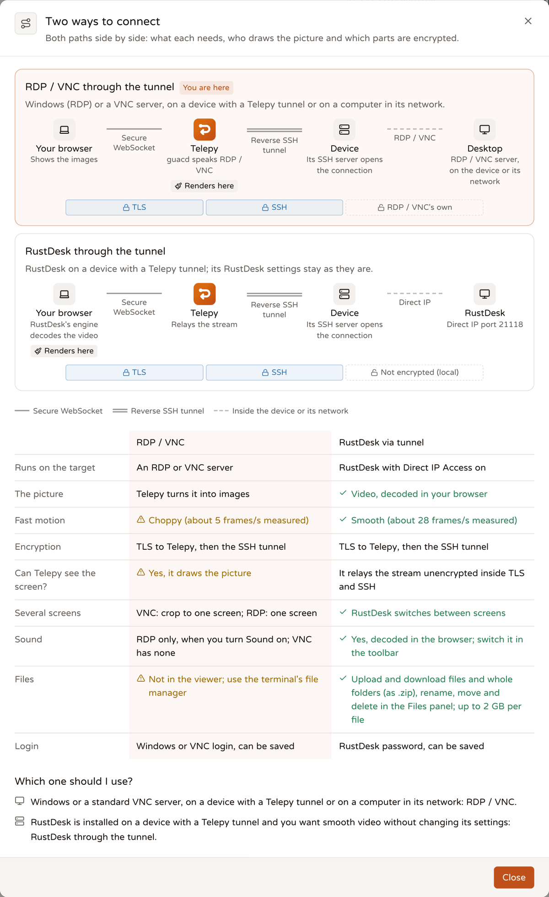
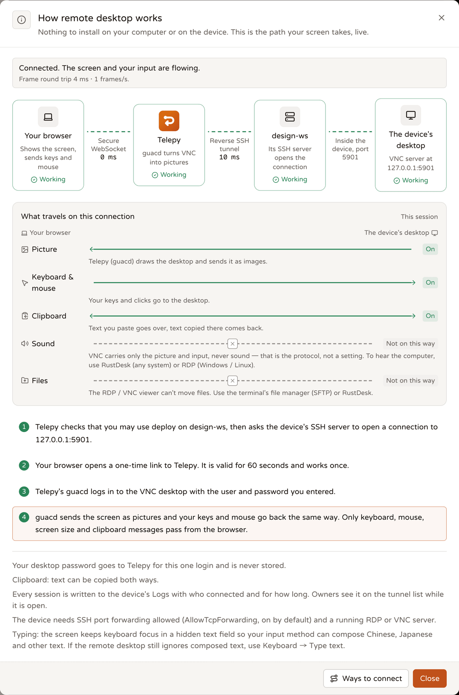

# Remote desktop (RDP / VNC / RustDesk in the browser)

<p align="center"><b>English</b> | <a href="./remote-desktop.zh-TW.md">繁體中文</a> | <a href="./remote-desktop.ja.md">日本語</a></p>

See and control a computer's desktop right in the browser: Windows over RDP, any VNC server, or RustDesk. The computer can be a device with a Telepy tunnel, or another computer on that device's network.

Nothing gets installed on the device. Its own SSH server opens the connection to the desktop, and Telepy carries it through the tunnel to your browser.

You can open it from:

- **Remote desktop** in the sidebar,
- the tunnel menu, or the **Desktop** button in the tunnel list,
- a computer's panel on the **Network** page.

The feature sits behind the **Remote desktop** feature permission: if an administrator turns it off for you, the page explains that instead, and the API answers 403 `feature_disabled`.

## Which way to connect



There are two ways in, and both go through the tunnel:

- **RDP / VNC**: Telepy's desktop engine (guacd) talks RDP or VNC to the desktop and sends your browser a stream of images.
- **RustDesk**: RustDesk's own engine runs in your browser tab and decodes RustDesk's video; Telepy only relays it. If you prefer the RustDesk app, Telepy can forward the port to your computer instead.

| | RDP / VNC | RustDesk through the tunnel |
|---|---|---|
| Runs on the target | An RDP or VNC server | RustDesk with Direct IP Access on |
| The picture | Telepy turns it into images | Video, decoded in your browser |
| Fast motion | Choppy (about 5 frames/s measured) | Smooth (about 28 frames/s measured) |
| Several screens | VNC: show one at a time; RDP: one screen | RustDesk's own screen switching |
| Sound | RDP only, when you turn it on; VNC has none | Yes |
| Files | Not in the viewer (use the terminal's file manager) | Files panel, up to 2 GB per file |
| Login | Windows or VNC login, can be saved | RustDesk password, can be saved |

The short version: Windows or a standard VNC server, use RDP / VNC. RustDesk already on the machine and you want smooth video, use RustDesk.

The **Ways to connect** button in the page header shows this comparison in the app, with who encrypts which hop and the way you're using marked. The protocol field's hint and the info dialog's footer open it too.

## What the remote computer needs

- **Forwarding on the device.** Its sshd must allow TCP forwarding (`AllowTcpForwarding`). OpenSSH and Win32-OpenSSH allow it by default.
- **A desktop server**, on the device itself or on a computer in its network:
  - Windows Remote Desktop: port 3389
  - xrdp on Linux: 3389
  - macOS Screen Sharing: 5900 (set a password under "VNC viewers may control screen with password")
  - TigerVNC / x11vnc: 5900 plus the display number (`:1` = 5901)
  - RustDesk: Direct IP Access on port 21118 (see [RustDesk](#rustdesk))
- **A device account you may use.** It is only for the SSH hop into the device, not the desktop login. If you have none there, ask the tunnel's owner to allow one.

RDP connects with `security=any` and `ignore-cert=true`. If the Windows machine requires Network Level Authentication (NLA), the login has to be exactly right, domain included.

## Connecting to RDP or VNC

1. Open **Remote desktop** and pick the device. The top of the form is a path diagram, the same as on the terminal page: your browser → Telepy → device → desktop.
2. In that diagram, choose **Desktop on** (the device itself or a computer on its network), the device account, the **Protocol** and the **Port**.
3. Fill in the login: **Desktop user**, **Password** and, for Windows, **Domain**. Or pick a **Saved login**.
4. Check **Quality**, **Clipboard**, **Sound** and **Display** below. They start from your saved preferences.
5. Click **Connect**.

Telepy logs in to the desktop on the server side. Your password is sent for this connection only, kept in memory while the session lasts, and never stored, unless you tick **Save this login for this desktop**.

If the tunnel asks for a confirmation before sessions (step-up), Telepy asks for your second factor first.

Once connected, the page scrolls so the picture sits just under the header. Click the picture to type into it.

## The picture

### Quality

| Preset | RDP | VNC |
|---|---|---|
| **Auto** (default) | Smooth fonts; guacd decides | No extra settings |
| **Faster** | 16-bit colour, no font smoothing | 16-bit colour, more compression |
| **Sharper** | 24-bit colour, lossless only | 24-bit colour, best quality, lossless only |

Faster is for a slow tunnel; Sharper costs bandwidth. Sharper text on a HiDPI screen is a separate switch, under Display. Your choice is saved on your account, and Preferences → Remote desktop shows the same setting.

### Scaling

Display settings live in three places that share one value: Preferences → Remote desktop → Display, the **Display** field on the connect form, and the **Display** menu in the toolbar. They're saved on your account, so every browser you sign in to uses them.

- **Fit to window** (default): the whole picture fills the frame, and a small remote screen is enlarged too.
- **Shrink only**: a big screen shrinks to fit, a smaller one stays at 1:1.
- **Actual size (1:1)**: one remote pixel per screen pixel (per device pixel with HiDPI). Move the mouse to an edge of the picture, or drag with two fingers, to see the rest.
- **Custom %**: anything from 25 to 400 %.

Modes stick: when the window changes size, Fit fits again and 1:1 stays 1:1. The toolbar's − / % / + buttons and pinching switch to a fixed percentage.

### Resolution and HiDPI

- **RDP resolution**: **Match the window** (default) makes the remote desktop the size of the picture frame. It follows when you resize the window, fill the window or go full screen; Telepy waits until the frame has been still for 400 ms before asking. **Fixed size** (1280×720, 1600×900, 1920×1080, 2560×1440 or custom) keeps that size and scales it in the browser, from the next connection on.
- **HiDPI (device pixels)**: on a Retina / HiDPI screen, ask for the screen's real pixels (up to 2×) so text is sharper. Off by default: Windows enlarges its interface to match, but xrdp and most VNC servers don't, so text gets tiny. Flipping it mid-session resizes a window-following session right away.
- **Resize VNC desktops too** (off by default): asks the VNC server to take the window's size. Only virtual desktops (TigerVNC Xvnc, KasmVNC) follow; real screens (x11vnc, macOS Screen Sharing, most Windows servers) keep theirs. It's off because quietly changing the resolution of someone's real monitor is rarely the surprise they were hoping for.
- **RustDesk**: the remote decides its resolution, and Telepy only scales the picture in the browser.
- **The site's ceiling**: an administrator sets a maximum resolution (longer side, 2560 by default). A bigger request is scaled down keeping its shape, both at connect and whenever the window changes.

### Filling the window

**Fill the browser window** in the Display menu covers the sidebar and page header to give the picture more room. It isn't full screen: Esc still goes to the remote desktop. **Back to the page** in the toolbar leaves it. Full screen has its own toolbar button.

### Touch screens and phones

- Pinch with two fingers to zoom, drag with two fingers to pan.
- One finger is still the remote mouse: tap = click, long-press = right click.
- A small − / % / + pill sits at the top right. Tap the percentage to go back to fit. Zoom goes up to at least 4×.
- On a phone, a shrunk picture (VNC, or RustDesk at a fixed resolution) opens at 1.5× from the top-left corner so the text is readable. RDP isn't enlarged, because its resolution already follows the frame. This starting zoom comes back on a new connection, another screen or area, or a new resolution.
- With only a mouse, nothing changes.

## One screen out of several (VNC)

A VNC server sends every monitor stitched into one big picture (macOS Screen Sharing, x11vnc and TightVNC all do this), and guacd can't pick a monitor. So Telepy crops in your browser instead, and clicks still land in the right place.

The toolbar's **Screen** menu offers:

- **Whole desktop**
- each detected screen, with its name, size and which one is main
- **Split evenly**: left / right half, thirds, top / bottom half; always available
- **Custom area**: choose **Select an area…** and drag across the part you want (at least 64 px). Esc or Cancel gives up, and while you select, keys and clicks stay on your side.
- **Detect screens again**

On connect, Telepy asks the device once where its screens are. That only works for the device itself, not for a computer on its network. When the device has nothing useful to say, Telepy guesses from the picture's shape (monitors come in a handful of common aspect ratios) and marks those entries **Guessed from the picture's shape**. Your choice is remembered per device or computer, in this browser.

RDP doesn't need any of this: Telepy sets the size of an RDP session, and it is always one screen.

## Clipboard

Pick a direction with the **Clipboard** field on the connect form, or in Preferences → Remote desktop. It's saved on your account.

- **Both ways**: text you send goes over, and text copied on the remote desktop comes to your clipboard.
- **Paste in only**: text goes to the remote desktop; anything copied there stays there.
- **Off**: nothing crosses in either direction.

With RDP / VNC you send text with the **Paste** button. With RustDesk, text you copy on your computer is sent while the tab has focus, and text copied on the remote shows up below the toolbar.

An administrator sets a ceiling (**Desktop clipboard limit**). The narrower of the two applies, and options above the ceiling are greyed out. For RDP / VNC, guacd enforces it on the server. The server can't see inside RustDesk's stream, so there the RustDesk engine in your tab applies it: off asks that RustDesk to disable its clipboard, and paste-in-only ignores whatever the remote sends back.

## Sound

Sound works with RDP and RustDesk. VNC never carries sound: the protocol only knows pictures and input. macOS Screen Sharing is VNC, so to hear a Mac, use RustDesk.

Turn **Sound** on in the connect form. It's off by default because audio costs bandwidth, and the choice is saved on your account.

- **RDP**: decided at connect. Off means guacd doesn't even load the sound channel; while connected, the toolbar can only mute it.
- **RustDesk**: you can also switch it from the toolbar while connected. Off asks the device not to send sound at all.
- Your microphone never goes the other way.

### The sound button

| State | What it means |
|---|---|
| **Playing** | Sound is arriving and playing. |
| **Quiet** | The sound channel is open, but nothing is playing on the remote. |
| **Waiting for sound** | Just connected; waiting for the remote to open its sound channel. |
| **Sound held back** | Sound arrives, but the browser holds it until you click the page. Click **Click to enable sound**. |
| **No sound** | 10 seconds after connecting, the remote still hasn't opened a sound channel. |
| **Muted** | You muted it in this tab. Sound still arrives and is dropped, so unmuting doesn't replay a backlog. |

The button's tooltip, and the Sound line in the info dialog, say why.

### Turned it on and hear nothing?

Browsers only let a page make noise after you've clicked something on it. It's the rule that keeps ads from autoplaying, and now and then it catches you too. Telepy unlocks audio during your **Connect** click, so normally it just plays. If it's still held back (Safari is the strictest), the button says **Sound held back** and offers **Click to enable sound**.

If the button says **No sound**, the remote isn't sending any. The tunnel's Logs say so as well: the session's close line reads `no sound channel from the RDP server`. Check the remote computer:

- **Windows (RDP)**: sound is redirected unless a policy turns off "Allow audio and video playback redirection".
- **Linux (xrdp)**: needs `pulseaudio-module-xrdp` (not packaged for Debian / Ubuntu; build it from source following its instructions) or `pipewire-module-xrdp`.
- **RustDesk on Linux**: records the sound server (PulseAudio / PipeWire) of the signed-in desktop session. If nobody is signed in to the desktop, there's no sound.
- **RustDesk on Windows**: records whatever the default output plays.
- **RustDesk on an Apple silicon Mac**: records system sound through the Screen Recording permission it needs anyway.
- **RustDesk on an Intel Mac**: records only its Audio input device, which is the microphone by default, so you'd hear the room rather than the music. Install a loopback device such as BlackHole and pick it in RustDesk's Settings → General → Audio input device.

RustDesk sound also needs a browser that can decode audio with WebCodecs. Without it, the sound button is disabled and says why.

## Keyboard and input methods

- **Input methods just work.** Chinese, Japanese and other composed text reaches the remote, even across systems, say from a Windows browser into a Mac's Screen Sharing. It's sent as Unicode characters, which RDP and the common VNC servers (macOS Screen Sharing, x11vnc, TigerVNC, TightVNC) accept.
- **Keyboard → Type text…**: if a remote still ignores composed text, write in this dialog with your own input method. Each character is sent as a key press, and line breaks as Enter. Nothing is stored.
- **Paste**: the last resort; it sends text to the remote clipboard.
- **Send Ctrl as ⌘ Command** (RDP / VNC): for macOS desktops, Ctrl+C arrives as ⌘C. It's on by default when the device is a Mac and your browser isn't, and this browser remembers your choice. Switching it while holding a key never leaves a modifier stuck.
- **Ctrl+Alt+Del** is in the Keyboard menu for RDP and RustDesk.

## RustDesk

RustDesk speaks its own protocol, which guacd doesn't understand. Telepy reaches it two ways, both through the tunnel: in the browser (the default once you pick **RustDesk** as the protocol), or with the RustDesk app through a forwarded port.

Either way, no RustDesk ID or relay server is involved: Telepy reaches the RustDesk on that machine through the device.

### Get that computer's RustDesk ready

When you pick RustDesk, the page checks from the device whether RustDesk answers and shows a checklist. Each step has a small picture of RustDesk's screen, in RustDesk's own words, showing where to click (**Show where**). Only the step to look at now is open; once a session connects, the list folds to one line.

1. **RustDesk is open and accepts direct connections.** In RustDesk: Settings → Security → **Unlock security settings**, then turn on **Enable direct IP access** (port 21118). RustDesk has to stay open.
2. **A permanent password RustDesk accepts.** On the same page, under Password, choose **Use both passwords** (not **Use one-time password**), then **Set permanent password**. A one-time password works beautifully, exactly once.
3. **Permission to show and control the screen** (Mac). System Settings → Privacy & Security: turn RustDesk on under **Screen Recording** and **Accessibility**. Without them the picture stays black or the mouse does nothing.
4. **Keep it reachable after it closes or restarts** (recommended). Install RustDesk's system service where RustDesk offers it. Without it, RustDesk stops when the app closes and doesn't come back after a restart.

With sound on, and if the last computer you reached was a Mac, a **Sound from a Mac** step appears too (see [Sound](#sound)).

### Connecting in the browser

Type the **RustDesk password** and click **Connect in the browser**. The password stays in your browser: the RustDesk engine in the tab answers RustDesk's challenge itself, and Telepy only relays it.

You get the picture, mouse and keyboard, clipboard text, screen switching, quality, sound and files. There's no terminal, remote printing or microphone; use the RustDesk app for those.

- **Screen** menu: the remote's own displays (RustDesk switches natively), and quality. Faster / Auto / Sharper map to RustDesk's own low / balanced / best.
- **Keyboard** menu: Type text… and Ctrl+Alt+Del.
- The latency button shows what RustDesk's engine measures (latency, frames per second, target bitrate) plus the tunnel's latency.
- RustDesk asks you to confirm an "unencrypted direct connection". Telepy confirms it for you, since the whole path already runs inside TLS and the SSH tunnel.
- One RustDesk screen per page.
- RustDesk sessions don't time out when idle; the site's idle timeout covers RDP / VNC only.

It needs a browser with WebCodecs: a current Chrome, Edge or Safari.

### Files

In-browser RustDesk sessions have a **Files** button in the toolbar. The panel sits to the right of the picture on a wide screen, below it on a phone. It uses RustDesk's own file transfer on a second connection, relayed through the tunnel, up to 2 GB per file.

- **Browse**: breadcrumbs (on Windows the top level lists the drives), **Up one folder**, **Home folder**, **Show hidden files**.
- **Upload** files, or **Upload a folder** (dropping a folder in works too and keeps empty folders). Folders are created first; one that already exists is fine.
- **Download** a file, or **Download as .zip** for a whole folder. Telepy counts what's inside first and asks before more than 500 files or 2 GB. Empty files and folders come along.
- **Rename**: type a new name, or a path such as `../archive/name` to move it on the same disk. The dialog shows where it ends up, and the button turns into **Move**.
- **New folder** and **Delete** (several at once works). Deleting a folder first shows how many files and how much, hidden files included. RustDesk has no trash, so delete means delete.
- **Transfers** show progress and speed, can be cancelled, and ask **Skip** or **Replace** when a name already exists.

Browser differences: Chrome and Edge save straight into the file you pick, even a big zip. Firefox and Safari have no save dialog, so a download is collected in memory first and a folder zip must stay under 2 GB. When the device reports an error, you see its message as it is.

The panel's info button (**How files travel**) draws the path: your browser ─ Telepy ─ tunnel ─ RustDesk on the device ─ disk.

Only the person who opened the screen can open its Files panel, and the file connection ends with the screen. An administrator can turn **RustDesk file transfer** off for the site; the panel disappears and the relay refuses file-transfer logins, so it's more than a hidden button. Deletes and renames are written to the tunnel's Logs (paths and counts, never content).

### Using the RustDesk app instead

Under **Prefer the RustDesk app?**, Telepy forwards RustDesk's Direct IP port to your computer and the app connects to `127.0.0.1`. RustDesk's own features (file transfer, sound, its toolbar) then work as usual.

1. Click **Check from the device** to see that the device reaches RustDesk.
2. Run the command shown on your computer and keep it open:

   ```
   ssh -L 21118:<host>:21118 <alias>
   ```

3. In the RustDesk app, enter `127.0.0.1` as the ID (`127.0.0.1:<port>` if your local port isn't 21118) and use the permanent password.

You need a device account on that device to forward the port. The Command Sheet's **Use RustDesk** recipe has the options (RustDesk host, RustDesk port, local port). The LAN scan looks for port 21118 too, and the Network page's Commands tab lists the `-L` command for a RustDesk machine.

## Saved logins

Tick **Save this login for this desktop** when you connect, and next time pick it under **Saved login**. Preferences → Saved logins lists them and deletes them.

- **Yours only.** Nobody else can see or use them, administrators included.
- **One desktop each.** A saved login is tied to its tunnel and protocol and, if set, the computer on its network and the port. Telepy refuses to use it anywhere else, so a Windows password never wanders off to another machine.
- **Encrypted on the server** with a key derived from the server's `SECRET_KEY`. The password is never shown again; Telepy decrypts it only when you connect. If the administrator changes `SECRET_KEY`, old saved logins can't be opened any more: save them again.
- **RustDesk is the one exception.** RustDesk's password is checked by the engine in your browser, so for that one start Telepy decrypts it and hands it to the engine over TLS. It isn't logged or kept in the page.
- Deleting the tunnel or the network computer deletes its saved logins. The session's line in Logs names the saved login it used (the name only).

The same vault also keeps SSH logins for computers on a device's network. Those belong to the terminal and aren't covered here.

## Seeing what is going on



The page's info button (**How it works**) shows the live path: your browser ─ Telepy ─ device ─ desktop. Each spot reads waiting, active, OK or failed, so when something breaks you can see which hop it stopped at. While connected, each link shows its round trip and the slowest one turns yellow. For RustDesk in the browser, and for the app route, the diagram changes to match.

Below it, **What travels on this connection** draws five lines (picture, keyboard & mouse, clipboard, sound, files), each with a state and a one-line reason:

- **On**, or **One way** (clipboard set to paste in only)
- **Off**: you turned it off, or muted it in this tab
- **Blocked by the site**: the administrator's ceiling
- **Not on this way**: VNC has no sound, RDP / VNC can't move files, the browser has no WebCodecs audio
- for sound also **Waiting** and **Not getting through**; for RustDesk files, the state of download, upload, rename and delete

### Latency and stream status

The toolbar's latency button shows signal bars, the frame round trip and one word: **Streaming**, **Lagging**, **No data** or **Idle**. Open it for the numbers:

- **Frame round trip**: from a frame leaving Telepy until your browser has drawn it and answered. This is the lag you feel. It's blank when the desktop is still.
- **Network round trip**: your browser ↔ Telepy, without drawing.
- **Telepy ↔ device**: the tunnel, measured every 15 seconds.
- Frames per second, picture data, your input, sound data, **Frames waiting** (sent but not drawn yet), and how many frames guacd merged because the browser fell behind.
- The remote screen's size and the zoom, plus one sentence on where most of the delay is: the network, the tunnel, or your browser drawing slowly (a smaller window, **Faster** or closing other tabs helps).

For RustDesk, the engine decodes in the browser, so there's no frame round trip or frames waiting. The network round trip is the browser ↔ device figure that RustDesk measures itself.

## Troubleshooting

### Connect fails right away

Telepy opens the path to the desktop before any picture starts, so most problems show up the moment you click Connect:

| The page says | What to do |
|---|---|
| The device is offline | Its tunnel to Telepy isn't connected. Bring the device back. |
| The device refused Telepy's key for the account | Add Telepy's service key to that account's `authorized_keys`. |
| The device's SSH server does not allow port forwarding | Set `AllowTcpForwarding yes` in its `sshd_config` and restart sshd. |
| The device presented a different SSH host key | Review it in the tunnel's details before trusting it. |
| The device could not reach the address | Check that the RDP / VNC server runs and listens on that port. |
| All remote desktop slots are in use | The site's limit is reached. Try again in a moment. |
| Remote desktop is turned off on this server | An administrator switched it off. |
| Telepy's desktop engine (guacd) is not running | Ask an administrator to start it. |
| The desktop rejected the login | Check the user, password and domain. |

### The picture or the text is too small

- Use **Fit to window** rather than **Shrink only**.
- If **HiDPI** is on and the remote is xrdp or VNC, turn it off: those servers don't enlarge their interface.
- A fixed RDP size is scaled into the frame; switch to **Match the window**.

### Chinese or Japanese doesn't arrive

Try **Keyboard → Type text…**. With RustDesk on Linux, check that RustDesk runs with a locale (`LANG`) set: in the C locale it refuses multibyte text, and its log says `Invalid multi-byte sequence encountered`. That's the device's environment, not something Telepy can fix from here.

### RustDesk won't connect

- **Nothing answers on port 21118**: RustDesk is closed, or **Enable direct IP access** is off.
- **The password is rejected**: use the permanent password, and check the password setting isn't **Use one-time password**.
- **No screen to show, or a black picture**: nobody is signed in to a desktop session, or (on a Mac) Screen Recording / Accessibility is missing.
- **The engine won't start**: the browser needs WebCodecs (a current Chrome, Edge or Safari).

For sound, see [Turned it on and hear nothing?](#turned-it-on-and-hear-nothing).

### Why did the session end?

When a session closes, the page tells you why. This is the code behind it:

| Code | RDP / VNC | RustDesk |
|---|---|---|
| 4404 | The session or its ticket is invalid or expired | The ticket is invalid or expired |
| 4403 | You lost access (the tunnel or the device account) | Refused by permissions or by the login guard |
| 4011 | guacd unreachable, or its handshake failed | — |
| 4013 | guacd disconnected or sent something broken | The device closed the connection |
| 4014 | Ended by the server: idle, or stopped | Stopped by the server; a files connection also ends when its screen ends, file transfer is turned off, or a newer one replaces it |
| 4400 | The browser sent something unreadable | Protocol error |
| 4009 | Ended from Live sessions (the reason names who), or access lost (`Telepy (access changed)`) | Same |
| 4010 | The browser sign-in that opened it was signed out (reason: user / admin / logout / reuse / disabled) | Same |

Errors from guacd itself, such as 0x0203 / 0x0301 (RDP login refused), are translated on the page and pinned to the hop where things stopped.

## Who sees what, and when sessions end

- **Logs**: every session writes an open and a close line to the tunnel's Logs: how long it ran, why it ended, what went to the browser (for example "12.3 MB to the browser, 2,340 frames, frame latency avg 48 ms (max 210 ms)"), how much sound, and guacd's last error. RustDesk lines carry the bytes in both directions, and RustDesk file deletes and renames get lines of their own.
- **"N using"**: the owner and Admin sharees see open desktops in the tunnel list, with the device account each one uses.
- **Live sessions** lists them and can end one; the person sees who ended it. Administrators have **All live sessions**.
- **Losing access ends the session.** Unsharing, a share expiring, a lower permission, a smaller account allow-list, a renamed or deleted device account, the feature turned off, a disabled account: Telepy checks right away, and again every 10 seconds. The session closes with `Telepy (access changed)`, the Logs line says why, and the person gets a notice.
- **Signing out ends it too.** When the browser sign-in that opened a desktop is signed out (from Your devices, by an administrator, or because the account was disabled), the desktop closes at once.
- Sessions also end when stopped from the server, and RDP / VNC ones after the site's idle timeout.

## For administrators

### Site settings

Site settings → Remote desktop:

| Setting | Default | What it does |
|---|---|---|
| Allow remote desktop (`desktop_enabled`) | on | Off = no new sessions. Open ones aren't affected. |
| Max concurrent desktops (`desktop_max_sessions`) | 4 | Across the whole site, RDP / VNC and RustDesk together, connections still starting included. 0 = no limit. |
| Desktop idle timeout (`desktop_session_idle_timeout`) | 900 s | Disconnect after this long without keyboard, mouse or clipboard input. 0 = never. RDP / VNC only. |
| Desktop clipboard limit (`desktop_clipboard`) | both | The most anyone may allow: `both` / `to_remote` / `off`. Each person picks within it. |
| Maximum resolution (`desktop_max_resolution`) | 2560 | Longer side in pixels (640–16384). Bigger requests are scaled down keeping their shape, at connect and during the session. |
| RustDesk file transfer (`desktop_file_transfer`) | on | Off hides the Files panel, refuses file-transfer logins at the relay and closes open file connections. |

### Running guacd

`docker-compose.yml` runs `guacamole/guacd:1.6.0` as the `guacd` service, on an internal network (`telepy-desktop-${PROJECT_NAME}`) that only the backend shares with it. Two environment variables matter:

- `GUACD_ADDR`: where the backend finds guacd (default `guacd:4822`).
- `DESKTOP_CALLBACK_HOST`: the name guacd uses to connect back to the backend (`backend` in compose; unset = the container's `HOSTNAME`).

## Under the hood

An RDP / VNC session, in plain words:

1. Your browser asks Telepy to start. Telepy checks your access, then opens the path through the device to the desktop straight away. That's why "device offline" or "nothing on that port" shows up instantly. The browser gets a one-time ticket, valid for 60 seconds.
2. The browser opens a WebSocket with the ticket. Telepy checks again, logs in to the desktop through guacd on the server (the password never travels back to the browser), and joins guacd to the path from step 1.
3. Pictures flow to the browser; keys, mouse and clipboard flow back. The browser can only send input, never instructions of its own to guacd.

guacd sits on an internal network only the backend can reach, and it never dials the device. For each session it connects back to a one-time port on the backend, and the backend pipes that into an SSH channel on the device's existing connection. On the device, sshd connects to `127.0.0.1:<port>` for its own desktop, or to a network computer's address, the same way as `ssh -J` and the LAN scan.

RustDesk in the browser works differently. RustDesk's engine (a community TypeScript port of RustDesk's web client, AGPL-3.0, shipped with Telepy) believes it is talking to an ID server and a relay. Both are really the same WebSocket on Telepy, which hands the relay half to the device's Direct IP port. Telepy runs no RustDesk server of its own.

The rest of this section is reference material for API users and contributors.

<details>
<summary>Architecture diagram (RDP / VNC)</summary>

```
Browser (guacamole-common-js)
  │ wss /ws/desktop/<session>/?ticket=…&width=&height=&dpi=   subprotocol guacamole; ticket valid 60 s, single use
  ▼
backend (desktop WebSocket)
  │  browser → guacd: only key / mouse / touch / size / sync / nop / disconnect / clipboard / blob / end / ack pass
  │  guacd → browser: passed through (lengths re-encoded: guacd counts code points, the browser UTF-16 units)
  │  TCP guacd:4822: the Guacamole handshake is done in the backend; credentials never reach the browser
  ▼
guacd container (internal network shared only with the backend)
  │  dials back to this session's own rendezvous port on the backend (guacd's address only, one connection, then closed)
  ▼
backend bridge
  │  copied both ways ⇄ a direct-tcpip channel on the device's pooled SSH connection (takes no session slot)
  ▼
device sshd ──► 127.0.0.1:<port> (the device's own desktop) or <LAN address>:<port> (a computer on its network)
```

After the handshake the backend first sends `0.,<uuid>;` (guacamole-common-js marks the tunnel open only then), followed by any instructions it already read during the handshake (guacd often packs `ready` and the first screen updates together).

</details>

<details>
<summary>API reference</summary>

**RDP / VNC**

- `POST /api/reverse/server/{id}/desktop/start` with `{protocol, username?, port?, lan_host_id?, login?, password?, domain?, credential_id?, quality?, clipboard?, audio?, resize?}`.
  - Checks: remote desktop enabled, VIEW on the tunnel, step-up on sensitive tunnels, `username` among your allowed device accounts (omitted = the default one), the LAN host belongs to this tunnel, and the site limit.
  - Errors: 502 `device_offline` / `device_auth` / `host_key_changed` / `forwarding_disabled` / `target_unreachable` / `device_unreachable`; 503 `desktop_disabled` / `desktop_busy`; a field error on `credential_id` when the saved login belongs to another target; a field error when `audio` isn't a boolean.
  - Returns `{session_id, ws_path, ticket, expires_in, protocol, clipboard, clipboard_limit, quality, audio, resize, max_resolution, target, username}`. `clipboard` and `audio` are the values in effect (VNC always has `audio: false`).
  - `clipboard` omitted = your personal setting, capped by the site's. `credential_id` replaces `login` / `password` / `domain`.
  - `quality`: `auto` / `speed` / `sharp`. `resize: false` = fixed size; for VNC, `resize: true` asks the server to follow the window.
- `/ws/desktop/<session>/?ticket=…&width=&height=&dpi=`: the WebSocket, subprotocol `guacamole`. The close code is repeated as the close reason, because guacamole-common-js only reads the reason.
- `POST /api/reverse/server/desktop/{sid}/stop`: ends a session (4014).
- `GET /api/reverse/server/{id}/desktop/screens?username=`: the device's screens, same gate as start. Returns `{os, source, screens: [{name, x, y, width, height, primary}], username}`; not knowing is not an error (`screens: []`).
- `GET /api/reverse/server/{id}/desktop/probe?port=&username=&lan_host_id=`: checks from the device whether a port answers. Same gate and path as start, closed at once; it doesn't look at `desktop_enabled`.

**RustDesk**

- `POST /api/reverse/server/{id}/rustdesk/start` with `{username?, port?, lan_host_id?, credential_id?, clipboard?}`. Same gate as desktop start; the site limit counts RDP / VNC and RustDesk together. Returns `{session_id, ws_path: "/ws/rustdesk/{sid}/", ticket, expires_in, target, username, clipboard, clipboard_limit, file_transfer}`, plus `password` when `credential_id` was sent.
- `/ws/rustdesk/{sid}/?ticket=`: the WebSocket the engine connects to (twice).
- `POST /api/reverse/server/rustdesk/{sid}/stop`: ends a session (4014).
- `POST /api/reverse/server/rustdesk/{sid}/files`: opens a files connection under a connected screen session. 409 `not_connected`, 503 `file_transfer_disabled` / `desktop_disabled`, 502 as for start.

**Saved logins**

- `GET /api/credentials` (filter with `tunnel_id` / `lan_host_id` / `protocol`), `POST`, `PATCH /api/credentials/{id}`, `DELETE`. Owner only.
- Fields: `protocol` (`rdp` / `vnc` / `rustdesk`; `ssh` rows belong to the terminal), `tunnel_id`, optional `lan_host_id` / `port`, `label`, `login` (empty for RustDesk), `domain`, and the password. Responses carry `has_password` (and `has_key` for `ssh` rows), never the password.

**Your preferences** (`/api/user/settings`)

- `desktop_clipboard`: `both` / `to_remote` / `off`; the response also carries the read-only `desktop_clipboard_limit` (the site's ceiling).
- `desktop_display`: one JSON object `{scale, percent, resolution, width, height, hidpi, vnc_resize, quality, audio}`. `scale` is `fit` / `shrink` / `actual` / `custom`. Unknown fields or out-of-range values are field errors, `percent` is clamped to 25–400, and empty means never chosen. On sign-in the account's value wins; an account without one takes this browser's earlier choice.

</details>

<details>
<summary>What guacd is asked for</summary>

| Choice | Sent to guacd |
|---|---|
| Quality Auto | RDP as it always was (smooth fonts); VNC with no extra parameters |
| Quality Faster | RDP `color-depth 16`, no font smoothing; VNC `color-depth 16`, `compress-level 6`, `quality-level 5` |
| Quality Sharper | RDP `color-depth 24`, `force-lossless`; VNC `color-depth 24`, `quality-level 9`, `force-lossless` |
| Match the window (RDP) | `resize-method display-update`; the browser's `size` is sent once the frame has been still for 400 ms |
| Fixed size (RDP) | no resize method; the relay drops the browser's `size` |
| HiDPI | devicePixelRatio (≤ 2) times the pixels, plus `dpi` |
| VNC resize off | `disable-display-resize` (guacd 1.6 would otherwise send SetDesktopSize at connect) |
| Clipboard | `disable-copy` / `disable-paste` |
| Sound on (RDP) | the handshake's `audio` instruction offers `audio/L8` and `audio/L16` |
| Sound off (RDP) | `disable-audio=true`, so rdpsnd is never loaded |

Every requested size, at connect and during the session, is scaled down so its longer side fits the site's maximum. guacd's audio streams (`audio` / `blob` / `end`) pass through untouched and the browser may answer with `ack`; an `audio` from the browser (a microphone) is dropped.

</details>

<details>
<summary>Stream statistics on the wire</summary>

Every second the relay sends the browser two instructions of its own. guacamole-common-js ignores unknown opcodes, and the page picks them out before the Guacamole client sees them.

| Instruction | Content |
|---|---|
| `telepy-ping <n>` | The browser answers `telepy-pong <n>` at once; the relay settles the network round trip and never forwards it to guacd. |
| `telepy-stats <json>` | `{ms, frame_ms, net_ms, tunnel_ms, frames, merged, down, up, behind, audio}` |

- `frame_ms`: guacd ends each frame with `sync <ts>`, and the browser echoes it only after drawing that frame. Null after 3 seconds without a new sample.
- `net_ms`: ping / pong, without drawing.
- `tunnel_ms`: the device sshd round trip the monitor measures every 15 seconds.
- `frames` per second; `merged` = how many frames one `sync` combined (guacd 1.6's second argument; above 1 = the browser can't keep up); `behind` = frames sent but not echoed; `down` / `up` = bytes this second.
- `audio`: bytes on guacd's sound streams; null if none was ever opened.

</details>

<details>
<summary>How screens are detected and guessed</summary>

The device is asked over its SSH connection:

- `uname -s`; on Darwin `system_profiler SPDisplaysDataType -json` (sizes only, no positions);
- other POSIX systems `xrandr --listmonitors` (trying `$DISPLAY`, `:0`, `:1`);
- no `uname`: PowerShell `[System.Windows.Forms.Screen]::AllScreens`.

Placing them: screens with positions are shifted to (0,0) and, when the total has the picture's shape but not its size (Windows display scaling), scaled. Sizes without positions (macOS) are laid out from the picture: widths that add up to its width sit side by side, heights that add up to its height are stacked, and the black areas of the picture decide whether a shorter screen sits at the top or the bottom.

Guessing is for when the device reports nothing usable (a computer on its network, detection failed, Xvfb reporting one screen for everything). Monitors only come in a few aspect ratios (16:9, 16:10, MacBook ≈ 1.545, 3:2, 4:3, 5:4, 21:9), so:

- Telepy splits the width into 2–4 equal-height screens of those ratios (or the height into stacked ones), within 0.5 %. It prefers the closest fit, then equal ratios, then fewer screens, and tries every order.
- A screen shorter than the picture is measured from a black band. The band has to agree across 9 sampled columns and form a common ratio, so a black wallpaper can't fool it.
- When no equal-height split fits (a MacBook 1728×1117 next to a 2560×1440), it tries one equal-height screen plus one shorter one.
- A picture with a single common ratio, 21:9 included, is one screen. 3840×1080 counts as two 16:9.

The choice is kept in this browser's localStorage under `telepy.desktopScreen.<tunnel>.<lanHost|device>`, a custom area under `telepy.desktopArea.<…>`.

</details>

<details>
<summary>RustDesk relay and login guard</summary>

The engine connects to `/ws/rustdesk/{sid}/` twice, because both its ID server and its relay server are set to that URL. The first binary message decides the role:

- `punch_hole_request` = the ID-server role. The backend answers `relay_response` naming the same URL, then waits, answering any further punch the same way.
- `request_relay` = the relay role. It takes over the channel opened at start; from then on every WebSocket message is re-framed into RustDesk's TCP framing (a 1–4 byte length prefix) and back, up to 16 MiB per frame.

The **login guard** is the only thing the relay parses, and only the outer layer of what the browser sends the device:

- `login_request` must be remote control on a screen session and file transfer on a files session. Anything else (port forwarding, camera, terminal, the wrong kind) closes with 4403, and the close line in Logs says `refused: …`.
- A `public_key` with content (a request for encryption) is refused. Telepy's stand-in ID server never hands out the device's key, so only a modified client would ask, and once encrypted the relay couldn't see what it logs in as. The whole path is inside TLS and SSH anyway.
- `file_action` / `file_response` on a screen session are refused (the engine only uses the file-transfer connection for those).
- More than 32 messages before a login are refused.

That's why turning file transfer off is enforced by the server, not just by a missing button.

Other details: the RustDesk password is answered by the engine and never passes the backend, except a saved one, which is returned in that start response only (over TLS, not logged). Sound off = RustDesk's `disable-audio` option sent before login, so the device never starts its audio service; the toolbar switch goes through the engine's option toggle. Clipboard off = that peer's `disable-clipboard`; paste in only = clipboard events from the remote are dropped. Logs lines are `rustdesk_open` / `rustdesk_close`.

Measured while choosing this design (1280×800, lots of motion): the engine through the relay ran at 28 fps / about 645 KB/s, guacd's VNC at 4–5 fps / 0.5–1.3 MB/s. Notes in [`rustdesk-spike.md`](engineering/rustdesk-spike.md).

</details>

<details>
<summary>RustDesk files: how the panel works</summary>

- RustDesk moves files on a separate connection whose login asks for file transfer. The panel asks for a child session under the screen session: same target and account, its own ticket and SSH channel. It doesn't count toward the site limit, has no entry in Live sessions and sends no webhook. A screen has at most two; opening another closes the oldest (a reload overlaps briefly). It ends with its screen.
- Inside one RustDesk engine only the top session gets video, so a files session there froze the picture. The panel therefore loads a second copy of the engine in a hidden iframe on the same page and drives its file API (`read_remote_dir`, `send_files`, `select_files` + `send_local_files`, `confirm_override_file`, `cancel_job`).
- File pickers need your click: the save dialog opens in the page and its handle is passed into the iframe, and uploads come from the page's own file input or drop.
- Folder as .zip (built in the tab with client-zip, MIT, streaming + ZIP64): the panel lists the folder recursively, then asks for its empty folders with `ReadEmptyDirs`, a message the engine understands the answer to but can't send, so the panel encodes it and sends it on the engine's WebSocket (an older RustDesk stays silent; after 4 seconds that counts as none). The engine's folder download writes into a stand-in folder handle that streams each file into the zip. The engine never opens a handle for a 0-byte file, so empty files and folders are added from the listing.
- Deleting a folder: list it recursively (hidden files included), remove each file, then remove the emptied folders (RustDesk only deletes empty trees).
- Rename: the device joins the new name to the old parent folder, which is why `../` or an absolute path moves the item.
- Each action waits for the device's done or error answer for its own job.
- Audit: the files connection isn't encrypted (the guard sees to that), so the relay reads the browser's requests and the device's answers and writes `rustdesk_file_delete` / `rustdesk_file_rename` lines. Deleting a folder becomes one line ("deleted folder /x (12 files)", with the count and the first error on failure); single files and renames get one line each once answered; anything unanswered when the session ends is written too.

</details>

<details>
<summary>Notes for contributors</summary>

- **Why the display works this way.** Measured against a real guacd 1.6 with xrdp, x11vnc and Xvnc. Before the rework:
  - the picture frame was `100dvh − 15rem` and didn't scroll into view (it is now `100dvh − 8.5rem`);
  - fit was capped at 1:1, so small VNC pictures never grew;
  - Sharper also asked for HiDPI, so on Retina an x11vnc 1024×768 picture was drawn at 512×384 and xrdp text came out half size;
  - the maximum resolution clamped width and height separately (3080×1916 → 2560×1916, wrong shape), and in-session `size` messages skipped it;
  - zoom buttons existed only on touch devices.
- **Sound autoplay.** guacamole-common-js and the RustDesk engine create their AudioContext inside a WebSocket message, with no user gesture, so browsers keep it suspended (Safari always). The Connect click (before its first await) creates and resumes one shared context; guacd's player gets it as its AudioContext factory, and the RustDesk engine gets the same one while the viewer is mounted. Checked with real sound (440 Hz through xrdp + pulseaudio-module-xrdp, and a Linux RustDesk 1.5) in Chromium and WebKit.
- **RustDesk confirm pitfall.** The engine fires its "insecure connection" message box synchronously and only afterwards records who waits for the answer, so answering inside the event handler is lost: the connection hangs, the device closes after 30 seconds, and the stats show "0 B to the device". The viewer answers on the next tick.
- **RustDesk resolution, maybe later.** The web engine's `change_resolution` isn't implemented (`setByName change_resolution not implemented (phase 2)`). Encoding a `Misc.change_resolution` ourselves and sending it like `ReadEmptyDirs` would let RustDesk follow the window (its Windows / Linux X11 side supports it).
- **The Ways to connect dialog** keeps its fact table in the frontend; update it when a fact here changes.
- **A road not taken.** A mode where Telepy acted as RustDesk's own ID / relay server (no tunnel needed) was built in #201–#208 and removed in #212, leaving only the path through the tunnel that every other feature uses. Research notes: [`rustdesk-id-server.md`](engineering/rustdesk-id-server.md). The data migration `2026-10-26-drop-rustdesk-server-devices` deleted the logins and the two tables that mode stored.
- **Tests.** `tests/desktop_api.rs` (a fake guacd: handshake, sound, clipboard, resolution, access loss), `tests/rustdesk_api.rs` (a fake RustDesk device, the login guard, files and their audit) and `tests/credentials_api.rs`. Browser end-to-end runs against real RustDesk / guacd were done by hand and aren't in the repository.

</details>
