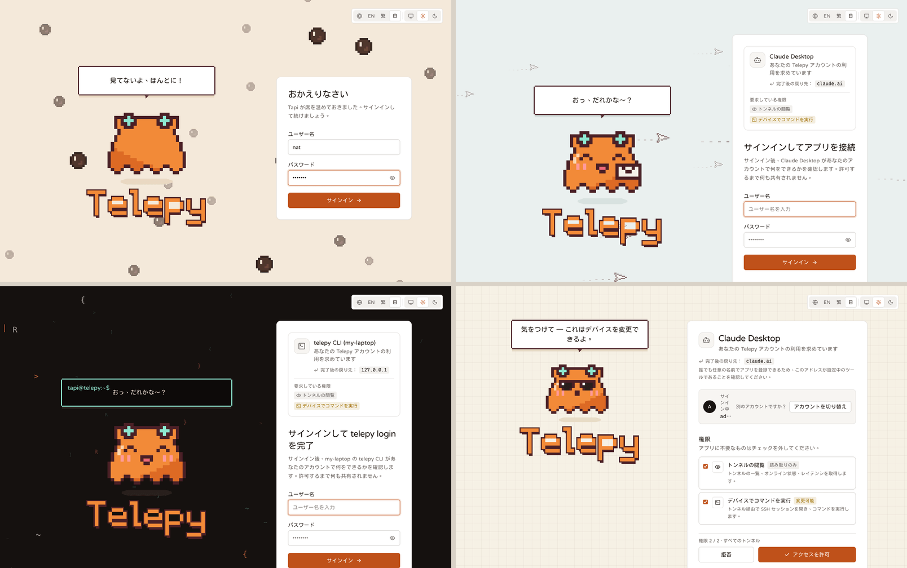

# 図で見る Telepy

<a href="./visual-guide.md">English</a> | <a href="./visual-guide.zh-TW.md">繁體中文</a> | <b>日本語</b>

Telepy のほとんどのページには情報ボタンがあり、押すといま起きていることを図で見せてくれます。接続がどの経路を通るのか、どの層が判断したのか、どこで止まったのか、といったことです。

このページでは、そうした図といくつかの画面録画をまとめました。アプリを開く前に、各部分がどう組み合わさっているかを見渡せます。どの図にも、ボタンの場所と、詳しい説明のあるドキュメントへのリンクを添えています。

画像は、架空のデバイスを並べたデモサーバーで撮ったものです（[スクリーンショットの作り方](./screenshots/README.ja.md)）。アプリの中の図はライブで、あなた自身のデバイス、アカウント、設定が表示されます。

**目次**：[デバイスの追加と削除](#デバイスの追加と削除) · [デバイス上での作業](#デバイス上での作業) · [共有とコントロール](#共有とコントロール) · [キーと SSH 設定](#キーと-ssh-設定) · [通知](#通知) · [自動化](#自動化) · [サインイン](#サインイン) · [サーバーの運用](#サーバーの運用)

## デバイスの追加と削除

### なぜリバーストンネルなのか

場所：**トンネル → トンネルを作成**、いちばん上の図です。

3 つの場面で進む短いストーリーです。デバイスはプライベートネットワークの中にあり、ルーターは外からの接続をすべて落とします。そこでデバイスのほうから Telepy へ接続し、あなたはデバイスが開いたその回線を通って入ります。

ルーターのポートはひとつも開けないので、ネットワークは閉じたまま。ルーターの面倒を見ている人も安心して眠れます。通れるのは Telepy で許可した人だけです。

### 1 行のコマンドを、ライブで追う

場所：**トンネルを作成 → 1 行のコマンド → コマンドを作成**。

その 1 行をデバイスに貼り付けて実行すると、スクリプトが進むたびにページの各ステップが点灯します。デバイスにあるもの、ホスト鍵、ゲートウェイの確認、登録、Telepy の承認、サービスの順です。Telepy がトンネル経由でログインできたら完了です。スクリプトの詳細は[1 行コマンドでのデバイス追加](./device-join.ja.md)をご覧ください。

### デバイス情報

場所：トンネルのメニュー → **詳細と説明 → デバイス → 収集の仕組み**。

Telepy は 1 日 1 回、接続中の各デバイスに読み取り専用のスクリプトでログインし、OS、稼働時間、メモリ、ディスク、負荷、再起動待ちかどうかを読み取ります。ダイアログには経路、前回と次回の実行、実際のコマンド、各警告のしきい値が表示されます。

### トンネルの削除

場所：トンネルのメニュー → **トンネルを削除**。

何かを実行する前に、ダイアログがそのトンネルに誰が届くのか、デバイス上に何があるのかを図にします。トンネルのサービス、アカウントごとに Telepy が入れた鍵、サービス鍵です。どの選択でどうなるかも、その場で図に表示されます。

そのあとは 1 ステップずつライブで進みます。Telepy はトンネルがつながっているうちにデバイスを片付け、デバイスが自分で切れるのを待ち、そのまま戻ってこないことを確かめてから（出かける前にガスの元栓を二度確かめるようなものです）、最後にトンネルを削除します。

## デバイス上での作業

### ターミナル

場所：**ターミナルページ → しくみ**（ヘッダー）。

あなたのブラウザ ─ Telepy ─ デバイスのシェルと、各区間の往復時間です。接続に失敗したときは、どこで止まったかが図に出ます。背景を知りたい方は[バックエンドがデバイスに届くしくみ](./device-connections.ja.md)と[レイテンシ詳解](./latency-deep-dive.ja.md)へ。

### 接続が切れても残るシェル

場所：**環境設定 → ターミナル → しくみ**。切断後にシェルを残す設定の隣にあります。

タイムラインは、接続中 ─ 切断 ─ N 保持 ─ 再接続、または時間切れ、と進みます。保持時間をどの層が決めるか（あなたの選択、サイトの上限、トンネルのポリシー）も分かります。

### ファイル

場所：ファイルマネージャーの **ファイルのしくみ** ボタン。

ファイルマネージャーでの操作はすべて、ターミナルと同じログインの上にある共有 SFTP チャネル 1 本を通ります。デバイスがオフラインのときや、Telepy が本人確認を待っているときに、どこで止まるかもダイアログに表示されます。

### ツールボックス

場所：**ツールボックス → ツールボックスのしくみ**。

スニペットの変数はブラウザで埋められ、そのあとシェルに 1 行ずつ入力されます。だからコマンドルールは、自分で打ったときとまったく同じように、すべての行を見ることになります。

### リモートデスクトップ

場所：接続中の **リモートデスクトップ → しくみ**。

上は経路で、ブラウザ ─ Telepy ─ デバイス ─ デスクトップと各区間の往復時間です。その下に、接続上を流れるもの（画面、入力、クリップボード、サウンド、ファイル）が、それぞれの状態と理由とともに並びます。

場所：**リモートデスクトップ → 接続方法の比較**。

guacd 経由の RDP / VNC と、ブラウザ内でデコードする RustDesk を並べて比べます。画面をどこで描くか、どの層が何を暗号化するか、どう選べばよいかが分かります。詳細は[リモートデスクトップ](./remote-desktop.ja.md)へ。

### リモートブラウザ

場所：**リモートブラウザ → ブラウザを起動**。

起動中は 3 つのステップが表示されます。デバイス経由のプロキシ、Telepy のブラウザコンテナで立ち上がる新しい Chromium、このタブに映る画面です。そのあとブラウザが現れ、その通信はデバイスから出ていきます。詳細は[リモートブラウザ](./remote-browser.ja.md)へ。

## 共有とコントロール

### デバイス上のログインアカウント

場所：トンネルのメニュー → **ターゲットサーバーユーザー → これらのアカウントの役割**。

つながりは Telepy のユーザー ─ 許可リスト ─ OS アカウント ─ デバイスの sshd です。デバイスには Telepy のユーザーの区別がつかないので、許可リストこそが本当の境界線になります。

### 機能の権限

場所：**管理 → ユーザーとアクセス → 機能の権限 → 仕組み**。

互いに独立した関門が 2 つあり、両方が適用されます。1 つはその人がどのツールを使えるかで、デフォルト → 全員 → ユーザーグループ → 本人の順に決まり、最後の本人が優先です。もう 1 つは共有で、どのトンネルに届くかを決めます。

### コマンドの判定のしくみ

場所：**コマンドルール → コマンドの判定のしくみ**。

コマンドはまず分解されます。sudo、`sh -c`、パイプの中も見ます。分けた各部分を、そのトンネルで有効なサイト全体のルールと個人のルールに照らし、実行・リマインド・承認が必要・ブロックのいずれかに決まります。最後に試したコマンドの経路が点灯します。詳細は [MCP ドキュメントのコマンドルール](./mcp.ja.md#コマンドルールssh_exec)へ。

### ターミナルの観覧

場所：**ライブセッション → 観覧のしくみ**。

相手のブラウザ ─ Telepy ─ デバイスで、あなたのブラウザは Telepy から枝分かれします。相手の画面が見え、相手にも観覧中であることが通知されます。入力できるのは、相手がキーボードを渡してくれてからです。

## キーと SSH 設定

### デバイスのキーリスト

場所：**キー → 仕組み**。

あなたの鍵 → デバイスのキーリスト → そこで使えて、かつ選んだアカウント → 各アカウントの `authorized_keys`。Telepy が削除するのは自分で追加した鍵だけです。アクセス権を失えば、あなたの鍵もまた外されます。

場所：**キー → キーグループ → キーグループの仕組み**。

鍵をまとめたグループを、デバイスまたはトンネルグループに一度付与するだけです。あとから鍵やトンネルを追加しても、同期が保たれます。

### お使いのコンピューター用の SSH 設定

場所：トンネルのメニュー → **SSH 設定**。

あなたのコンピューター ─ ssh ─ Telepy ═ トンネル ═ デバイス。生成された `Host` エントリが何をするのか、鍵がどう入るのかをダイアログが説明します。あとは `ssh <alias>` だけです。

場所：**SSH 設定 → それぞれの方法について**。「Telepy への接続方法」の隣にあります。

あなたのコンピューターは、SSH ポートか Web ポートのどちらかで Telepy に届きます。これはデバイスの接続方法とは別の話です。詳細は[バックエンドがデバイスに届くしくみ](./device-connections.ja.md)へ。

### SSH config エディター

場所：**SSH config エディター → しくみ**。

名前を選ぶと、簡略化の前と後で ssh がその名前のためにファイルをどう読むかを追えます。最初の値が優先されること、どのオプションが積み重なるか、ワイルドカードが何に一致するか、です。ターミナルでは `telepy config tidy` が同じことをします（[CLI](./cli.ja.md)）。

## 通知

### アプリ内通知とデスクトップ通知

場所：**環境設定 → 通知 → 仕組み**。

イベント ─ サイトの既定 ─ 自分の既定 ─ このトンネル ─ 結果。トーストやデスクトップ通知を出すかどうかをどの層が決めるのか、管理者がどこで強制したのかが分かります。

### サイト全体の webhook からトンネルを外す

場所：**Webhooks → サイト全体の Webhook → 対象外の仕組み**。

webhook とトンネルを選ぶと、そのトンネルのイベントが管理者のチャンネルに届くかどうか、誰が対象外にしたかが分かります。詳細は [Webhooks](./webhooks.ja.md) へ。

## 自動化

### 4 つの入り口

場所：**API → 4 つの入り口**。

Web サインイン、API トークン、CLI サインイン、MCP アプリは、Telepy への 4 つの独立した経路です。「もし…」を切り替えると、1 つを取り消しても切れるのはその経路だけだと分かります。詳細は [CLI と API トークン](./cli.ja.md)へ。

### `telepy` コマンドライン

場所：**CLI → しくみ**。

ほとんどのコマンドは、あなたのサインインを使って HTTPS で通信します。`ssh`、`scp`、`sftp` だけは別で、システムの OpenSSH があなたの個人の鍵でゲートウェイを通ります。

### MCP アプリ

場所：**MCP → アプリはどこまで届く？**

アプリ ─ Telepy ─ デバイス ─ LAN／インターネット。接続中のアプリのスコープに応じて点灯します。詳細は [MCP](./mcp.ja.md) へ。

## サインイン

### サインインを保つしくみ

場所：**環境設定 → セキュリティ → サインイン状態の仕組み**。

サインインは Telepy を使っている間は自動で更新され、しばらく使わないと終了します。ほかの場所からあるブラウザをサインアウトさせると、そのブラウザはすぐに切断されます。

### 控えめなサインインページ

場所：**サイト設定 → サインイン → サインインページの表示 → 控えめ**。

表示されるのは「Telepy」の文字、動く背景、そしてあなたが書いた数行だけで、行は 1 文字ずつタイプされていきます。自己紹介はあまりしたくない、というサーバーのための見た目です。

### Tapi のサインインページ

場所：**サイト設定 → サインイン → サインインページの表示 → Tapi**。4 つのページのどれでも選べます。

Tapi はどのページでもそばにいて、場面はページの役割に合わせて変わります。サインインページはタピオカミルクティーで、タピオカが浮かび上がります。アプリ接続のページでは紙飛行機がアプリの依頼を運んできて、Tapi が手紙を持っています。CLI のページはターミナルで、吹き出しはプロンプトの 1 行です。承認ページは方眼紙の受付カウンターで、サングラスの Tapi が承認にハンコを押します。

Tapi はあなたの操作に反応します。ユーザー名を打つあいだはじっと見つめ、パスワードを打つあいだは後ろを向き、それでも「パスワードを表示」を押すとびっくりします。カウンターでは、デバイスを変更できる権限にチェックを入れると注意してくれます。許可すると大きな OK のハンコが押され、拒否すると手を振ってアプリを見送ります。背景をクリックするとちょっとしたおまけがあり、Tapi をつつくと笑います。

## サーバーの運用

### サーバーの状態

場所：**管理 → サーバーの状態 → しくみ**。

訪問者 ─ プロキシ ─ Telepy バックエンド ─ ディスク上のデータ。その脇に付随するサービスが並びます。各部分はそのチェックの結果で点灯し、「現在」には最初に対応が必要なものが出ます。

場所：**サーバーの状態 → 訪問者のアドレス → Telepy から見たあなたのアドレス**。

あなた自身のリクエストの X-Forwarded-For の連鎖を、ホップごとにたどります。プロキシが本当のアドレスを隠しているときは、何を直せばよいかを教えてくれます。

### `.env` とサイト設定

場所：**サイト設定 → サーバー → .env とこのページの関係**。

`.env` からも指定できる設定はすべて、`.env` が優先されてフィールドがロックされます。なければ保存した設定、それもなければ組み込みのデフォルトが使われます。

場所：**サイト設定 → サーバー → SSH ホスト → なぜ名前が 2 つ？**

Web の名前が Web のトラフィックしか通さないプロキシを経由しているとき、SSH にはサーバーを直接指す専用の名前が必要になります。

