# 図で見る Telepy

<a href="./visual-guide.md">English</a> | <a href="./visual-guide.zh-TW.md">繁體中文</a> | <b>日本語</b>

Telepy のほとんどのページには情報ボタンがあり、いま何が起きているかを図で見せてくれます。接続がどの経路を通るのか、
どの層が判断を下したのか、どこで止まったのか、といったことです。このページではそれらの図と、いくつかの録画をまとめました。
アプリを開く前に、各部分がどう組み合わさっているかを見渡せます。それぞれの図には見つけられる場所を添え、
詳しい説明のあるドキュメントへのリンクも付けています。

画像は、架空のデバイスを置いたデモサーバーで撮ったものです（[スクリーンショットの作り方](./screenshots/README.ja.md)を参照）。
アプリ内の図はライブで、あなた自身のデバイス、アカウント、設定が表示されます。

**目次：** [デバイスの追加と削除](#デバイスの追加と削除) ·
[デバイス上での作業](#デバイス上での作業) · [共有とコントロール](#共有とコントロール) ·
[キーと SSH 設定](#キーと-ssh-設定) · [通知](#通知) · [自動化](#自動化) ·
[サインイン](#サインイン) · [サーバーの運用](#サーバーの運用)

## デバイスの追加と削除

### なぜリバーストンネルなのか

**トンネル → トンネルを作成**、一番上の図です。3 つの場面で進みます。デバイスはプライベートネットワークの中にあり、
ルーターは外からの接続をすべて遮断します。デバイスが Telepy へ外向きに接続し、あなたはデバイスが開いた回線を通って入ります。
ルーターのポートは開けないので隔離は保たれたまま、Telepy で許可した人だけが通れます。

### 1 行のコマンドを、ライブで追う

**トンネルを作成 → 1 行のコマンド → コマンドを作成。** その 1 行をデバイスに貼り付けると、スクリプトの各ステップ
（デバイスの状態、ホストキー、ゲートウェイの確認、登録、Telepy の承認、サービス）が起きるたびにページが点灯し、
Telepy がトンネル経由でログインできたところで完了します。詳細：[1 行コマンドでのデバイス追加](./device-join.ja.md)。

### デバイス情報

トンネルのメニュー → **詳細と説明 → デバイス → 収集の仕組み。** Telepy は 1 日 1 回、読み取り専用のスクリプトで
接続中の各デバイスにログインします（OS、稼働時間、メモリ、ディスク、負荷、再起動待ち）。ダイアログには経路、
前回と次回の実行、実際のコマンド、各警告のしきい値が表示されます。

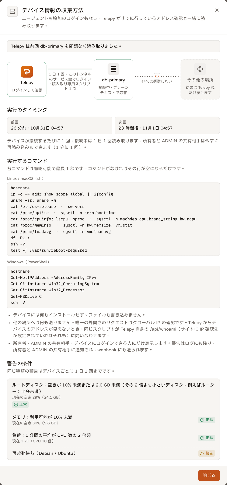

### トンネルの削除

トンネルのメニュー → **トンネルを削除。** 何かが起きる前に、ダイアログがそのトンネルに誰が到達できるか、デバイス上に何があるか
（トンネルのサービス、アカウントごとに Telepy が入れたキー、サービスキー）を図にし、それぞれの選択でどうなるかを示します。

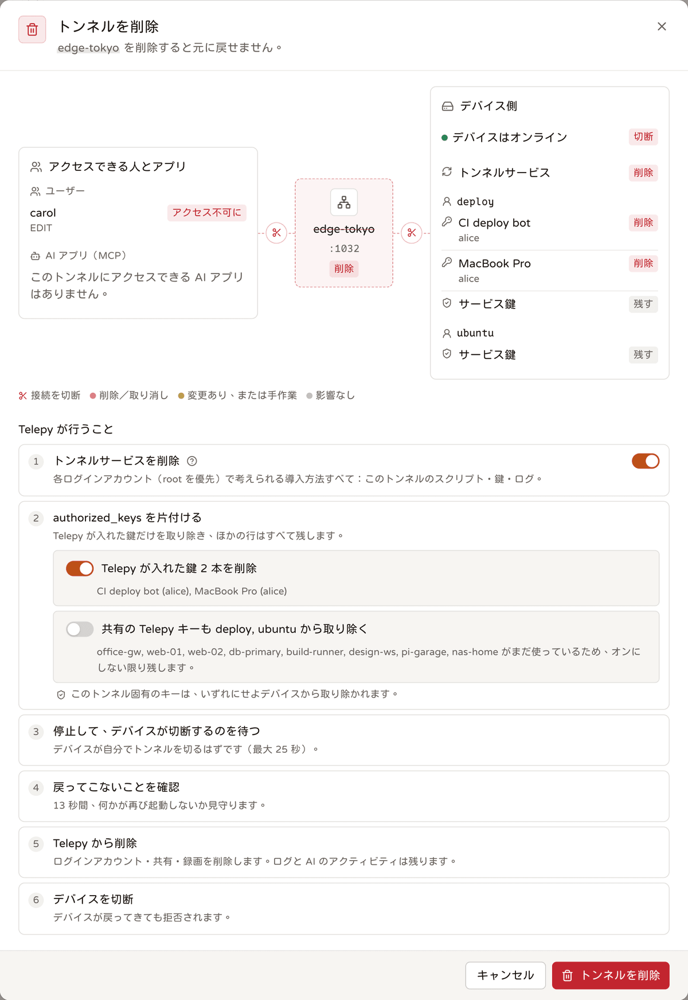

その後は 1 ステップずつライブで進みます。トンネルがつながっているうちにデバイスをクリーンアップし、デバイスが自分で切れるのを待って
そのまま戻ってこないことを確かめてから、最後にトンネルを削除します。

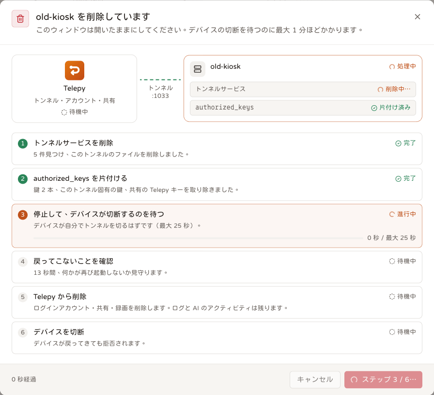

## デバイス上での作業

### ターミナル

**ターミナルページ → しくみ**（ヘッダー）。あなたのブラウザ ─ Telepy ─ デバイスのシェル。各区間の往復時間と、
接続に失敗したときにどこで止まったかが分かります。詳細：[バックエンドがデバイスに届くしくみ](./device-connections.ja.md)、
[レイテンシ詳解](./latency-deep-dive.ja.md)。

### 接続が切れても残るシェル

**環境設定 → ターミナル → しくみ**（切断後にシェルを残す設定の隣）。接続中 ─ 切断 ─ N 保持 ─ 再接続、または時間切れ。
そして保持時間をどの層が決めるか（あなたの設定、サイトの上限、トンネルのポリシー）。

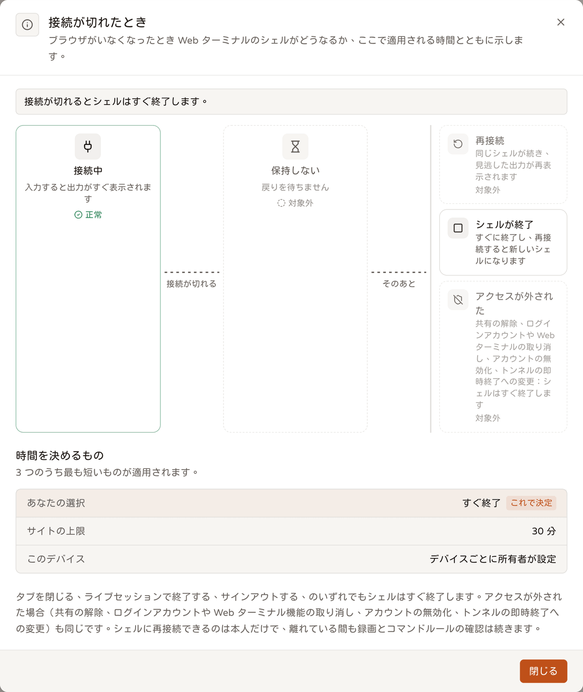

### ファイル

ファイルマネージャーの **ファイルのしくみ** ボタン。ファイルマネージャーでの操作はすべて、ターミナルと同じログインの上の
共有 SFTP チャネル 1 本を通ります。デバイスがオフラインのときや確認が足りないときに、どこで止まるかがダイアログに表示されます。

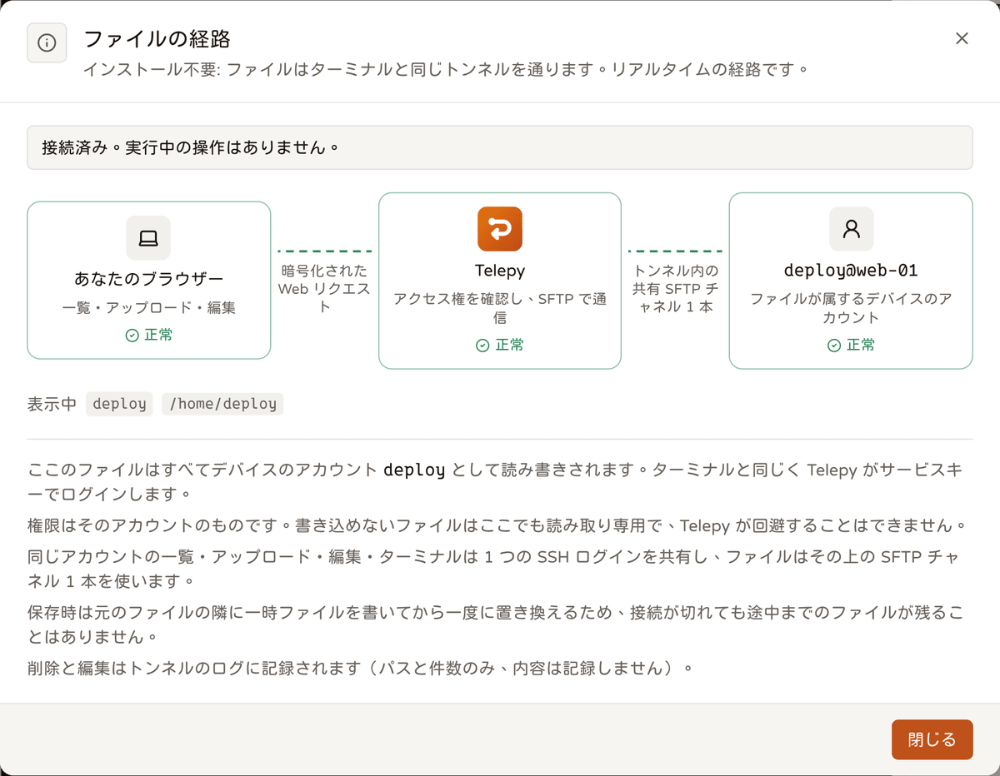

### ツールボックス

**ツールボックス → ツールボックスのしくみ。** スニペットの変数はブラウザで埋められ、シェルに 1 行ずつ入力されます。
そのため、コマンドルールは自分で打ったときとまったく同じように、すべての行を見ることになります。

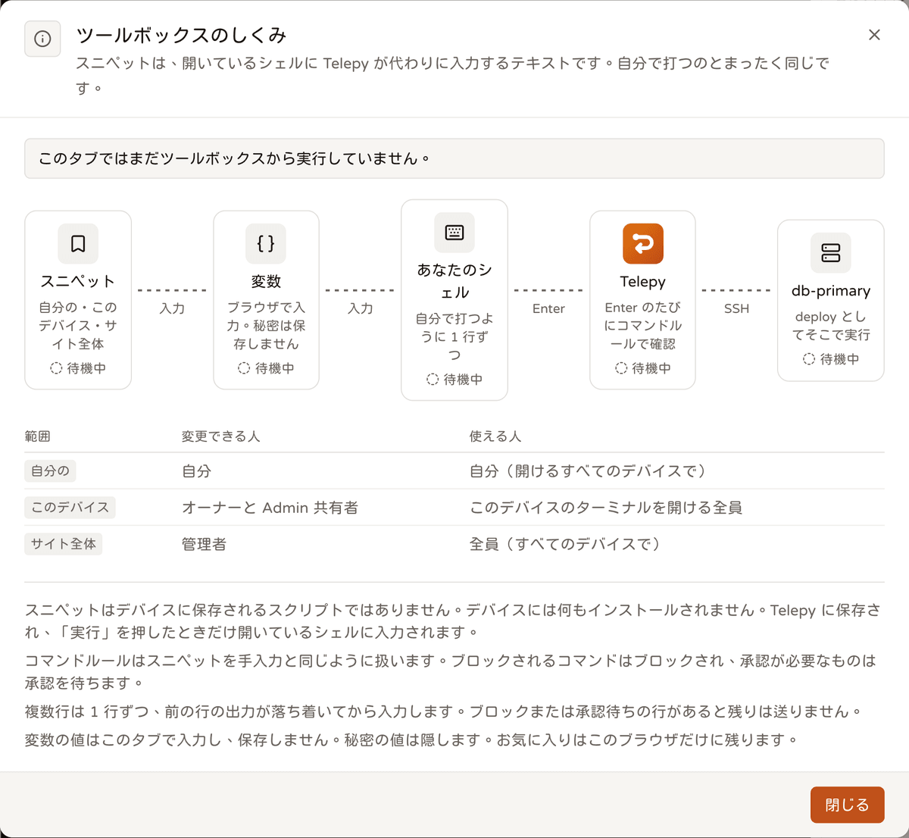

### リモートデスクトップ

接続中の **リモートデスクトップ → しくみ**：ブラウザ ─ Telepy ─ デバイス ─ デスクトップと各区間の往復時間。その下には、
接続上を流れるもの（画面、入力、クリップボード、サウンド、ファイル）が、それぞれの状態と理由とともに並びます。
詳細：[リモートデスクトップ](./remote-desktop.ja.md)。

**リモートデスクトップ → 接続方法の比較** は、guacd 経由の RDP / VNC と、ブラウザ内でデコードする RustDesk を並べて比べます。
画面をどこで描くか、各層が何を暗号化するか、どう選ぶか。

### リモートブラウザ

**リモートブラウザ → ブラウザを起動。** 起動すると 3 つのステップ（デバイス経由のプロキシ、Telepy のブラウザコンテナ内の新しい Chromium、
このタブに映る画面）が表示され、その後ブラウザが現れます。通信はデバイスから出ていきます。
詳細：[リモートブラウザ](./remote-browser.ja.md)。

## 共有とコントロール

### デバイス上のログインアカウント

トンネルのメニュー → **ターゲットサーバーユーザー → これらのアカウントの役割。** Telepy のユーザー ─ 許可リスト ─ OS アカウント ─
デバイスの sshd。デバイスは Telepy のユーザーを区別できないので、許可リストが境界線になります。

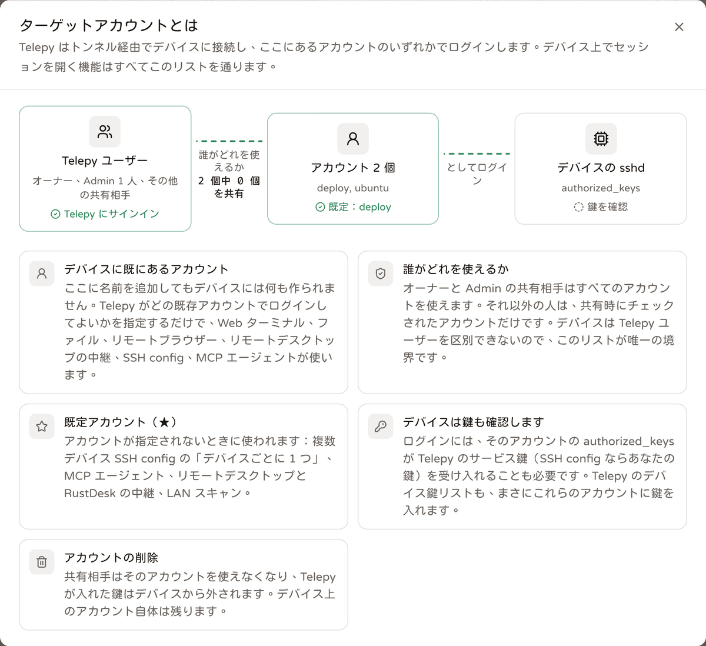

### 機能の権限

**管理 → ユーザーとアクセス → 機能の権限 → 仕組み。** 互いに独立した 2 つの関門：その人がどのツールを使えるか
（デフォルト → 全員 → ユーザーグループ → 本人、最後の本人が優先）と、どのトンネルに届くか（共有）。

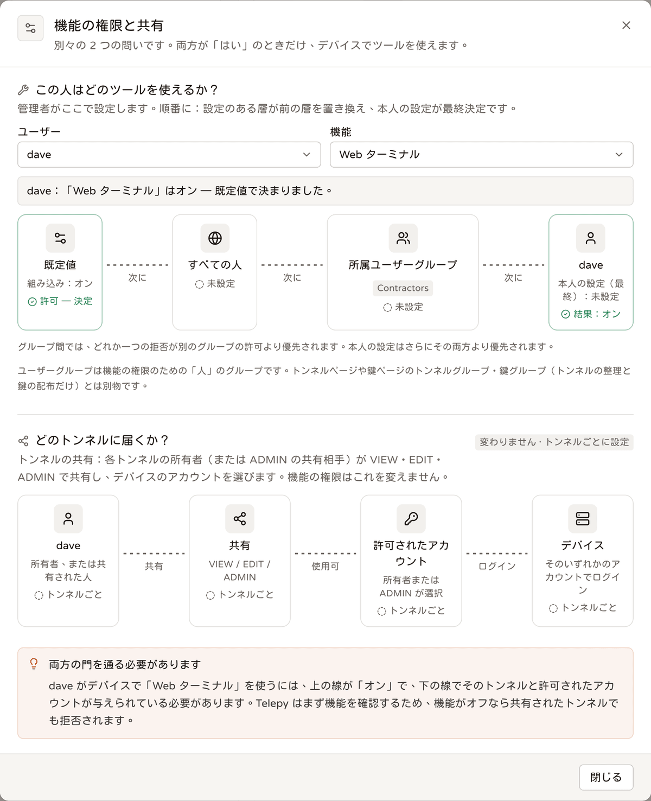

### コマンドの判定のしくみ

**コマンドルール → コマンドの判定のしくみ。** コマンドは分解され（sudo、`sh -c`、パイプの中も見ます）、そのトンネルで有効な
サイト全体のルールと個人のルールに照らされ、実行／リマインド／承認／ブロックのいずれかで終わります。
最後に試したコマンドの経路が点灯します。詳細：[MCP](./mcp.ja.md#コマンドルールssh_exec)。

### ターミナルの観覧

**ライブセッション → 観覧のしくみ。** 相手のブラウザ ─ Telepy ─ デバイス、そしてあなたのブラウザは Telepy から枝分かれします。
相手の画面が見え、相手にはそれが通知され、キーボードを渡してもらってはじめて入力できます。

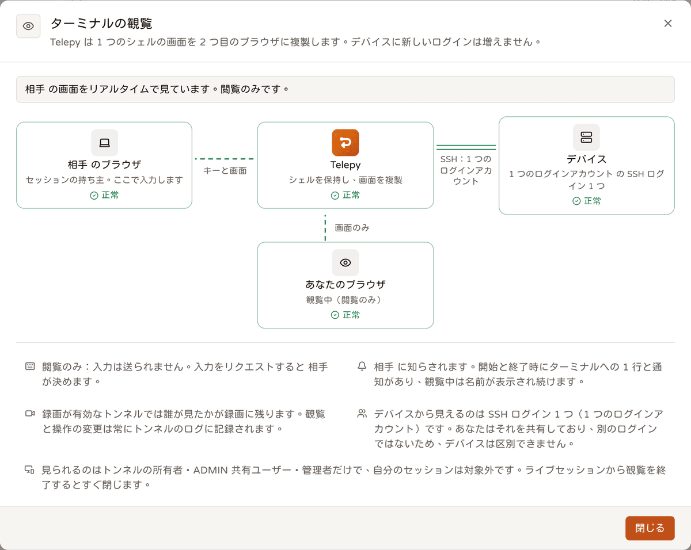

## キーと SSH 設定

### デバイスのキーリスト

**キー → 仕組み。** あなたのキー → デバイスのキーリスト → そこで使えて（かつ選んだ）アカウント → 各アカウントの
`authorized_keys`。Telepy が削除するのは自分が追加したキーだけで、アクセス権を失うとそのキーも外されます。

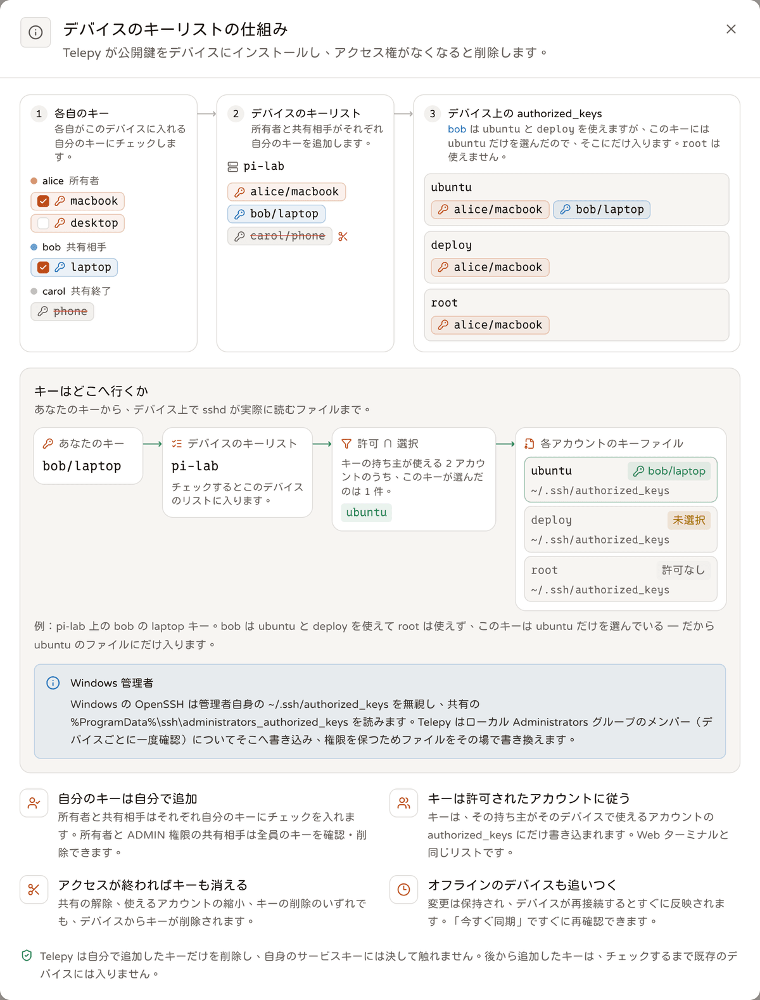

**キー → キーグループ → キーグループの仕組み。** キーをひとまとめにしたグループを、デバイスまたはトンネルグループに一度付与すれば、
キーやトンネルを追加しても同期が保たれます。

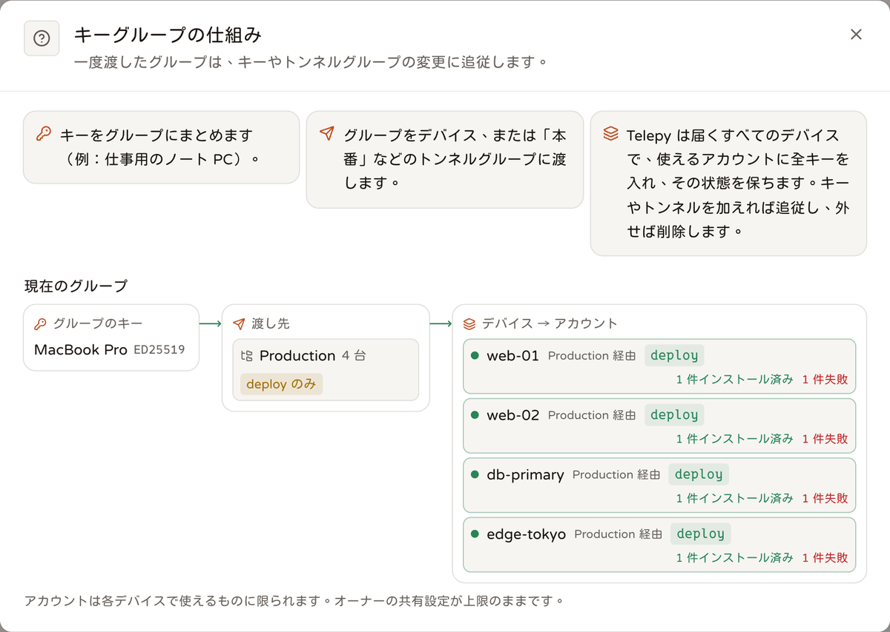

### お使いのコンピューター用の SSH 設定

トンネルのメニュー → **SSH 設定。** あなたのコンピューター ─ ssh ─ Telepy ═ トンネル ═ デバイス：生成された `Host` エントリが
何をするか、キーがどう入るか、そして `ssh <alias>`。

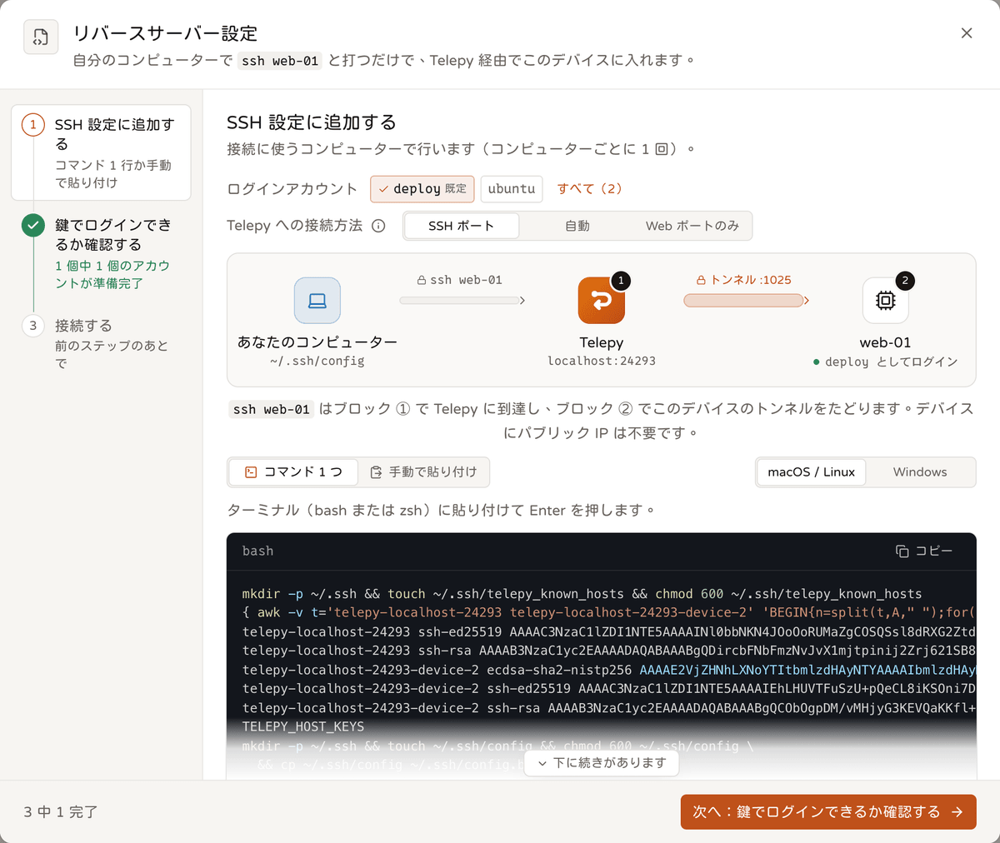

**SSH 設定 → それぞれの方法について**（「Telepy への接続方法」の隣）：あなたのコンピューターは、デバイスの接続方法とは別に、
SSH ポートまたは Web ポートのどちらかで Telepy に届きます。詳細：[バックエンドがデバイスに届くしくみ](./device-connections.ja.md)。

### SSH config エディター

**SSH config エディター → しくみ。** 名前を選ぶと、簡略化の前と後で ssh がそのファイルをどう読むかを追えます。
最初の値が優先されること、どのオプションが積み重なるか、ワイルドカードが何に一致するか。`telepy config tidy` はターミナルで同じことを行います
（[CLI](./cli.ja.md)）。

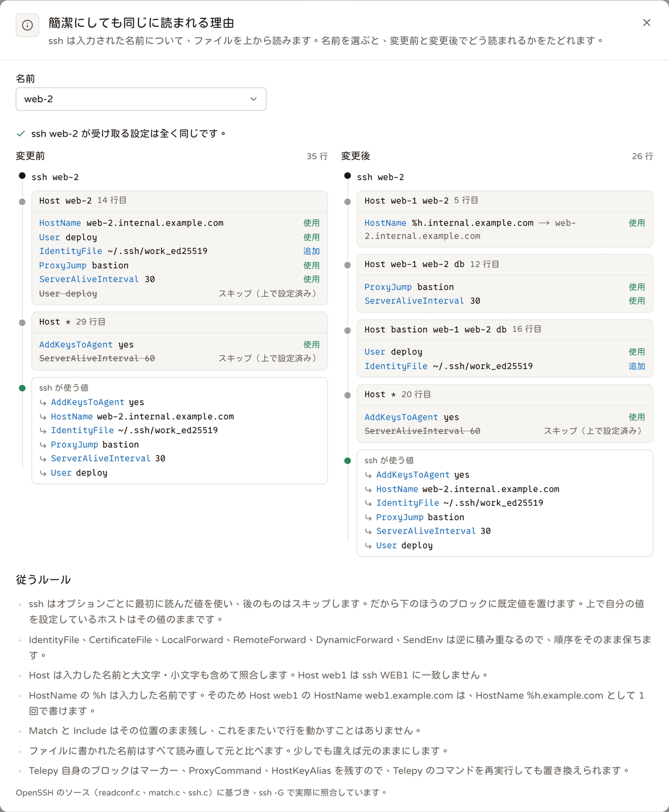

## 通知

### アプリ内通知とデスクトップ通知

**環境設定 → 通知 → 仕組み。** イベント ─ サイトのデフォルト ─ あなたのデフォルト ─ このトンネル ─ 結果：トーストやデスクトップ通知を
出すかどうかをどの層が決めるか、管理者がどこで強制したか。

### サイト全体の webhook からトンネルを外す

**Webhooks → サイト全体の Webhook → 対象外の仕組み。** webhook とトンネルを選ぶと、そのイベントが管理者のチャンネルに届くかどうか、
誰が対象外にしたかが分かります。詳細：[Webhooks](./webhooks.ja.md)。

## 自動化

### 4 つの入り口

**API → 4 つの入り口。** Web サインイン、API トークン、CLI サインイン、MCP アプリは、Telepy への 4 つの独立した経路です。
「もし…したら」では、1 つを取り消しても切れるのはその経路だけだと分かります。詳細：[CLI と API トークン](./cli.ja.md)。

### `telepy` コマンドライン

**CLI → しくみ。** ほとんどのコマンドはあなたのサインインを使って HTTPS で通信します。`ssh` / `scp` / `sftp` は、
システムの OpenSSH があなたの個人キーでゲートウェイを通ります。

### MCP アプリ

**MCP → アプリはどこまで届く？** アプリ ─ Telepy ─ デバイス ─ LAN／インターネット。接続中のアプリのスコープに応じて点灯します。
詳細：[MCP](./mcp.ja.md)。

## サインイン

### サインインを保つしくみ

**環境設定 → セキュリティ → サインイン状態の仕組み。** サインインは Telepy を使っている間は自動で更新され、
しばらく使わないと終了します。ほかの場所でサインアウトすると、そのブラウザはすぐに切断されます。

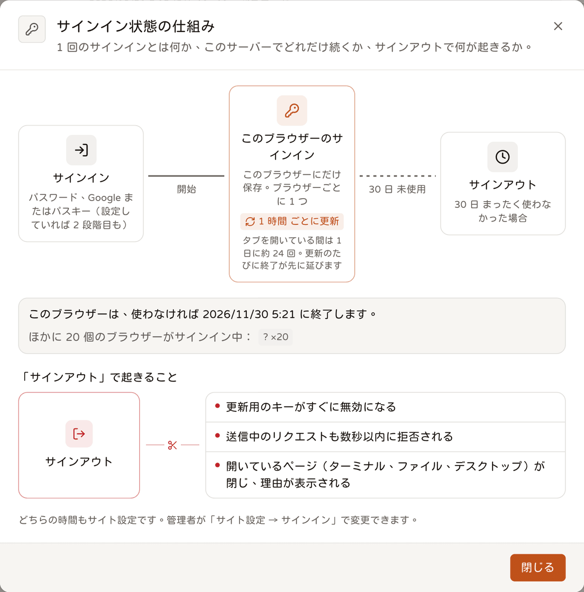

### 控えめなサインインページ

**サイト設定 → サインイン → サインインページの表示 → 控えめ**：「Telepy」の文字、動く背景、そして入力した行だけを表示します。
存在を知らせたくないサーバー向けです。

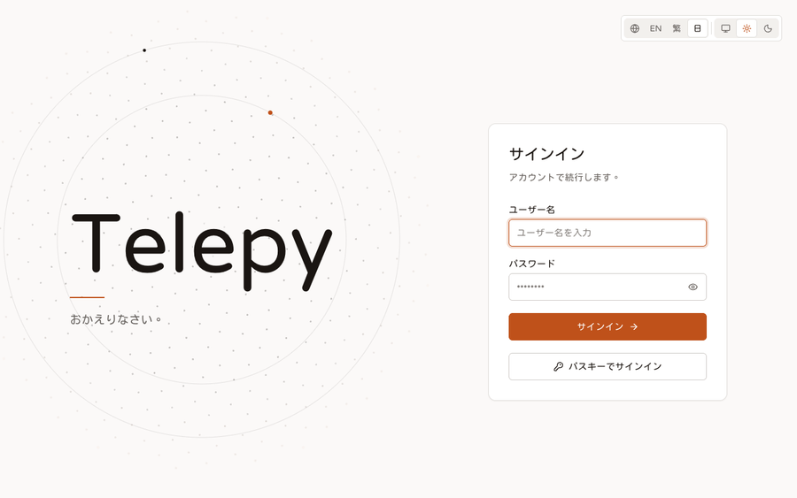

## サーバーの運用

### サーバーの状態

**管理 → サーバーの状態 → しくみ。** 訪問者 ─ プロキシ ─ Telepy バックエンド ─ ディスク上のデータ。その脇に付随するサービスが並びます。
各部分はそのチェックで点灯し、「いま」には最初に対応が必要なものが示されます。

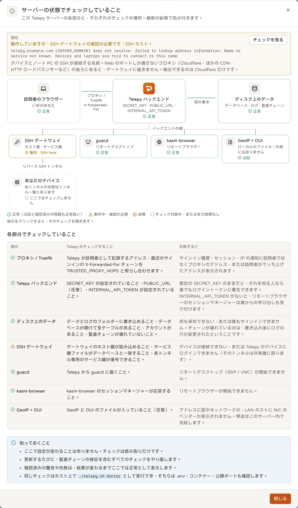

**サーバーの状態 → 訪問者のアドレス → Telepy から見たあなたのアドレス** は、あなた自身のリクエストの X-Forwarded-For の連鎖をホップごとにたどり、
プロキシが本当のアドレスを隠しているときに何を直すべきかを教えてくれます。

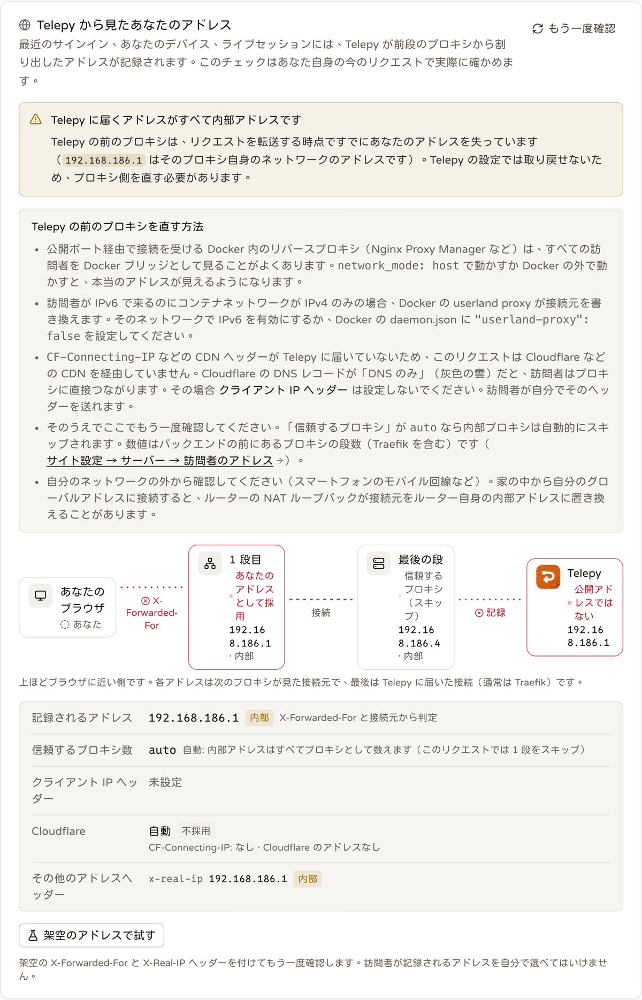

### `.env` とサイト設定

**サイト設定 → サーバー → .env とこのページの関係。** `.env` からも指定できる各設定について：
`.env` が優先されてフィールドがロックされ、なければ保存した設定、それもなければ組み込みのデフォルトが使われます。

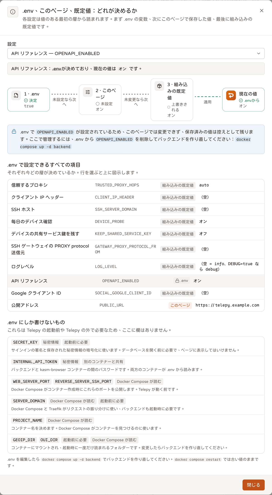

**サイト設定 → サーバー → SSH ホスト → なぜ名前が 2 つ？** Web の名前が Web のトラフィックしか通さないプロキシを経由しているとき、
SSH にはサーバーを直接指す専用の名前が必要になります。

