# Telepy in pictures

<b>English</b> | <a href="./visual-guide.zh-TW.md">繁體中文</a> | <a href="./visual-guide.ja.md">日本語</a>

Most pages in Telepy have an info button. It opens a diagram of what is going on: which path a connection takes, which layer made a decision, where something stopped.

This page collects those diagrams, plus a few screen recordings, so you can see how the parts fit together before you open the app. Each picture says where its button lives and links to the document with the details.

The pictures come from a demo server full of made-up devices ([how the screenshots are made](./screenshots/README.md)). In the app the diagrams are live and show your own devices, accounts and settings.

**Contents:** [Adding and removing devices](#adding-and-removing-devices) · [Working on a device](#working-on-a-device) · [Sharing and control](#sharing-and-control) · [Keys and SSH configs](#keys-and-ssh-configs) · [Notifications](#notifications) · [Automation](#automation) · [Signing in](#signing-in) · [Running the server](#running-the-server)

## Adding and removing devices

### Why a reverse tunnel

Find it: **Tunnels → Create Tunnel**, the diagram at the top.

It plays a short story in three parts. The device sits in a private network whose router drops every connection from outside. So the device dials out to Telepy, and you come in through the line it opened.

No port is opened on the router, so the network stays as isolated as it was, and whoever looks after that router can keep sleeping. Only people you allow in Telepy get through.

### One command, followed live

Find it: **Create Tunnel → One command → Create the command**.

Paste the line on the device and the page lights up each step of the script as it happens: what the device has, host keys, the gateway check, registration, authorizing Telepy, the service. It is done once Telepy has logged in through the tunnel. The whole script is explained in [One-command device join](./device-join.md).

### Device facts

Find it: a tunnel's menu → **Details & description → Device → How these are collected**.

Once a day Telepy logs in to each connected device with a read-only script and reads the OS, uptime, memory, disk, load and whether a reboot is pending. The dialog shows the path, the last and next run, the exact commands, and the thresholds behind each warning.

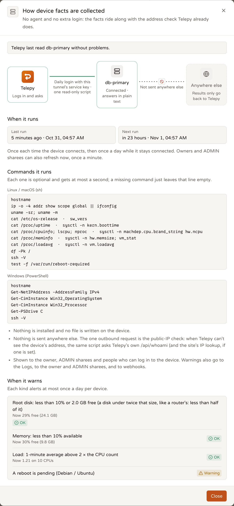

### Deleting a tunnel

Find it: a tunnel's menu → **Delete tunnel**.

Before anything happens, the dialog maps who reaches the tunnel and what sits on the device: the tunnel service, the keys Telepy installed for each account, and the service key. Each choice shows its outcome right on the map.

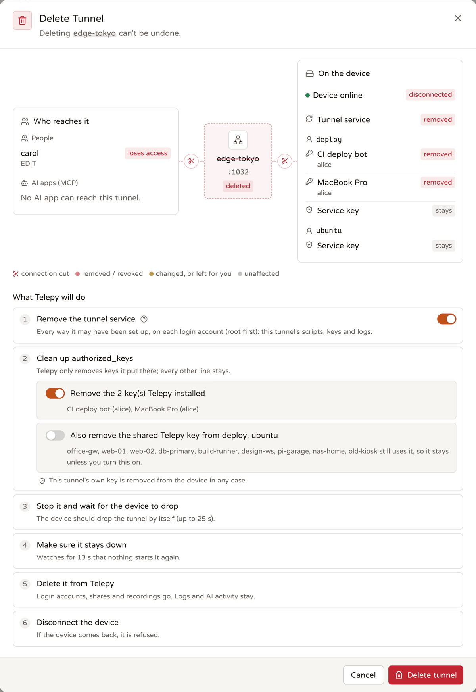

Then it runs step by step, live. Telepy cleans the device while the tunnel is still up, waits for the device to drop by itself, makes sure it stays down (the tunnel version of checking the stove twice), and only then deletes the tunnel.

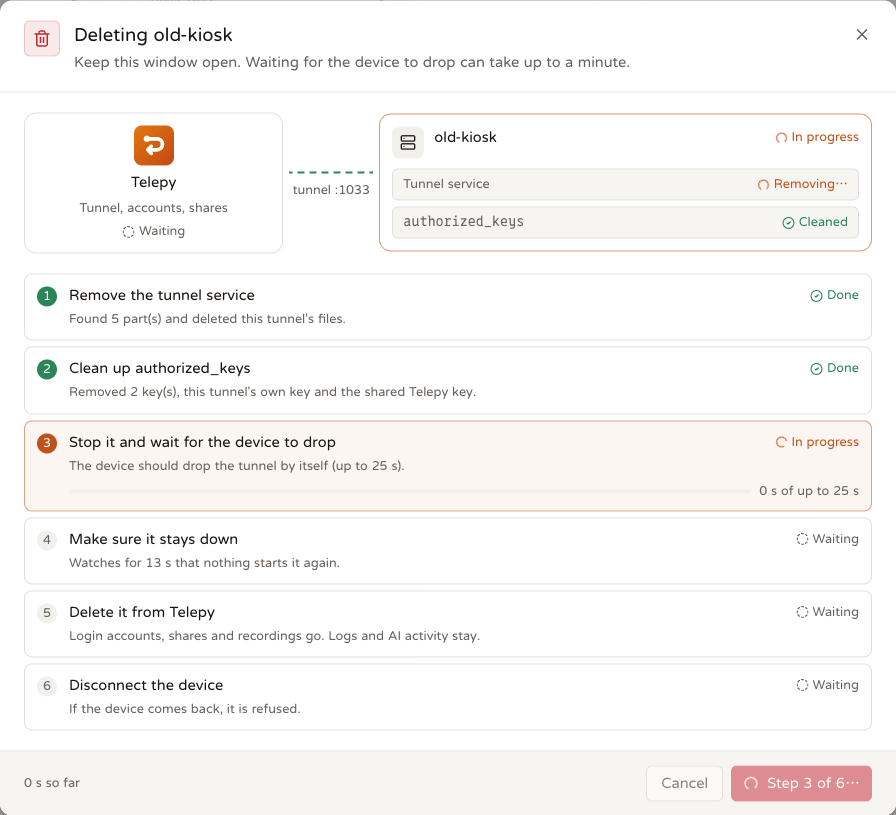

## Working on a device

### Terminal

Find it: **Terminal page → How it works**, in the header.

Your browser ─ Telepy ─ the device's shell, with the round trip of each hop. When a connection fails, the diagram shows where it stopped. Background reading: [How the backend reaches devices](./device-connections.md) and the [Latency deep dive](./latency-deep-dive.md).

### Shells that survive a dropped connection

Find it: **Preferences → Terminal → How it works**, next to the setting that keeps shells after a drop.

The timeline runs connected ─ drop ─ kept for N ─ reattach, or time's up. It also shows which layer decides how long: your setting, the site's ceiling or the tunnel's policy.

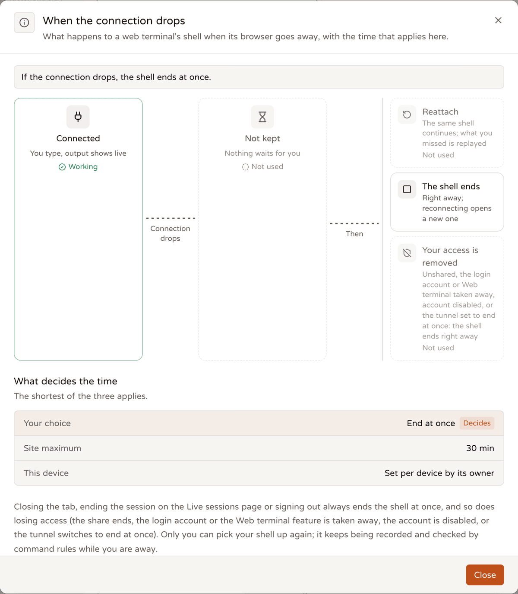

### Files

Find it: the file manager's **How files work here** button.

Everything you do in the file manager goes through one shared SFTP channel, on the same login as your terminal. The dialog also shows where things stop when the device is offline or Telepy is waiting for you to confirm it's you.

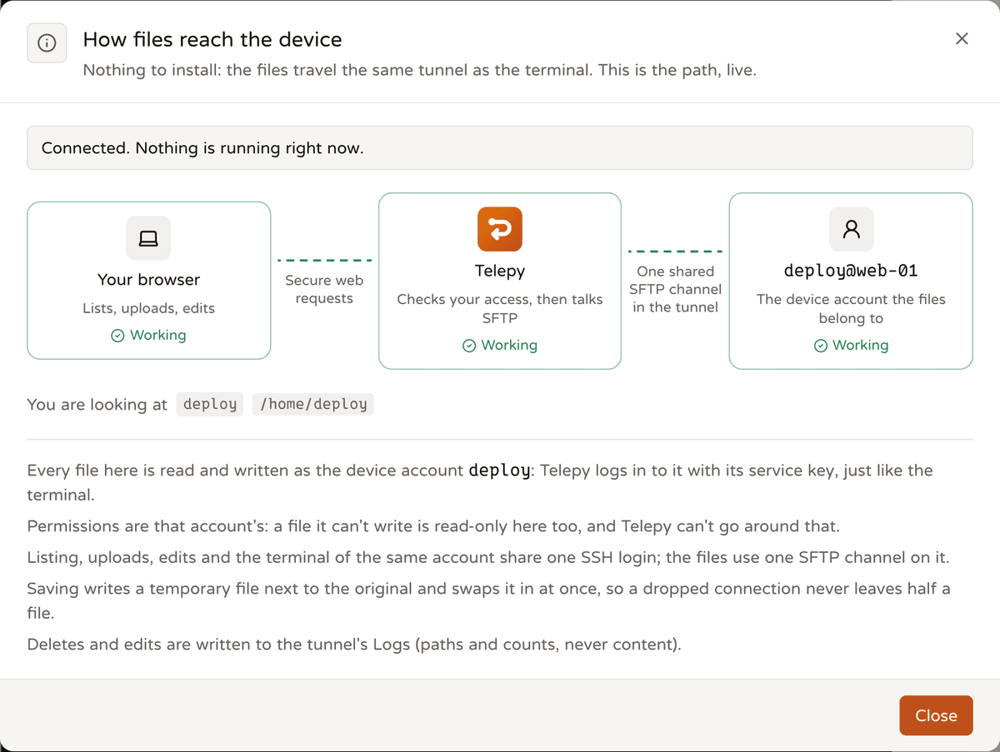

### Toolbox

Find it: **Toolbox → How the toolbox works**.

A snippet's variables are filled in your browser, then the snippet is typed into your shell line by line. So command rules see every line, exactly as if you had typed it yourself.

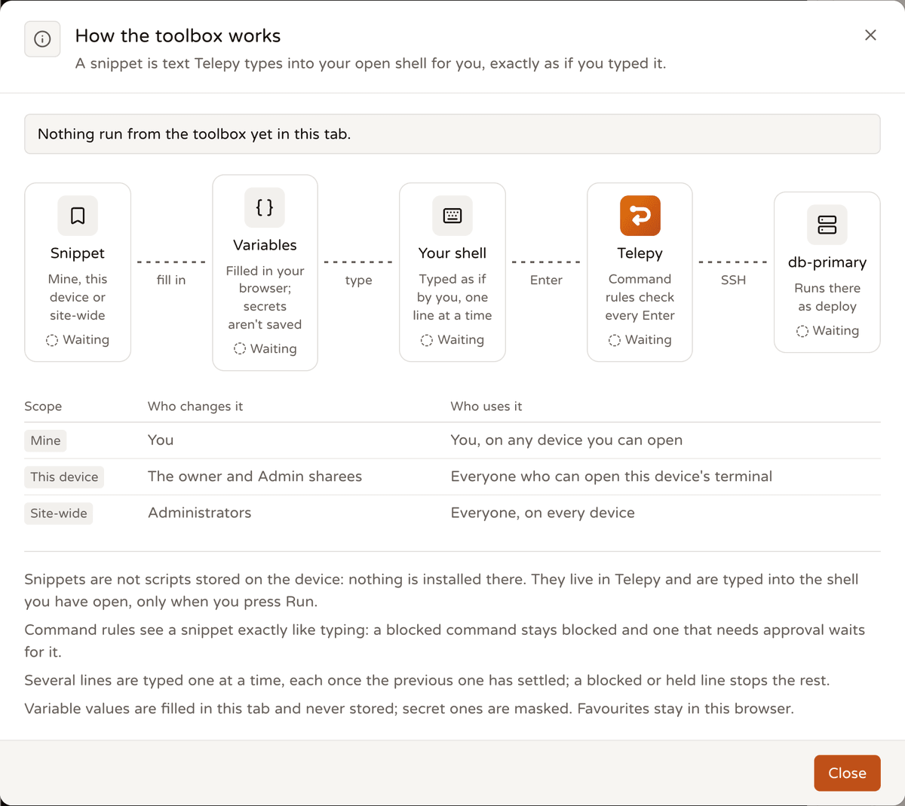

### Remote desktop

Find it: **Remote desktop → How it works**, while connected.

The top is the path: browser ─ Telepy ─ device ─ desktop, with round trips. Below it is everything that travels on the connection (picture, input, clipboard, sound, files), each with its state and the reason for it.

Find it: **Remote desktop → Ways to connect**.

This one puts RDP / VNC through guacd next to RustDesk decoded in the browser: where the picture is drawn, which layers encrypt what, and how to choose. All the details are in [Remote desktop](./remote-desktop.md).

### Remote browser

Find it: **Remote browser → Start Browser**.

Starting shows three steps: a proxy through the device, a fresh Chromium in Telepy's browser container, and the picture in this tab. Then the browser appears, and its traffic leaves through the device. More in [Remote browser](./remote-browser.md).

## Sharing and control

### Login accounts on a device

Find it: a tunnel's menu → **Target Server Users → What are these accounts for?**

The chain is Telepy users ─ the allow-list ─ OS accounts ─ the device's sshd. The device can't tell Telepy users apart, so the allow-list is the real boundary.

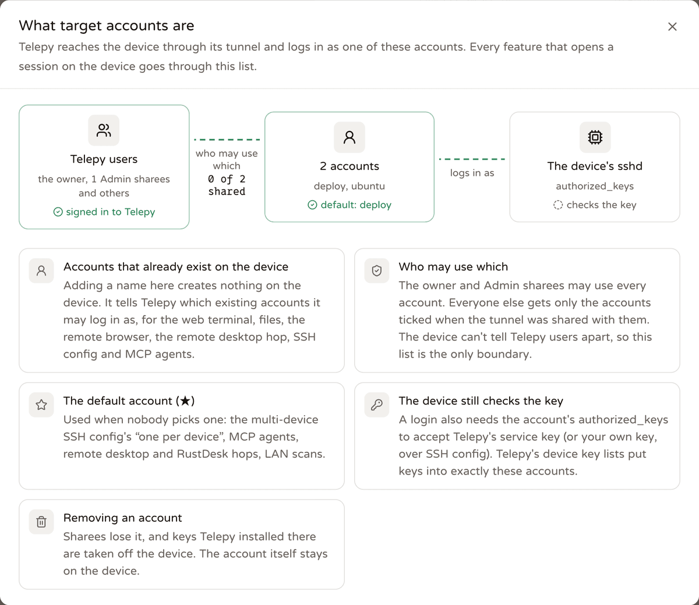

### Feature permissions

Find it: **Admin → Users & access → Feature permissions → How it works**.

There are two independent gates, and both apply. One decides which tools a person may use: default → everyone → user groups → the person, who has the last word. The other is sharing, which decides which tunnels they reach.

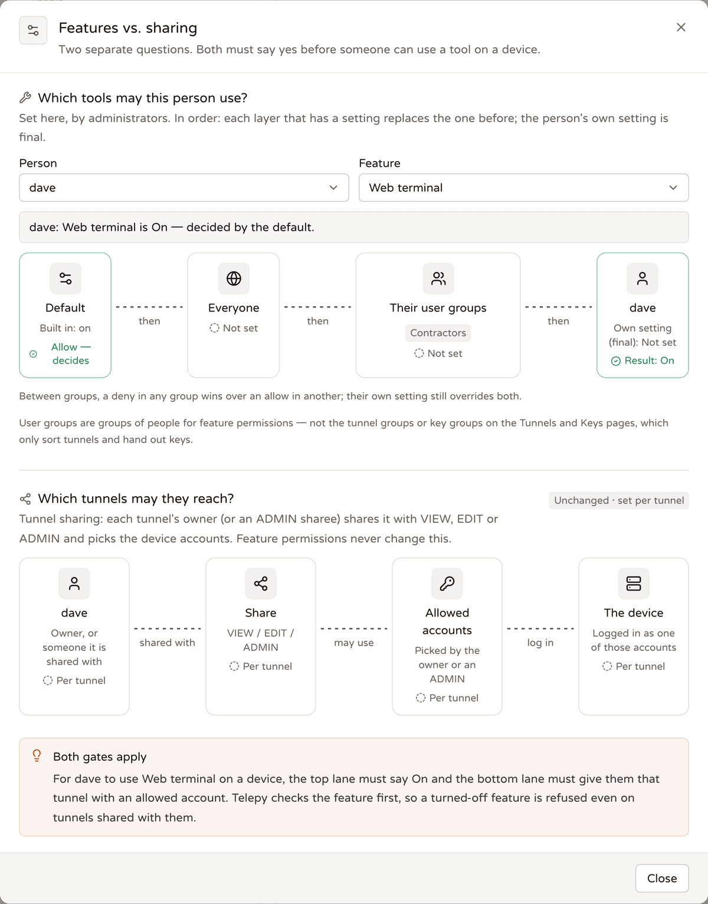

### How a command is decided

Find it: **Command rules → How a command is decided**.

A command is first split up, looking through sudo, `sh -c` and pipes. The pieces are checked against the site-wide and personal rules in force on the tunnel, and the verdict is run, remind, approve or block. The path of the last command you tried lights up. More in [Command rules in the MCP guide](./mcp.md#command-rules-ssh_exec).

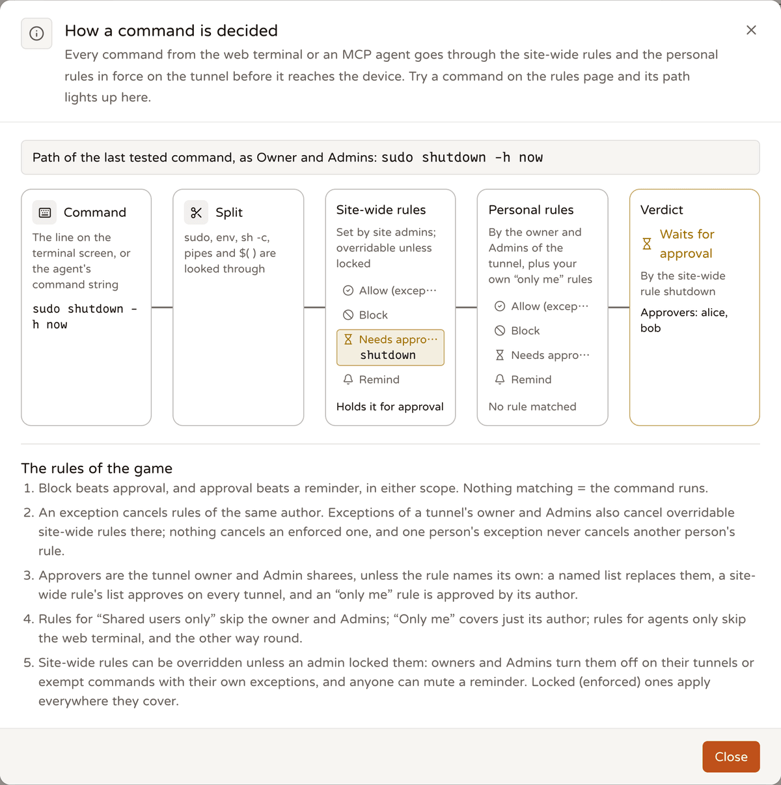

### Watching a terminal

Find it: **Live sessions → How watching works**.

Their browser ─ Telepy ─ device, with your browser branching off Telepy. You see their screen and they are told you are watching. You can type only once they hand you the keyboard.

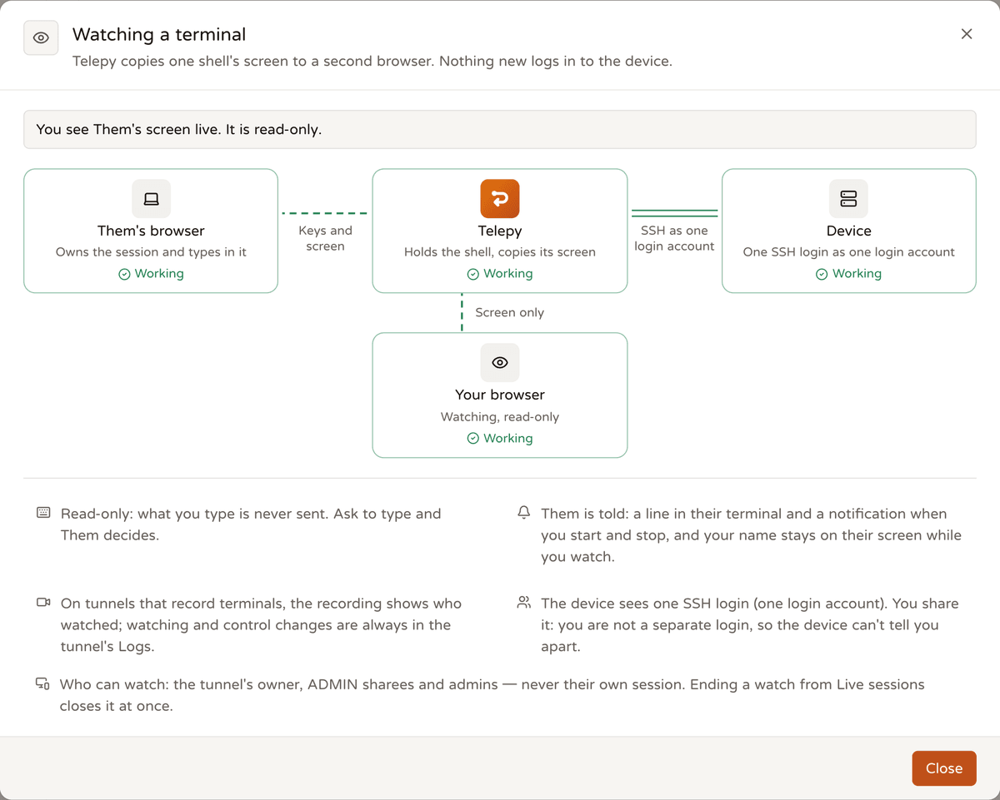

## Keys and SSH configs

### Device key lists

Find it: **Keys → How it works**.

Your key → the device's key list → the accounts you may use there (and picked) → each account's `authorized_keys`. Telepy only removes keys it added itself, and if you lose access, your keys come off again.

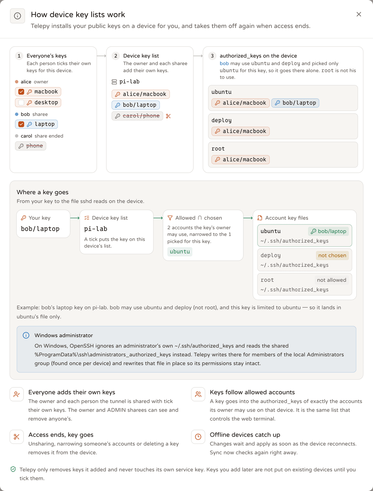

Find it: **Keys → Key groups → How key groups work**.

Give a group of keys once, to a device or to a tunnel group. It stays in step as you add keys or tunnels later.

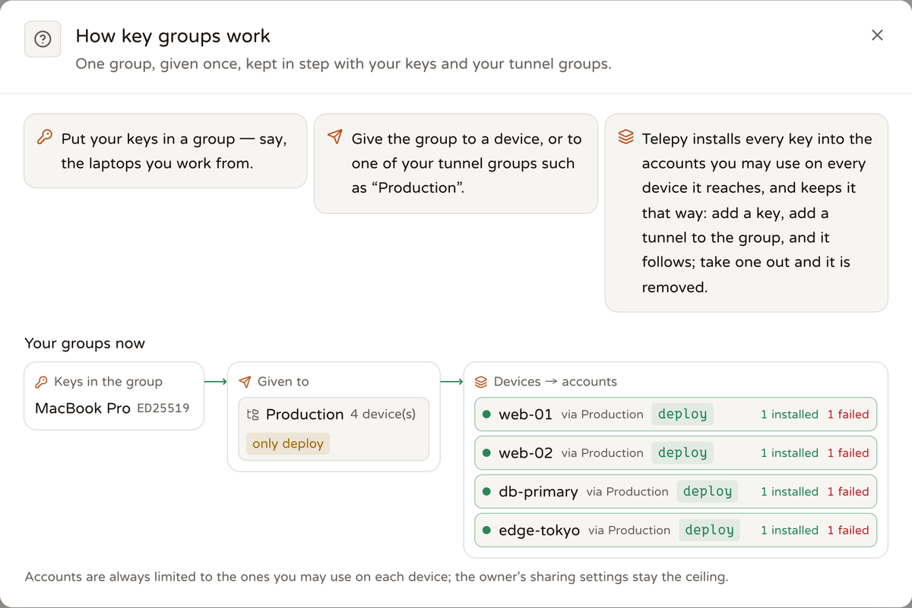

### SSH config for your computer

Find it: a tunnel's menu → **SSH config**.

Your computer ─ ssh ─ Telepy ═ tunnel ═ device. The dialog explains what the generated `Host` entry does and how your key gets in. After that it's just `ssh <alias>`.

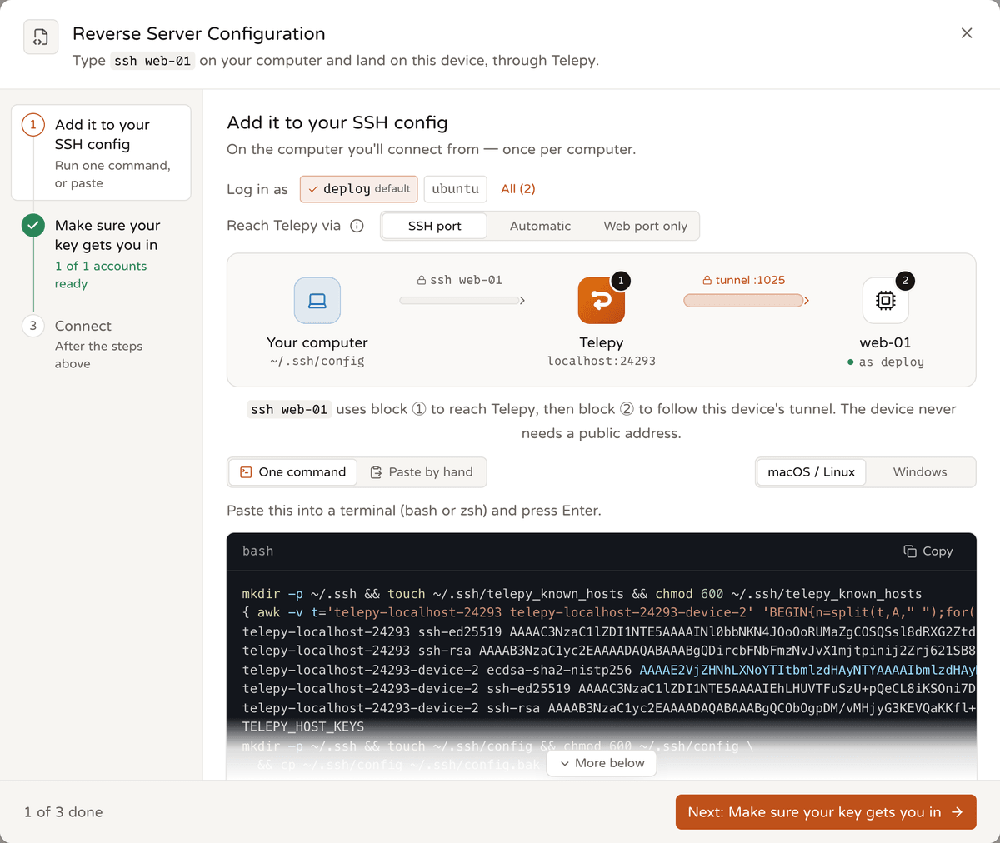

Find it: **SSH config → About these ways**, next to "Reach Telepy via".

Your computer reaches Telepy either on the SSH port or through the web port. That choice is separate from how the device dials in. More in [How the backend reaches devices](./device-connections.md).

### SSH config editor

Find it: **SSH config editor → How it works**.

Pick a name and follow how ssh reads the file for it, before and after the simplification: the first value wins, some options add up, and you see what each wildcard matches. In a terminal, `telepy config tidy` does the same ([CLI](./cli.md)).

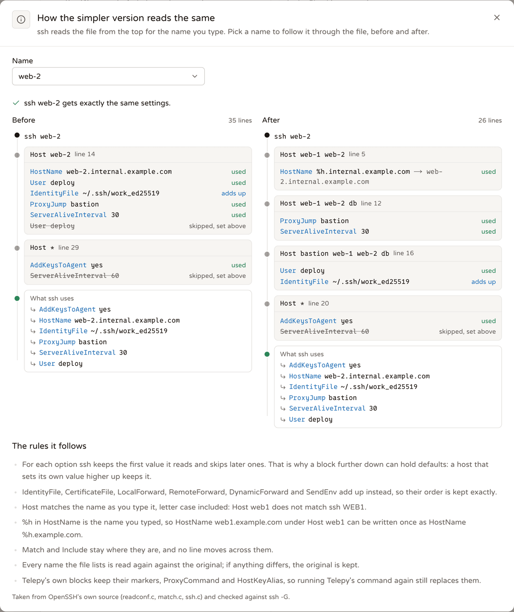

## Notifications

### In-app and desktop notifications

Find it: **Preferences → Notifications → How it works**.

Event ─ site default ─ your default ─ this tunnel ─ result. It shows which layer decides whether a toast or desktop notification appears, and where an admin has enforced it.

### Opting a tunnel out of a site-wide webhook

Find it: **Webhooks → Site-wide webhooks → How opt-outs work**.

Pick a webhook and a tunnel to see whether that tunnel's events reach the admins' channel, and who opted it out. More in [Webhooks](./webhooks.md).

## Automation

### Four ways in

Find it: **API → Four ways in**.

Web sign-in, API token, CLI sign-in and MCP app are four separate lanes into Telepy. Flip "What if I…" and you'll see that revoking one cuts only its own lane. More in [CLI and API tokens](./cli.md).

### The `telepy` command line

Find it: **CLI → How it works**.

Most commands go over HTTPS with your sign-in. `ssh`, `scp` and `sftp` are different: they use your system's OpenSSH with your personal key, through the gateway.

### MCP apps

Find it: **MCP → What can an app reach?**

App ─ Telepy ─ device ─ LAN / internet, lit up by the scopes of a connected app. More in [MCP](./mcp.md).

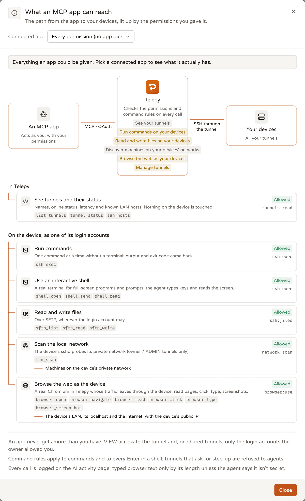

## Signing in

### Staying signed in

Find it: **Preferences → Security → How staying signed in works**.

A sign-in renews itself while you use Telepy and ends after a stretch of not using it. Signing a browser out from somewhere else cuts it off at once.

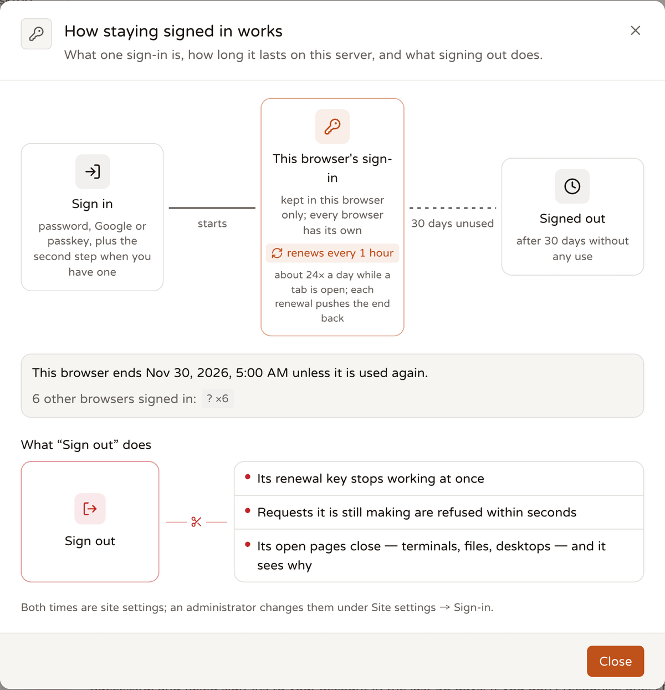

### The discreet sign-in page

Find it: **Site settings → Sign-in → Sign-in page look → Discreet**.

Only the word "Telepy", a moving background and the lines you write, typed out one by one. Made for a server that would rather not introduce itself.

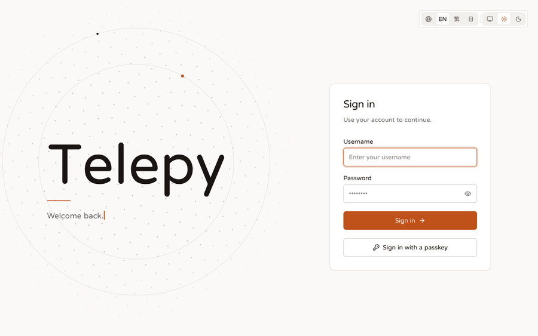

### The Tapi sign-in page

Find it: **Site settings → Sign-in → Sign-in page look → Tapi**, for any of the four pages.

Tapi keeps you company on every page, in a scene that fits the job. On the sign-in page it is a cup of bubble tea with pearls rising. On the app connection page, paper planes bring the app's request and Tapi holds the letter. The CLI pages are a terminal, prompt line included. The approval page is a counter on grid paper, where Tapi wears sunglasses and stamps your approval.

Tapi reacts as you go. It watches you type your username, turns around while you type the password, and is visibly startled if you show the password anyway. At the counter it warns you when you tick a permission that can change things on your devices. Approve and a big OK stamp lands; deny and it waves the app goodbye. Click the background for a small surprise; poke Tapi and it giggles.

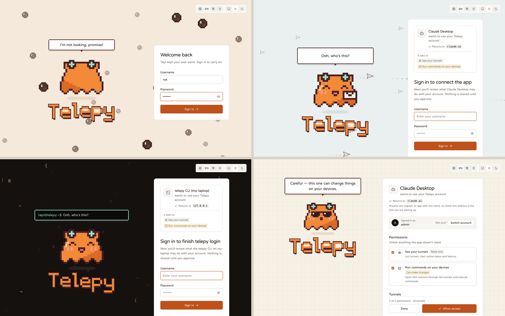

## Running the server

### Server health

Find it: **Admin → Server health → How it works**.

Visitor ─ proxy ─ Telepy backend ─ data on disk, with the companion services alongside. Each part is lit by its checks, and "Right now" names the first one that needs attention.

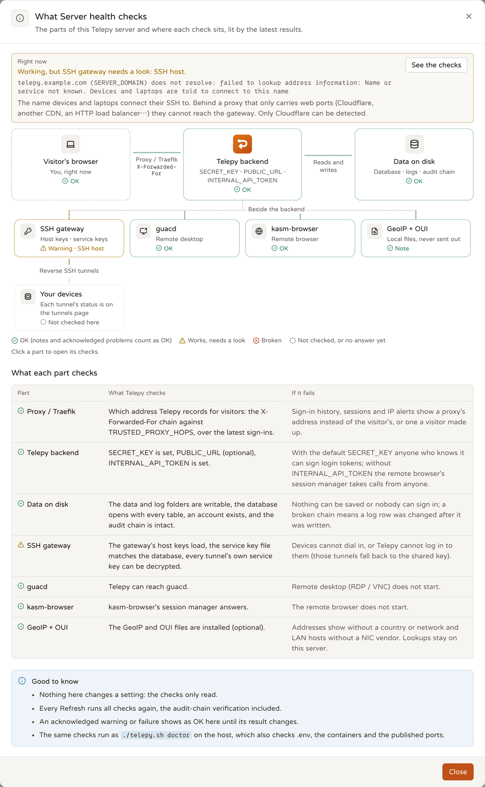

Find it: **Server health → Visitor addresses → How Telepy sees your address**.

It walks the X-Forwarded-For chain of your own request, hop by hop. When proxies hide the real address, it tells you what to fix.

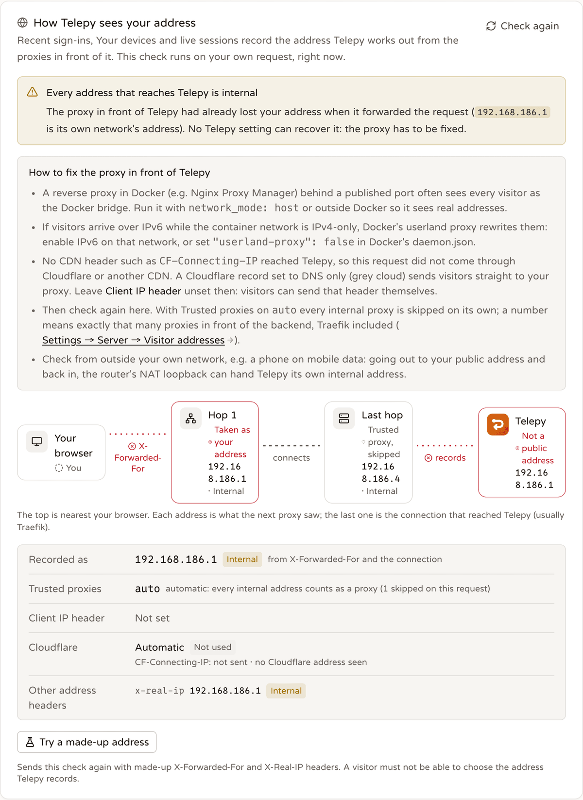

### `.env` and Site settings

Find it: **Site settings → Server → How .env and this page combine**.

For every setting that can also come from `.env`: `.env` wins and locks the field; otherwise the saved setting applies; otherwise the built-in default.

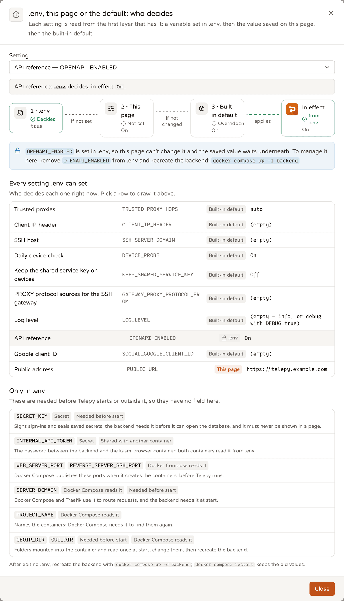

Find it: **Site settings → Server → SSH host → Why two names?**

When the web name goes through a proxy that only carries web traffic, SSH needs a name of its own that points straight at the server.

