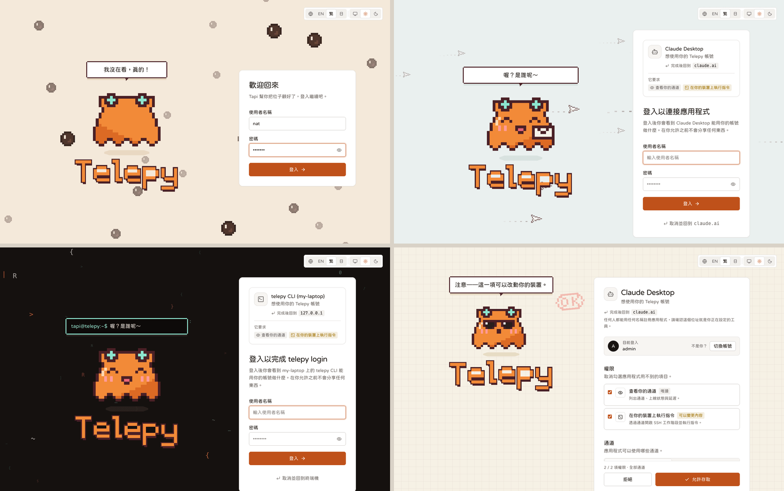

# 圖解 Telepy

<a href="./visual-guide.md">English</a> | <b>繁體中文</b> | <a href="./visual-guide.ja.md">日本語</a>

Telepy 大部分的頁面都有一顆資訊按鈕，按下去會打開一張圖，畫出當下正在發生的事：連線走哪條路、哪一層做了決定、事情卡在哪裡。

這一頁把這些圖和幾段螢幕錄影收在一起，讓你還沒打開 Telepy，就能先看懂各個部分怎麼搭在一起。每張圖都會寫出按鈕在哪裡，並連到有完整說明的文件。

圖片來自一台放滿虛構裝置的示範伺服器（[截圖是怎麼做的](./screenshots/README.zh-TW.md)）。在 Telepy 裡，這些圖都是即時的，畫的是你自己的裝置、帳號和設定。

**目錄**：[新增與移除裝置](#新增與移除裝置) · [在裝置上工作](#在裝置上工作) · [分享與控管](#分享與控管) · [金鑰與 SSH 設定](#金鑰與-ssh-設定) · [通知](#通知) · [自動化](#自動化) · [登入](#登入) · [維運伺服器](#維運伺服器)

## 新增與移除裝置

### 為什麼用反向通道

位置：**通道 → 建立通道**，最上面那張圖。

這張圖分三段播放。裝置待在私有網路裡，路由器會擋掉所有從外面進來的連線；所以改由裝置主動撥出去連 Telepy，你再從裝置打開的那條線進去。

路由器一個連接埠都不用開，網路照樣隔離，顧路由器的人也能繼續安心睡覺。只有你在 Telepy 裡允許的人進得來。

### 一行指令，全程即時顯示

位置：**建立通道 → 一行指令 → 產生指令**。

把這行指令貼到裝置上執行，頁面會跟著腳本一步一步亮起來：裝置上有什麼、主機金鑰、閘道檢查、註冊、授權 Telepy、服務。等 Telepy 經由通道登入成功，才算完成。腳本的完整說明在[一行指令加入裝置](./device-join.zh-TW.md)。

### 裝置資訊

位置：通道選單 → **詳細資訊與說明 → 裝置 → 這些是怎麼來的**。

Telepy 每天會用一支唯讀腳本登入每台已連線的裝置，讀取作業系統、開機多久、記憶體、磁碟、負載，以及是否等著重開機。對話框會列出整條路徑、上次和下次執行的時間、實際跑的指令，還有每項警告背後的門檻。

### 刪除通道

位置：通道選單 → **刪除通道**。

在任何動作開始之前，對話框會先畫出誰連得到這條通道、裝置上有哪些東西：通道服務、Telepy 在各帳號裝的金鑰、服務金鑰。每個選項會帶來什麼結果，也都直接標在圖上。

接著一步一步即時執行。Telepy 先趁通道還連著把裝置清乾淨，再等裝置自己斷線，並確認它不會再連回來（就像出門前回頭確認瓦斯關了沒），最後才刪除通道。

## 在裝置上工作

### 終端機

位置：**終端機頁 → 怎麼運作**，在頁首。

你的瀏覽器 ─ Telepy ─ 裝置的 shell，標出每一段的來回時間。連線失敗時，圖上會指出停在哪裡。延伸閱讀：[後端如何連到裝置](./device-connections.zh-TW.md)、[延遲深入解析](./latency-deep-dive.zh-TW.md)。

### 斷線後仍保留的 shell

位置：**偏好設定 → 終端機 → 怎麼運作**，在斷線後保留 shell 的設定旁邊。

時間軸是這樣走的：已連線 ─ 斷線 ─ 保留 N ─ 重新接上，或是時間到。圖上也會標出保留多久由哪一層決定：你的選擇、站台上限，還是通道的政策。

### 檔案

位置：檔案管理員的 **檔案是怎麼傳的** 按鈕。

你在檔案管理員裡做的每件事，都走同一條共用的 SFTP channel，跟你的終端機用同一個登入。裝置離線，或 Telepy 還在等你確認是本人時，對話框也會畫出事情停在哪裡。

### 工具箱

位置：**工具箱 → 工具箱怎麼運作**。

片段裡的變數會先在你的瀏覽器裡填好，再一行一行打進你的 shell。所以指令規則看得到每一行，就跟你親手打的一模一樣。

### 遠端桌面

位置：連線中的 **遠端桌面 → 怎麼運作**。

上面是路徑：瀏覽器 ─ Telepy ─ 裝置 ─ 桌面，附上各段來回時間。下面列出連線上傳送的所有東西（畫面、輸入、剪貼簿、聲音、檔案），各自的狀態和原因。

位置：**遠端桌面 → 連線方式比較**。

這張圖把經由 guacd 的 RDP / VNC，和在瀏覽器裡解碼的 RustDesk 並排比較：畫面在哪裡畫出來、哪一層加密了什麼，以及該怎麼選。細節請看[遠端桌面](./remote-desktop.zh-TW.md)。

### 遠端瀏覽器

位置：**遠端瀏覽器 → 啟動瀏覽器**。

啟動時會看到三個步驟：經由裝置的代理、Telepy 瀏覽器容器裡一個全新的 Chromium、出現在這個分頁的畫面。接著瀏覽器才登場，它的流量從裝置那端出去。細節請看[遠端瀏覽器](./remote-browser.zh-TW.md)。

## 分享與控管

### 裝置上的登入帳號

位置：通道選單 → **目標主機使用者 → 這些帳號是做什麼的？**

這條鏈是 Telepy 使用者 ─ 允許清單 ─ 作業系統帳號 ─ 裝置的 sshd。裝置分不出誰是哪個 Telepy 使用者，所以允許清單才是真正的界線。

### 功能權限

位置：**管理 → 使用者與權限 → 功能權限 → 怎麼運作**。

這裡有兩道互相獨立的關卡，兩道都要過。一道決定一個人能用哪些工具：預設 → 所有人 → 使用者群組 → 本人，本人說了算。另一道是分享，決定他連得到哪些通道。

### 指令是怎麼決定的

位置：**指令規則 → 指令是怎麼決定的**。

指令會先被拆開，sudo、`sh -c`、管線都會看穿。拆出來的每一段再拿去對照這條通道上生效的全站規則與個人規則，最後判定為執行、提醒、需要核准或擋下。你最近試過的那個指令，走過的路徑會亮起來。細節請看 [MCP 文件裡的指令規則](./mcp.zh-TW.md#指令規則ssh_exec)。

### 觀看終端機

位置：**即時連線 → 觀看怎麼運作**。

對方的瀏覽器 ─ Telepy ─ 裝置，你的瀏覽器則從 Telepy 分出去。你看得到對方的畫面，對方也會知道你在看；要等對方把鍵盤交給你，你才能打字。

## 金鑰與 SSH 設定

### 裝置金鑰清單

位置：**金鑰 → 運作方式**。

你的金鑰 → 裝置的金鑰清單 → 你在那台裝置上可用、而且有選的帳號 → 各帳號的 `authorized_keys`。Telepy 只會移除自己加上去的金鑰；你失去存取權時，你的金鑰也會被拿掉。

位置：**金鑰 → 金鑰群組 → 金鑰群組怎麼運作**。

把一組金鑰一次授予某台裝置或某個通道群組，之後不管加了金鑰還是加了通道，都會自動跟上。

### 你電腦上的 SSH 設定

位置：通道選單 → **SSH 設定**。

你的電腦 ─ ssh ─ Telepy ═ 通道 ═ 裝置。對話框會說明產生出來的 `Host` 項目在做什麼、你的金鑰怎麼放進去，之後只要 `ssh <alias>` 就好。

位置：**SSH 設定 → 這幾種方式是什麼？**，在「連到 Telepy 的方式」旁邊。

你的電腦連到 Telepy，可以走 SSH 連接埠，也可以走網頁連接埠；這和裝置怎麼撥進來是兩回事。細節請看[後端如何連到裝置](./device-connections.zh-TW.md)。

### SSH config 編輯器

位置：**SSH config 編輯器 → 怎麼運作**。

選一個名稱，就能看 ssh 在簡化前後怎麼替它讀這個檔案：先出現的值優先、哪些選項會累加、萬用字元會比對到什麼。想在終端機裡做同樣的事，就用 `telepy config tidy`（見 [CLI](./cli.zh-TW.md)）。

## 通知

### 應用程式內與桌面通知

位置：**偏好設定 → 通知 → 怎麼運作**。

事件 ─ 網站預設 ─ 我的預設 ─ 這條通道 ─ 結果。圖上會標出是哪一層決定要不要跳出提示或桌面通知，以及管理員在哪裡強制了設定。

### 讓通道退出全站 webhook

位置：**Webhooks → 全站 Webhook → 退出怎麼運作**。

選一個 webhook 和一條通道，就看得到這條通道的事件會不會送到管理員的頻道，以及是誰讓它退出的。細節請看 [Webhooks](./webhooks.zh-TW.md)。

## 自動化

### 四種存取方式

位置：**API → 四種存取方式**。

網頁登入、API token、CLI 登入、MCP app，是進入 Telepy 的四條獨立路線。切換「如果我…」就會看到：撤銷其中一條，只會切斷它自己那條。細節請看 [CLI 與 API token](./cli.zh-TW.md)。

### `telepy` 命令列

位置：**CLI → 怎麼運作**。

大部分指令都用你的登入，透過 HTTPS 執行。`ssh`、`scp`、`sftp` 不一樣：它們用系統上的 OpenSSH，帶著你的個人金鑰經過閘道。

### MCP app

位置：**MCP → app 碰得到哪裡？**

app ─ Telepy ─ 裝置 ─ 區網／網際網路，依已連接 app 的權限範圍亮起來。細節請看 [MCP](./mcp.zh-TW.md)。

## 登入

### 保持登入

位置：**偏好設定 → 安全性 → 登入狀態是怎麼維持的**。

你在用 Telepy 的時候，登入會自己續期；一段時間沒用，就會結束。從別的地方把某個瀏覽器登出，它會立刻被切斷。

### 低調登入頁

位置：**網站設定 → 登入 → 登入頁的樣子 → 低調**。

畫面上只有「Telepy」這個字、會動的背景，和你寫的幾行字，一個字一個字打出來。專門給不太想自我介紹的伺服器。

### Tapi 版登入頁

位置：**網站設定 → 登入 → 登入頁的樣子 → Tapi 版**，四頁都能選。

Tapi 在每一頁陪著你，場景照那一頁做的事換。登入頁是一杯珍奶，粉圓往上浮；應用程式連接頁有紙飛機把應用程式的請求送進來，Tapi 拿著信；CLI 的頁面是一台終端機，對話框就是一行提示字元；授權頁是格子紙上的審核櫃台，Tapi 戴著墨鏡替你蓋章。

Tapi 會跟著你反應。打帳號時它盯著看，打密碼時它轉過身去，你硬要按「顯示密碼」它還會嚇一跳。到了櫃台，你勾了會改動裝置的權限，它會提醒一聲；按允許，一個大大的 OK 章就蓋下去；按拒絕，它就揮手送客。點背景有小驚喜，戳 Tapi 它會笑。

## 維運伺服器

### 伺服器狀態

位置：**管理 → 伺服器狀態 → 運作方式**。

訪客 ─ 代理 ─ Telepy 後端 ─ 磁碟上的資料，旁邊是配套服務。每個部分依它的檢查結果亮起來，「現在」會指出第一個需要處理的地方。

位置：**伺服器狀態 → 訪客位址 → Telepy 怎麼看你的位址**。

它會拿你自己這個請求的 X-Forwarded-For 鏈，一跳一跳走過去。代理把真實位址藏起來時，它會告訴你該修哪裡。

### `.env` 與網站設定

位置：**網站設定 → 伺服器 → .env 與這一頁怎麼搭配**。

凡是也能從 `.env` 給的設定：`.env` 優先，而且會鎖住欄位；沒有的話用這一頁儲存的值；再沒有，才用內建預設值。

位置：**網站設定 → 伺服器 → SSH 主機 → 為什麼要兩個名稱？**

如果網頁名稱經過一個只放行網頁流量的代理，SSH 就需要一個自己的名稱，直接指向伺服器。

