# 圖解 Telepy

<a href="./visual-guide.md">English</a> | <b>繁體中文</b> | <a href="./visual-guide.ja.md">日本語</a>

Telepy 的多數頁面都有一顆資訊按鈕，會打開一張圖，說明當下發生了什麼：連線走哪條路、哪一層做了決定、哪裡卡住了。
這一頁把這些圖和幾段錄影收在一起，讓你在打開應用程式之前，就能看懂各個部分是怎麼配合的。每張圖都會註明在哪裡找得到，
並連到有詳細說明的文件。

圖片來自一台放了虛構裝置的示範伺服器（參見[截圖是怎麼做的](./screenshots/README.zh-TW.md)）。
應用程式裡的圖是即時的：顯示的是你自己的裝置、帳號和設定。

**目錄：** [新增與移除裝置](#新增與移除裝置) ·
[在裝置上工作](#在裝置上工作) · [分享與控管](#分享與控管) ·
[金鑰與 SSH 設定](#金鑰與-ssh-設定) · [通知](#通知) · [自動化](#自動化) ·
[登入](#登入) · [維運伺服器](#維運伺服器)

## 新增與移除裝置

### 為什麼用反向通道

**通道 → 建立通道**，最上方的圖。它分三段播放：裝置在私有網路裡，路由器會擋掉所有從外面來的連線；裝置主動撥出到
Telepy；你再從裝置打開的那條線進去。路由器上不用開任何連接埠，隔離依然成立——只有你在 Telepy 裡允許的人才進得來。

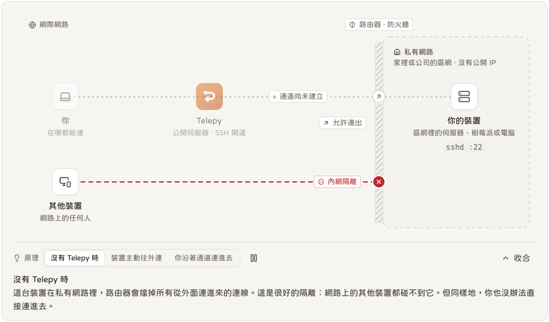

### 一行指令，全程即時顯示

**建立通道 → 一行指令 → 產生指令。** 把這行指令貼到裝置上執行；頁面會在腳本每個步驟發生時一一點亮（裝置有什麼、主機金鑰、
閘道檢查、註冊、授權 Telepy、服務），直到 Telepy 經由通道登入成功才結束。詳細說明：[一行指令加入裝置](./device-join.zh-TW.md)。

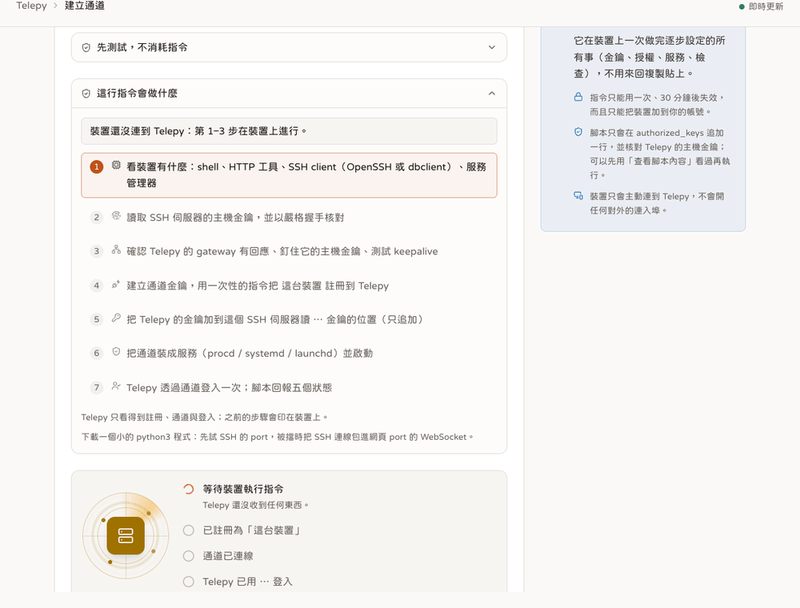

### 裝置資訊

通道的選單 → **詳細資訊與說明 → 裝置 → 這些是怎麼來的。** Telepy 每天會用一支唯讀腳本登入每台已連線的裝置
（作業系統、開機時間、記憶體、磁碟、負載、是否待重開機）；對話框會顯示整條路徑、上次與下次執行時間、實際執行的指令，
以及每項警告背後的門檻。

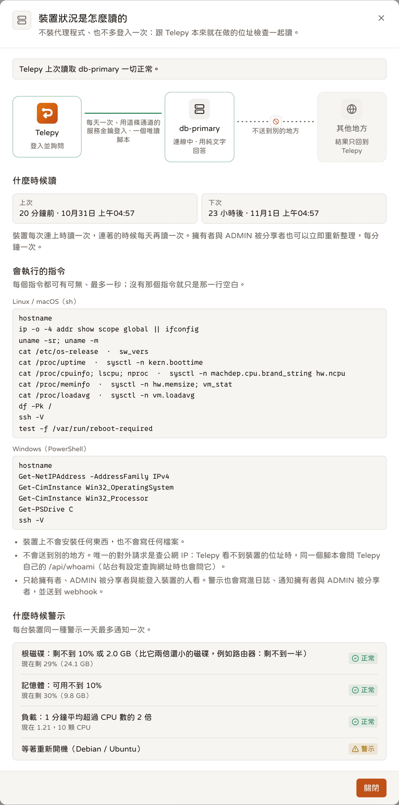

### 刪除通道

通道的選單 → **刪除通道。** 在任何動作發生之前，對話框會先畫出誰連得到這條通道、裝置上有什麼——通道服務、Telepy 在各帳號
裝上的金鑰、服務金鑰——以及每個選擇的結果。

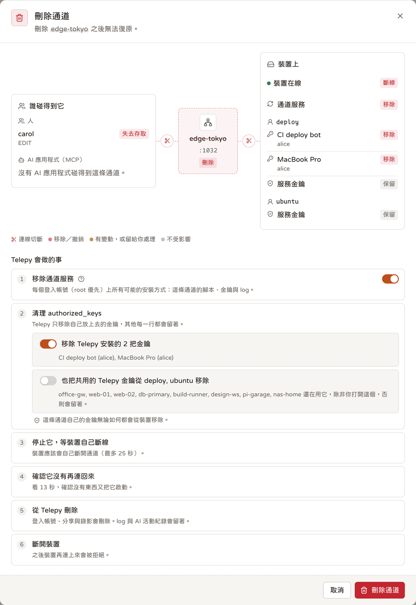

接著會一步一步即時執行：先在通道還連著時清理裝置，等裝置自己斷線並確認不會再連回來，最後才刪除通道。

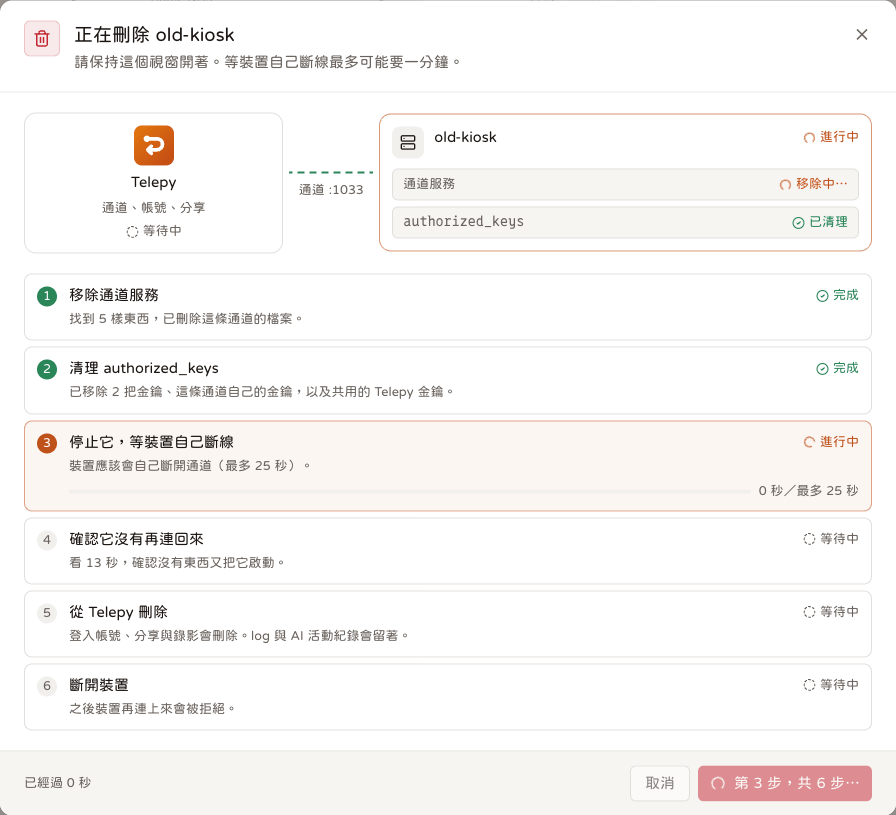

## 在裝置上工作

### 終端機

**終端機頁 → 怎麼運作**（頁首）。你的瀏覽器 ─ Telepy ─ 裝置的 shell，標出每一段的來回時間，以及連線失敗時停在哪裡。
詳細說明：[後端如何連到裝置](./device-connections.zh-TW.md)、
[延遲深入解析](./latency-deep-dive.zh-TW.md)。

### 斷線後仍保留的 shell

**偏好設定 → 終端機 → 怎麼運作**（在斷線後保留 shell 的設定旁）。已連線 ─ 斷線 ─ 保留 N ─ 重新接上，或時間到；
以及由哪一層決定保留多久（你的設定、站台的上限、通道的政策）。

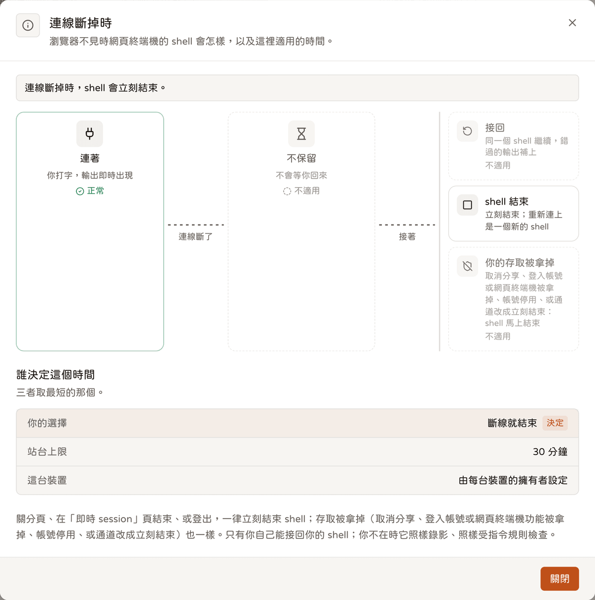

### 檔案

檔案管理員的 **檔案是怎麼傳的** 按鈕。你在檔案管理員裡做的所有事，都經過同一條共用的 SFTP 通道，和終端機用同一個登入；
對話框會顯示裝置離線或缺少確認時，是在哪裡被擋下。

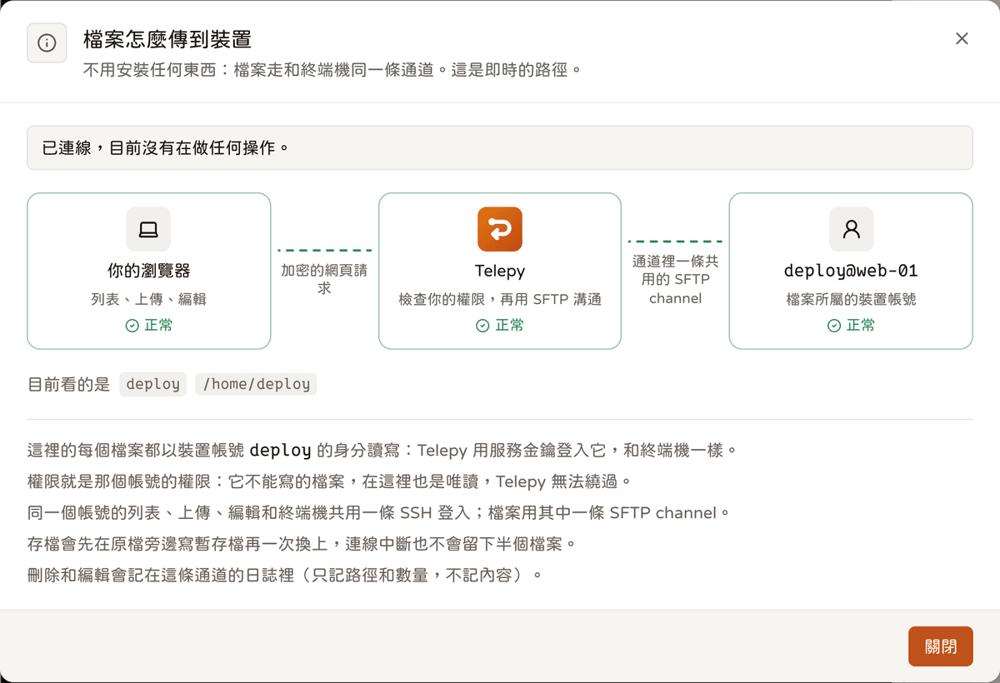

### 工具箱

**工具箱 → 工具箱怎麼運作。** 片段裡的變數在你的瀏覽器中填好，再一行一行打進你的 shell——所以指令規則會看到每一行，
就跟你親手輸入的一樣。

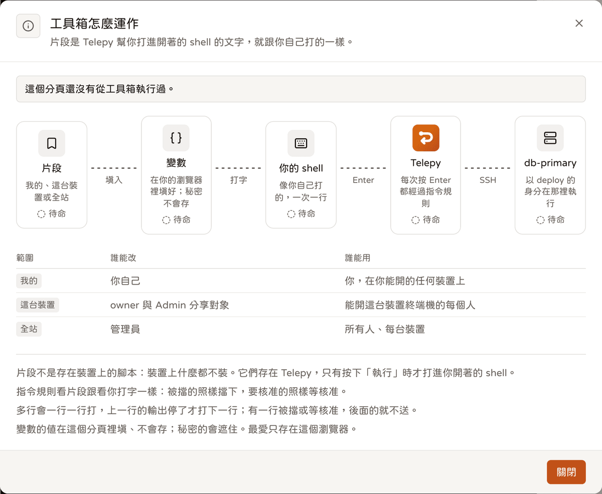

### 遠端桌面

連線中的 **遠端桌面 → 怎麼運作**：瀏覽器 ─ Telepy ─ 裝置 ─ 桌面，標出各段來回時間；下方是連線上傳送的內容——畫面、輸入、
剪貼簿、聲音、檔案——各自的狀態與原因。詳細說明：[遠端桌面](./remote-desktop.zh-TW.md)。

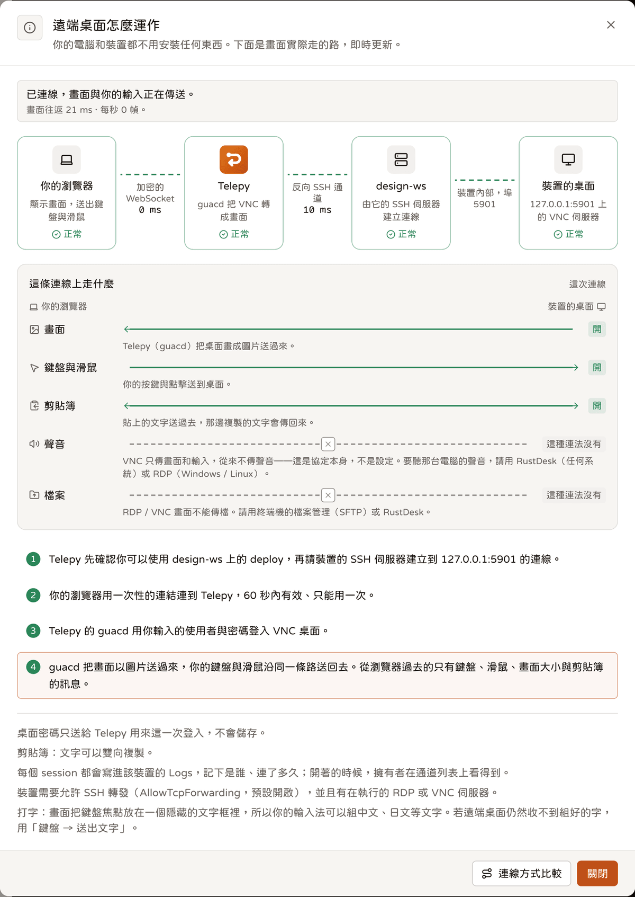

**遠端桌面 → 連線方式比較** 把經由 guacd 的 RDP / VNC，和在瀏覽器中解碼的 RustDesk 並排比較：畫面在哪裡繪製、
各層分別加密什麼，以及怎麼選。

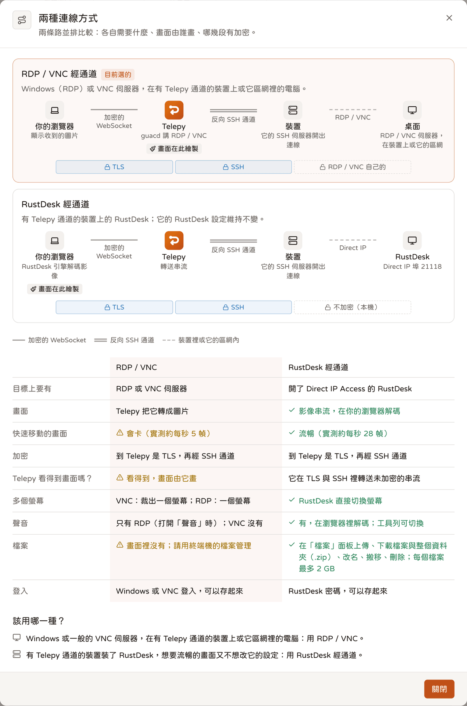

### 遠端瀏覽器

**遠端瀏覽器 → 啟動瀏覽器。** 啟動時會顯示三個步驟——經由裝置的代理、Telepy 瀏覽器容器裡全新的 Chromium、顯示在這個分頁的畫面——
然後才是瀏覽器本身，它的流量從裝置出去。詳細說明：[遠端瀏覽器](./remote-browser.zh-TW.md)。

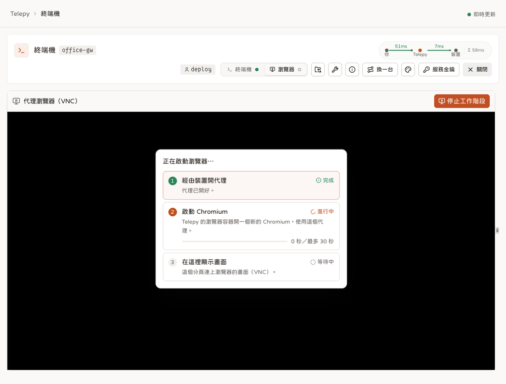

## 分享與控管

### 裝置上的登入帳號

通道的選單 → **目標主機使用者 → 這些帳號是做什麼的？** Telepy 使用者 ─ 允許清單 ─ 作業系統帳號 ─
裝置的 sshd。裝置分不出哪些是 Telepy 使用者，所以允許清單就是界線。

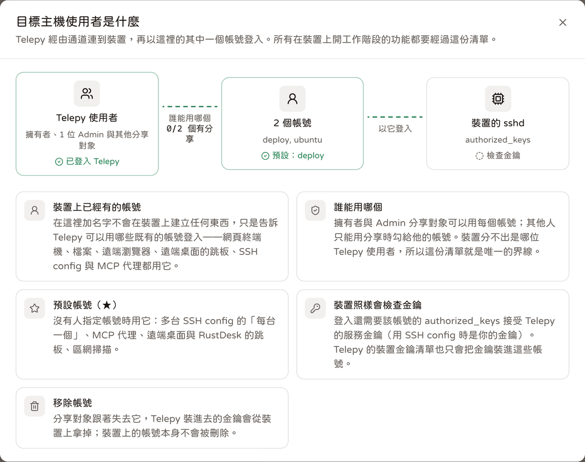

### 功能權限

**管理 → 使用者與權限 → 功能權限 → 怎麼運作。** 兩道互相獨立的關卡：一個人可以用哪些工具
（預設 → 所有人 → 使用者群組 → 本人，以本人為準），以及他連得到哪些通道（分享）。

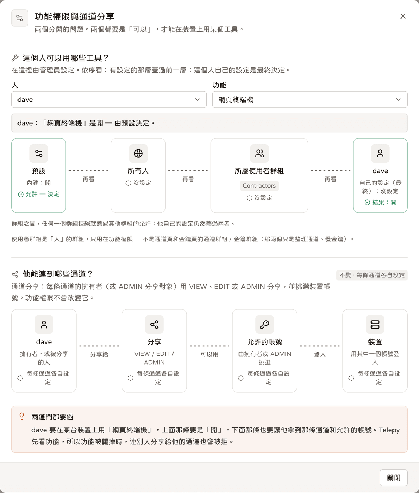

### 指令是怎麼決定的

**指令規則 → 指令是怎麼決定的。** 指令會先被拆開（sudo、`sh -c`、管線都會看穿），再對照這條通道上生效的全站規則與個人規則，
最後得到執行／提醒／核准／封鎖其中之一。你最近試的那個指令走過的路徑會被點亮。詳細說明：[MCP](./mcp.zh-TW.md#指令規則ssh_exec)。

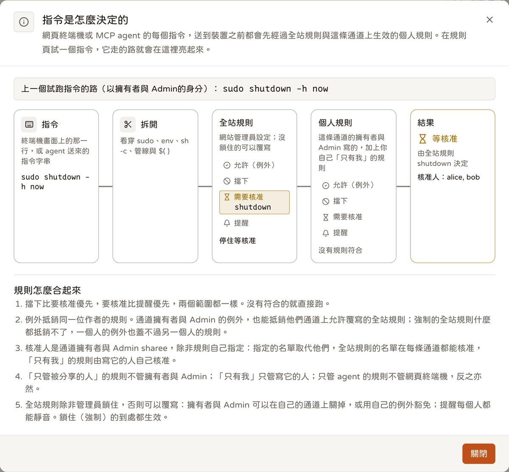

### 觀看終端機

**即時連線 → 觀看怎麼運作。** 對方的瀏覽器 ─ Telepy ─ 裝置，而你的瀏覽器從 Telepy 分出去：你看得到對方的畫面，
對方會被告知，而你要等對方把鍵盤交給你才能打字。

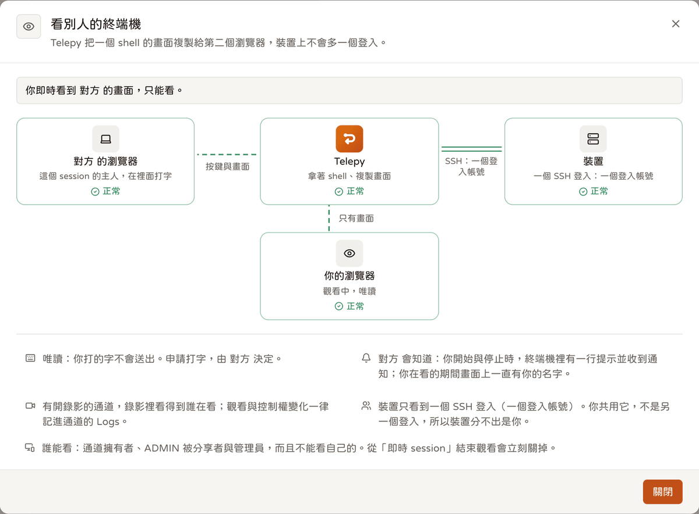

## 金鑰與 SSH 設定

### 裝置金鑰清單

**金鑰 → 運作方式。** 你的金鑰 → 裝置的金鑰清單 → 你在那裡可用（並且選擇）的帳號 → 各帳號的
`authorized_keys`。Telepy 只會移除自己加的金鑰；失去存取權時，金鑰也會一併被拿掉。

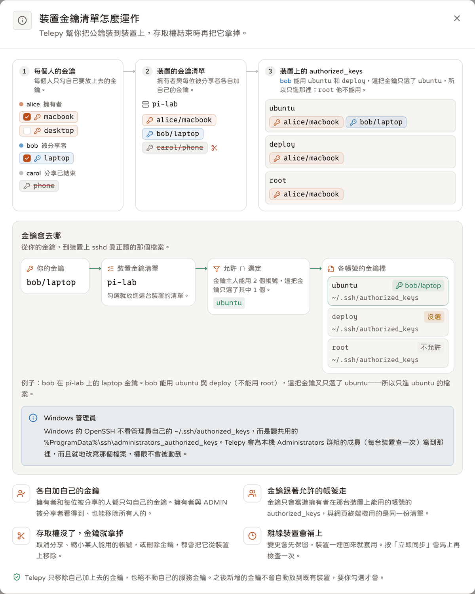

**金鑰 → 金鑰群組 → 金鑰群組怎麼運作。** 一組金鑰，只要授予一次給某台裝置或某個通道群組，之後新增金鑰或通道時，
都會自動保持同步。

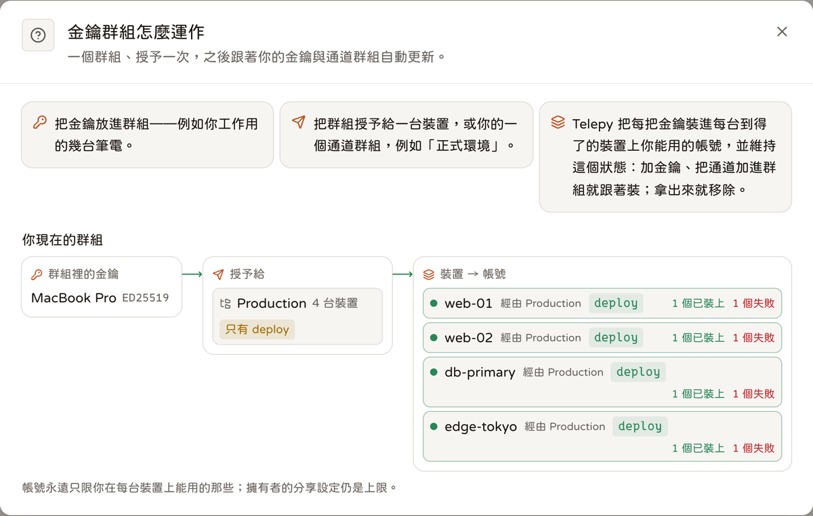

### 你電腦上的 SSH 設定

通道的選單 → **SSH 設定。** 你的電腦 ─ ssh ─ Telepy ═ 通道 ═ 裝置：產生的 `Host` 項目做了什麼、你的金鑰怎麼進去，
然後 `ssh <alias>`。

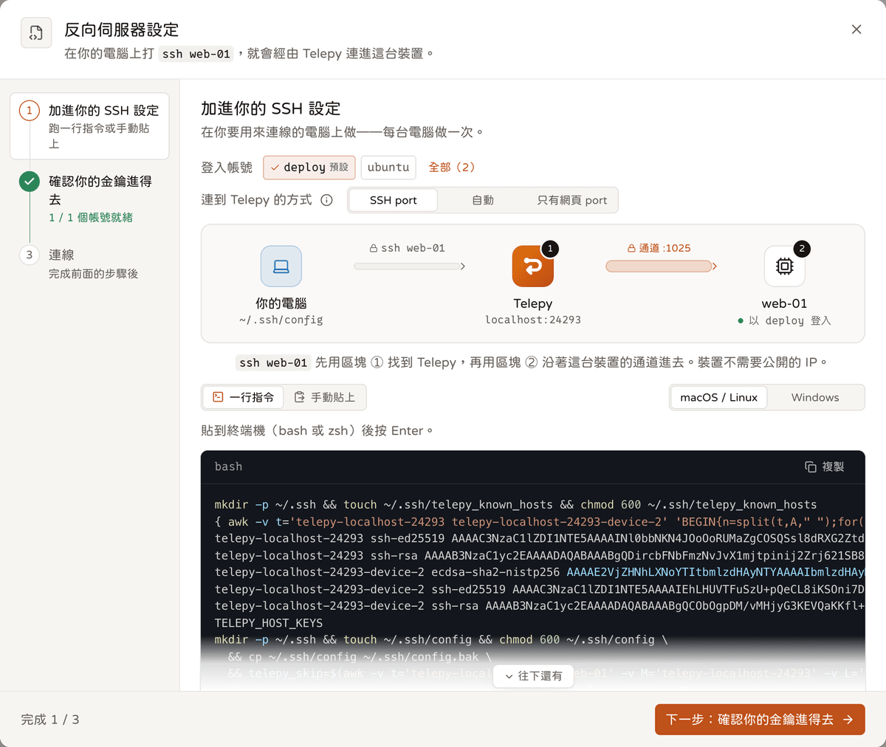

**SSH 設定 → 這幾種方式是什麼？**（在「連到 Telepy 的方式」旁）：你的電腦可以走 SSH 連接埠，也可以走網頁連接埠連到 Telepy，
這和裝置怎麼撥入是分開的。詳細說明：[後端如何連到裝置](./device-connections.zh-TW.md)。

### SSH config 編輯器

**SSH config 編輯器 → 怎麼運作。** 選一個名稱，看 ssh 在簡化前後怎麼為它讀取這個檔案——先出現的值優先、哪些選項會累加、
萬用字元會比對到什麼。`telepy config tidy` 在終端機裡做同樣的事（[CLI](./cli.zh-TW.md)）。

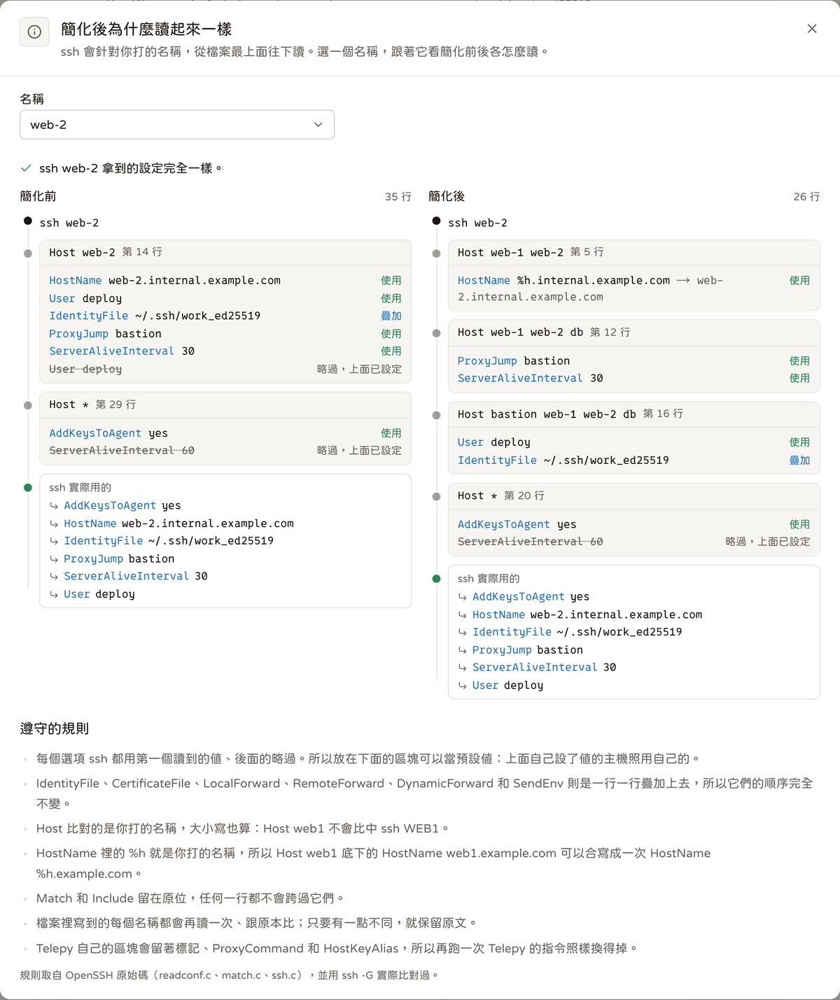

## 通知

### 應用程式內與桌面通知

**偏好設定 → 通知 → 怎麼運作。** 事件 ─ 站台預設 ─ 你的預設 ─ 這條通道 ─ 結果：哪一層決定要不要顯示提示訊息或桌面通知，
以及管理員在哪裡強制了設定。

### 讓通道退出全站 webhook

**Webhooks → 全站 Webhook → 退出怎麼運作。** 選一個 webhook 和一條通道，看它的事件會不會送到管理員的頻道，
以及是誰讓它退出的。詳細說明：[Webhooks](./webhooks.zh-TW.md)。

## 自動化

### 四種存取方式

**API → 四種存取方式。** 網頁登入、API token、CLI 登入和 MCP app 是進入 Telepy 的四條獨立路線；「如果我…」會顯示撤銷其中一條，
只會切斷它自己那條。詳細說明：[CLI 與 API token](./cli.zh-TW.md)。

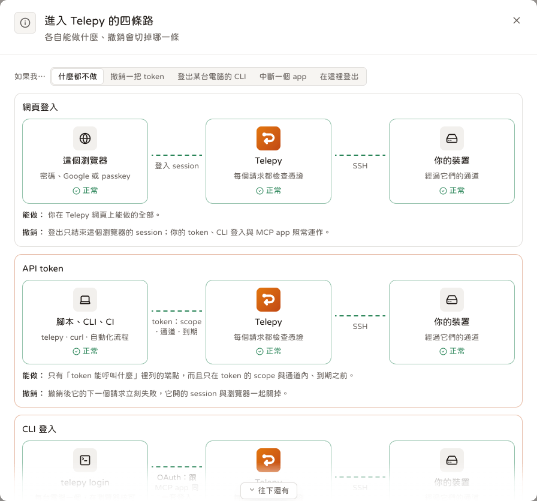

### `telepy` 命令列

**CLI → 怎麼運作。** 多數指令用你的登入透過 HTTPS 執行；`ssh` / `scp` / `sftp` 則使用系統的
OpenSSH，帶著你的個人金鑰經過閘道。

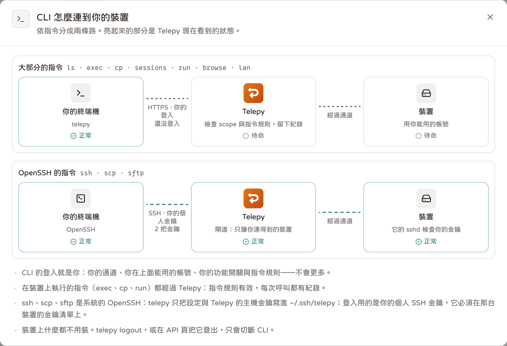

### MCP app

**MCP → app 碰得到哪裡？** app ─ Telepy ─ 裝置 ─ 區網／網際網路，依已連接 app 的權限範圍點亮。
詳細說明：[MCP](./mcp.zh-TW.md)。

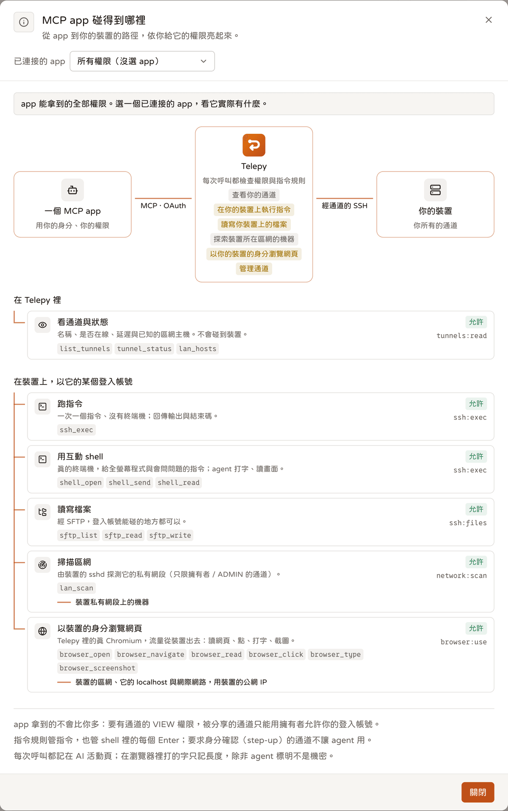

## 登入

### 保持登入

**偏好設定 → 安全性 → 登入狀態是怎麼維持的。** 你使用 Telepy 時登入會自動續期，閒置一段時間後結束；
在別處登出，該瀏覽器會立刻被切斷。

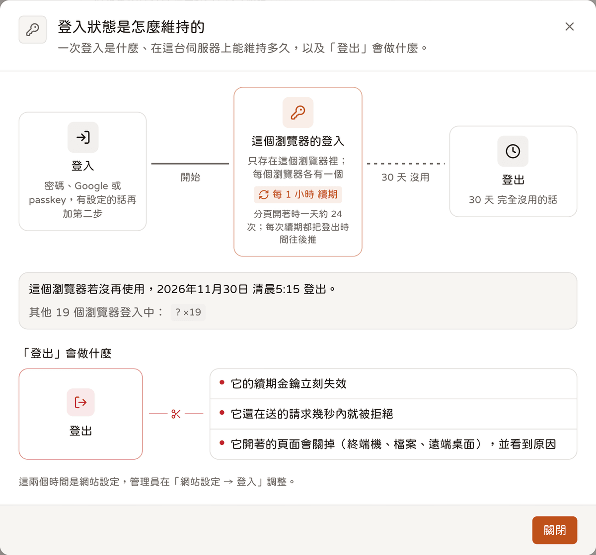

### 低調登入頁

**網站設定 → 登入 → 登入頁的樣子 → 低調**：只有「Telepy」、會動的背景和你輸入的文字，
適合不想張揚的伺服器。

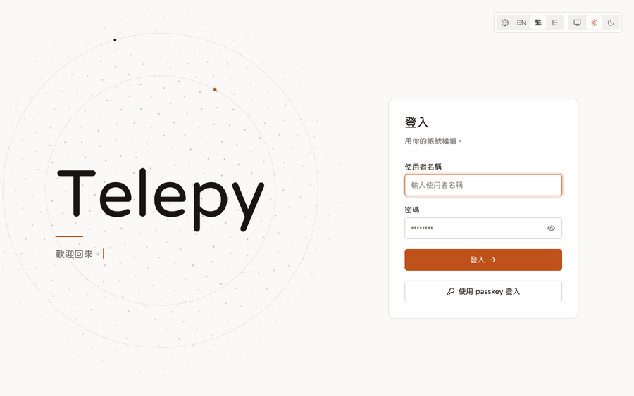

## 維運伺服器

### 伺服器狀態

**管理 → 伺服器狀態 → 運作方式。** 訪客 ─ 代理 ─ Telepy 後端 ─ 磁碟上的資料，旁邊是配套服務；
每個部分由它的檢查點亮，「現在」會指出第一個需要處理的項目。

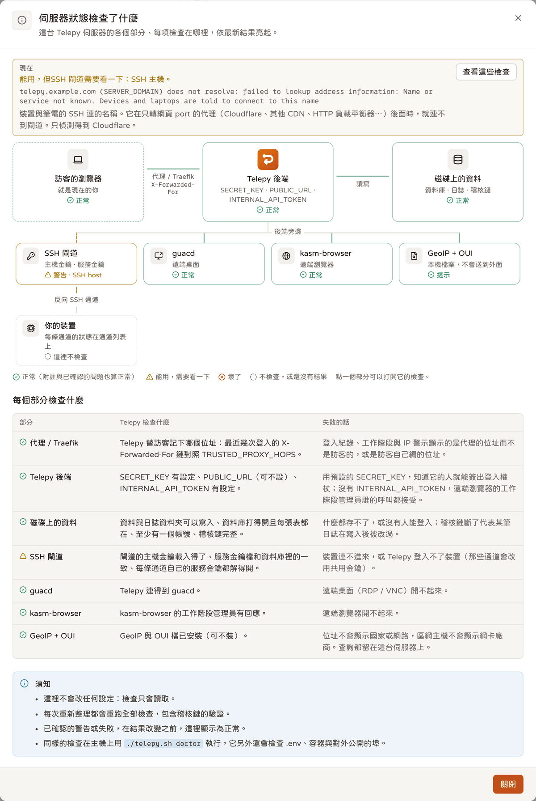

**伺服器狀態 → 訪客位址 → Telepy 怎麼看你的位址** 會逐跳走過你自己這個請求的 X-Forwarded-For 鏈，
並在代理隱藏了真實位址時，告訴你該修什麼。

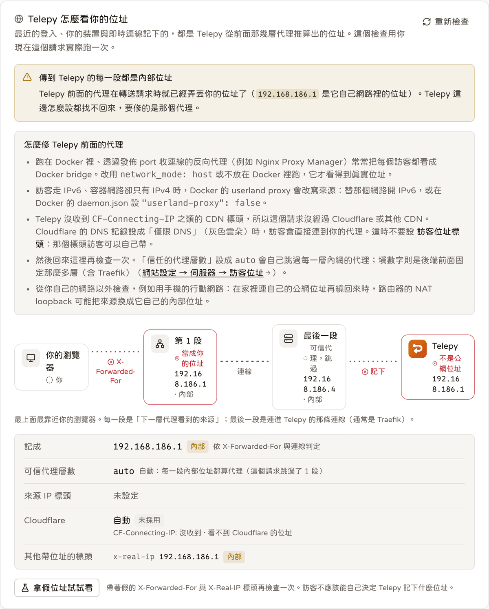

### `.env` 與網站設定

**網站設定 → 伺服器 → .env 與這一頁怎麼搭配。** 對每個也能由 `.env` 提供的設定：
`.env` 優先並鎖住欄位，其次是儲存的設定，最後才是內建預設值。

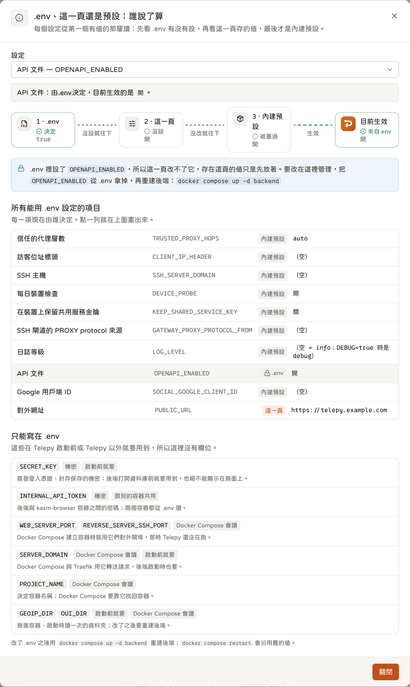

**網站設定 → 伺服器 → SSH 主機 → 為什麼要兩個名稱？** 當網頁名稱經過只放行網頁流量的代理時，
SSH 需要一個直接指向伺服器的專屬名稱。

