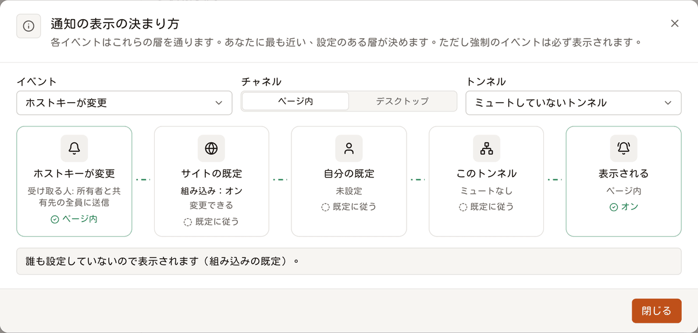
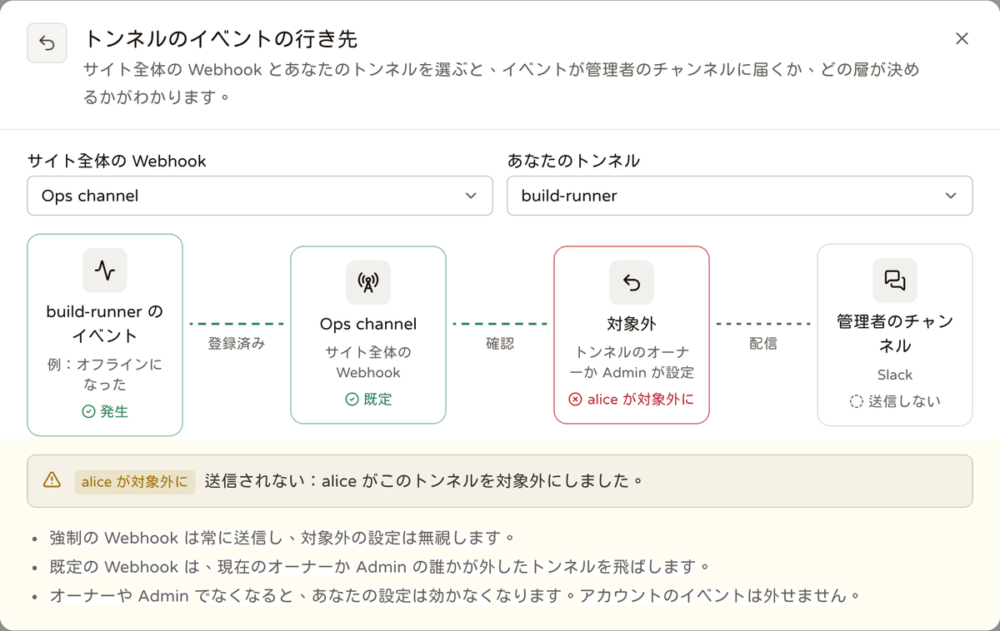

# Webhooks

<p align="center"><a href="./webhooks.md">English</a> | <a href="./webhooks.zh-TW.md">繁體中文</a> | <b>日本語</b></p>

Webhook は、Telepy の通知をブラウザーの外へ送る仕組みです。送り先は Slack、Discord、Google Chat、Microsoft Teams、Telegram、ntfy 経由のスマートフォン、あるいは自分のサービスです。

種類は 2 つあります。**個人 Webhook** は誰でも作れて、自分がもともと受け取っている通知を送ります。**サイト全体の Webhook** は管理者が作るもので、サーバー全体の重要なイベントをチームのチャンネルへ届けます。

## Webhook を設定する

1. サイドバーの Webhooks を開き、「webhook を追加」を押します。
2. **送信先**：チャットアプリの Incoming Webhook の URL か、自分のエンドポイントを貼り付けます。Telepy は URL からサービスを判断し、そのサービス向けにメッセージを整えます。「メッセージの言語」はチャンネルの人が読む言語を選んでください。名前は空欄でもかまいません。
3. **送るイベント**：イベントにチェックを入れるか、プリセット（トンネルの状態、セキュリティ、承認、すべて）から始めます。各イベントの下に、誰が受け取るかが書いてあります。状態イベントを選んだら「状態通知までの待ち時間」も決めます。
4. **対象のトンネル**：「自分のすべてのトンネル」（後から追加したものも含む）か「一部だけ」を選びます。サインインと SSH 鍵のイベントは、どちらを選んでも送られます。
5. **カスタムヘッダー**は省略できます。自分のサービス向けの `Authorization` などに使います。
6. 保存したら、Webhook のカードで「テスト送信」を押し、届くかどうか確かめます。

管理者がサイト全体の Webhook を作る手順も同じで、場所は「ルールと通知 → サイト全体の Webhook」（「サイト全体の webhook を追加」）です。こちらの「対象のトンネル」には「すべてのトンネル」があります。

> [!TIP]
> Telegram は URL に `chat_id` を入れる必要があり、Teams は Workflows の Webhook を使います。サービスごとの詳細は[送信される内容](#送信される内容)の表にあります。

## 個人かサイト全体か

| | 個人 Webhook | サイト全体の Webhook |
| --- | --- | --- |
| 作成・管理する人 | 各自が自分用に。他の人には、管理者にも見えません | 管理者。どの管理者でも見られ、編集できます |
| 送るもの | その人が Web 上でもともと受け取る通知 | 厳選した重要なイベント（状態、デバイスの識別とセキュリティ、アカウント） |
| 対象範囲 | 自分が所有する、または共有されたトンネル（絞り込み可） | すべてのトンネルとすべてのアカウント（選んだトンネルに限定可） |
| 内部ネットワークのアドレス | 既定では不可（[アドレス検査](#アドレス検査ssrf)を参照） | 可 |
| 他の人に見えるもの | 何も見えません | 各自の Webhooks ページに概要が出ます。URL・ヘッダー・シークレットは出ません |
| トンネルを除外できるか | — | 「既定」モードなら、トンネルのオーナーと ADMIN の共有先が自分のトンネルを対象外にできます。「強制」モードではできません |

### 個人 Webhook のサイト設定

管理者は「サイト設定 → 通知」で個人 Webhook を管理します。

- **個人の webhook**（`notify_user_webhooks`、既定でオン）：オフにするとすべての個人 Webhook が止まります。サイト全体の Webhook はそのまま動きます。
- **プライベートネットワーク宛てを許可**（`notify_private_targets`、既定でオフ）：個人 Webhook が内部ネットワーク、ローカルホスト、クラウドのメタデータに接続できるようにします。
- **1 人あたりの webhook 数**（`notify_max_webhooks`、既定 10、0〜100）。

管理者は「ユーザーとアクセス → 機能の権限」で、特定の人やユーザーグループの「個人 Webhook」機能をオフにすることもできます。その人の Webhooks ページは説明文に置き換わり、`/api/webhooks*` は 403 `feature_disabled` を返します。サイト全体の Webhook を対象外にするための 2 つのルートは引き続き使えます。

アカウントが無効になると、その人の個人 Webhook は送信されなくなります。

> [!NOTE]
> 以前の単一のアラート URL（`notify_webhook_url` / `notify_down_delay`）を使っていた場合、アップグレード時に「Status alerts」という名前のサイト全体の Webhook に移されています。同じ 4 つの状態イベントに `tunnel.ip_changed` を加え、遅延も同じで、元の設定はクリアされました。

## イベント

受信者は、同じ出来事のアプリ内通知の宛先と常に同じです。そのため、Web 上で見えないことを Webhook が誰かに知らせることはありません。共有が終わったり権限が下がったりすると、そのトンネルのイベントはその人に届かなくなります。

最後の列は、サイト全体の Webhook が購読できる厳選イベントです。

| イベント | グループ | 個人 Webhook の受信者 | サイト全体 |
| --- | --- | --- | --- |
| `tunnel.offline` / `tunnel.online` | トンネルの状態 | オーナーとすべての共有先 | ✓ |
| `tunnel.degraded` / `tunnel.recovered` | トンネルの状態 | オーナーとすべての共有先 | ✓ |
| `tunnel.ip_changed` | デバイスの識別 | オーナーと ADMIN の共有先 | ✓ |
| `tunnel.host_key_changed` | デバイスの識別 | オーナーとすべての共有先 | ✓ |
| `device.claim_attempt` | デバイスの識別 | オーナーと ADMIN の共有先 | ✓ |
| `tunnel.device_warning` | デバイスの識別 | オーナーと ADMIN の共有先 | ✓ |
| `share.received` | 共有とアクセス | 共有された人 | |
| `share.ended` | 共有とアクセス | 共有の双方（終了させた人を除く） | |
| `access.requested` | 共有とアクセス | オーナーと ADMIN（申請者を除く） | |
| `access.decided` | 共有とアクセス | 申請者 | |
| `command.approval_requested` | コマンドルール | そのルールの承認者（下記参照） | |
| `command.approval_decided` | コマンドルール | 申請者。自分で決定・取り消しした場合は送られません | |
| `command.blocked` | コマンドルール | オーナーと ADMIN（本人を除く）。メッセージにコマンドが入ります | |
| `session.started` | セッション | オーナーと ADMIN（本人を除く）。ターミナル、LAN ターミナル、ファイル、ブラウザー、デスクトップ、RustDesk | |
| `session.watched` | セッション | 見られている人 | |
| `mcp.session_opened` / `mcp.session_closed` | セッション | エージェントのユーザーとトンネルのオーナー | |
| `account.sign_in` | サインイン | アカウント本人 | |
| `account.sign_in_new_device` | サインイン | アカウント本人 | |
| `account.sign_in_failed` | サインイン | アカウント本人 | ✓（任意のアカウント） |
| `key.expiring` | SSH 鍵 | 鍵の所有者 | |
| `key.expired` | SSH 鍵 | 鍵の所有者 | |
| `user.created` | 管理 | — | ✓ |
| `carriers.updated` | 管理 | — | ✓ |
| `carriers.update_failed` | 管理 | — | ✓ |
| `webhook.test` | — | 「テスト送信」ボタンが送るもの。購読はできません | |

いくつかのイベントには補足があります。

- **デバイスの警告**（`tunnel.device_warning`）：ルートディスクの空きが 10 % または 2 GB 未満、使用可能メモリが 10 % 未満、1 分間のロードが CPU 数の 2 倍超、または再起動待ち。トンネルごと・種類ごとに 1 日 1 回までです。`data` には `warning`、`detail`、`avail`、`total`、`load1`、`cpus` が入ります。
- **承認の依頼**（`command.approval_requested`）：ルールで承認者が指定されていればその人たちへ、なければオーナーと ADMIN へ送ります。自分のターミナルで入力したコマンドでは送られず、自分の MCP エージェントのコマンドでは送られます。
- **閲覧**（`session.watched`）：オーナー、ADMIN、または管理者が、あなたの Web ターミナルの閲覧を始めたときです。`data` には `by`、`account`、`lan_host` が入ります。
- **MCP セッション**（`mcp.session_*`）：`data.kind` は `ssh` か `browser` です。
- **新しいデバイス**（`account.sign_in_new_device`）：過去 90 日間の成功したサインインで一度も見たことのない国またはブラウザーからのサインインです。

### 状態通知は少し待ってから送る

状態イベント（offline / online / degraded / recovered）は、起きた瞬間には送られません。Webhook ごとに待ち時間（すぐ〜1 日、既定 1 分）があり、その状態が待ち時間より長く続いたときだけ送ります。オフィスの Wi-Fi で一瞬しゃっくりした Raspberry Pi に、チャンネル全員を叩き起こす権利はありません。

online / recovered は、先に offline / degraded を送った場合にだけ送ります。追跡するのは、Webhook を作成した後の変化だけです。

### SSH 鍵の期限切れ

`key.expiring` と `key.expired` は、「キー」ページにある**個人 SSH 鍵**、つまりノート PC が gateway 経由でデバイスに接続するときの鍵についてのイベントです。管理者は「個人鍵の有効期間（日）」（`user_key_max_days`）で有効期間を設けられます。トンネル（デバイス）の鍵は意図的に期限切れにならないため、対応するイベントはありません。

- Telepy は 10 分ごとに確認します。
- 7 日以内に期限が切れる鍵は `key.expiring` を送ります。`days_left` は切り上げです。
- 期限が切れたばかりの鍵は `key.expired` を送ります。gateway はこの鍵を拒否し、デバイスからも削除されます。送るのは 48 時間以内に切れたものだけで、それより前に切れたものを後から送ることはありません。
- 各鍵につき、段階ごと・期限日時ごとに 1 回だけ送ります。更新して期限日時が変われば、数え直します。

### デバイスのキャリアの更新

`carriers.*` は、このサーバーがデバイスに配る**キャリア**についてのイベントです。キャリアとは、デバイスのトンネルが Web ポート経由で接続するときに使うプログラムです（[バックエンドがデバイスに届く仕組み](./device-connections.ja.md)を参照）。

- `carriers.updated`：キャリアが新しいリリースに置き換えられました。毎日の自動更新の場合と、管理者が「サーバーの状態 → 関連サービス → デバイスのキャリア」で更新した場合があります。`data` には `tag`、`targets`、`by` が入ります（自動のときは `by` が null）。
- `carriers.update_failed`：毎日の自動更新が、最新リリースを読み取れなかったか取得できませんでした（`data.error`）。同じエラーは 1 回だけ送り、サーバーにあるキャリアはそのまま配られます。

### Webhook とアプリ内通知は別物



ページ内の通知（トースト）とデスクトップ通知には、独自の設定があります。

- 自分の設定は「環境設定 → 通知」。
- サイト全体の既定は「ルールと通知 → サイト全体の通知」。管理者は一部のイベントを強制して、必ず表示させることもできます。
- 各トンネルのメニューから、そのトンネルの状態だけ、または通知すべてをミュートできます。

これらの設定が決めるのは、ブラウザーに何を表示するかだけです。Web 上でオフにしたりミュートしたりしたイベントでも、個人 Webhook が購読していれば送られます。Webhook が見るのは、自身のイベント一覧、トンネルの絞り込み、そしてサイト全体の Webhook なら対象外設定だけです。

## 送信される内容

Webhook ごとに「メッセージ形式」（既定は URL から判断）と「メッセージの言語」（English / 繁體中文 / 日本語）があります。メッセージはそのままチャットルームに入るので、文面はバックエンドで組み立てます。

| 形式 | URL による判断 | 内容 |
| --- | --- | --- |
| Telepy JSON | それ以外の URL | 下記の完全な JSON |
| Slack 互換 | `hooks.slack.com` | `{"text"}`。`& < >` をエスケープします（Mattermost、Rocket.Chat も受け付けます） |
| Discord | `discord.com/api/webhooks/…` | `{"content", "allowed_mentions": {"parse": []}}` |
| Google Chat | `chat.googleapis.com` | `{"text"}`。`<…>` 構文は無効化します |
| Microsoft Teams | `*.logic.azure.com`、`*.webhook.office.com`、`*.powerplatform.com` | Adaptive Card（Workflows の「Webhook 要求を受信したとき」） |
| Telegram | `api.telegram.org` | `{"text"}`。`chat_id` は URL に入れます（`…/sendMessage?chat_id=…`） |
| ntfy | `ntfy.sh`、`ntfy.*` | プレーンテキスト。`title` / `tags` / `priority` / `click` は URL パラメーターとして付きます |

名前やコマンドはユーザーが入力した文字なので、どの形式でも `@everyone` や `<!channel>` のようなメンションは無効化されます。トンネルに `@everyone` と名付けても、変な名前のトンネルが 1 本できるだけで、全員集合の号令にはなりません。

### Telepy JSON の中身

```json
{
  "id": "msg_…",
  "event": "tunnel.ip_changed",
  "title": "New device IP address",
  "severity": "warning",
  "at": "2026-10-26T12:00:00Z",
  "text": "[Telepy] office-pi connected from a new IP address: 203.0.113.9 (was 198.51.100.1)",
  "server": "https://telepy.example.com",
  "url": "https://telepy.example.com/tunnels/logs?tunnel=4",
  "tunnel": { "id": 4, "name": "office-pi", "reverse_port": 1025 },
  "data": { "ip": "203.0.113.9", "previous_ip": "198.51.100.1" }
}
```

- `tunnel` はトンネルに関するイベントにだけ含まれます。
- `data` はイベントごとに異なります（`by`、`command`、`reason` など）。
- リンクには `PUBLIC_URL` を使い、未設定なら `https://SERVER_DOMAIN` を使います。どちらもなければリンクは付きません。

## カスタムヘッダー

Webhook ごとに最大 10 個のカスタムヘッダーを付けられます。たとえば自分のサービス向けの `Authorization` や、ntfy のアクセストークンです。

- 名前は HTTP トークンで、同じ名前は 1 回だけです。
- Telepy 自身が設定するヘッダー（`content-type`、`user-agent`、`webhook-*`、`x-telepy-event`、`host`、`content-length` など）は変更できません。
- 値は 1〜2048 文字の可視 ASCII 文字で、改行は使えません。

ヘッダーは `SECRET_KEY` から導出した鍵で暗号化して保存され、API が返す相手はその Webhook を管理できる人だけです。`PATCH` で `headers` を渡すとセット全体が置き換わり、渡さなければ何も変わりません。

`SECRET_KEY` を変更すると、保存したヘッダーは読み出せなくなります。送信は理由つきで失敗し、編集画面では再入力を促されます（API では `headers_unreadable` で分かります）。

## 署名（Standard Webhooks）

すべてのリクエストに次のヘッダーが付きます。

- `webhook-id`：メッセージ ID。再試行しても変わりません（重複排除に使えます）
- `webhook-timestamp`：今回の送信の Unix 秒（古いものは拒否して再送攻撃を防ぎます）
- `webhook-signature`：`v1,` + base64(HMAC-SHA256(key, `{id}.{timestamp}.{body}`))。key ＝ シークレットの `whsec_` 以降を base64 デコードしたバイト列
- `x-telepy-event`：イベント名

Standard Webhooks に対応したライブラリならどれでも検証できます。「署名シークレット」ダイアログの「サービス側で検証する」には Node.js と Python のサンプルもあります。Slack や Discord などのチャットアプリは署名を見ないので、必要なのは自分のサービスだけです。

シークレットの表示・コピー・交換は、カードのメニューから「署名シークレット」を開いて行います。交換すると古いシークレットはすぐ使えなくなるので、サービス側もすぐ更新してください。

シークレットは `SECRET_KEY` から導出した鍵で暗号化して保存され、Webhook の id に紐づいています。`SECRET_KEY` を変更すると読み出せなくなるので、新しいものに交換してください。

## 送信、再試行、一時停止

- **再試行**：失敗（接続エラー、タイムアウト、408、429、5xx）は、10 秒後と 1 分後に 1 回ずつ再試行します。それ以外の 4xx は再試行しません。
- **リダイレクト**：3xx は追いかけません。最終的な URL を入力してください。
- **送信数の上限**：1 つの Webhook につき 1 分あたり最大 30 件です。超えた分はスキップされ、最初のスキップは `skipped` として記録されます。
- **一時停止**：連続 20 回失敗すると一時停止し、所有者に通知します（サイト全体の Webhook は全管理者へ）。再びオンにすると解除されます。
- **送信履歴**：Webhook ごとに最新 50 件を、本文（最大 16 KB）つきで 30 日間保存します。送信前にまず `sending` として記録し、送信後に結果を補います。再試行の待機中にバックエンドが再起動した場合は、起動時に失敗に変わります（「Telepy restarted before this was delivered.」）。

### 1 件を再送する

「送信履歴」で失敗・スキップした項目には「再送」ボタンがあります（送達済みの項目も展開すれば出ます）。再送は次のように動きます。

- 同じ `webhook-id` を使います。
- Webhook の現在の形式・言語・ヘッダーで組み立て直します。
- 再試行はせず、連続失敗にも数えません。
- オフの Webhook でも送れます。
- 新しい項目として記録されます。

テスト送信は再送できません。

### 記録されること

サイト全体の Webhook の追加・変更（モード変更を含む）・削除とシークレットの交換は、`webhook` イベントとして管理セクションの「監査ログ」に記録されます。対象外にした操作と元に戻した操作は、そのトンネルの「ログ」に `webhook_optout` として記録されます。

## サイト全体の Webhook と対象外設定



### 誰でも見られます

Webhooks ページには、自分の Webhook の下に読み取り専用の「サイト全体の Webhook」セクションがあります。それぞれについて、名前、サービス（Slack、Teams など）、イベント、対象のトンネル、オンか一時停止中かが表示されます。トンネルは自分が見られるものだけが表示され、残りは本数だけが出ます。

URL、カスタムヘッダー、署名シークレット、送信履歴、作成者は表示されません。一般ユーザーに見えるのは、オンのものと、失敗が続いて一時停止中のものだけです。管理者にはここに「管理」リンクが出ますが、変更は管理セクションの「サイト全体の Webhook」ページで行います。

### 既定か強制か

サイト全体の Webhook にはモードがあります（API の `mode`）。

- **既定**（`default`）：管理者のダイアログで「ユーザーによる上書きを許可」がオンの状態です。新しく作った Webhook はこのモードで始まり、アップグレード前からあるサイト全体の Webhook もこれです。トンネルのオーナーまたは ADMIN の共有先は、そのトンネルを対象外にできます。
- **強制**（`enforced`）：「ユーザーによる上書きを許可」がオフで、カードに「強制」チップが付きます。対象のトンネルは常に送信され、誰も対象外にできません。それまでの対象外設定は一時的に無視されます。

### トンネルを対象外にする

サイト全体のセクションで「自分のトンネルを外す」を押し、トンネルごとにスイッチをオフにします。表示されるのは、自分が管理していて、かつこの Webhook が対象にしているトンネルだけです。他の人がすでに外したトンネルも表示されます。

送信時の判断は次のとおりです。

- トンネルに関するイベントは、そのトンネルの**現在の**管理者のうち誰か 1 人でも対象外にしていれば、既定モードのサイト全体の Webhook には送られません。管理者とは、オーナーと、現在の権限が ADMIN の共有先です。送信の瞬間に確認します。
- ADMIN でなくなった人の対象外設定は数えられなくなります。
- 状態アラート（offline / online / degraded / recovered）も同じルールに従います。
- アカウントのイベント（サインイン失敗、新規ユーザー）は対象外にできません。個人 Webhook には対象外という仕組み自体がありません。
- テスト送信と再送は、対象外設定を見ません。

### 管理者に見えるもの

サイト全体の Webhook のカードには「N 本が対象外」と表示されます。開くと、どのトンネルを、誰が、いつ外したか、今も有効かが分かります。トンネルや Webhook を削除すると、関連する対象外設定も一緒に削除されます。

サイト全体のセクションの「対象外の仕組み」ボタンを押すと、イベント ─ サイト全体の Webhook ─ 対象外 ─ 管理者のチャンネル、という図が開きます。Webhook とトンネルを 1 つずつ選ぶと、そのイベントが送られるかどうかと、どの層が決めているかが点灯します。

## 上限

| 項目 | 上限 |
| --- | --- |
| 1 人あたりの個人 Webhook | 既定 10。管理者が 0〜100 で設定可 |
| Webhook ごとのカスタムヘッダー | 10 個 |
| Webhook ごとの送信数 | 1 分あたり 30 件。超えた分はスキップ |
| 再試行 | 2 回：10 秒後と 1 分後 |
| 一時停止 | 連続 20 回の失敗で |
| 送信履歴 | Webhook ごとに最新 50 件、本文は最大 16 KB、30 日間保存 |
| 状態通知までの待ち時間 | すぐ〜1 日（既定 1 分） |

## アドレス検査（SSRF）

個人 Webhook の URL は誰でも入力でき、サーバーはその URL に素直に接続します。クラウドのメタデータのアドレスを指定されたら、サーバー自身の認証情報を丁重に差し出すことになりかねません。そこまで親切にする必要はないでしょう。

そのため、既定では公開アドレスだけを許可します。

- **保存時**：ホスト名を解決し、いずれかのアドレスが内部ネットワーク、ローカルホスト、リンクローカル（クラウドのメタデータ 169.254.169.254 を含む）、CGNAT、予約済みの範囲にある場合、またはそうした IPv4 を包んだ IPv6（mapped、NAT64、6to4）である場合は、`private_target` で拒否します。
- **送信時**：公開アドレスだけを返す DNS リゾルバー経由で接続します（DNS リバインディング対策）。IP リテラルは別途検査し、リダイレクトは追わず、環境変数のプロキシも使いません。

許可されるのは、管理者が「プライベートネットワーク宛てを許可」（`notify_private_targets`）をオンにしたときだけです。サイト全体の Webhook は常に許可されます。

## API

| | |
| --- | --- |
| `GET /api/webhooks` | 自分のもの。管理者にはサイト全体の完全なデータ。`site_summary`（全員向け：サイト全体の Webhook の概要。`mode`、`my_optout`、自分が管理している対象トンネルの `managed` を含む）。2 つの範囲のイベントカタログ。`policy` |
| `POST /api/webhooks` | `{scope?, name?, url, format?, language?, events?, all_tunnels?, tunnel_ids?, delay?, enabled?, headers?, mode?}` → `{webhook, secret}`。`mode` ＝ `default` / `enforced`、サイト全体でのみ意味があります |
| `GET / PATCH / DELETE /api/webhooks/{id}` | 自分のもの（サイト全体は管理者）だけ。他人のものは常に 404 |
| `POST /api/webhooks/{id}/test` | `webhook.test` を送って結果を待ちます（再試行なし、連続失敗に数えません） |
| `GET /api/webhooks/{id}/deliveries` | 最新 50 件 |
| `POST /api/webhooks/{id}/deliveries/{delivery_id}/redeliver` | 1 件を再送します（テスト送信は 409 `not_redeliverable`） |
| `GET / POST /api/webhooks/{id}/secret` | 署名シークレットの読み出し／交換 |
| `PUT /api/webhooks/{id}/optout` | `{tunnel_ids}`：**自分の**対象外設定をまとめて置き換え（自分が管理していて、このサイト全体の Webhook が対象にしているトンネルのみ）、自分の概要を返します。強制モードは 400 `enforced`、個人 Webhook は 404 |
| `DELETE /api/webhooks/{id}/optout` | 自分の対象外設定を消します |

レスポンスには、ほかにも次のものが含まれます。

- 管理者には、`GET /api/webhooks` が `site_tunnels`（サーバー上のすべてのトンネル。サイト全体の Webhook で選ぶためのもの）も返し、サイト全体の各 Webhook には `optouts [{tunnel_id, tunnel_name, by, at, active}]` が付きます。
- 失敗が続いて一時停止した Webhook には `paused_reason = failing` が付きます。再送した項目には `redelivered_from` が付きます。
- エラーは `{field: [message], code}` または `{error, code}` の形です。

<details>
<summary>エラーコード</summary>

| `code` | 意味 |
| --- | --- |
| `private_target` | アドレスが内部ネットワーク、またはこのサーバー自身にあります |
| `invalid_url` | `http://` または `https://` の URL ではありません |
| `unresolvable` | ホスト名が見つかりません |
| `no_events` | イベントが 1 つも選ばれていません |
| `no_tunnels` | すべてのトンネルも、個別のトンネルも選ばれていません |
| `limit` | 1 人あたりの上限に達しました |
| `personal_disabled` | 管理者が個人 Webhook をオフにしています |
| `admins_only` | サイト全体の Webhook を追加できるのは管理者だけです |
| `secret_unreadable` | `SECRET_KEY` が変わりました。シークレットを交換してください |
| `bad_header` | カスタムヘッダーが不正です |
| `not_redeliverable` | この項目は再送できません（テスト送信） |
| `enforced` | このサイト全体の Webhook は強制モードなので、対象外にできません |
| `not_manager` | そのトンネルのオーナー／ADMIN ではありません |
| `not_covered` | この Webhook はそのトンネルを対象にしていません |

</details>
