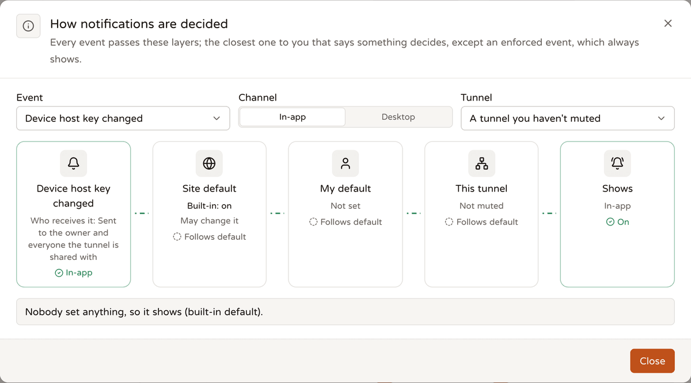
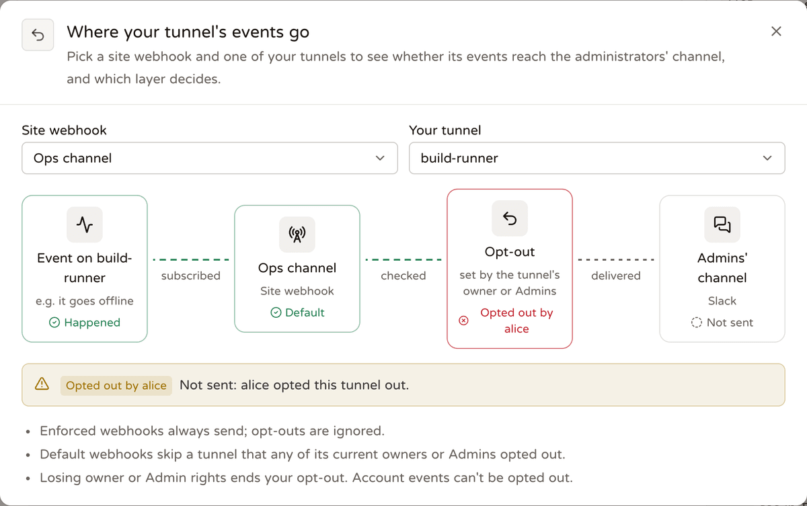

# Webhooks

<p align="center"><b>English</b> | <a href="./webhooks.zh-TW.md">繁體中文</a> | <a href="./webhooks.ja.md">日本語</a></p>

A webhook sends Telepy's notifications somewhere outside the browser: Slack, Discord, Google Chat, Microsoft Teams, Telegram, your phone through ntfy, or a service of your own.

There are two kinds. Everyone can set up **personal webhooks** for the notifications they already get. Admins can add **site-wide webhooks** that carry the important events of the whole server to the team's own channel.

## Set one up

1. Open **Webhooks** in the sidebar and press **Add webhook**.
2. **Where to send**: paste the incoming-webhook URL from your chat app, or any endpoint of your own. Telepy recognises the service from the URL and formats messages for it. Pick the **Message language** the people in that channel read. A name is optional.
3. **What to send**: tick events, or start from a preset (Tunnel status, Security, Approvals, Everything). Each event says who receives it. If you picked status events, set **Wait before a status alert** too.
4. **Which tunnels**: **All my tunnels** (later ones included) or **Only some**. Sign-in and SSH key events are sent either way.
5. **Custom headers** are optional, for example an `Authorization` header for your own service.
6. Save, then press **Send test** on the webhook's card to check that it arrives.

Admins add site-wide webhooks the same way under **Rules & alerts → Site webhooks** (**Add site-wide webhook**). There, **Which tunnels** offers **Every tunnel** instead.

> [!TIP]
> Telegram wants `chat_id` in the URL, and Teams needs a Workflows webhook. The table in [What is sent](#what-is-sent) has the details for each service.

## Personal or site-wide

| | Personal webhook | Site-wide webhook |
| --- | --- | --- |
| Who creates and manages it | Each person, for themselves; nobody else can see it, not even an admin | Admins; every admin can see and edit it |
| What it carries | The notifications that person already gets in the web UI | A curated set of important events: status, device identity and security, accounts |
| Scope | Tunnels the person owns or that are shared with them (can be narrowed) | Every tunnel and every account (can be limited to chosen tunnels) |
| Private addresses | Not allowed by default (see [Address check](#address-check-ssrf)) | Allowed |
| What others can see | Nothing | Everyone sees a summary on their own Webhooks page, without URL, headers or secret |
| Can a tunnel be left out | — | In **Default** mode, a tunnel's owner and ADMIN sharees can opt their tunnels out. In **Enforced** mode, they can't |

### Site settings for personal webhooks

Admins control personal webhooks under **Site settings → Notifications**:

- **Personal webhooks** (`notify_user_webhooks`, on by default): turning it off pauses every personal webhook. Site-wide ones keep working.
- **Allow private network targets** (`notify_private_targets`, off by default): lets personal webhooks reach private networks, localhost and cloud metadata.
- **Webhooks per person** (`notify_max_webhooks`, default 10, 0–100).

Admins can also turn the **Personal webhooks** feature off for certain people or a user group under **Users & access → Feature permissions**. That person's Webhooks page then shows an explanation, and `/api/webhooks*` answers 403 `feature_disabled`. The two routes for opting out of site-wide webhooks keep working.

When an account is disabled, its personal webhooks stop sending.

> [!NOTE]
> Used the old single alert URL (`notify_webhook_url` / `notify_down_delay`)? The upgrade moved it into a site-wide webhook named "Status alerts", with the same four status events plus `tunnel.ip_changed` and the same delay, and cleared the old settings.

## Events

Recipients always match the in-app notification for the same event. A webhook never tells anyone about something they can't see in the web UI, and once a share ends or a permission drops, that tunnel's events stop going to that person.

The last column marks the curated set that site-wide webhooks can subscribe to.

| Event | Group | Who receives it (personal webhook) | Site-wide |
| --- | --- | --- | --- |
| `tunnel.offline` / `tunnel.online` | Tunnel status | The owner and all sharees | ✓ |
| `tunnel.degraded` / `tunnel.recovered` | Tunnel status | The owner and all sharees | ✓ |
| `tunnel.ip_changed` | Device identity | The owner and ADMIN sharees | ✓ |
| `tunnel.host_key_changed` | Device identity | The owner and all sharees | ✓ |
| `device.claim_attempt` | Device identity | The owner and ADMIN sharees | ✓ |
| `tunnel.device_warning` | Device identity | The owner and ADMIN sharees | ✓ |
| `share.received` | Sharing and access | The person it was shared with | |
| `share.ended` | Sharing and access | Both sides of the share, except whoever ended it | |
| `access.requested` | Sharing and access | The owner and ADMINs, except the requester | |
| `access.decided` | Sharing and access | The requester | |
| `command.approval_requested` | Command rules | The rule's approvers (see below) | |
| `command.approval_decided` | Command rules | The requester, unless they decided or cancelled it themselves | |
| `command.blocked` | Command rules | The owner and ADMINs, except the person involved. The message includes the command | |
| `session.started` | Sessions | The owner and ADMINs, except the person involved (terminal, LAN terminal, files, browser, desktop, RustDesk) | |
| `session.watched` | Sessions | The person being watched | |
| `mcp.session_opened` / `mcp.session_closed` | Sessions | The agent's user and the tunnel owner | |
| `account.sign_in` | Sign-ins | The account holder | |
| `account.sign_in_new_device` | Sign-ins | The account holder | |
| `account.sign_in_failed` | Sign-ins | The account holder | ✓ (any account) |
| `key.expiring` | SSH keys | The key's owner | |
| `key.expired` | SSH keys | The key's owner | |
| `user.created` | Administration | — | ✓ |
| `carriers.updated` | Administration | — | ✓ |
| `carriers.update_failed` | Administration | — | ✓ |
| `webhook.test` | — | Sent by the **Send test** button; can't be subscribed to | |

A few events need a word more:

- **Device warnings** (`tunnel.device_warning`): the root disk has under 10 % or 2 GB free, available memory is under 10 %, the 1-minute load is above twice the CPU count, or a reboot is pending. At most once a day per tunnel and kind. `data` has `warning`, `detail`, `avail`, `total`, `load1` and `cpus`.
- **Approval requests** (`command.approval_requested`): go to the people the rule names, otherwise to the owner and ADMINs. Not sent for commands you type in your own terminal, but sent for commands from your own MCP agent.
- **Watching** (`session.watched`): the owner, an ADMIN or an admin started watching your web terminal. `data` has `by`, `account` and `lan_host`.
- **MCP sessions** (`mcp.session_*`): `data.kind` is `ssh` or `browser`.
- **New device** (`account.sign_in_new_device`): a sign-in from a country or browser not seen in any successful sign-in within 90 days.

### Status alerts wait a moment

Status events (offline / online / degraded / recovered) aren't sent the instant they happen. Each webhook has its own wait, from right away to 1 day (default 1 minute), and the condition must last longer than that. A Raspberry Pi that hiccups on the office Wi-Fi shouldn't get to wake up the whole channel.

Online / recovered is only sent after an offline / degraded was sent. Only changes after the webhook was created are tracked.

### SSH key expiry

`key.expiring` and `key.expired` are about the **personal SSH keys** on the Keys page: the ones a laptop uses to reach devices through the gateway. Admins can give them a lifetime with **Personal key lifetime (days)** (`user_key_max_days`). Tunnel (device) keys deliberately never expire, so there's no event for them.

- Telepy checks every 10 minutes.
- A key that expires within 7 days sends `key.expiring`, with `days_left` rounded up.
- A key that just expired sends `key.expired`: the gateway now refuses it and it's removed from devices. Only keys that expired in the last 48 hours are sent; older expiries aren't sent after the fact.
- Each key sends each stage once per expiry time. A renewal that changes the expiry time starts over.

### Device carrier updates

`carriers.*` is about the **device carriers** this server hands out: the program a device's tunnel uses to come in over the web port (see [How the backend reaches devices](./device-connections.md)).

- `carriers.updated`: copies were replaced with a newer release, either by the daily automatic update or by an admin under **Server health → Companion services → Device carriers**. `data` has `tag`, `targets` and `by` (`by` is null when it was automatic).
- `carriers.update_failed`: the daily update couldn't read or fetch the latest release (`data.error`). The same error is sent only once, and the copies already on the server keep being served.

### Webhooks and in-app notifications are separate



In-page toasts and desktop notifications have their own preferences:

- your own, under **Preferences → Notifications**;
- site-wide defaults, under **Rules & alerts → Site notifications**, where admins can also enforce events so they always show;
- each tunnel's menu, which can mute that tunnel's status or all of its notifications.

Those settings only decide what the browser shows. An event you turned off or muted in the web UI still goes to a personal webhook that subscribes to it. A webhook looks only at its own event list, its tunnel filter and, for site-wide webhooks, opt-outs.

## What is sent

Each webhook has a **Message format**, by default recognised from the URL, and a **Message language** (English / 繁體中文 / 日本語). The backend builds the sentences, because the message goes straight into a chat room.

| Format | Recognised from the URL | Content |
| --- | --- | --- |
| Telepy JSON | Any other URL | The full JSON below |
| Slack-compatible | `hooks.slack.com` | `{"text"}`, with `& < >` escaped (Mattermost and Rocket.Chat accept it too) |
| Discord | `discord.com/api/webhooks/…` | `{"content", "allowed_mentions": {"parse": []}}` |
| Google Chat | `chat.googleapis.com` | `{"text"}`, with the `<…>` syntax neutralised |
| Microsoft Teams | `*.logic.azure.com`, `*.webhook.office.com`, `*.powerplatform.com` | An Adaptive Card (Workflows' "When a webhook request is received") |
| Telegram | `api.telegram.org` | `{"text"}`; `chat_id` goes in the URL (`…/sendMessage?chat_id=…`) |
| ntfy | `ntfy.sh`, `ntfy.*` | Plain text; `title` / `tags` / `priority` / `click` are added as URL parameters |

Names and commands are text that people typed, so every format neutralises mentions such as `@everyone` and `<!channel>`. Name a tunnel `@everyone` and you get a tunnel with an odd name, not a fire drill.

### The Telepy JSON payload

```json
{
  "id": "msg_…",
  "event": "tunnel.ip_changed",
  "title": "New device IP address",
  "severity": "warning",
  "at": "2026-10-26T12:00:00Z",
  "text": "[Telepy] office-pi connected from a new IP address: 203.0.113.9 (was 198.51.100.1)",
  "server": "https://telepy.example.com",
  "url": "https://telepy.example.com/tunnels/logs?tunnel=4",
  "tunnel": { "id": 4, "name": "office-pi", "reverse_port": 1025 },
  "data": { "ip": "203.0.113.9", "previous_ip": "198.51.100.1" }
}
```

- `tunnel` is present only for events about a tunnel.
- `data` depends on the event, for example `by`, `command` or `reason`.
- The link uses `PUBLIC_URL`, or `https://SERVER_DOMAIN` when that's unset. With neither, no link is included.

## Custom headers

Each webhook can carry up to 10 custom headers, for example `Authorization` for your own service or an ntfy access token.

- Names must be valid HTTP tokens, and each name can appear only once.
- Headers Telepy sets itself (`content-type`, `user-agent`, `webhook-*`, `x-telepy-event`, `host`, `content-length`…) can't be changed.
- Values are 1–2048 visible ASCII characters, with no line breaks.

Headers are stored encrypted with a key derived from `SECRET_KEY`, and the API returns them only to people who can manage that webhook. A `PATCH` with `headers` replaces the whole set; without it, nothing changes.

If `SECRET_KEY` is replaced, the saved headers can't be read any more. Deliveries fail with an explanation, and the edit screen asks you to enter them again (the API flags this as `headers_unreadable`).

## Signing (Standard Webhooks)

Every request carries:

- `webhook-id`: the message id, unchanged across retries (use it to de-duplicate)
- `webhook-timestamp`: the Unix seconds of this attempt (reject old ones to prevent replay)
- `webhook-signature`: `v1,` + base64(HMAC-SHA256(key, `{id}.{timestamp}.{body}`)), where key = the bytes you get by base64-decoding what follows `whsec_` in the secret
- `x-telepy-event`: the event name

Any Standard Webhooks library can verify it, and the **Signing secret** dialog has Node.js and Python examples under **Verify it in your service**. Chat apps such as Slack and Discord ignore the signature; you only need it for a service of your own.

To view, copy or rotate the secret, open **Signing secret** from the card's menu. Rotating it stops the old secret at once, so update your service right after.

The secret is stored encrypted with a key derived from `SECRET_KEY` and bound to the webhook's id. If `SECRET_KEY` is replaced, it can't be read any more: rotate to get a new one.

## Delivery, retries and pausing

- **Retries**: failures (connection errors, timeouts, 408, 429, 5xx) are retried once after 10 seconds and once after 1 minute. Other 4xx aren't retried.
- **Redirects**: 3xx responses aren't followed, so enter the final URL.
- **Rate limit**: at most 30 messages per webhook per minute. The rest are skipped, and the first skip is recorded as `skipped`.
- **Pausing**: after 20 failures in a row the webhook is paused and its owner is notified (for a site-wide webhook, every admin). Turning it back on clears the pause.
- **History**: each webhook keeps its latest 50 deliveries, with the body (up to 16 KB), for 30 days. A delivery is recorded as `sending` before it goes out and completed afterwards. If the backend restarted while a retry was still waiting, startup marks it failed ("Telepy restarted before this was delivered.").

### Resending a delivery

In **Deliveries**, failed and skipped entries have a **Resend** button (delivered ones too, once expanded). A resend:

- keeps the same `webhook-id`;
- is rebuilt with the webhook's current format, language and headers;
- isn't retried and doesn't count towards consecutive failures;
- works on a disabled webhook;
- is recorded as a new entry.

Test sends can't be resent.

### What gets logged

Creating, editing (mode changes included) and deleting a site-wide webhook, and rotating its secret, are recorded as `webhook` events in the admin section's **Audit log**. Opting out and cancelling an opt-out are recorded in that tunnel's **Logs** as `webhook_optout`.

## Site-wide webhooks and opt-outs



### Everyone can see them

Under your own webhooks, the Webhooks page has a read-only **Site-wide webhooks** section. For each one it shows the name, the service (Slack, Teams…), the events, which tunnels it covers and whether it's on or paused. It lists only the tunnels you can see; the rest are just counted.

The URL, custom headers, signing secret, delivery history and creator are never shown. Regular users see only webhooks that are on, or paused because they keep failing. Admins get a **Manage** link there, but changes are still made on **Site webhooks** in the admin section.

### Default or enforced

Each site-wide webhook has a mode (`mode` in the API):

- **Default** (`default`): **Let people override** is on in the admin dialog. New webhooks start like this, and so do site-wide webhooks that existed before the upgrade. A tunnel's **owner or ADMIN sharees** can opt that tunnel out.
- **Enforced** (`enforced`): **Let people override** is off, and the card shows an **Enforced** chip. Every covered tunnel is always sent, nobody can opt out, and earlier opt-outs are ignored for now.

### Opting a tunnel out

In the site-wide section, press **Opt my tunnels out** and switch tunnels off one by one. Only tunnels you manage that this webhook covers are listed, including ones someone else already opted out.

How delivery decides:

- An event about a tunnel isn't sent to a default-mode site-wide webhook as soon as **any current** manager of that tunnel has opted out. Managers are the owner plus sharees whose permission is ADMIN, read at the moment of delivery.
- When someone loses ADMIN, their opt-out stops counting.
- Status alerts (offline / online / degraded / recovered) follow the same rule.
- Account events (failed sign-in, new user) can't be opted out of. Personal webhooks have no opt-out.
- Test sends and resends ignore opt-outs.

### What admins see

A site-wide webhook's card shows **N opted out**. Open it to see which tunnel, who opted out, when, and whether it still counts. Deleting a tunnel or a webhook deletes the related opt-outs with it.

The **How opt-outs work** button in the site-wide section opens a diagram: event ─ site-wide webhook ─ opt-out ─ admins' channel. Pick a webhook and a tunnel, and it lights up whether the event is sent and which layer decides.

## Limits

| What | Limit |
| --- | --- |
| Personal webhooks per person | 10 by default; admins can set 0–100 |
| Custom headers per webhook | 10 |
| Messages per webhook | 30 a minute; the rest are skipped |
| Retries | Two: after 10 seconds and after 1 minute |
| Pausing | After 20 failures in a row |
| Delivery history | Latest 50 per webhook, body up to 16 KB, kept 30 days |
| Wait before a status alert | Right away to 1 day (default 1 minute) |

## Address check (SSRF)

Anyone can fill in a personal webhook's URL, and the server connects to whatever it says. Pointed at the cloud metadata address, that would be a very polite way to ask the server for its own credentials, and Telepy would rather not be that helpful.

So by default only public addresses are allowed:

- **On save**, the host name is resolved. If any address falls in a private, localhost, link-local (cloud metadata 169.254.169.254 included), CGNAT or reserved range, or is an IPv6 address wrapping such an IPv4 (mapped, NAT64, 6to4), the URL is refused with `private_target`.
- **At delivery**, the connection goes through a DNS resolver that returns public addresses only (against DNS rebinding). IP literals are checked separately, redirects aren't followed and proxies from environment variables aren't used.

Private targets are allowed only when an admin turns on **Allow private network targets** (`notify_private_targets`). Site-wide webhooks are always allowed.

## API

| | |
| --- | --- |
| `GET /api/webhooks` | Mine; for admins, the full site-wide data; `site_summary` (for everyone: a summary of the site-wide webhooks, including `mode`, `my_optout` and `managed`, the covered tunnels I manage); the event catalogue for both scopes; `policy` |
| `POST /api/webhooks` | `{scope?, name?, url, format?, language?, events?, all_tunnels?, tunnel_ids?, delay?, enabled?, headers?, mode?}` → `{webhook, secret}`; `mode` = `default` / `enforced`, meaningful for site-wide only |
| `GET / PATCH / DELETE /api/webhooks/{id}` | Only your own (site-wide: admins); anyone else's is always 404 |
| `POST /api/webhooks/{id}/test` | Sends `webhook.test` and waits for the result (no retries, not counted towards consecutive failures) |
| `GET /api/webhooks/{id}/deliveries` | The latest 50 |
| `POST /api/webhooks/{id}/deliveries/{delivery_id}/redeliver` | Resend one (409 `not_redeliverable` for test sends) |
| `GET / POST /api/webhooks/{id}/secret` | Read / rotate the signing secret |
| `PUT /api/webhooks/{id}/optout` | `{tunnel_ids}`: replaces **my** opt-outs as a whole (only tunnels I manage that this site-wide webhook covers) and returns my summary; enforced mode is 400 `enforced`, a personal webhook is 404 |
| `DELETE /api/webhooks/{id}/optout` | Clears my opt-outs |

A few more things in the responses:

- For admins, `GET /api/webhooks` also returns `site_tunnels` (every tunnel on the server, for picking in a site-wide webhook), and each site-wide webhook carries `optouts [{tunnel_id, tunnel_name, by, at, active}]`.
- A webhook paused for failing has `paused_reason = failing`. A resent delivery carries `redelivered_from`.
- Errors are `{field: [message], code}` or `{error, code}`.

<details>
<summary>Error codes</summary>

| `code` | Meaning |
| --- | --- |
| `private_target` | The address is on a private network or this server |
| `invalid_url` | Not an `http://` or `https://` URL |
| `unresolvable` | The host name could not be found |
| `no_events` | No event was picked |
| `no_tunnels` | Neither all tunnels nor at least one tunnel was picked |
| `limit` | The per-person limit is reached |
| `personal_disabled` | An admin turned personal webhooks off |
| `admins_only` | Only admins can add site-wide webhooks |
| `secret_unreadable` | `SECRET_KEY` changed; rotate the secret |
| `bad_header` | A custom header is invalid |
| `not_redeliverable` | This delivery can't be resent (test sends) |
| `enforced` | The site-wide webhook is enforced, so no opt-outs |
| `not_manager` | You're not the owner / ADMIN of that tunnel |
| `not_covered` | This webhook doesn't cover that tunnel |

</details>
