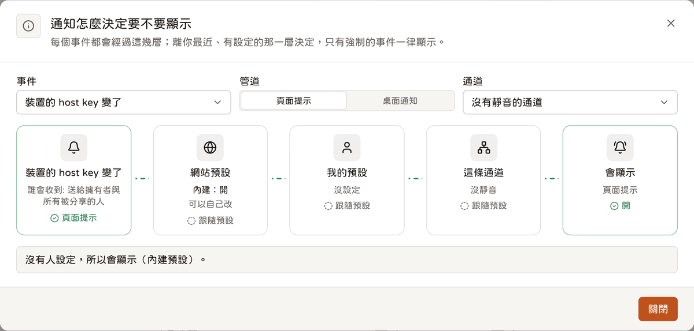
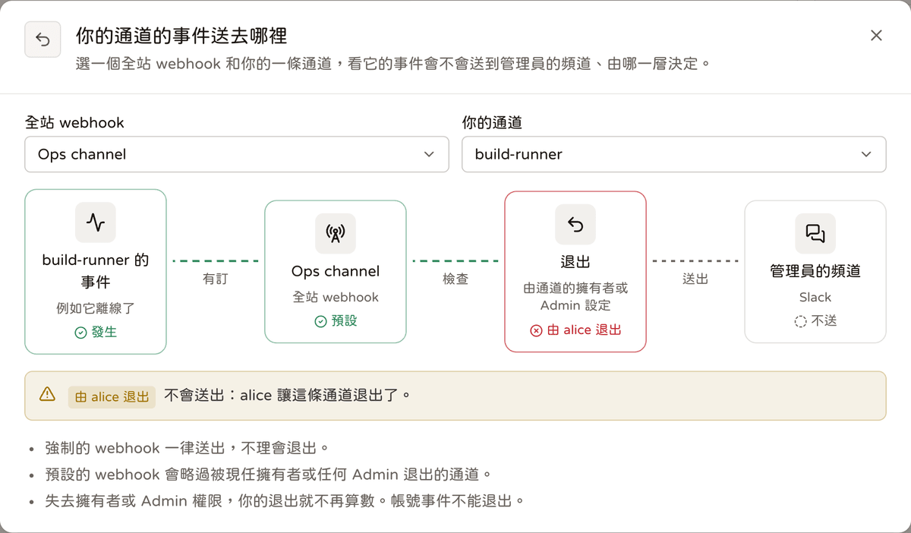

# Webhooks

<p align="center"><a href="./webhooks.md">English</a> | <b>繁體中文</b> | <a href="./webhooks.ja.md">日本語</a></p>

Webhook 把 Telepy 的通知送到瀏覽器以外的地方：Slack、Discord、Google Chat、Microsoft Teams、Telegram、透過 ntfy 推到手機，或是你自己的服務。

webhook 分兩種。每個人都能建立**個人 webhook**，收自己本來就會收到的通知。管理員另外可以建立**全站 webhook**，把整台伺服器的重要事件送進團隊自己的頻道。

## 設定一個 webhook

1. 打開側欄的 Webhooks，按「新增 webhook」。
2. **送到哪裡**：貼上聊天 App 給的 incoming webhook 網址，或你自己的任何端點。Telepy 會從網址認出是哪個服務，訊息照它的格式排好。「訊息語言」選頻道裡的人看得懂的那種；名稱可填可不填。
3. **要送什麼**：勾選事件，或從預設組合開始（通道狀態、安全、核准、全部）。每個事件底下都寫了誰會收到。有勾狀態事件的話，順便設定「狀態通知前先等」多久。
4. **哪些通道**：「我所有的通道」（之後新增的也算）或「只限幾條」。登入與 SSH 金鑰的事件不管怎麼選都會送。
5. **自訂 header** 可以不填，例如給自己服務用的 `Authorization`。
6. 儲存之後，在 webhook 卡片上按「送測試」，確認真的收得到。

管理員建立全站 webhook 的步驟一樣，位置在「規則與通知 → 全站 Webhook」（「新增全站 webhook」）。那裡的「哪些通道」改成「每條通道」。

> [!TIP]
> Telegram 要把 `chat_id` 放在網址裡，Teams 要用 Workflows 的 webhook。各服務的細節見[送出的內容](#送出的內容)那張表。

## 個人還是全站

| | 個人 webhook | 全站 webhook |
| --- | --- | --- |
| 誰建立、誰管理 | 每個人管自己的，別人看不到，管理員也一樣 | 管理員；每位管理員都看得到、都能改 |
| 送什麼 | 這個人在網頁上本來就會收到的通知 | 精選的重要事件：狀態、裝置身分與安全、帳號 |
| 範圍 | 自己擁有或被分享的通道（可以再縮小） | 每條通道、每個帳號（可以限定在挑選的通道） |
| 內網位址 | 預設不准（見[位址檢查](#位址檢查ssrf)） | 可以 |
| 別人看得到什麼 | 什麼都看不到 | 每個人在自己的 Webhooks 頁看得到摘要，不含網址、header 與密鑰 |
| 能不能把通道排除 | — | 「預設」模式下，通道的 owner 與 ADMIN 被分享者可以把自己的通道退出；「強制」模式下不行 |

### 個人 webhook 的網站設定

管理員在「網站設定 → 通知」管個人 webhook：

- **個人 webhook**（`notify_user_webhooks`，預設開）：關掉就暫停所有個人 webhook，全站的照常運作。
- **允許內網位址**（`notify_private_targets`，預設關）：讓個人 webhook 能連到內網、本機與雲端 metadata。
- **每人 webhook 上限**（`notify_max_webhooks`，預設 10，可設 0–100）。

管理員也可以在「使用者與權限 → 功能權限」替某些人或某個使用者群組關掉「個人 webhook」功能。那個人的 Webhooks 頁會換成一段說明，`/api/webhooks*` 回 403 `feature_disabled`。退出全站 webhook 用的兩個路由不受影響。

帳號被停用時，他的個人 webhook 就不再送出。

> [!NOTE]
> 以前用過單一告警網址（`notify_webhook_url` / `notify_down_delay`）嗎？升級時它被搬成一個名為 “Status alerts” 的全站 webhook：同樣的四個狀態事件加上 `tunnel.ip_changed`，延遲也一樣，舊設定則清掉了。

## 事件

收件人一律跟同一件事的站內通知對象相同。所以 webhook 不會讓任何人知道他在網頁上看不到的事；分享結束或權限調降之後，那條通道的事件也就不再送給他。

最後一欄標出全站 webhook 能訂的精選事件。

| 事件 | 分組 | 個人 webhook 誰收得到 | 全站 |
| --- | --- | --- | --- |
| `tunnel.offline` / `tunnel.online` | 通道狀態 | owner 與所有被分享者 | ✓ |
| `tunnel.degraded` / `tunnel.recovered` | 通道狀態 | owner 與所有被分享者 | ✓ |
| `tunnel.ip_changed` | 裝置身分 | owner 與 ADMIN 被分享者 | ✓ |
| `tunnel.host_key_changed` | 裝置身分 | owner 與所有被分享者 | ✓ |
| `device.claim_attempt` | 裝置身分 | owner 與 ADMIN 被分享者 | ✓ |
| `tunnel.device_warning` | 裝置身分 | owner 與 ADMIN 被分享者 | ✓ |
| `share.received` | 分享與存取 | 被分享的人 | |
| `share.ended` | 分享與存取 | 分享的雙方，不含結束分享的人 | |
| `access.requested` | 分享與存取 | owner 與 ADMIN，不含申請人 | |
| `access.decided` | 分享與存取 | 申請人 | |
| `command.approval_requested` | 指令規則 | 這條規則的核准人（見下方） | |
| `command.approval_decided` | 指令規則 | 申請人；自己決定或取消的不送 | |
| `command.blocked` | 指令規則 | owner 與 ADMIN，不含本人；訊息裡有指令 | |
| `session.started` | 連線 | owner 與 ADMIN，不含本人（終端機、區網終端機、檔案、瀏覽器、桌面、RustDesk） | |
| `session.watched` | 連線 | 被看的人 | |
| `mcp.session_opened` / `mcp.session_closed` | 連線 | agent 的使用者與通道 owner | |
| `account.sign_in` | 登入 | 帳號本人 | |
| `account.sign_in_new_device` | 登入 | 帳號本人 | |
| `account.sign_in_failed` | 登入 | 帳號本人 | ✓（任何帳號） |
| `key.expiring` | SSH 金鑰 | 金鑰的擁有者 | |
| `key.expired` | SSH 金鑰 | 金鑰的擁有者 | |
| `user.created` | 管理 | — | ✓ |
| `carriers.updated` | 管理 | — | ✓ |
| `carriers.update_failed` | 管理 | — | ✓ |
| `webhook.test` | — | 「送測試」按鈕送的，不能訂 | |

有幾個事件要多說一句：

- **裝置警告**（`tunnel.device_warning`）：根磁碟剩不到 10 % 或 2 GB、可用記憶體不到 10 %、1 分鐘負載超過 CPU 數的兩倍，或是等著重開機。每條通道每一種一天最多一次。`data` 有 `warning`、`detail`、`avail`、`total`、`load1`、`cpus`。
- **核准申請**（`command.approval_requested`）：規則有指定核准人就送給那些人，否則送給 owner 與 ADMIN。自己在終端機打的指令不送，自己的 MCP agent 送出的指令會送。
- **被看**（`session.watched`）：owner、ADMIN 或管理員開始看你的網頁終端機。`data` 有 `by`、`account`、`lan_host`。
- **MCP 連線**（`mcp.session_*`）：`data.kind` 是 `ssh` 或 `browser`。
- **新裝置**（`account.sign_in_new_device`）：這次登入的國家或瀏覽器，在 90 天內的成功登入裡都沒出現過。

### 狀態通知會先等一下

狀態事件（offline / online / degraded / recovered）不是一發生就送。每個 webhook 有自己的等待時間，從立刻到 1 天（預設 1 分鐘），狀況要持續超過這段時間才會送。辦公室 Wi-Fi 打個嗝的樹莓派，不該有權把整個頻道叫醒。

只有送過 offline / degraded，結束時才會送 online / recovered。只追蹤 webhook 建立之後的變化。

### SSH 金鑰到期

`key.expiring` 與 `key.expired` 講的是金鑰頁上的**個人 SSH 金鑰**，也就是筆電經過 gateway 連裝置時用的那把。管理員可以用「個人金鑰效期（天）」（`user_key_max_days`）幫它們設效期。通道（裝置）金鑰刻意設計成不會到期，所以沒有對應的事件。

- Telepy 每 10 分鐘檢查一次。
- 7 天內會到期的金鑰送 `key.expiring`，`days_left` 無條件進位。
- 剛到期的金鑰送 `key.expired`：gateway 從此拒絕它，也會把它從裝置上移除。只送 48 小時內到期的，更早到期的不會補發。
- 每把金鑰的每個階段，同一個到期時間只送一次。續期改了到期時間，就重新算。

### 裝置載體更新

`carriers.*` 講的是這台伺服器交給裝置的**載體**，也就是裝置的通道走網頁埠時用的那支程式（見[後端怎麼連到裝置](./device-connections.zh-TW.md)）。

- `carriers.updated`：載體換成了較新的 release，可能是每天的自動更新，也可能是管理員在「伺服器狀態 → 相依服務 → 裝置載體」手動更新的。`data` 有 `tag`、`targets`、`by`（自動更新時 `by` 是 null）。
- `carriers.update_failed`：每天的自動更新讀不到或抓不到最新版（`data.error`）。同一個錯誤只送一次，伺服器上現有的載體照樣提供。

### webhook 和站內通知是兩回事



網頁上的提示（toast）與桌面通知有自己的一套偏好：

- 自己的設定在「偏好設定 → 通知」；
- 全站預設在「規則與通知 → 全站通知」，管理員還能強制某些事件一定提示；
- 每條通道的選單可以把那條通道的狀態，或它的全部通知靜音。

這些設定只決定瀏覽器要顯示什麼。在網頁上關掉或靜音的事件，只要個人 webhook 有訂，照樣會送。webhook 只看自己的事件清單、通道篩選，以及（全站 webhook 才有的）退出設定。

## 送出的內容

每個 webhook 都有「訊息格式」（預設依網址判斷）與「訊息語言」（English / 繁體中文 / 日本語）。句子在後端組好，因為訊息會直接進聊天室。

| 格式 | 依網址判斷 | 內容 |
| --- | --- | --- |
| Telepy JSON | 其他網址 | 下面那份完整 JSON |
| Slack 相容 | `hooks.slack.com` | `{"text"}`，跳脫 `& < >`（Mattermost、Rocket.Chat 也吃這個格式） |
| Discord | `discord.com/api/webhooks/…` | `{"content", "allowed_mentions": {"parse": []}}` |
| Google Chat | `chat.googleapis.com` | `{"text"}`，`<…>` 語法會失效 |
| Microsoft Teams | `*.logic.azure.com`、`*.webhook.office.com`、`*.powerplatform.com` | Adaptive Card（Workflows 的「收到 webhook 時張貼」） |
| Telegram | `api.telegram.org` | `{"text"}`；`chat_id` 放在網址裡（`…/sendMessage?chat_id=…`） |
| ntfy | `ntfy.sh`、`ntfy.*` | 純文字；`title` / `tags` / `priority` / `click` 加在網址參數 |

名稱、指令都是使用者自己打的字，所以每種格式都會讓 `@everyone`、`<!channel>` 這類提及失效。通道就算取名叫 `@everyone`，得到的也只是一條名字很怪的通道，不會變成全員緊急集合。

### Telepy JSON 內容

```json
{
  "id": "msg_…",
  "event": "tunnel.ip_changed",
  "title": "New device IP address",
  "severity": "warning",
  "at": "2026-10-26T12:00:00Z",
  "text": "[Telepy] office-pi connected from a new IP address: 203.0.113.9 (was 198.51.100.1)",
  "server": "https://telepy.example.com",
  "url": "https://telepy.example.com/tunnels/logs?tunnel=4",
  "tunnel": { "id": 4, "name": "office-pi", "reverse_port": 1025 },
  "data": { "ip": "203.0.113.9", "previous_ip": "198.51.100.1" }
}
```

- `tunnel` 只有跟通道有關的事件才有。
- `data` 依事件而不同，例如 `by`、`command`、`reason`。
- 連結用 `PUBLIC_URL`；沒設就用 `https://SERVER_DOMAIN`；兩個都沒有就不附連結。

## 自訂 header

每個 webhook 最多 10 個自訂 header，例如自己服務要的 `Authorization`，或 ntfy 的 access token。

- 名稱必須是 HTTP token，同一個名稱只能出現一次。
- Telepy 自己設的 header（`content-type`、`user-agent`、`webhook-*`、`x-telepy-event`、`host`、`content-length`…）不能改。
- 值是 1–2048 個可見的 ASCII 字元，不能換行。

header 以 `SECRET_KEY` 衍生的金鑰加密存放，API 只回給能管理這個 webhook 的人。`PATCH` 有帶 `headers` 就整組取代，沒帶就不變。

換掉 `SECRET_KEY` 之後，存好的 header 就讀不出來了。送出會失敗並附上說明，編輯畫面也會請你重新輸入（API 會標出 `headers_unreadable`）。

## 簽章（Standard Webhooks）

每個請求都帶著：

- `webhook-id`：訊息代號，重試時不變（拿來去重）
- `webhook-timestamp`：這次送出的 Unix 秒數（拒絕太舊的，防重送攻擊）
- `webhook-signature`：`v1,` + base64(HMAC-SHA256(key, `{id}.{timestamp}.{body}`))，key = 密鑰 `whsec_` 後面那段 base64 解開的位元組
- `x-telepy-event`：事件名稱

任何 Standard Webhooks 函式庫都能驗證；「簽章密鑰」對話框的「在你的服務驗證」也有 Node.js 與 Python 範例。Slack、Discord 這類聊天 App 不看簽章，只有你自己的服務才用得到。

要看、複製或換密鑰，從卡片選單打開「簽章密鑰」。換了之後舊密鑰立刻失效，記得馬上更新你的服務。

密鑰以 `SECRET_KEY` 衍生的金鑰加密存放，並綁定這個 webhook 的 id。換掉 `SECRET_KEY` 之後就讀不出來了，請換一把新的。

## 送出、重試與暫停

- **重試**：失敗（連線錯誤、逾時、408、429、5xx）會在 10 秒後與 1 分鐘後各重試一次。其他 4xx 不重試。
- **轉址**：3xx 不會跟過去，請直接填最終網址。
- **流量上限**：每個 webhook 一分鐘最多 30 則，超過的跳過，第一次跳過會記一筆 `skipped`。
- **暫停**：連續失敗 20 次就暫停，並通知擁有者（全站 webhook 則通知每位管理員）。二十次已經很有耐心了，換成人，大概打到第三通就放棄。重新開啟就解除暫停。
- **送出紀錄**：每個 webhook 保留最新 50 筆送出紀錄，含內容（最多 16 KB），存 30 天。每一筆送出前先記成 `sending`，送完再補上結果。重試還在等的時候後端重啟了，啟動時會改成失敗（“Telepy restarted before this was delivered.”）。

### 重送某一筆

在「送出紀錄」裡，失敗與跳過的項目有「重送」按鈕（送達的展開後也有）。重送時：

- 沿用同一個 `webhook-id`；
- 依 webhook 現在的格式、語言與 header 重新組；
- 不重試，也不算進連續失敗；
- 關著的 webhook 也能重送；
- 記成新的一筆。

測試送出不能重送。

### 留下哪些紀錄

全站 webhook 的新增、修改（含改模式）、刪除與換密鑰，都會以 `webhook` 事件記在管理區的「稽核日誌」。退出與取消退出則記在那條通道的「日誌」，事件是 `webhook_optout`。

## 全站 webhook 與退出



### 每個人都看得到

Webhooks 頁在你自己的 webhook 下面，有一段唯讀的「全站 Webhook」。每一個都列出名稱、服務（Slack、Teams…）、事件、涵蓋哪些通道，以及開著還是暫停。通道只列你看得到的，其餘只說還有幾條。

網址、自訂 header、簽章密鑰、送出紀錄與建立者都不會顯示。一般使用者只看得到開著的，以及因為一直失敗而暫停的。管理員在這裡會看到「管理」連結，不過要改還是得到管理區的「全站 Webhook」頁。

### 預設還是強制

每個全站 webhook 都有一個模式（API 裡的 `mode`）：

- **預設**（`default`）：管理員對話框裡的「允許使用者覆寫」是開的。新建的 webhook 一開始就是這樣，升級前就存在的全站 webhook 也是。通道的 owner 或 ADMIN 被分享者，可以把那條通道退出。
- **強制**（`enforced`）：「允許使用者覆寫」關掉，卡片上會出現「強制」標籤。涵蓋的通道一律照送，沒有人能退出，之前的退出暫時不算。

### 把通道退出

在全站區塊按「退出我的通道」，再一條一條關掉。清單只列你管理、而且這個 webhook 有涵蓋的通道；別人已經退出的也會列出來。

送出時怎麼判斷：

- 關於某條通道的事件，只要那條通道**現在的**任何一位管理者退出了，預設模式的全站 webhook 就不送。管理者是 owner，加上目前權限是 ADMIN 的被分享者，送出的當下才去讀。
- 某人失去 ADMIN 之後，他的退出就不再算數。
- 狀態告警（offline / online / degraded / recovered）也照這條規則。
- 帳號事件（登入失敗、新使用者）不能退出。個人 webhook 沒有退出這回事。
- 測試送出與重送不看退出設定。

### 管理員看得到什麼

全站 webhook 的卡片上會顯示「N 條已退出」。點開可以看到是哪條通道、誰退出、什麼時候，以及現在還算不算數。通道或 webhook 刪掉時，相關的退出設定會一起刪掉。

全站區塊的「退出怎麼運作」按鈕會打開一張圖：事件 ─ 全站 webhook ─ 退出 ─ 管理員的頻道。挑一個 webhook 和一條通道，圖上就會亮出這個事件送不送、由哪一層決定。

## 上限

| 項目 | 上限 |
| --- | --- |
| 每人個人 webhook 數 | 預設 10，管理員可設 0–100 |
| 每個 webhook 的自訂 header | 10 個 |
| 每個 webhook 的訊息量 | 一分鐘 30 則，超過的跳過 |
| 重試 | 兩次：10 秒後、1 分鐘後 |
| 暫停 | 連續失敗 20 次 |
| 送出紀錄 | 每個 webhook 最新 50 筆，內容最多 16 KB，存 30 天 |
| 狀態通知前先等 | 立刻到 1 天（預設 1 分鐘） |

## 位址檢查（SSRF）

個人 webhook 的網址誰都能填，伺服器會乖乖的照著連。要是有人把網址指向雲端的 metadata 位址，等於很有禮貌的請伺服器把自己的憑證交出來。這種熱心，Telepy 就免了。

所以預設只准公網位址：

- **儲存時**解析主機名稱。只要有任何一個位址落在內網、本機、link-local（含雲端 metadata 169.254.169.254）、CGNAT 或保留網段，或是 IPv6 裡包著這類 IPv4（mapped、NAT64、6to4），就以 `private_target` 拒絕。
- **送出時**透過只回傳公網位址的 DNS resolver 連線（防 DNS rebinding）。IP 字面值另外檢查，不跟 redirect，也不走環境變數設定的 proxy。

只有管理員打開「允許內網位址」（`notify_private_targets`）才會放行。全站 webhook 一律放行。

## API

| | |
| --- | --- |
| `GET /api/webhooks` | 我的；對管理員還有全站的完整資料；`site_summary`（每個人都有：全站 webhook 的摘要，含 `mode`、`my_optout` 與我管理的涵蓋通道 `managed`）；兩種範圍的事件目錄；`policy` |
| `POST /api/webhooks` | `{scope?, name?, url, format?, language?, events?, all_tunnels?, tunnel_ids?, delay?, enabled?, headers?, mode?}` → `{webhook, secret}`；`mode` = `default` / `enforced`，只對全站的有意義 |
| `GET / PATCH / DELETE /api/webhooks/{id}` | 只能動自己的（全站的：管理員）；別人的一律 404 |
| `POST /api/webhooks/{id}/test` | 送出 `webhook.test` 並等結果（不重試、不算進連續失敗） |
| `GET /api/webhooks/{id}/deliveries` | 最新 50 筆 |
| `POST /api/webhooks/{id}/deliveries/{delivery_id}/redeliver` | 重送一筆（測試送出回 409 `not_redeliverable`） |
| `GET / POST /api/webhooks/{id}/secret` | 讀取 / 更換簽章密鑰 |
| `PUT /api/webhooks/{id}/optout` | `{tunnel_ids}`：整組取代**我的**退出設定（只能是我管理、而且這個全站 webhook 有涵蓋的通道），回傳我的摘要；強制模式回 400 `enforced`，個人 webhook 回 404 |
| `DELETE /api/webhooks/{id}/optout` | 清掉我的退出設定 |

回應裡還有幾樣東西：

- 對管理員，`GET /api/webhooks` 另外回 `site_tunnels`（整台伺服器的通道，給全站 webhook 挑選用），每個全站 webhook 也帶著 `optouts [{tunnel_id, tunnel_name, by, at, active}]`。
- 因為一直失敗而暫停的 webhook 有 `paused_reason = failing`。重送的那一筆帶著 `redelivered_from`。
- 錯誤的格式是 `{field: [message], code}` 或 `{error, code}`。

<details>
<summary>錯誤代碼</summary>

| `code` | 意思 |
| --- | --- |
| `private_target` | 位址在內網或就是這台伺服器 |
| `invalid_url` | 不是 `http://` 或 `https://` 網址 |
| `unresolvable` | 找不到這個主機名稱 |
| `no_events` | 一個事件都沒選 |
| `no_tunnels` | 沒選全部通道，也一條都沒挑 |
| `limit` | 達到每人上限 |
| `personal_disabled` | 管理員關掉了個人 webhook |
| `admins_only` | 只有管理員能新增全站 webhook |
| `secret_unreadable` | `SECRET_KEY` 換過了，請換一把新密鑰 |
| `bad_header` | 有個自訂 header 不合規定 |
| `not_redeliverable` | 這一筆不能重送（測試送出） |
| `enforced` | 這個全站 webhook 是強制模式，不能退出 |
| `not_manager` | 你不是那條通道的 owner / ADMIN |
| `not_covered` | 這個 webhook 沒有涵蓋那條通道 |

</details>
